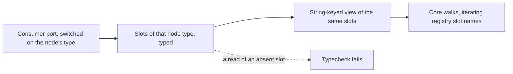

# Slot-keyed children port

The children port types a node's slots by the node's own type, so `port(node)["gallery"]` on a Section is a compile error rather than a child list that is `undefined` at runtime.

## How it works

Today `BlockChildren<TNode>` is a function from a node to `Readonly<Record<string, readonly TNode[]>>`. Every consumer's port satisfies it, and every walk in the core reads through it with a slot name. The record hides which names are real, so the one guarantee the archived design needs, that a walk reads only slots the node has, is held by convention.

## Decision: per-type return, one view for the walks

The port's return becomes the node type's own slot record, so a read of a slot the type lacks fails the compiler. The core's walks still need to iterate every slot by name, because the registry holds the names at runtime, so the core derives one string-keyed view from the typed record once, at the port's boundary. The assertion that view would need stays out of the walks.

**Rejected: keeping the record and rewording the archived design's claim.** The claim is the guarantee the typed slot ports change set out to prove, and rewording it would accept the hole the change closed.

**Decided: the registry's slot names stay strings.** The core's walks read every slot through one string-keyed view, `getBlockSlots`, derived once from the port, and the port's per-type return keeps the typed read. **Rejected: typing the registry's slot names per node type.** The core could then walk by those names and drop the view, but that moves the correlation between a name and a typed slot into the registry, which the archived design rejected for the runtime tag. The view costs one helper; the registry keeps no type it cannot check.

## Key files

| File                                                              | Role                                                                |
| ----------------------------------------------------------------- | ------------------------------------------------------------------- |
| `packages/headless-block-editor/src/models/BlockChildren.ts`      | The port's type, currently a string-keyed record                    |
| `packages/headless-block-editor/src/services/renderBlockNodes.ts` | The fold that reads children through the port                       |
| `packages/headless-block-editor/src/models/blockTypes.test-d.ts`  | The type-level tests that a misspelt or absent slot fails the check |

## Notes

- The archived design claim this change makes true is at [the typed slot ports design](../archive/2026-10-20-headless-block-editor-typed-slot-ports/design.md).
