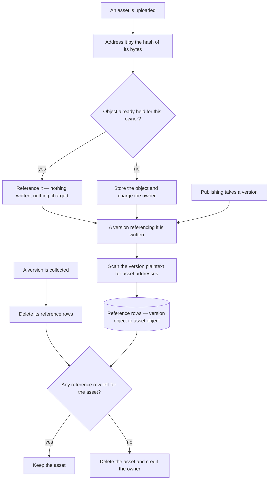

# Content-Addressed Assets

Publishing an immutable snapshot clones **every asset the content references** and rewrites each url to point at the clone — one storage round trip per asset, paid on the publish request ([publishing](../../specs/architecture/publishing/design.md)). It is done that way because an asset is addressed by where it was uploaded, so a published snapshot pointing at the working copy's assets would break the moment the owner replaced or deleted one.

Content addressing removes the reason. An asset addressed by the hash of its bytes cannot be replaced in place — a different image is a different address — so a snapshot and the working copy can safely reference the same object, and there is nothing to clone and no url to rewrite.

This is a second phase of the [resource version store](../../specs/resource/resource-version-store/design.md), sharing its substrate and none of its risk: versions ship on content addressing while assets keep their current paths, and nothing about the store depends on this landing.

## What it removes

The clone walk over content, the per-asset copy, the url rewriting that follows it, and the whole class of failure they create together. That failure is not hypothetical: an unpublish sweeping assets concurrently with a publish leaves a live publication whose images are gone, and the recovery for it is a re-clone and a re-upload after the transaction has already committed. With a shared object, an unpublish cannot sweep an asset the working copy still references, so the race has nothing to race over.

## What it costs

Reference tracking, and this is the entire difficulty. A version's references are a column on a row; an asset's references live **inside content**, so nothing can answer "is this object still needed" from the database as it stands.

The answer is an explicit table: one row per content-object-to-asset-object reference, written when a version is stored, by scanning that version's plaintext for asset urls. The scan already exists — it is what the clone walk does today — so this moves the walk from publish time to version-write time and does it once rather than once per publish.

The gate is the same one the version store uses, applied one level down: an object survives while a row names it. What differs is that the naming rows are derived by a scan rather than written directly, which is why this is the phase with the sharp edge — a scan that misses a reference deletes an asset that is still in use, and the failure is a broken image in a published artifact rather than an error anyone sees.

That is what makes it separable and what makes it second. It wants the scan to be exhaustive, tested against every content type that can embed an asset url, and shipped behind a period where assets are reference-counted but never actually collected, so an under-counting bug shows up as an object nothing deletes rather than as an object deleted too early.

## Key files

| File                                                                   | Role after the change                                                   |
| ---------------------------------------------------------------------- | ----------------------------------------------------------------------- |
| `apps/web/app/composables/resource/useUploadResourceFile.ts`           | uploads an asset under the hash of its bytes                            |
| `apps/web/server/trpc/procedure/resource/createResourceProcedures.ts`  | the upload SAS is signed for the hash address; publish no longer clones |
| `apps/web/server/services/resource/cloneContentAssets.ts`              | deleted, along with its test                                            |
| `apps/web/server/services/resource/transformPublishedBlobUrls.ts`      | deleted: no url is rewritten                                            |
| `apps/web/server/services/emailEditor/transformPublishedEmail.ts`      | stops rewriting asset urls                                              |
| `apps/web/server/services/resource/snapshot/writeSnapshotVersion.ts`   | scans each version it writes and records its reference rows             |
| `apps/web/server/services/resource/snapshot/collectSnapshotObjects.ts` | drops a collected version's rows and counts the orphaned assets         |
| `packages/db-schema/src/schema/resource/`                              | the version-to-asset reference table, registered by existing            |

## Why not now

The version store stands on its own and paid for itself immediately. This phase is a larger blast radius for a smaller win: it removes real complexity and real per-publish latency, but it touches publishing, unpublishing, the asset upload path and the deletion sweep at once, and its correctness rests on a scan rather than on a column. Sequencing it behind a store that is already proven in production is the cheaper order.

## Sources

- [Pro Git — Git objects](https://git-scm.com/book/en/v2/Git-Internals-Git-Objects) — a content-addressable store keyed by the hash of each object's bytes, the addressing that makes an asset impossible to replace in place.

## Decisions

These settle what the phase builds where the sketch above left a choice open.

- **Address is `{resourceId}/files/{sha256}`**, the lowercase hex SHA-256 of the bytes, with no filename. The filename is not part of the address, so identical bytes dedupe whatever they were called. Scope is the resource rather than the owner: a resource is the unit purge takes and the version store's objects are already resource-scoped, and a resource has one payer. Identical bytes inside one resource dedupe; a duplicate gets its own copies, as [resource file assets](../../specs/resource/resource-file-assets/spec.md) requires.
- **The client hashes, the server decides.** The upload composable hashes the file, and `generateUploadFileSasEntities` checks whether `{resourceId}/files/{hash}` exists. If it does, the entity comes back as deduplicated with no signature and no quota reservation, and the server touches the blob so its last-modified time moves; the client skips the PUT. If not, the quota is reserved and a create-only SAS is signed for the hash name. A create-only write that loses a race to an identical upload is a success for the uploader; its reservation expires like any failed upload's.
- **Reference rows** live in `resourceVersionAssetsInResource`, keyed by resource, channel, version and asset hash, with a composite foreign key to the version row and cascade delete. `writeSnapshotVersion` writes a version's rows under the resource lock, replacing any rows the repair rewrite leaves behind. The scan visits every string in the content and keeps the asset urls that name this resource, after own-origin absolute urls are relativized. The scan covers every content type, since it does not look at the schema.
- **Release is one function for every path.** Eviction, unpublish and a file delete each hand it candidate hashes: the hashes the released rows named, or the one file deleted. It runs under the resource lock. A candidate survives if any remaining version row of the resource names it, if the working copy's content embeds it, or if its blob was last written within the grace window. Anything else is published for deletion. The grace window exists because an upload that dedupes onto an old object and is saved a moment later must not lose the object to a collection that ran between the two.
- **Counting-only** is a shared constant. While it is off, release computes the same set, logs its count as unreferenced, and deletes nothing. Enabling it is a one-line change after the period.
- **A version never names a missing object.** Under the same lock, `writeSnapshotVersion` checks that every hash it is about to reference exists, and fails the write if one does not. A publish that races a file delete therefore fails cleanly instead of publishing a page with broken images.
- **Publishing no longer clones or rewrites.** `transformPublishedBlobUrls` is deleted, along with the publish repair that existed to re-clone after a sweep, the published prefix sweep on unpublish, and the directory name that addressed the clones. Email keeps its compiled-html check and its dataset strip.
- **Read access** for a file: the owner reads any `{resourceId}/files/{hash}`. Anyone else reads it only while the resource is published and the current published version row names the hash. This replaces the old separate published path, which no longer exists.
- **Duplicate keeps cloning**, because the copy must own its objects. `cloneContentAssets` survives for that one caller, copying each referenced object to the destination's own hash name and skipping any that already exist. Restore needs no clone: the restored version's rows keep its objects alive, and they are the same resource's objects.
- **Spec of record.** The file-assets requirement "Published pages keep their own copies of their files" is replaced by the shared-object requirement in this change's delta. On ship, this change folds into `openspec/specs/resource/content-addressed-assets/` and the file-assets spec is updated to match.
