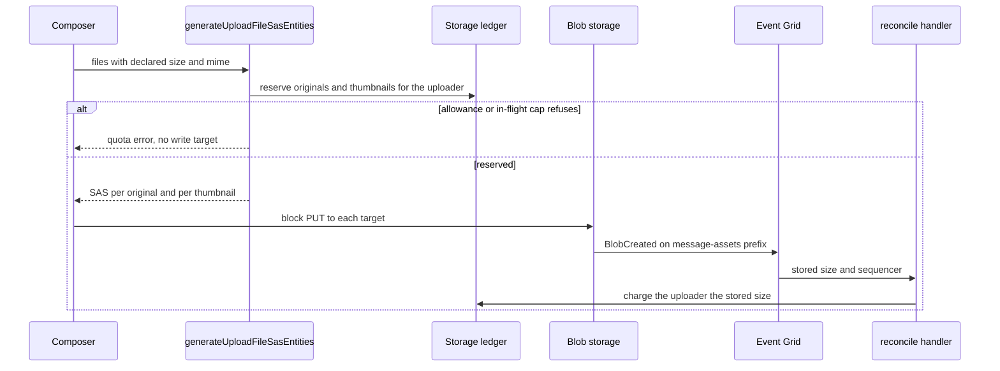

# Message attachment accounting

Message uploads are reserved against the uploader's storage allowance when their write targets are minted, measured by the `BlobCreated` reconcile, and given back by the release path that already serves resource assets.

## Scope

Today a message upload's write target comes from `generateUploadFileSasEntities`, which mints a SAS per file and a sibling thumbnail target, with no reserve and no ledger row. The reconcile handler's container list holds resource assets only. The change adds the reserve, the measurement and the forward charge. It does not add a measured check against the room's size cap, and it does not change the declared-size gate.

## Decisions

- **The uploader pays, not the room.** The ledger's `userId` is the uploader, so the allowance is the uploader's. The alternative, a room-scoped allowance, is the [deferred room attachment quota](../../deferred/esbabbler/room-attachment-quota/design.md). It needs an owner-facing bar and a rule for an unowned room, and neither is built. Charging the room would need a new counter on the room row and a new meter; charging the uploader reuses the counter, the ledger and the meter that exist.
- **The reserve runs before the mint.** `reserveStorageBytes` takes the whole set of originals and thumbnails before any SAS is signed, the way the resource upload's chokepoint runs ([resource asset upload](../../specs/resource/storage-quotas/design.md)). The minter names every target first, hands the set to its `reserve` option, and only then signs, so a refused reserve throws the quota error with no target minted and the client never holds a write target the ledger does not record.
- **The procedure becomes a mutation.** Minting now writes a ledger row, and a query that writes is a retry hazard: a retried read would hold a second row for the same blob names. The one caller, `useUploadFiles`, moves to the mutation client.
- **Thumbnails reserve a server-fixed size.** A thumbnail's bytes are produced by the client's canvas, and the input carries no size for it. Reserving the client's size would add a declared number with no gain, since the reconcile replaces any declared figure with the stored one. A named bound, `MAX_THUMBNAIL_BYTES`, next to the thumbnail's content type holds the space until the event lands. It is the raw RGBA of a square at the thumbnail's longest edge, `THUMBNAIL_MAX_EDGE`. That edge moved from the composer's constants to the same schema file so the bound follows it, and a lossy encode at the composer's quality stays well under that ceiling.
- **A second subscription, not a wider filter.** An Event Grid subscription takes one `subjectBeginsWith`. Dropping the filter would deliver every blob event in the account to the handler, which drops most of them. A second subscription costs one event subscription per environment and is the cheaper choice.
- **Forwards are charged, not refused.** A forward copies bytes the server writes, and the storage quota already rules that such writes are charged without being refused ([storage quotas](../../specs/resource/storage-quotas/design.md)). The forwarder is charged for each copy before the copy is written, and `cloneContentAssets` charges its clones the same way. Both paths call one helper, `chargeAndCopyBlob`, which takes the charge, copies, and gives the charge back if the copy fails.
- **Release needs no code.** `deleteStorageBlobs` and `releaseStorageLedgerEntriesByPrefix` read each row's bytes off the row and its user off the row. A message blob's row exists once the reserve writes it, so a delete, a discarded upload and a room deletion give bytes back through the paths that run today. The one release this change writes is the forward's own rollback: when a forward fails after some of its copies landed, `cloneFiles` deletes those copies and releases their rows, since a deletion it runs itself publishes no event for the release path to find.

## How it works



A forward runs its own leg: `cloneFiles` reads each source blob's length, charges the forwarder for each copy through `chargeAndCopyBlob`, and copies it into the destination room's prefix. The router then refreshes the forwarder's meter once the rooms have settled.

## Failure and retry

- **A refused reserve** writes nothing and mints nothing. The composer shows the refusal and the files stay unsent.
- **A lost completion event** leaves the stored bytes uncharged, as it does for resource assets. The hold expires with its SAS, so the counter never holds bytes for a blob nothing wrote.
- **A redelivered event** finds the row and computes a zero delta, so the counter does not move twice.
- **A failed forward copy** releases the charge taken for it, deletes and releases the copies that had already landed, and throws, so the forward fails with nothing counted.

## Key files

| File                                                                                             | Role                                                                                                                                                           |
| ------------------------------------------------------------------------------------------------ | -------------------------------------------------------------------------------------------------------------------------------------------------------------- |
| `apps/web/server/trpc/routers/message/index.ts`                                                  | `generateUploadFileSasEntities` reserves and mints; `forwardMessage` charges each copy; the comment that calls room attachments outside the quota is rewritten |
| `apps/web/server/services/resource/generateReservedResourceAssetSasEntities.ts`                  | the precedent: mint and reserve in one call, which the message path mirrors                                                                                    |
| `apps/web/server/services/storage/reserveStorageBytes.ts`                                        | the gate, reused unchanged                                                                                                                                     |
| `apps/web/app/composables/message/file/useUploadFiles.ts`                                        | the composer's caller, moved to the mutation client and showing the refusal                                                                                    |
| `packages/db/src/services/azure/container/generateUploadFileSasEntities.ts`                      | names the original and thumbnail targets, reserves the set through its `reserve` option, then signs                                                            |
| `packages/db/src/services/azure/container/cloneFiles.ts`                                         | copies a forwarded file's blobs, charging each copy through `chargeAndCopyBlob`                                                                                |
| `packages/db/src/services/storage/chargeStorageLedgerEntry.ts`                                   | the charge for a server-written blob, reused for each copy                                                                                                     |
| `packages/db/src/services/storage/chargeAndCopyBlob.ts`                                          | the charge-then-copy step both clones share                                                                                                                    |
| `apps/web/server/services/resource/cloneContentAssets.ts`                                        | its clone copies through `chargeAndCopyBlob`, with the same charge as before                                                                                   |
| `packages/db/src/services/storage/deleteStorageBlobs.ts`                                         | releases a deleted blob's row, reused unchanged                                                                                                                |
| `apps/functions/src/handlers/reconcileStorageLedgerEntryHandler.ts`                              | the `BlobCreated` handler; its container list gains message assets                                                                                             |
| `apps/infra/src/azure/resources/Microsoft.EventGrid/eventSubscriptions/prodEvgsEsposterAe007.ts` | the resource-asset subscription; a second one covers the message prefix                                                                                        |
| `apps/infra/src/azure/resources/Microsoft.EventGrid/eventSubscriptions/devEvgsEsposterAe007.ts`  | the dev counterpart                                                                                                                                            |
| `apps/infra/src/azure/resources/Microsoft.EventGrid/eventSubscriptions/prodEvgsEsposterAe008.ts` | the message-attachment subscription, a second one because a subscription filters on one prefix                                                                 |
| `apps/infra/src/azure/resources/Microsoft.EventGrid/eventSubscriptions/devEvgsEsposterAe008.ts`  | the dev counterpart                                                                                                                                            |
| `packages/db-schema/src/services/file/constants.ts`                                              | gains the thumbnail's edge and its declared bound beside its content type                                                                                      |
| `apps/web/app/services/file/constants.ts`                                                        | loses the thumbnail edge, which moved to the schema package above                                                                                              |
| `packages/db-schema/src/schema/storage/storageLedgerInStorage.ts`                                | the ledger comment that keys a message asset by room is rewritten                                                                                              |

A new file, in the tree form the design template asks for:

```text
apps/web/server/services/message/file/generateReservedMessageFileSasEntities.ts   mint and reserve a message's write targets in one call
```

## Notes

- Room emoji and the other uploads outside the message and resource paths write without a reserve, and this change does not charge them. Room emoji mint their write target through `generateWriteSasUrl` directly, so charging them is a follow-up that reserves through `reserveStorageBytes` the way this change does; the deferred room-attachment page lists the rest.
- The room's size cap stays a declared-size check. Measuring the stored size against the cap, and deleting a blob that exceeds it, would be a second decision and is not part of this change.
- The outstanding-reservation cap counts thumbnails as well as originals, so a drop of many images reaches the cap sooner than a drop of the same number of documents.
