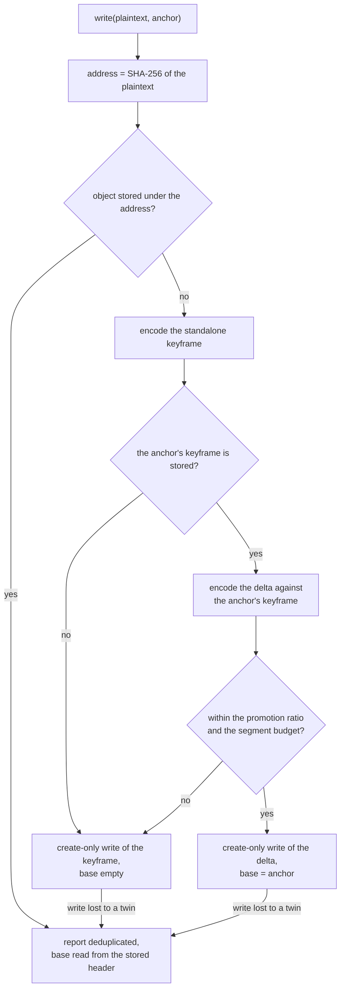

# Keyframe Store Area

The package's object format and its caller contract are specified as an area of their own, with the package's README left as the install page. Both capabilities describe the code as it stands, so the change writes pages and adds only the tests a stated rule lacks.

## How it works



A write does the same work on every path. It reads the object already stored under its address, and it verifies that read, not just the header, before adopting it. The keyframe and the delta are encoded in parallel, the promotion gate chooses one, and the backend's create-only write decides which writer's object lands. A writer that loses that race reports the stored object's base, so its caller's record names the keyframe the stored bytes actually decode against.

## Decisions

- **Two capabilities, not one.** `object-format` changes only when the on-disk layout changes, and `OBJECT_FORMAT_VERSION` is bumped for that alone ([constants](../../../packages/keyframe-store/src/services/constants.ts)). `version-store` changes when a caller's contract does, such as the anchor or the collection rule. One page would version two different things together.
- **An area, not an architecture standard.** The package is a library another project could install, and [page shapes](../../specs/architecture/README.md) gives such a package an area. A standard under `architecture/` holds a repo-wide rule, and this is one package's contract.
- **The README keeps the install page, and How it works moves.** Two pages stating the object format would drift, so the README keeps what an npm reader needs and links the area for the rest.
- **Adoption verifies the whole object.** The alternative was to adopt a stored object on its header alone, which is cheaper. It was rejected because a torn write or one bit of rot can leave a header that parses over a payload that does not decode to its address, and adopting that would report someone else's damaged write as this one's success.
- **No Upstream table.** The package replaced no installed dependency. Compression uses Node's own zstd through `node:zlib`, which the [compression](../../specs/architecture/compression/design.md) standard already records.

## Key files

| File                                                           | Role                                                            |
| -------------------------------------------------------------- | --------------------------------------------------------------- |
| `packages/keyframe-store/src/createKeyframeStore.ts`           | the store: write, read, collect, adoption and promotion         |
| `packages/keyframe-store/src/services/encodeObject.ts`         | a keyframe or a delta, as bytes                                 |
| `packages/keyframe-store/src/services/decodeObject.ts`         | the decode against the base plaintext                           |
| `packages/keyframe-store/src/services/decodeVerifiedObject.ts` | a decode checked against the address it was read by             |
| `packages/keyframe-store/src/services/parseObject.ts`          | the header parse, refusing bytes outside the format             |
| `packages/keyframe-store/src/services/getContentAddress.ts`    | the SHA-256 address of a plaintext                              |
| `packages/keyframe-store/src/services/constants.ts`            | the magic, the format version, the header layout and the ratios |
| `packages/keyframe-store/src/models/ObjectStore.ts`            | the backend contract: read, create-only write, delete           |
| `packages/keyframe-store/src/models/VersionAnchor.ts`          | the anchor a caller passes                                      |
| `packages/keyframe-store/src/createKeyframeStore.bench.md`     | the committed codec figures the area cites                      |
| `packages/keyframe-store/README.md`                            | the install page, with How it works removed                     |

The files it creates:

```text
openspec/specs/keyframe-store/
  README.md                     ← the area's index and key concepts
  object-format/{spec,design}.md
  version-store/{spec,design}.md
```

## Sources

- [Zstandard manual](https://facebook.github.io/zstd/zstd_manual.html): the dictionary mode the delta is encoded with, the keyframe's plaintext as the dictionary. The area takes its frame and dictionary terms from it.
