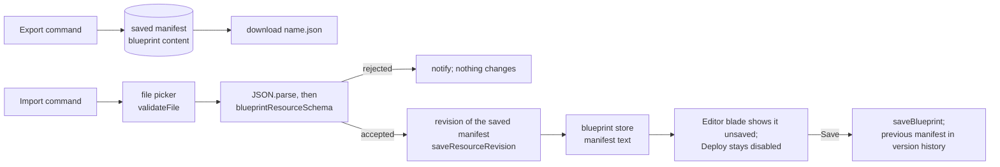

# Blueprint Manifest Export and Import

A blueprint's manifest travels as the JSON the Editor blade already shows, so the file is the manifest and nothing wraps it. The Note's Markdown format is the precedent: it is one Portable entry, and its import runs from the overflow menu outside any component.

## How it works



- **Export reads the saved manifest.** Deploy runs the saved copy, so a file must match what a deploy would create. The alternative, exporting the text on screen, could write a manifest Deploy would reject or never run.
- **The file is the manifest, verbatim.** The alternative was a wrapper such as `{ format, version, manifest }`. It was rejected because the Editor already displays this exact JSON, the schema is the one stated shape of a manifest, and a wrapper would be a second format to version. A future change to the manifest is a schema change, checked on import like any other manifest.
- **Import lands as unsaved text, not in a preview dialog.** The Note's import previews in a dialog because a Note replaces its document as soon as it is confirmed. A blueprint's Editor already holds an unsaved manifest and refuses Deploy until it is saved, so a second preview would repeat that review. The text the Editor shows is held by the blueprint store rather than by the Editor, so an import from the overflow menu, which runs outside any component, fills the same text the Editor edits. Leaving the Editor drops unsaved text, as its navigation guard already warns, so the text shown next time is the saved manifest again.
- **The import takes a revision before it replaces the text, and Save takes none.** An automatic save keeps a revision only once per interval, so a Save soon after another could leave the replaced manifest out of [version history](../../specs/resource/resource-snapshots/design.md). The import takes the `BeforeImport` revision the platform takes before any import replaces a draft, so the manifest it replaces is always a point to return to. The alternative was a revision on Save, which needs an imported flag held in the store that a discard would then have to clear. The cost is that a discarded import leaves one revision of the unchanged saved manifest behind.
- **Import checks the manifest schema, not each entry's content.** Save already checks the schema, so an import is no looser than pasting the same JSON into the Editor. Deploy pre-validates every entry against its type and creates nothing if any entry fails, so a bad entry cannot become a bad resource.
- **Ids of resources outside the manifest travel verbatim.** Capture rewrites only the ids of the resources it selected. An unselected resource's id stays as a raw id, so on another account that reference dangles. This is the fail-soft posture deploy already has, and export has no knowledge of the owner's other resources to rewrite them with.

## Key files

| File                                                             | Role                                                     |
| ---------------------------------------------------------------- | -------------------------------------------------------- |
| `apps/web/shared/services/resource/ResourceDefinitionMap.ts`     | Blueprint declares `portable`                            |
| `apps/web/app/services/resource/PortableFormatMap.ts`            | the JSON format for Blueprint                            |
| `apps/web/shared/models/resource/blueprint/BlueprintResource.ts` | the manifest schema an import must pass                  |
| `apps/web/app/store/resource/blueprint/index.ts`                 | holds the manifest text the Editor shows                 |
| `apps/web/app/components/Resource/Blueprint/Editor.vue`          | shows an imported manifest as unsaved text               |
| `apps/web/app/services/resource/constants.ts`                    | the accept list for a manifest file, beside Note's `.md` |

The files it creates:

```text
apps/web/app/services/resource/
  createBlueprintPortableFormat.ts   ← export and import, as createNoteMarkdownPortableFormat does
  blueprint/parseBlueprintManifest.ts      ← the check Save and an import share
  blueprint/stringifyBlueprintManifest.ts  ← the one text form of a manifest: the Editor, the file, the store
```

## Notes

- A manifest's own nested blueprint entries travel inside it as opaque content, as capture and deploy already treat them ([blueprint resource](../../specs/resource/blueprint-resource/design.md)). The file adds no case of its own.
