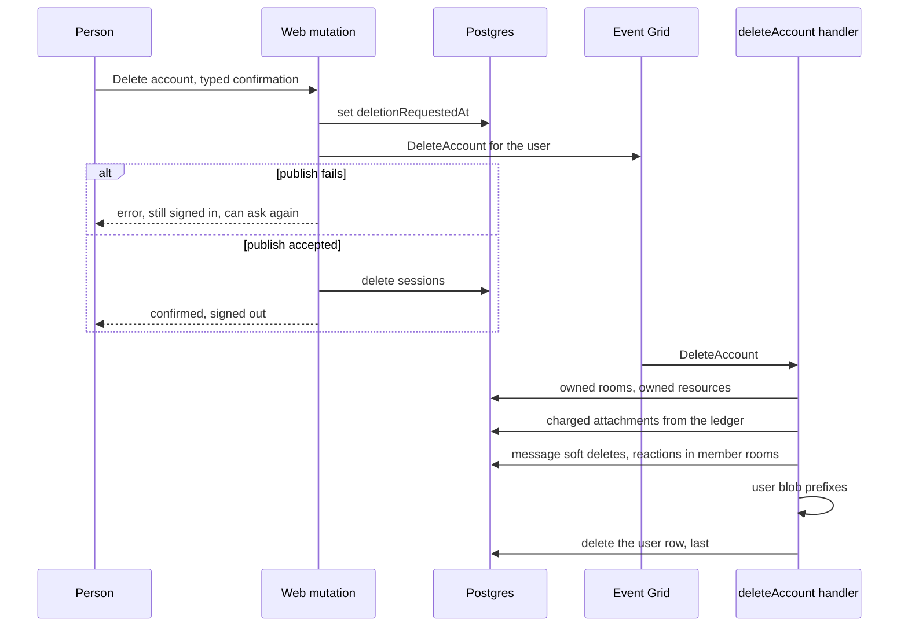

# Account deletion design

The inventory in [user data](../../../specs/architecture/user-data-inventory/design.md) is the list of stores this sweeps. Each row there names the removal this change adds, and the sweep covers every row that is keyed to the user.

## Decisions

**The marker is the row, and the user row goes last.** The purge of a resource already works this way: the Postgres row is the durable marker, every external sweep treats an already-gone target as success, and the row is deleted last, so a replay after any failure finds the same work. The account follows it. Deleting the user row first would cascade away the only record of what still needs sweeping.

**The mutation does not sweep.** It sets `users.deletionRequestedAt`, publishes one Event Grid event, and only then deletes the account's sessions so the caller is signed out everywhere. The publish comes before the sessions so that a failed publish fails the request with the person still signed in: a retry sets the same marker and publishes again, and every step is idempotent. A sweep across message partitions and blob directories can outlast a request, and the caller is owed an answer once the event is accepted.

**Owned rooms are deleted, as an owner's departure already deletes them.** `leaveRoom` deletes a room for everyone when its owner leaves, so account deletion does the same rather than inventing a transfer. A transfer of ownership is a feature with its own design, and it is the reason to revisit this. `deleteRoom` already publishes the room's attachment prefix and profile images, but the sweep does not rely on that teardown. The owned-room step deletes both prefixes itself, and adds the room's five table partitions, which `deleteRoom` does not clear.

**The user's messages are soft-deleted, and their charged attachments are removed.** A message is attributed to its author, so a deletion removes the author's content from every room the user is a member of, through the soft delete the moderation ban already uses. A reaction is one row shared by everyone who reacted with that emoji, so in each member room the sweep takes the account's id out of the reactions it shares and removes the ones it holds alone, as the reaction's own removal does. The soft delete moves into `packages/db` so the function and the web app share one implementation. The attachment list comes from the storage ledger, which holds one row per charged blob and its owner, so the sweep never scans a message partition to find files.

**The soft delete does not announce itself to open rooms.** A moderation ban publishes each batch it commits, so members watching the room see the messages leave. The sweep passes a no-op in that place, so members keep seeing a deleted account's messages until they reload.
The sweep also removes the account from reactions in shared rooms without an announcement, so open rooms show a removed reaction until reload. Both lags are accepted: a live announcement of these removals was decided against ([rejected](../../../rejected/esbabbler/deleted-account-live-removal/proposal.md)).

**Blob directories are swept by the user's prefix.** `{userId}/` in the public and private asset containers and in the game-save containers holds everything the user wrote there, and `character-packs/staging/{userId}/` in the game-asset container holds their pending character-pack uploads. The deletion lists no names.

**The export archive is found by its row, not by a prefix.** The archive in `DataExports` is named by its export id and sits under no user prefix, so the sweep reads each `dataExports` row's `blobName` and deletes that blob before the user row, since the cascade drops the row that names it. A queued row's `blobName` is null, as no archive exists until its build starts, so the sweep skips a row that names no blob and deletes only those that do.

**Resources go through the purge that already exists.** `purgeResource` already deletes a resource's directory, its table partitions and its ledger rows, in the order that makes replay safe. Each owned resource is passed to it with the table clients of its type.

**The `accounts` foreign key cascades.** The inventory found `accounts` as the one foreign key that blocks the user row's deletion. It is changed to cascade in the schema, so the deletion declares what it removes, and no step deletes accounts by hand.

**Shared character-pack files stay.** They are keyed by content hash and shared across accounts, and nothing counts their references, so removing one could break another account. The user's manifest is removed under `{userId}/`, and their staging under `character-packs/staging/{userId}/`. Whether the shared files hold personal data is an owner question, and deleting them needs a reference count first.

## Rejected

- **Sweeping inside the mutation.** It makes the caller wait on blob listings and partition scans, and a failure half way leaves the answer unknown.
- **Anonymising messages instead of deleting them.** It keeps the content, which is the thing a deletion is for. Replies to a deleted message show as deleted.
- **Transferring owned rooms.** It adds an ownership model the platform does not have. It is recorded as the revisit point above.

## Sequence

A failure in any step fails the handler, the marker stays, and Event Grid redelivers the event. Every step treats an already-gone target as done, so the replay finds only what is left.

## Limits the spec states

- Messages a user wrote in a room they have since left remain attributed to them. Membership is the only index from a user to a room.
- Moderation records in other people's rooms that name the user, and resource activity records on resources the user does not own, are kept as the platform's audit trail. Whether that is lawful retention is an owner decision.
- The Azure AI Search index may keep message text whose removal is unverified. The indexer's handling of soft-deleted messages decides it.
- The shared character-pack files are left in place, as above.

## Key files

| Path                                                                     | Role                                           |
| :----------------------------------------------------------------------- | :--------------------------------------------- |
| `packages/db-schema/src/schema/auth/accountsInAuth.ts`                   | The `accounts` foreign key, changed to cascade |
| `packages/db-schema/src/schema/auth/usersInAuth.ts`                      | The deletion marker                            |
| `apps/web/server/trpc/routers/user.ts`                                   | The `deleteAccount` mutation                   |
| "apps/web/server/services/user/deleteAccountSessions.ts"                 | New: revokes the account's sessions            |
| `packages/db/src/services/message/softDeleteRoomMessagesByUser.ts`       | The soft delete, moved from the web app        |
| `packages/db/src/services/resource/purgeResource.ts`                     | Reused for each owned resource                 |
| "apps/functions/src/handlers/deleteAccountHandler.ts"                    | New: the sweep, in order, idempotent           |
| "apps/functions/src/functions/deleteAccount.ts"                          | New: the event registration                    |
| `apps/infra/src/azure/resources/Microsoft.EventGrid/eventSubscriptions/` | The subscription, in both environments         |
| `apps/web/app/pages/user/settings.vue`                                   | The Delete account flow                        |
