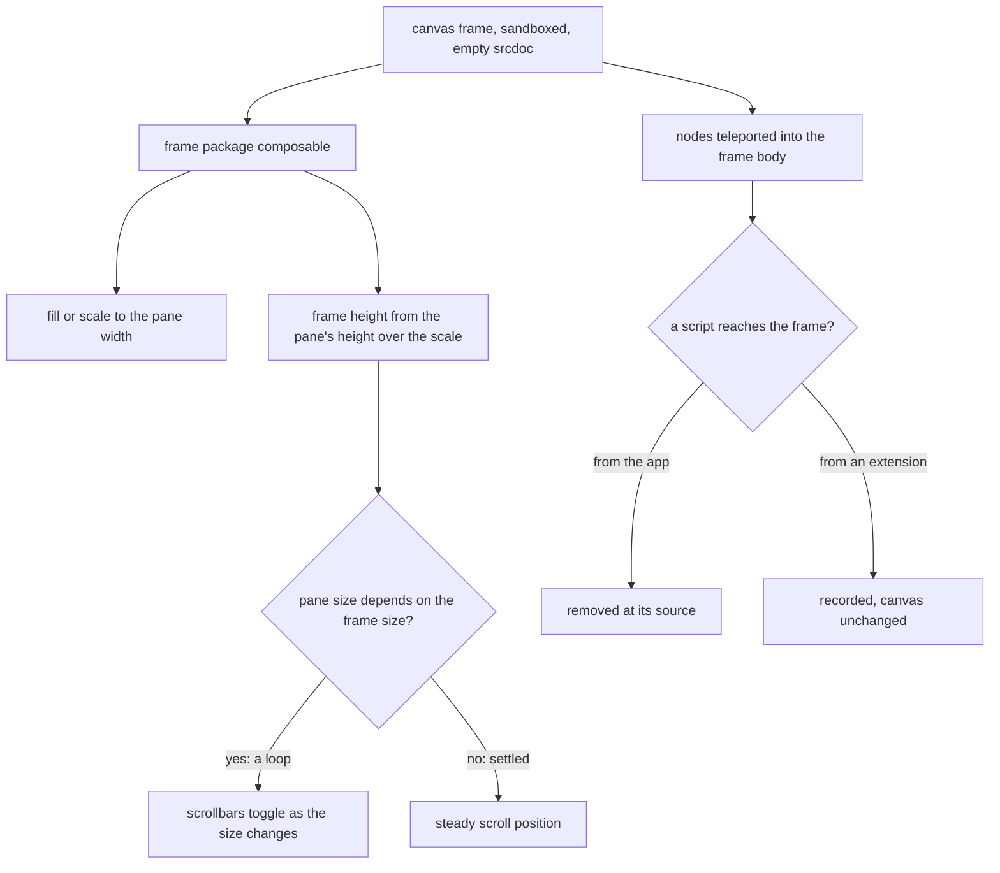

# Canvas frame: blocked script and scroll flicker

The page builder draws a page or an email in an iframe, the canvas frame, so the drawing has its own document and its own layout. The frame is sandboxed to keep a drawn page from reaching the owner's session, and it is scaled to fit the pane it sits in.

## How it works

The canvas creates the frame with an empty srcdoc. The frame package's composable then sizes the frame against its pane: a fill or a scale to the pane's width, and a frame height equal to the pane's measured height over the scale. A ResizeObserver watches the pane and re-measures it on each resize, and nothing measures the frame's own content. The canvas draws its nodes into the frame's body through a teleport.

The pane takes its height from the editor's `h-full` chain and clips its content with `of-hidden`. The frame's layout box is the pane's height over the scale, so it is taller than the pane whenever the frame is scaled down, and the pane clips it. It cannot resize the pane. An email taller than the pane therefore scrolls inside the frame's own document, in a viewport that the pane's height over the scale sets.

Every HTML string the frame receives passes the sanitiser first: text nodes and email text through `renderNoteHtml`, and custom HTML blocks through `sanitizeHtml` at their render. Neither allows a script element or an event-handler attribute, so the markup the app draws gives the frame nothing to run.

The loop at `E` was one of the open hypotheses, and the reproduction refuted it: nothing in the frame's size reaches the pane, and no value of the pane or the frame alternated after an edit, a resize or a load, with the scrollbars made to take layout width as well. The scrollbars the symptom names are the frame's own document's, and what changed that document's size was the overlay layer, below.

## Data model

None.

## Key files

| File                                                                   | Role                                                                                         |
| ---------------------------------------------------------------------- | -------------------------------------------------------------------------------------------- |
| `apps/web/app/components/PageBuilder/Canvas/Frame.vue`                 | the canvas frame: `sandbox="allow-same-origin"`, the empty srcdoc, the teleport of the nodes |
| `apps/web/app/components/PageBuilder/Canvas/Index.vue`                 | the email's body-width wrapper and the node drawing the frame holds                          |
| `packages/vue-canvas-frame-headless/src/composables/useCanvasFrame.ts` | the frame's sizing: fill or scale to the pane, the frame height, and the adopted style sheet |
| `packages/vue-canvas-frame-headless/src/services/constants.ts`         | `CANVAS_FRAME_SRCDOC`, the empty document the frame starts from                              |
| `apps/web/shared/services/resource/note/renderNoteHtml.ts`             | the sanitised note html a text node and an email's text draw                                 |
| `apps/web/shared/services/pageBuilder/customHtmlNodeType.ts`           | the custom HTML block, sanitised at its render: the other user html the frame receives       |

## Notes

- A script the sandbox blocks is the sandbox doing its job. The fix is to find what tried to run, not to add `allow-scripts`, which would let a drawn page run code beside the owner's session.
- The reproduction was done in a driven Chrome 156 with no extensions, on the dev server, against the page builder mounted with the app's real starter email, with an email holding one of every one of the 23 node types the palette offers, and with Preview's sandboxed frame given the compiled HTML of both. No `Blocked script execution` message appeared in any load, edit, selection or Preview, in the console, in CDP's log domain or as a page error. The schema refuses a `javascript:` link, and a raw `<script>`, an `onclick` and an `onerror` are stripped at parse and by the sanitiser, so no script or handler reaches the frame from the document. The message is therefore not the app's. An extension that injects into every frame is the usual source, and the owner's browser is the only place to name it, with the extensions turned off one at a time. The canvas is unchanged.
- The scroll flicker's source was the overlay layer. The frame's document holds only the page's own sheet, which is empty for an email, so the utility classes the layer and its boxes were styled with did not apply there: the layer was `position: static`, the hover and selection boxes were blocks laid out in the email's flow with no outline and no border, and the node toolbar was never placed. Hovering a node added its box's height to the frame's document and selecting it added a second, so a long email's scroll height went 1243, 1328, 1413 pixels over one hover and one selection, and its scrollbar appeared, moved and disappeared as the pointer crossed nodes. The layer and its boxes now carry their styles inline, and the scroll height holds at 1243 through a hover, a selection and four more selections.
- Found in the same run: a palette drag never resolved a target, because the editor lets the pointer pass through the frame while it runs, so the hover the drop target read was never set. The target now reads the node under the pointer from the frame's document, and a Button or a Text dropped over a column's text lands in that column. The outlines also take the library's accent, read from the app's document and read again when its theme changes.
- The email canvas is not close to the compiled email yet. Measured on the starter email at desktop and mobile width, 42 of 43 paired nodes differ by more than a pixel, and the canvas hero, the one drawing that overflowed its band, now keeps its headline inside it. The other differences are drawings: a navbar link without its padding, a button drawn as a full-width label where MJML draws a centred inline-block, text and divider heights, an accordion drawn open where the compiled email draws it closed, a group whose columns stack where the compiled email puts them side by side, and the social elements, which are not drawn. They belong to the email canvas drawing, and the performance and proof capability keeps the requirement open.
