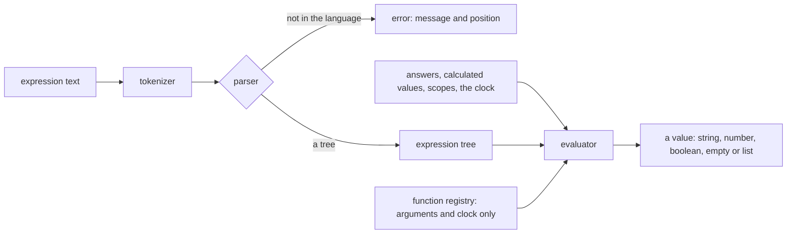

# Survey Logic

The survey's expression language as a workspace package: a tokenizer and parser that return a tree or a positioned error, and an evaluator over a record of answers. It is a grammar and an interpreter, so it is an engine of its own, and the [survey engine package](../2026-11-04-resource-survey-form-engine-document/design.md) and the app both import it. The [math expression compiler](../../../specs/math-expression-compiler/language/design.md) is numeric by design and stays out of this, since the survey's value model is strings, booleans, numbers and lists.

## How it works



## The language

- **Literals**: numbers, strings in single or double quotes, `true` and `false`, and lists in square brackets.
- **References**: `{name}` reads an answer by question name. A name may hold dots, so `{matrix.row1.col1}` reads a nested answer: first the whole name as one key, then each dotted split read as a key of the part before it. A part may end in an index, `{panel[0].q1}`, and a digit key reads an item of a list, `{list.0}`. `{list.length}` reads the length of a list or text and zero for any other value after a dot. Inside a dynamic panel, `{panel.name}` reads the panel's own answer, and inside a dynamic matrix row `{row.name}` reads the row's cell, both through the scopes the caller passes, and a scope wins over a path of the same name.
- **Operators, loosest to tightest**: `or` and `||`; `and` and `&&`; `not` and `!`; the comparisons `=`, `==`, `!=`, `<>`, `<`, `<=`, `>`, `>=`, `contains`, `notcontains`, `anyof`, `allof`, `empty` and `notempty`; `+` and `-`; `*`, `/` and `%`; `^`; and a unary minus. Every binary operator groups to the left, `^` included, so `2 ^ 3 ^ 2` is 64, as SurveyJS gives it, and a minus before a power binds tighter, so `-2 ^ 2` is 4.
- **Empty**: an unanswered reference is empty, and so is an empty text or list. An unanswered question equals only the empty text, `null` and another unanswered question, so `{a} != 5` and `{a} != 0` are true for it and `{a} != ''` is false. It is never less or greater than a value, so `{a} < 5` and `{a} > 5` are both false, while `{a} >= ''` is true through equality. An empty text reads as zero against a number and as text against text, so `{a} < 5` is true for an answer of `''`. An empty list equals only an empty list. The oracle fixtures hold each of these.
- **Coercion**: a comparison of a number with a numeric string compares as numbers, as SurveyJS does; the oracle fixtures hold every case found.
- **Functions**: every built-in function of SurveyJS's function registry whose result depends only on its arguments and the clock. The functions that read the live survey object (`isContainerReady`, `isDisplayMode`, `displayValue`, `propertyValue`) are not implemented, since the package has no survey object. The clock is passed in the context, so a test fixes it.

## Decisions

- **The parser checks syntax; the check also checks function names.** `parseSurveyExpression` accepts a call to any identifier, and `checkSurveyExpression` parses and then refuses a call whose function is not in the registry, naming it. The parser needs no registry, so it is built before the functions. Rejected: the parser taking the registry, which would make the first unit wait on the last.
- **Errors carry a position.** The parser returns a neverthrow result whose error holds a message and a character index, because the document's save check names the element and the Creator's builder shows the fault. Rejected: throwing, which loses the position at the first catch.
- **The oracle is SurveyJS while it is in the tree.** A throwaway script outside the repository runs SurveyJS's expression runner over a table of expressions and answer records at a fixed clock, and writes the results as JSON fixtures that the package's tests keep. SurveyJS leaves the tree afterwards, the fixtures stay. Rejected: fixtures written by hand, which would record what the package does rather than what SurveyJS does.
- **The package is private.** It is consumed by the app and the functions only, so it has no npm entry to keep alive. Rejected: publishing it, which adds a trusted-publisher entry for a package no one outside the repository has asked for.
- **Dates are strings until a function reads them.** The value model has no date value; a date function parses its string arguments with the same rules SurveyJS uses and returns a string or a number.

## Key files

| File                                            | Role after the change                                                  |
| ----------------------------------------------- | ---------------------------------------------------------------------- |
| `packages/survey-logic/package.json`            | the private package's manifest                                         |
| `packages/math-expression-compiler/src/models/` | the sibling package's models and services, the layout this one follows |

New files land here:

```text
packages/survey-logic/src/models/       SurveyExpressionNode, SurveyLogicValue, SurveyLogicContext, SurveyLogicError, SurveyLogicFunction
packages/survey-logic/src/services/     tokenizeSurveyExpression, parseSurveyExpression, evaluateSurveyExpression, runSurveyExpression,
                                        checkSurveyExpression, collectSurveyExpressionReferences, one module per function under functions/
packages/survey-logic/src/services/fixtures/   oracleFixtures.json and the test that replays it
```

## Notes

- The function list is enumerated from SurveyJS's registry when the functions are written, and each implemented function is a row in the package's README, so a function SurveyJS has that is not implemented is visible there rather than missing silently.
- **The deliberate deviations.** The package answers SurveyJS's value for every fixture except these, each listed with its reason in `services/fixtures/oracleFixtures.test.ts` and replayed against the package's own value, so a change to one is noticed:
  - **Names are case-sensitive.** `{Name}` reads only an answer named `Name`, where SurveyJS ignores case. Question names are checked unique case-sensitively, so one name is one answer.
  - **Syntax SurveyJS refuses is accepted.** `not` and `!`, a unary minus before any operand (`-{a}`, `-(3)`, `- 3`) and a number with a leading dot (`.5`) all evaluate, where SurveyJS reports an invalid expression.
  - **Records hold no text and read as no number.** `{a} + 'x'` joins as `'x'` where SurveyJS joins `'[object Object]x'`, `{a} + 1` is not a number where SurveyJS joins the text, and `sum` skips a record where SurveyJS joins its text. Lists are not in this group: a list reads as its text, as `{a} + 1` on a list of one number gives `'31'` in both.
  - **A date amount that is numeric text is a number.** `today('3')` and `dateAdd(date, '3')` add three days, where SurveyJS joins the text (January 2 plus `'3'` is day 23).
  - **A date-time end with an hours, minutes or seconds unit is the real difference.** `dateDiff('1970-01-01', '1970-01-01 05:00:00', 'hours')` is 5, where SurveyJS gives NaN for the same end. The package keeps the time of a date-time end, so the difference is the real one.
  - **An invalid date is empty.** `today('x')` and `dateAdd('x', 1)` are empty, where SurveyJS gives an invalid `Date`.
  - **The filter form of an array function is refused.** `checkSurveyExpression` refuses it and `runSurveyExpression` answers empty, where SurveyJS filters the items.
  - **An unanswered reference and an empty result are `undefined`.** SurveyJS gives `null` for an unanswered reference, for a date with no amount and for a missing date, and the package gives `undefined` for each.
  - **A sum that SurveyJS throws on answers empty.** A text added to a sum with decimals makes SurveyJS throw, where the package answers empty.
  - **A binary or octal text compares inconsistently in SurveyJS.** SurveyJS's equality makes `'0b1'` equal to 0 and `'0o7'` equal to both 0 and 7, so no one reading matches it; the package reads each as its number.
  - **Rounding is capped at 100 digits.** A sum or product with more decimals is rounded to 100, since `toFixed` throws above that.
