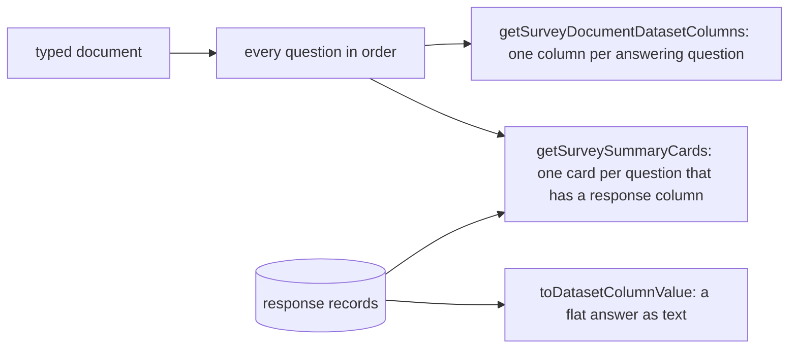

# Survey Readers

The summary cards and the dataset columns, rewritten over the [typed document](../../../specs/resource/survey-document/design.md), whose types come from the `survey-engine` package. The response record stays a flat object keyed by question name, so only the reading of the questions changes.

## How it works

## Decisions

- **A column per answering question.** `html` and `image` have no answer and no column or card. A dynamic panel is one column; its template questions are not columns of their own.
- **Column types.** `boolean` is a boolean column; `rating`, `slider`, a `text` question of input type `number` and an `expression` question displayed as a decimal or percent are number columns; a `text` question of a date input type is a date column; every other kind is a string column.
- **Non-flat answers are text.** A flat list (`checkbox`, `tagbox`, `ranking`, a multi-select `imagepicker`) keeps the existing separator join. A `matrix`, `multipletext`, `matrixdynamic` or `paneldynamic` answer is compact JSON text in its one column, so the row never needs a column per cell.
- **Cards.** A choice card for `radiogroup`, `dropdown`, `checkbox`, `tagbox`, `buttongroup`, `imagepicker`, `boolean` and `ranking`, with labels from the node's choices and an other answer counted under its own line; a rating card for `rating`; a number card for `slider`, a number input and a numeric expression; and a text card for everything else that answers. Rejected: a card per matrix row, which the card list has no shape for.

## Key files

| File                                                                               | Role after the change                                 |
| ---------------------------------------------------------------------------------- | ----------------------------------------------------- |
| `apps/web/app/services/survey/summary/getSurveySummaryCards.ts`                    | the cards, keyed by the typed kinds                   |
| `apps/web/app/services/survey/summary/getSurveySummaryCards.test.ts`               | the cards' tests, re-expressed over the typed kinds   |
| `apps/web/app/services/resource/survey/getSurveyResponseSummaryCards.ts`           | the summary's entry, reading the typed document       |
| `apps/web/server/services/dataset/surveyResponses/getSurveyModelDatasetColumns.ts` | replaced by the column reader over the typed document |
| `apps/web/server/models/dataset/surveyResponses/SurveyModelElement.ts`             | removed: the typed question union replaces it         |
| `apps/web/server/services/dataset/surveyResponses/toDatasetColumnValue.ts`         | the column value of a flat or non-flat answer         |
| `apps/web/server/services/dataset/surveyResponses/readSurveyResponsesDataset.ts`   | the dataset read, passing the document to the columns |
| `apps/web/app/models/resource/survey/SurveySummaryCardType.ts`                     | the card types, unchanged                             |

## Notes

- The readers are built against the document's types and a hand-built fixture document, and are bound to the resource's content in the [respondent](../2026-11-04-resource-survey-form-engine-respondent/design.md) part's swap.
