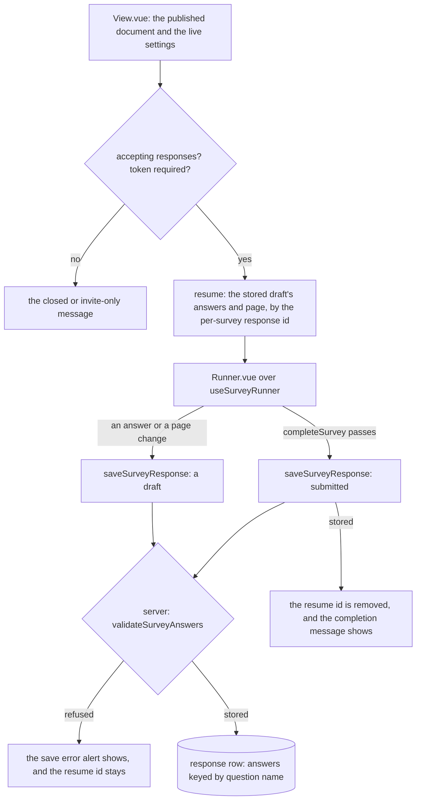

# Survey Respondent

The public respondent page: the published document rendered by the runner, a draft saved on every move, resume and submit by a per-survey response id, and the server's check of every answer a respondent writes.

## How it works

`View.vue` reads the published document and the live settings. A survey that is closed, or invite-only without a participant token, shows its message and no form. Otherwise the page resumes any stored draft and renders `Runner.vue` with the draft's answers, page and seed. Every move the runner reports saves a draft. A passing `completeSurvey` saves the submit. The page clears the resume id and shows the completion message only when the submit persisted, and a refused submit shows an error alert over the form.

The resume id is the response's row key. `useSurveyResponse` keeps it in local storage under a key scoped by survey and participant token, so a shared device cannot reopen a submitted response: the submit removes the id. The row key is also the seed the runner orders shuffled choices by, so a respondent sees the same order on every visit. On resume the page keeps only the answers whose names the published document still holds, so a republish that removed a question does not make the next write refused.

The server checks every write in `resolveSurveyResponseWrite`, the one boundary both response mutations pass through. It refuses a write while the survey is closed, resolves the participant token by the survey's response mode, and reads the published snapshot, the document the respondent was served. It then runs `validateSurveyAnswers` over the answers. A draft checks each answer that is present. A submit also checks that every visible required question is answered and that no answer belongs to a question that is not shown. The first issue refuses the write with the question's name and the rule's message. The response procedures, their version check and their conditional write are the [survey resource](../survey-resource/design.md)'s.

## Decisions

- **The server runs the runner's validation.** `validateSurveyAnswers` is the function the browser runs, so the server refuses what the respondent's page refuses. The response procedures are public and rate limited, and the answers are the only unauthenticated write, so the browser is not trusted.
- **The server validates against the published snapshot.** A name the document does not hold is refused, so a response record holds only a question's answers. Recording the content version on each response and reading that version's snapshot was rejected, since it adds an entity field and a read by version for a case the resume already handles.
- **A submit is checked for completeness, a draft is not.** A draft may hold a partial survey. Only the submit requires every visible required question, so a respondent can leave and come back.
- **The content is the typed document.** The resource's content is `{ document, settings }`, a strict object, so a save in the `{ model }` shape is refused rather than read as an empty survey. A save that omits its document parses into the empty survey a new survey starts from.
- **Answers keep their record shape.** The answer record is a flat object keyed by question name, so the Responses blade, the summary and the dataset read it the same way.

## Key files

| File                                                            | Role                                                                               |
| --------------------------------------------------------------- | ---------------------------------------------------------------------------------- |
| `apps/web/shared/models/resource/survey/SurveyResource.ts`      | the content schema, a strict `{ document, settings }`                              |
| `apps/web/app/store/survey/index.ts`                            | the content store: `document`, `settings`, `saveDocument` and `saveSettings`       |
| `apps/web/app/components/Resource/Survey/View.vue`              | the respondent page: the gates, resume, the runner, submit and the completion      |
| `apps/web/app/components/Resource/Survey/Runner.vue`            | the runner the page renders, which provides the resume seed to the fields          |
| `apps/web/app/composables/survey/useSurveyResponse.ts`          | the draft save, resume and submit, through the response procedures                 |
| `apps/web/app/components/Resource/Survey/Editor.vue`            | the Editor blade, which mounts the Creator                                         |
| `apps/web/server/trpc/routers/survey.ts`                        | the resource factory and the response procedures                                   |
| `apps/web/server/services/survey/resolveSurveyResponseWrite.ts` | the write boundary: the closed check, the token and the answer validation          |
| `apps/web/server/services/survey/reapplySurveyLiveContent.ts`   | the live settings merged over the published snapshot                               |
| `apps/web/server/services/survey/readLiveSurvey.ts`             | the survey row and its publication, read by every response read and write          |
| `apps/web/shared/models/db/survey/SurveyResponseModel.ts`       | the answer record: a flat record keyed by question name, bounded in count and size |

## Notes

- The runner applies the document's theme itself through `useSurveyTheme`, so the respondent page only renders the runner.
- A refused draft reports through the mutation's error alert. A refused submit also keeps the respondent on the form with the page's own alert, since the answers are still there to correct. The server's check is the backstop for a write the page did not make, since the page's runner has already checked each answer.
