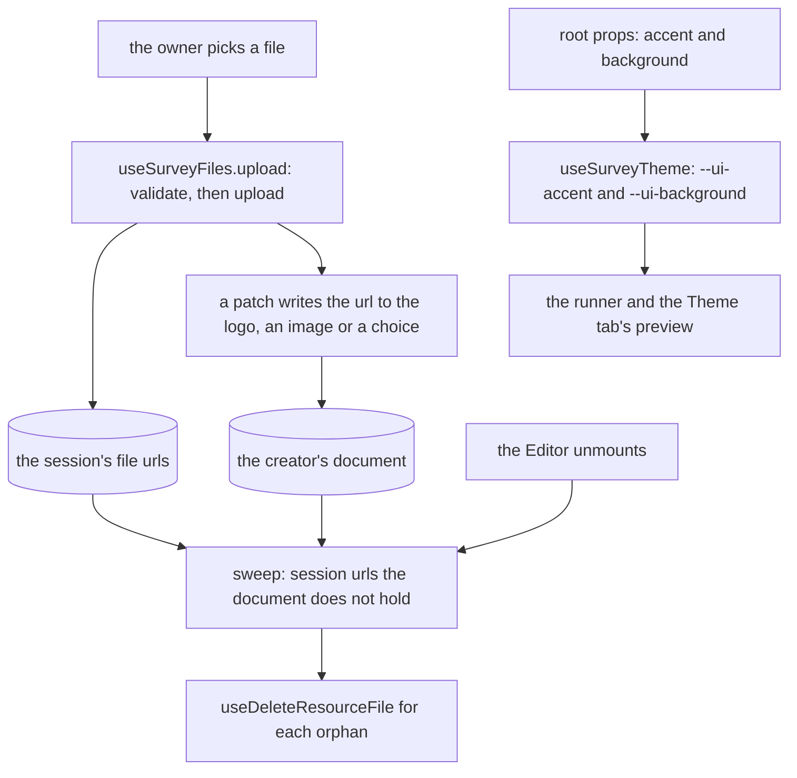

# Survey Theme And Files

The identity a survey carries, over the [document](../../../specs/resource/survey-document/design.md)'s root props, and the files its pictures are. The files live in the resource's [file assets](../../../specs/resource/resource-file-assets/design.md); the survey keeps only their urls in its document.

## How it works

A survey's files are its logo, the picture of an image question and the picture of each image picker choice. `useSurveyFiles` validates a picked file, uploads it and records its url in the editor session's set. The set holds each url the survey referenced when the editor opened and each url uploaded since. When the Editor unmounts, the sweep deletes each url in the set that the document no longer references. The colours are root props that `useSurveyTheme` turns into the library's accent and background variables, which the runner and the Theme tab's preview set on the element they draw in.

## Decisions

- **The theme is a subset on the root.** The logo, the accent colour and the background colour are root props that the Theme tab edits, so the theme is part of the document the readers and agents see. Rejected: the full theme editor SurveyJS shipped, which the app's design styles already cover. With no accent or background set, the survey draws with the design style's own tokens, so one look holds across the app's styles.
- **Deletion waits for the editor to close.** A removal can be undone, and a file deleted at the edit would leave an undone picture broken. Rejected: deleting at the edit, as SurveyJS's hooks did, which breaks undo; rejected: deleting at each save, which breaks undo across a save.
- **Only a file the session held is deleted.** That is a file the survey referenced when the editor opened or a file the session uploaded. The sweep never deletes a file the editor did not see.
- **The sweep is best effort.** It runs as the Editor unmounts, so a tab closed without unmounting skips it. A file that fails to delete is logged, and the rest are still deleted.
- **An upload is validated first.** The resource's file validation runs before the upload. A rejected file alerts and uploads nothing.
- **A choice's image is a url string.** The document stores the url the upload returned, as the image kinds' props hold it.

## Not built

- The progress bar is drawn by the runner from its root prop, at the position the setting names. The question numbering setting is not read: the runner numbers every question whatever it holds, so `showQuestionNumbers` has no effect. No control in the Creator edits either setting, and the properties panel leaves both out of the root form.
- The image question's picture and the image picker's choices have no editor in the Creator. `ImageUpload.vue` and `ImageChoicesEditor.vue` are built and tested, and `SurveyImageExtras` maps the two kinds to them, but the properties panel reads only `SurveyNodeExtrasComponentMap`, which has no entry for either kind. Mounting them is a change to the panel, which is why task 2.2 is not ticked.

## Notes

- An unset colour and a cleared one are both the empty text in the document, and the theme reads either as no variable.

## Key files

| File                                                                     | Role                                                                  |
| ------------------------------------------------------------------------ | --------------------------------------------------------------------- |
| `apps/web/app/composables/survey/useSurveyFiles.ts`                      | the upload, the session's url set and the sweep of orphans            |
| `apps/web/app/store/survey/files.ts`                                     | the session's file urls, shared by the Editor and the uploads         |
| `apps/web/app/composables/survey/useSurveyTheme.ts`                      | root colours to the library's accent and background variables         |
| `apps/web/app/services/resource/survey/collectSurveyFileUrls.ts`         | the urls a document references, its logo and its pictures             |
| `apps/web/app/services/resource/survey/SurveyImageExtras.ts`             | the map from the image kinds to their upload editors, not yet mounted |
| `apps/web/app/components/Resource/Survey/Creator/Theme.vue`              | the Theme tab: logo, accent and background, and the preview           |
| `apps/web/app/components/Resource/Survey/Creator/ImageUpload.vue`        | one image question's picture, uploaded and removed                    |
| `apps/web/app/components/Resource/Survey/Creator/ImageChoicesEditor.vue` | an image picker's choices, each with its picture                      |
| `apps/web/app/components/Resource/Survey/Editor.vue`                     | the Editor, which tracks the files on open and sweeps them on unmount |
| `apps/web/app/components/Resource/Survey/Runner.vue`                     | the runner that draws the logo and applies the theme                  |
| `apps/web/app/composables/resource/useUploadResourceFile.ts`             | the resource's file upload                                            |
| `apps/web/app/composables/resource/useDeleteResourceFile.ts`             | the resource's file delete                                            |
| `apps/web/app/composables/file/useValidateFile.ts`                       | the file validation every upload runs first                           |
| `apps/web/app/components/Ui/ColorField.vue`                              | the colour field the accent and background use                        |
| `apps/web/app/components/Ui/FileField.vue`                               | the file field the logo and picture uploads use                       |
