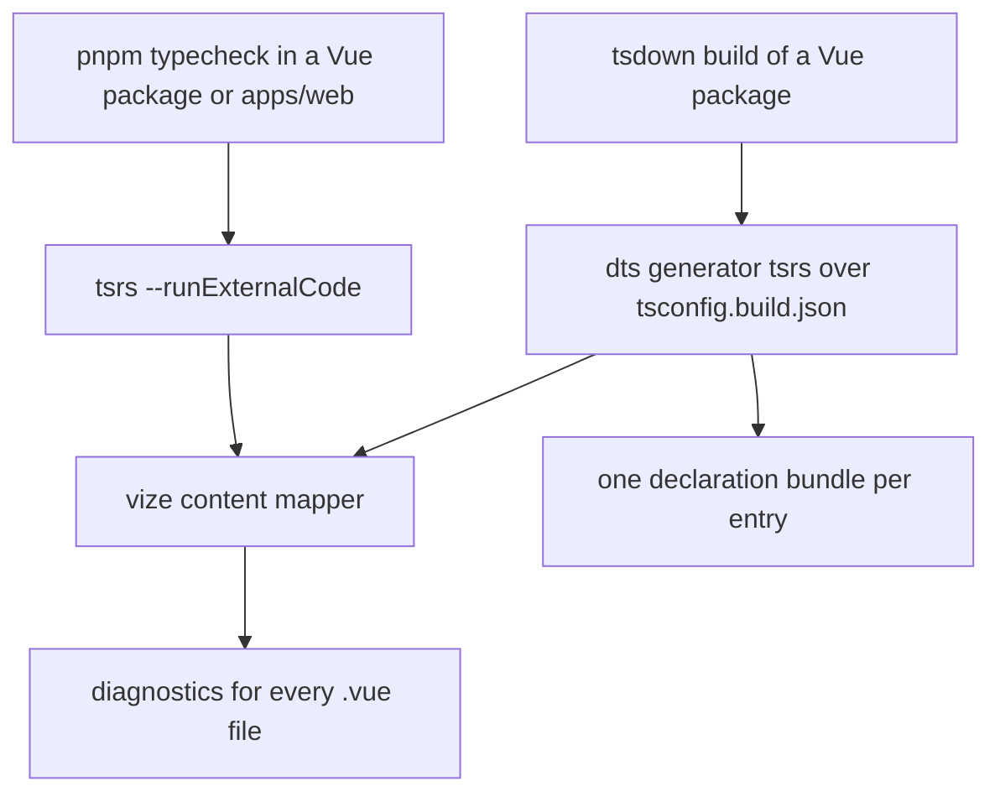

# Design

## Context

Plain typecheck runs through `tsrs` ([Rust toolchain change](../architecture-rust-typescript-toolchain/design.md)). `tsrs` ships no classic TypeScript API, so the Vue checks cannot read one either, and they run through the content mapper instead. `vize` checks `.vue` files through a content mapper, a separate process that TypeScript spawns and asks for virtual TypeScript per file. `tsrs`'s CLI implements that protocol and its language server does not. The mapper is declared in `vize`'s `package.json` under `typescript.contentMapper`: `node ./bin/vize content-mapper`, `dynamicConfig: true` and the compiler options it reads.

Every Vue check runs through the mapper on `tsrs`: `vue-phaserjs`, `genshin-interface`, `genshin-world` and the app project of `apps/web`. The declarations of the Vue packages' `.vue` files come from the same mapper, through `tsrs`'s declaration generator.

## Decisions

### The Vue checks run on `tsrs`, not on a second compiler

The goal is one compiler for every check. A permanent split, with `tsrs` for TypeScript and `tsc` for `.vue`, keeps the classic API alive and gives the Vue path a separate speed and memory profile to maintain.

Rejected: switching the Vue packages to the TypeScript 7.1 beta's `tsc`. It works, but it makes the Vue checks depend on a beta classic compiler that the rest of the repo does not use, and it is the same dependency the `tsrs` path removes. `tsrs` runs the mapper on its own copy of that compiler, which the mapper's conformance tests also run against, so the Vue checks neither move the `typescript` package to the beta nor alias a second one.

### What reads the classic `typescript` API

The override is read by the tools below, which need the classic API. The list comes from a read of the lockfile and the tools' source, not from a run with the override removed:

- **`typescript-estree`, behind `@typescript-eslint/parser`**, calls `createSourceFile` for every `.ts` and `.vue` file linted. It needs the parser only, and its peer range is `>=4.8.4 <6.1.0`. `@typescript-eslint/eslint-plugin`, `type-utils` and `ts-api-utils` require the module when they load. ESLint's type-aware rules are off in the app.
- **A full program** is built by the `attw` gate of every published build (`createProgram`, `resolveModuleName`); the root project's `typecheck:root` runs `tsrs --fast` and loads none. `rolldown-plugin-dts` loads the classic API on its `tsc` generator, and throws for TypeScript 7. `@pulumi/pulumi` loads it at config time and falls back to a vendored copy.
- **Nothing is read by** `oxlint` with type-aware rules (a Go binary), `knip`, `tsrs`, `vize`, `vitest`, Nuxt and `scripts/`.

TypeScript 7.0.2 ships no classic API (its package exports a version file and nothing else), so the override cannot move to 7.x. Stable 6.0.3 also exposes the classic API, so no reader strictly needs the bridge: it is a speed choice across all of them, and dropping it is a separate decision that moves them together.

### Formatter and linter stay on oxfmt and oxlint

`vize fmt` formats the `vue-phaserjs` sources identically to oxfmt, but it has no `objectWrap` option: on a multi-line object literal oxfmt collapses it under the repo's `objectWrap: "collapse"`, and `vize fmt` keeps it expanded with trailing commas. `vize lint` has no plugin API, and oxlint runs the repo-owned JS plugins (`scripts/src/oxlint/*.ts`) with type-aware rules, so those rules would be lost. Both stay.

### `.vue` declarations through `tsrs`

`getTsdownConfigurationVue` sets the declaration plugin's generator to `tsrs`, over the package's `tsconfig.build.json` with `runExternalCode`. `rolldown-plugin-dts` reads the content mapper from that tsconfig's `contentMappers`, so the declarations come from the mapper the type check runs, and no separate `vize check --declaration` step runs. The declarations have these properties, which a consumer sees:

- **The program is the tsconfig's own.** Its file list is `tsconfig.build.json`'s, less the base's excludes, so the tests stay out of it, and `auto-imports.d.ts`, an ambient file no entrypoint imports, is in it through the `include` (`.agents/skills/build/references/declarations.md`).
- **A component's declaration is vize's component model.** It exports `Props`, `Emits` and `Slots` types and a `__setup` function carrying the template slots and exposed members. It is not Vue's `DefineComponent`.
- **The helper types are inlined once,** in a `declare global` block that includes the checker's `ImportMeta` members (`client`, `server`, `dev`, `prod` and `ssr`). Importing a published package therefore types `import.meta.client` for its consumer, and a consumer that declares one of those members with another type gets TS2717. No declaration file imports `vize`.
- **Attributes pass through.** A `vue-tsc` 3.3 consumer in a scratch project accepts the `vue-phaserjs` declarations for `id`, `role`, `class`, `aria-label`, `data-x` and a listener on a component that declares an emit, and it reports a deliberate wrong prop type. With `skipLibCheck` off, its diagnostics match those against the `vue-tsc` declarations.
- **Sizes follow the component model.** `vue-phaserjs`'s `index.d.ts` is much smaller than the one `vue-tsc` writes, and `genshin-world`'s is the same size. `genshin-interface`'s is about three times larger, and its types ceiling in `packages/genshin-interface/src/index.test.ts` is raised to cover it.

**Decision: the declarations come from the mapper, and a `vue-tsc` consumer judges them.** A published package reaches projects outside this repository that check with `vue-tsc`, so the declarations are judged by such a consumer and not only by the app's checker. Narrowing the check to the repo's own consumers would not test that. Rejected: `vize check --declaration`. It emits per file with a shared helper file and no barrel, it does not expand the shared Vue tsconfig's `${configDir}` include, and it needs `auto-imports.d.ts` and `vite-env.d.ts` named on its command line. Bundling its output into one file per entry would fall to the declaration plugin, which would inline the helper file. Rejected: the `tsgo` generator on TypeScript 7.1 beta. It adds a second compiler to the declaration build, where the mapper path needs none.

**The compile plugin is a separate job.** Compiling a component and checking its types do not depend on each other, so it does not gate this change. The library builds and Vitest compile through Vize ([build pipeline](../../specs/architecture/build-pipeline/design.md)); the Nuxt module stays deferred ([deferred compiler page](../../deferred/architecture/vize-compiler/design.md)).

### `apps/web` on the mapper

`nuxt typecheck` generates the type declarations it checks against (auto-imports, route types, `.nuxt`) and checks them with the checker `@nuxt/cli` names (`vue-tsc` or `golar`). That list is fixed, so the Nuxt route to the mapper does not exist. The app runs the generation itself and checks what Nuxt writes with `tsrs`:

```bash
nuxt prepare
tsrs -b --fast --runExternalCode
```

`tsconfig.json` is a solution file that references the four projects Nuxt generates and `tsconfig.root.json`, which holds the configuration, the scripts and the service worker, so one `tsrs -b` checks them all. `configuration/typescript.ts` names `vize` as the `.vue` content mapper and `useTemplateRef` as Vue's composable in Nuxt's `tsConfig`, which Nuxt writes into the app project and the base the root project extends, so the build passes `--runExternalCode` once. The service worker is part of the root project and has no tsconfig of its own: its WebWorker-only lib guarded nothing, since `packages/shared/src/util/environment/checkIsServer.ts` already pulls the DOM lib into the worker's program. A deliberate type error written into a `.vue` file fails the script, and the script reports 0 diagnostics on the tree.

Two causes were fixed in the app and not upstream. `services/capture/inlineFontFace.ts` spread a font face's descriptors, which TypeScript 7.1's DOM typings do not make iterable (6.0.3 types `CSSFontFaceRule.style` as an iterable `CSSStyleDeclaration`, and 7.1 as a `CSSFontFaceDescriptors` with no iterator, though the browser object has one), so it uses `Array.from` and carries an unfiled `@TODO` for the typing. The root manifest lists `vue` from the catalog beside `vize`; without it the mapper runs in its silent fallback and reports four false `TS2353` diagnostics on three library components (`Tabs.Item`, `Treeview.Item`, `Select.Item`). That is configuration of this monorepo, and #11444, the report for the silent fallback, was closed as configuration.

`Input.test.ts` names its stub before the cast to the picker's instance type. Written inside the cast, the call takes the cast's type as its context, and `vize`'s component type makes that a union TypeScript refuses to compute (`TS2590`). That is #11499, open. The named stub type-checks and reads no worse, so no ignore is carried.

**The app's diagnostics, by release.** The first runs were hidden behind syntax errors in the mapper's virtual code (#11140 and #11257, both fixed).

| `vize` release      | Diagnostics on the app project |
| :------------------ | -----------------------------: |
| 0.637.0 and 0.638.0 |                            103 |
| 0.650.0 and 0.652.0 |               21, then 15 \*\* |
| 0.658.0             |                             11 |
| 0.659.0             |                              6 |
| 0.661.0             |                       0 (1 \*) |

\* One `TS2590` in `Input.test.ts`, cleared by naming the stub (#11499).

\*\* After the two changes in the app above. A mapper run over a `.nuxt` older than the checkout reports diagnostics from the stale generated types, so the check regenerates `.nuxt` first.

The three Vue packages report 0 diagnostics through the mapper, and each catches a deliberate error.

### Resolved upstream

Every report below was reduced to a standalone project, filed on `ubugeeei-prod/vize` and closed. The batches were #11359 to #11368 with #11390 and #11391 (first pass) and #11444 to #11454 (second). The compile-side reports from the same runs are recorded with their status in the [build pipeline](../../specs/architecture/build-pipeline/design.md) (the library builds) and on the [deferred compiler page](../../deferred/architecture/vize-compiler/design.md) (the Nuxt module).

| Issue  | What                                               | Closed as     | First release |
| :----- | :------------------------------------------------- | :------------ | :------------ |
| #11446 | `inheritAttrs: false` on a generic component       | completed     | 0.659.0       |
| #11447 | the payload of a generic library component         | completed     | 0.659.0       |
| #11451 | a destructured parameter of a nested callback      | completed     | 0.659.0       |
| #11452 | an assignment in an inline callback prop           | completed     | 0.659.0       |
| #11450 | a generic alias written at module scope            | completed     | 0.660.0       |
| #11445 | a cast to a `.vue` component type (`TS2352`)       | completed     | 0.661.0       |
| #11448 | a dynamic component with a generic key             | completed     | 0.661.0       |
| #11449 | a listener on a dynamic component in a slot        | completed     | 0.661.0       |
| #11453 | an event declared in camelCase and kebab-case      | completed     | 0.661.0       |
| #11454 | the declaration refuses undeclared attributes      | completed     | 0.661.0       |
| #11444 | the mapper's silent fallback on a mismatched `vue` | configuration | none          |

The twelve of the first pass (#11359 to #11368, #11390, #11391) are closed. Eleven were fixed in releases up to 0.650.0, which holds #11379, #11380, #11382, #11383 and #11395, and each reduction was re-run on 0.650.0 against the old release as its control: the control reproduced the diagnostic, 0.650.0 did not, and the same file with a deliberate real error still reported it. The twelfth, #11364, was closed with a reduction that already passed on every release (one required prop, no emits), which is why #11454 replaced it. Earlier landmines, also fixed: #11140 (dynamic event listeners wrote raw expressions into the virtual code, 1063 syntax errors across 15 `components/Dungeons` files), #11023 by #11074 in 0.606.0 (inline callback props typed from a child's prop got implicit `any`), #11257 in 0.628.0 (a `type: null` runtime prop, which `@nuxt/image` and `@nuxt/scripts` ship in about a dozen components), and #11365 (the declaration emit under `noUnusedLocals`).

Open: **#11499** (the `TS2590` above, with two further gaps in the generated helper) and **#11591** (the declaration's refusal of `id` and `role` on a component with an emit, which the consumer check in the `.vue` declarations section does not reproduce).

### Timings, cold and warm

Every run is a fresh process. Cold clears the tools' own caches: the cache folder of `vize`, `node_modules/.vize` and the build info of `nuxt typecheck`. Warm discards two priming runs. The OS page cache was not dropped, because the machine had no passwordless `sudo` for `purge`, so cold is cold for the tools only. Wall time is the median of 3 cold and 5 warm runs, and peak memory is the largest resident set size of any run. Apple M1 with 8 cores and 16 GiB, `tsrs` 0.20.1, `vue-tsc` 3.3.11 on `typescript-native-bridge`, and `vize` 0.664.0 for the mapper rows.

| Target                 | `vue-tsc` cold | Mapper cold | `vue-tsc` warm | Mapper warm | Peak memory (`vue-tsc` / mapper) |
| :--------------------- | -------------: | ----------: | -------------: | ----------: | -------------------------------: |
| `vue-phaserjs`         |           1.08 |        0.30 |           1.09 |        0.30 |                    0.9 / 0.2 GiB |
| `genshin-interface`    |           1.07 |        0.26 |           1.07 |        0.25 |                    0.7 / 0.2 GiB |
| `genshin-world`        |           6.25 |        1.48 |           6.22 |        1.33 |                    3.7 / 1.0 GiB |
| `apps/web` app project |          24.99 |        7.42 |          28.12 |        6.35 |                    7.4 / 2.8 GiB |

The whole app script against `nuxt typecheck`, on the same runs:

| Check                                                 |    Cold |    Warm | Peak memory | Diagnostics |
| :---------------------------------------------------- | ------: | ------: | ----------: | ----------: |
| `nuxt typecheck`                                      | 62.73 s | 64.26 s |     9.5 GiB |           0 |
| `pnpm typecheck` (`nuxt prepare`, then one `tsrs -b`) | 10.79 s |       — |     2.8 GiB |           0 |

The script is 5.8 times faster cold on 0.29 of the memory, and it also checks the service worker. Every run and the scripts that made them are in [the comment on the maintainer's performance issue, #10936](https://github.com/ubugeeei-prod/vize/issues/10936#issuecomment-6592116514).

`nuxt typecheck` is not a like-for-like row against one `tsrs` run: it checks five projects with incremental build info. The corpus numbers in [that thread](https://github.com/ubugeeei-prod/vize/issues/10936#issuecomment-6507703018) (2,500 generated components, an M2 Max, no warmup) are not comparable in seconds, only in ratio.

## Mechanism



## Key files

| File                                                               | Role                                                                                                           |
| :----------------------------------------------------------------- | :------------------------------------------------------------------------------------------------------------- |
| `packages/genshin-interface/package.json`                          | `typecheck` runs `tsrs --fast --runExternalCode`                                                               |
| `packages/genshin-world/package.json`                              | `typecheck` runs `tsrs --fast --runExternalCode`                                                               |
| `packages/vue-phaserjs/package.json`                               | `typecheck` runs `tsrs --fast --runExternalCode`                                                               |
| `apps/web/package.json`                                            | `typecheck` is `nuxt prepare` followed by one `tsrs -b --fast --runExternalCode` over the root `tsconfig.json` |
| `apps/web/configuration/typescript.ts`                             | Nuxt's `tsConfig`: names `vize` as the `.vue` content mapper and `useTemplateRef` as Vue's composable          |
| `packages/configuration/tsconfig.vue.json`                         | the shared Vue tsconfig: names `vize` as the `.vue` content mapper and `useTemplateRef` as Vue's composable    |
| `packages/configuration/src/services/getTsdownConfigurationVue.ts` | sets the declaration generator to `tsrs` over `tsconfig.build.json`, which the `.vue` declarations come from   |
| `pnpm-workspace.yaml`                                              | the `typescript` override onto `typescript-native-bridge` (stays), and the `vize` entries capped at `~0.684.0` |
| `renovate.json`                                                    | the rule that holds `vize`, `@vizejs/unplugin` and `@vizejs/vite-plugin` below 0.685.0, as one group           |
| `openspec/changes/architecture-rust-typescript-toolchain/`         | the change this one depends on, for every plain `tsc` path                                                     |

## Notes

- A `TS18069` on the command line was `tsrs`'s Windows launch of the mapper's bare `node`, reported as `tsrs` `#820` and fixed by `#822` in 0.20.1.
- `tsrs --noEmit` on a config with `contentMappers` is refused without `--runExternalCode`, so the scripts that use the mapper pass it explicitly.
- `vite-plugin-checker` and `@volar/typescript` have no tracked references in the repo.
- The 7.1 beta package does not replace the native bridge. It exports the CLI and the sync and async APIs, and `createSourceFile` and `createProgram` are undefined on its classic module, so it cannot host a classic-API consumer.
- `vize`'s Nuxt module (`@vizejs/nuxt`) does not touch the type check. It replaces Nuxt's Vue SFC compiler and adds an oxlint-based lint checker in dev, so registering it would change how every component compiles. That is the deferred compiler page's decision.

## Constraints that remain

- **The mapper's virtual code imports `vize/content-mapper-helpers`**, so every package that uses the mapper needs `vize` resolvable from its own folder. This is a requirement and not a defect, and it changes the lockfile per package.
- **A mismatched `vue` makes the mapper fall back silently**, with diagnostics that look like real attribute errors. The root manifest lists `vue` beside `vize`, which clears them; why it sits at the root is in the build skill's dependency placement page.
- **`vize` is capped below 0.685.0.** From 0.685.0 the mapper gives every component an inline helper preamble instead of the shared helper modules, (https://github.com/ubugeeei-prod/vize/issues/11907), and `apps/web` then reports false diagnostics on attributes and event handlers passed to generic components, which no issue records. `vize`, `@vizejs/unplugin` and `@vizejs/vite-plugin` are held at `~0.684.0` in the catalog, and the Renovate rule in `renovate.json` moves the three together. The cap lifts with a release that shares the helper modules again.
- **The declarations carry the checker's `ImportMeta` globals.** Each published Vue package's helper block declares `client`, `server`, `dev`, `prod` and `ssr`, so a consumer that declares one of them with another type gets TS2717. The types ceiling in `packages/genshin-interface/src/index.test.ts` has headroom for it, and the same release that shares the helper modules removes it (#11907).
- **A global `useTemplateRef` is Vue's only when the config says so.** From `vize@0.607.0` a call that resolves to an ambient declaration instead of a `vue` import is typed as that declaration says, because a separately authored function can share Vue's signature. The packages' committed `auto-imports.d.ts` declares `const useTemplateRef: typeof import('vue').useTemplateRef`, which is ambient, so every template ref came out `unknown` until `tsconfig.vue.json` named it with `vueCompilerOptions.composables.useTemplateRef`, the option the tsconfig carries for the type check and the declaration build alike. It is configuration and not a mapper workaround, and the other spelling of the declaration does not change the result.
- **TypeScript 7.1's DOM typings differ from 6.0.3's** (`lang` on `CanvasRenderingContext2D`, the iterable `CSSFontFaceDescriptors`), which fails code written against 6.0.3 under `tsrs`. Both are fixed in the code.
- **Releases come about hourly, and a closed issue is not a fixed release.** Each reduction is re-run on the newest release before its issue is filed, and a closed issue is checked the same way before its marker or its task is ticked.

## Sources

- [vize README](https://github.com/ubugeeei-prod/vize) — the `contentMappers` entry, the `typescript@beta` requirement and the experimental status.
- [vize content-mapper conformance workflow](https://github.com/ubugeeei-prod/vize/blob/main/.github/workflows/content-mapper-conformance.yml) — the TypeScript commit the mapper is tested against.
- [vize vue-tsc comparison workflow](https://github.com/ubugeeei-prod/vize/blob/main/.github/workflows/typecheck-vs-vue-tsc.yml) — report-only, not a gate.
- [tsrs content-mapper port notes](https://github.com/oxc-project/tsrs/blob/main/notes/contentmappers.md) — the JSON-RPC protocol and the host the failing request goes through.
