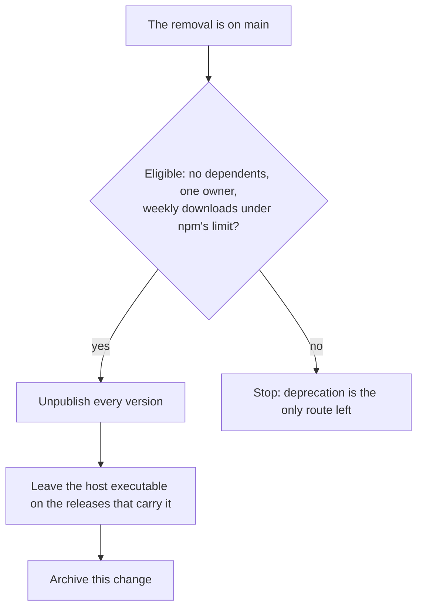

# Agent console retirement

The repository side of the retirement shipped first: the [rejected agent console](../../rejected/infra/agent-console/design.md) holds the decision and the reasons. This design settles the part outside the repository, which is permanent.

## How it works

The removal reaches `main` first. An unpublish before it would be undone by the next release republishing the package from the repository, and once the folder is gone no release publishes it.

## Decisions

- **Unpublish, not deprecate.** A deprecated package stays installable and keeps a page announcing something that no longer exists, so a stranger can still run a host for a page that is gone. Deprecation lost for that reason.
- **Eligibility is the day it runs.** npm allows an unpublish after the first days only while the package has no dependents in the registry, one owner and a weekly download count under its limit.
- **The executables stay.** GitHub's immutable releases answer an asset deletion with a validation error, so removing the file means deleting its release, and with it the release's notes and page, for a file nothing refers to once the package is gone. Deleting the releases lost to that cost. A machine that ever installed the host removes it with `agent-console-host.exe uninstall` from its installed copy; nothing in the repository can reach one.

## Key files

| File                                   | Role                                                    |
| :------------------------------------- | :------------------------------------------------------ |
| `.github/workflows/FinishRelease.yaml` | The release no longer builds or attaches the executable |

## Sources

- [npm's unpublish policy](https://docs.npmjs.com/policies/unpublish) — the conditions for unpublishing after the first days, that an unpublish cannot be undone, that a used version can never be published again, and the wait before the name can be reused; the limits the decision is bound by.
