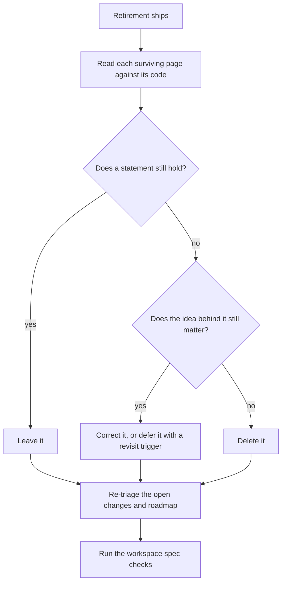

# Claude interface spec pass

Built on [the console's retirement](../infra-agent-console-retirement/design.md), which removes the code and the console's own pages and sweeps every mention. This pass is the judgement that sweep cannot make: which surviving statements were true only because the console existed. It follows the per-area pass the [openspec skill](../../../.claude/skills/openspec/SKILL.md) describes, one area at a time and in the main session, since triage needs one head and the pages share an index and a roadmap.

## What a mechanical sweep leaves behind

A removed name leaves three kinds of stale statement, and the pass looks for each.

| Kind                                   | Example of the shape                                                                                            | What the pass does                                                                               |
| :------------------------------------- | :-------------------------------------------------------------------------------------------------------------- | :----------------------------------------------------------------------------------------------- |
| A promise that named the removed thing | A mod's design saying a view of other sessions belongs to the console                                           | Say plainly that no surface carries it, and move the wish to a deferred idea if it still matters |
| An order that assumed it               | A roadmap placing work before or after the console, or a change waiting on a driver the console would have used | Re-triage the item and re-link what it waits on                                                  |
| A rule taught through its example      | A convention page whose example was drawn from the console's palette or panels                                  | Replace the example with a live one, or drop the rule if it has none                             |

## How it runs

Triage reads `deferred/` and `rejected/` before anything is added, so a decided idea is not argued again. A design whose Key files table names a source the retirement changed is read in full, its prose and its diagrams, against what the code now does, because no test fails on a sentence that was true last week.

## Decisions

- **A separate change from the retirement.** The retirement is a deletion whose check is that nothing names the console; this pass edits meaning and needs the deletion done first to see what is left. Folding them would make the deletion's review a reading of every surviving page.
- **One area, then done.** The pass covers the infra area's Claude interface pages and the roadmap above them. Other areas that named the console are reached only by the retirement's sweep, since reading them whole is the product review's job, not this pass's.
- **Corrections, not narration.** A page states the latest shape and carries no account of the console that is gone; the reason it went is in the rejected record.

## Key files

| File                                                           | Role after the change                                                |
| :------------------------------------------------------------- | :------------------------------------------------------------------- |
| `openspec/specs/infra/claude-interface/README.md`              | Re-read for its stages, its diagram and its survey after the console |
| `openspec/specs/infra/claude-interface/genshin-mods/README.md` | Re-read for what a mod can see and which surfaces carry the band     |
| `openspec/changes/infra-roadmap/tasks.md`                      | Re-triaged, with each remaining item linking a design that exists    |

## Notes

- The persona and the mods are the Claude interface's own work and are not up for decision here: the pass corrects how they are described, never whether they are kept.
