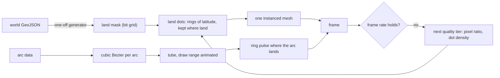

# About globe

The globe is the about page's one interactive visual. It is drawn on three.js alone: the land from a mask, the arcs from curves, and the pulses from rings.

## Decisions

- **Land is dots read off a mask, not tiles built from polygons.** A latitude ring of dots is spaced evenly in arc length and each dot is kept where the mask says land. Rejected: `three-globe`'s hex polygons, which rebuild the tiling from the GeoJSON in the browser on every mount and pull its geometry packages.
- **The mask is generated once and committed.** A generator rasterises the world GeoJSON into a bit grid at half a degree and writes it under `generated/`, so the browser never reads the polygons. Rejected: sampling a hand-drawn PNG through `getImageData`, which needs the canvas and a second source of truth.
- **Arcs are Bezier tubes with a draw range.** A cubic curve lifts each arc to its altitude, and the tube's draw range grows and shrinks. Rejected: dashed arcs, which draw the whole tube every frame.
- **Quality steps down, never up.** A watcher over the last fifty frames lowers the tier when the mean frame rate is under the target, and the dots are rebuilt at the lower density. Rejected: antialiasing, which the halo shader hides more cheaply.
- **The labels are dropped.** The old globe named fifty random countries and said itself that the browser was not powerful enough. The countries stay as bare coordinates for points and pulses.
- **The globe stands still when it cannot move.** Under reduced motion the arcs are drawn whole and the loop draws one frame; off screen the loop stops.

## Key files

| Path                                                              | Role                                                                          |
| :---------------------------------------------------------------- | :---------------------------------------------------------------------------- |
| `apps/web/app/components/Visual/Globe.vue`                        | the canvas mount                                                              |
| `apps/web/app/services/visual/globe/`                             | the pure services: mask decoding, dots, curves, quality tiers, start rotation |
| `apps/web/app/services/visual/GlobeConfiguration.ts`              | the colours and the sizes                                                     |
| `apps/web/app/assets/about/generated/globeLandMask/landMask.json` | the generated mask                                                            |
| `scripts/src/globeLandMask/index.ts`                              | the generator's entrypoint, with the world GeoJSON it reads beside it         |
| `apps/web/app/services/visual/globe/createGlobeScene.ts`          | the three.js scene: sphere, halo, dots, points, arc tubes and rings           |
| `apps/web/app/composables/visual/useGlobeScene.ts`                | the loop, the visibility and reduced-motion gates and the teardown            |

## Sources

- [How we built the GitHub globe](https://github.blog/engineering/how-we-built-the-github-globe/), the dots, the Bezier arcs, the rings, the quality tiers and the timezone start.
- [Visualizing GitHub's global community](https://github.blog/2020-12-21-visualizing-githubs-global-community/), the data the arcs stand for.
