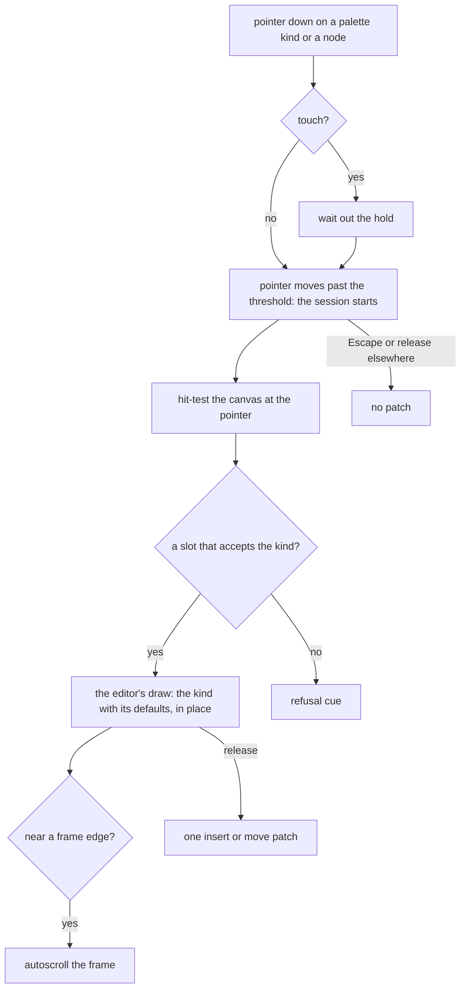

# Editor drag preview

Three editors share the pieces of a drag: one ghost chip at the pointer, the edge autoscroll's speed rule, the touch hold, the Escape cancel and the refusal cue. Each editor keeps what is its own: which slots accept a kind, where the pointer lands, and how the block is drawn in place.

## Decisions

- **The preview is drawn in the render path, not written to the document.** The session hands the editor a pending insertion, `{ slot, index, node }`, and the editor's own canvas renderer draws that node among the slot's children, marked as a preview and not selectable. The document, the history and the undo stacks never see it. Rejected: inserting the real node and removing it on cancel, which leaves history entries a cancelled drag must not leave.
- **The node is the kind's defaults.** The preview draws `createDefaultProps` for the kind, the same node a click would insert, so what the reader sees is what lands.
- **Each editor resolves its own target.** The page builder's nearest ancestor slot whose allow list accepts the kind is the target, and the index is the first child whose midpoint the pointer has not crossed; the survey resolves pages and panels the same way over its own boxes, and the whiteboard's target is the canvas point. Rejected: one resolver for all three, whose slots have nothing in common but the rule.
- **The boxes a move resolves against are read once, as the drag starts.** The preview pushes the nodes after it along, so boxes read live would move under a pointer held still and flip the target between two slots with every redraw. A frozen frame answers every move from the boxes that stood before the preview, moved by what the frame has scrolled since, and finds the node under the pointer from those boxes; the survey's canvas reads its slot boxes once for the same reason. A browser's rect holds its sides as getters on its prototype, so a frozen box is built from them and never spread. Rejected: reading the boxes live and moving the children after the preview back by what it pushed them, which a driven browser showed flipping the target at a pointer held still, since the margins between blocks stop collapsing once the preview sits between them.
- **One press tracker serves the three drags.** A composable owns the press: the window listeners filtered on its pointer id, the drag start distance, the touch rest and its tolerance, the click a release swallows, Escape, and the state of whether the press is a drag and where its pointer is. Each editor keeps what a move draws and what a release lands. A finger that drifts past the long press tolerance before it rests is scrolling, for all three. Rejected: a tracker in each editor's drag, which let the touch rule drift between them.
- **The page builder's gap is closed here.** Its canvas design promises edge autoscroll and a touch hold, and its drag composable had neither; it now holds a touch press for the reorder list's own delay and scrolls the frame near its edge. Each touch drag, once started, cancels its own `touchmove`, so the page's scroll does not take the finger back and cancel the drag. Every touch drag of the three, once started, cancels its own `touchmove` so the page's scroll does not take the finger back and cancel the drag.
- **The twin is unchanged.** Alt+arrow, Move to… and Insert stay as the keyboard path to the same patch, which is what makes a drag permissible.
- **A refused target says why.** The cue names the rule, "A Column goes in Columns", where the pointer is, so a refusal is never a silent no-op.

## Key files

| Path                                                              | Role                                                              |
| :---------------------------------------------------------------- | :---------------------------------------------------------------- |
| `apps/web/app/composables/pageBuilder/usePageBuilderDrag.ts`      | the page builder's drag, the starting point of the shared session |
| `apps/web/app/composables/survey/useSurveyCreatorDrag.ts`         | the survey Creator's drag, from the palette and from the canvas   |
| `apps/web/app/composables/whiteboard/useWhiteboardPaletteDrag.ts` | the whiteboard's palette drag and its ghost                       |
| `apps/web/app/composables/ui/usePressDrag.ts`                     | the one press tracker the three drags run on                      |
| `apps/web/app/services/pageBuilder/freezeFrameGeometry.ts`        | the canvas's boxes as they stood when the drag began              |
| `apps/web/app/composables/ui/useDragReorder.ts`                   | the autoscroll and the touch hold the session reuses              |
| `apps/web/app/services/ui/holdPageStillWhile.ts`                  | holds the page still under a finger whose drag has started        |
| `apps/web/app/components/PageBuilder/Canvas/Overlays.vue`         | where the preview's outline and the fallback drop line are drawn  |
| `apps/web/app/services/pageBuilder/resolveDropTarget.ts`          | the hit test                                                      |
| `apps/web/app/services/pageBuilder/withDragPreview.ts`            | the page builder's document with the pending insertion in it      |

## Sources

- The page builder's [canvas design](../../specs/resource/page-builder/canvas/design.md), the pointer drag and the keyboard twin this builds on.
- The survey Creator's [design](../../specs/resource/survey-creator/design.md), whose two decisions against dragging this overturns.
