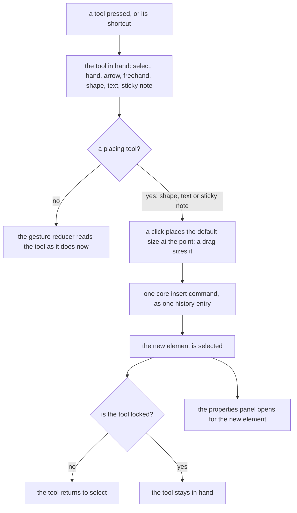

# Whiteboard layout

The whiteboard is the program's freeform pole: every tool is one press away in a single top toolbar, and a panel appears only for what is selected. It is a part of the [editor layout program](../2026-11-06-resource-editor-layout-program/design.md), drawn by the [editor shell](../2026-11-06-resource-editor-shell/design.md), and it changes the whiteboard's arrangement and its way of placing an element, not its document, its commands or its export, which the [whiteboard design](../../../specs/resource/whiteboard/design.md) holds.

Today the screen has a left palette of the shapes and notes with a search field, a tool row in the top-left corner, a zoom row in the bottom-left corner and a panel floating at the top-right. An element is placed by dragging it out of the palette or clicking its tile, and an arrow or a freehand stroke is drawn by choosing its tool first. After this change every element is placed the second way.

## How it works

The whiteboard declares a layout of four regions and a registry of panel content.

| Region     | Edge, by size class                                            | Opens        | Holds                                               |
| :--------- | :------------------------------------------------------------- | :----------- | :-------------------------------------------------- |
| Tools      | top, floating over the canvas; bottom and docked when compact  | always       | the toolbar                                         |
| Properties | start, over the canvas below the toolbar; a sheet when compact | with content | the contextual panel, for the selection kinds below |
| View       | bottom-start, over the canvas                                  | always       | undo, redo, zoom out, zoom in and fit to content    |
| Canvas     | the remainder                                                  | always       | the pannable, zoomable canvas                       |

The properties panel is shown for a shape, a sticky note, a text box, an arrow, a stroke, an image and a selection of several, and is absent with nothing selected. Its content is the same components the panel has now, each drawn by the shell where the layout put it: the fill field for a shape and a sticky note, the route, the arrowheads and the detach of each bound end for an arrow, and the stacking controls for every kind. A selection of several shows the stacking controls and a fill field that reads Mixed where the fills differ. Duplicate and delete are in the panel's footer for every kind, and delete keeps its confirmation.

**A placing tool draws the element.** Choosing the shape tool and clicking puts a shape of the default size at the click, and a drag makes the shape the size of the drag. The text box and the sticky note work the same way. The shape tool is one slot in the toolbar showing the shape last used, and its menu lists the shapes the palette held, the basic ones and the flowchart ones. The shapes are listed by category in the [whiteboard design](../../../specs/resource/whiteboard/design.md), their keys sit in `apps/web/app/services/whiteboard/tool/WhiteboardShapeItemMap.ts`, and the image types the picker accepts are `NOTE_IMAGE_MIME_TYPES` in `apps/web/shared/services/resource/note/constants.ts`, the same kinds a paste takes; this change keeps them as they are. The element is inserted by the core's insert command at the point, snapped to the grid as every placement is, and a commit the document check refuses leaves the document unchanged and tells the owner, as every commit does. After one placement the tool returns to select, so the next click selects, and a lock on the toolbar keeps the tool in hand for a run of the same shape.

**The image is a button.** It opens a file picker, through the app's hidden file input, and hands the chosen files to the insert a pasted image already uses, since an image has no point to draw. A paste and a picked file then reach the same composable, and the picker is the only new wiring.

**Every tool has a shortcut.** The shortcuts are registered commands in the whiteboard's command group, so the shortcuts dialog and the command palette list them: V for select, H for hand, A for arrow, P for freehand, T for text, N for a sticky note, and R, O and D for a rectangle, an ellipse and a diamond. A shortcut typed into a text field, including the inline label editor, is text and not a tool, and a modifier makes it another command.

**Undo and redo are buttons.** They sit beside zoom in the view region, so a reader on a touch screen can undo without a keyboard. The whiteboard undoes with a key only today and has no redo, so this change wires redo from the shared bounded history, which already holds it for the page builder, and registers it as a command beside undo.

**A compact window.** The tools region moves to the bottom edge and docks as a bar, with the shape slot and the rest folding into the overflow menu by the toolbar's rule. The properties region is a sheet opened by the button the shell shows while something is selected. The view region keeps its place above the toolbar.

## Decisions

- **The palette is removed and its kinds move into the toolbar.** The toolbar holds the shapes in one slot, the text box and the sticky note, so the reader's place to look for any element is the same place they look for the arrow. Rejected: keeping the palette beside the toolbar, which is two places for the one thing the whiteboard is for, and a palette is a list a reader searches, where a freeform editor wants a place the hand already knows. Rejected: keeping its search, since the shapes in one slot and a menu need no search, and the compact chrome added a search to the palette because the palette had no other way to be found.
- **An element is placed by choosing its tool and drawing it.** It is the gesture every drawing tool a reader has used shares, and it gives the reader the size at the same stroke as the place. Rejected: the drag out of a list, which can place only at a default size and needs the pointer to cross the whole canvas from the edge; and the click that puts an element at the middle of the view, which the reader then drags to where it should have been.
- **The tool returns to select after one placement, with a lock.** A reader who places one shape and moves on is the common case. Rejected: a tool that stays in hand, which turns the next click, meant to select, into a second shape.
- **The properties panel is absent with nothing selected.** The whiteboard has no setting of the document that needs a panel, since snap is a toolbar toggle and the view is in the view region. Rejected: a panel of canvas settings shown when nothing is selected, which holds one switch and covers the canvas for it.
- **The panel is on the start edge.** It is where Excalidraw's properties and a reader's eye on a left-to-right page both rest, and the top-right keeps the page's own controls clear. It still opens over the canvas below the toolbar's row, so it never moves what was just selected. The panel was on the end edge only because the palette held the start edge.
- **Shapes share one slot.** A button for every shape would be the crowded strip this change removes the palette to avoid. Rejected: a button per shape.
- **The toolbar floats over the canvas on a wide window and docks at the bottom on a compact one.** A floating island keeps the canvas whole and the tool within reach of the cursor, and the bottom edge is within a thumb's reach, as Excalidraw's phone bar is. Rejected: a docked top bar on a wide window, which spends a row of the canvas on a bar that is mostly empty.
- **A click centres the default size on its point, and a drag is anchored at its press.** The palette this replaces centred each element on the point it was placed at, so a click keeps that meaning. A drag's box runs from the press's corner to the pointer, as a drag does in every drawing tool, and holds the minimum element size. Nothing is drawn before a drag starts, so a click's element never changes size under the reader.
- **A text box keeps the width of its drag and no height.** Its text sets its height, as the text box model stores it.
- **The armed element is the tool in hand with the shape kind the shape tool holds.** The store holds the kind beside the tool and the lock beside both, rather than one armed value, so the toolbar's toggles bind to the tool and the shape slot binds to its kind.
- **A placement selects its element only when the document accepts it.** A refused commit leaves the selection where it was, so no selection names an element that was never placed.
- **Redo is the shared history's redo, under the shortcuts the page builder and the sheet bind.** The undo entry holds the operations as well as their inverses, as the page builder's entry does, so a redo reapplies them through the commit an edit takes, and its commands come from the shared undo and redo helper: Cmd+Z, Cmd+Shift+Z and Cmd+Y. Rejected: a redo rebuilt from the patch an undo returns, which would have to swap the entry the shared history moved onto the future stack. Rejected: a redo with one shortcut, which a reader on the other keyboard convention would not find.
- **A new edit after an undo clears the redo stack.** The shared history does this on every push, and the whiteboard keeps that rule rather than adding one.
- **The shape slot binds through the toolbar's one value.** The toolbar takes one value for the tool in hand, so a shape tool's value is the kind it places: the slot draws that kind, and a choice in the slot or a shape key sets both the tool and the kind. Rejected: a second value on the toolbar for the kind, which every editor's toolbar would have to take beside its tool.
- **The slot draws the variant a key put in hand.** The toolbar records the variant of its slot each time the tool in hand becomes one of that slot's variants, not only when the reader chose it in the slot, so a shape a key chose is the shape the slot shows once another tool is in hand. Rejected: remembering only the slot's own menu choices, which shows a stale shape after a key.
- **The view is a bottom overlay, since a region names an edge and not a corner.** The view is drawn bottom-start in the design's sketch, but the layout names only the four edges, so the view floats over the bottom of the canvas, above the bar a compact window docks. Rejected: a start overlay for the view, which would stand in the properties panel's column.
- **Panels are keyed by the selection kinds that need their own content.** An arrow and a selection of several have panels of their own. Every other kind shares the element panel through the layout's wildcard, which draws a fill where the kind has one and nothing else where it has none.
- **A selection of several is titled by its count.** The header reads "3 shapes" when every element is a shape and "3 elements" otherwise, in the editor's own vocabulary.
- **A selection of several has no stacking control in this change.** Stacking moves one element by its index, and moving a selection needs one operation over the whole selection. The panel for several builds its fill and its footer, and the whiteboard design's Not built names the stacking.
- **Undo and redo are the store's for the buttons, and the keys keep their own.** The view's buttons call the store's undo and redo over the store's edit state. The keyboard composable runs the same two services over the edit state it is handed, since its suite mounts it over bare refs. Both read and write one history.

## Not in this change

- **Defaults for the next element.** A style panel shown for the tool in hand, so a reader sets a fill before drawing, is a feature of the document's defaults and not of the arrangement. The placed element's fill is the constant it is now.
- **New elements and tools.** A line, an eraser, a frame and an alignment control are not elements or commands of the document, and this change adds no element.
- **A stencil library.** The shapes are the ones the palette held.

## Key files

| File                                                                           | Role                                                                                          |
| :----------------------------------------------------------------------------- | :-------------------------------------------------------------------------------------------- |
| `apps/web/app/components/Resource/Whiteboard/Editor.vue`                       | the editor, which the shell draws over the whiteboard's layout and registry                   |
| `apps/web/app/components/Resource/Whiteboard/EditorToolbar.vue`                | the toolbar's items: every tool, the shape slot, the image picker, the lock and the grid snap |
| `apps/web/app/components/Resource/Whiteboard/EditorControls.vue`               | the zoom row, which gains undo and redo and becomes the view region                           |
| `apps/web/app/components/Resource/Whiteboard/EditorPropertiesPanel.vue`        | the element panel, one of the registry's entries                                              |
| `apps/web/app/components/Resource/Whiteboard/EditorPropertiesArrowPanel.vue`   | the arrow panel, the entry the layout keys to an arrow                                        |
| `apps/web/app/components/Resource/Whiteboard/EditorPropertiesSeveralPanel.vue` | the panel of a selection of several, the entry the layout keys to several                     |
| `apps/web/app/components/Resource/Whiteboard/EditorPropertiesFooter.vue`       | the duplicate and delete buttons every panel holds                                            |
| `apps/web/app/services/whiteboard/layout/constants.ts`                         | the layout: its regions, its panels and the names of its regions                              |
| `apps/web/app/services/whiteboard/layout/WhiteboardContentComponentMap.ts`     | the registry: the component each content key draws                                            |
| `apps/web/app/composables/whiteboard/useWhiteboardGesture.ts`                  | feeds the pointer events to the reducer, which gains the placing gesture                      |
| `apps/web/app/composables/whiteboard/useWhiteboardKeyboard.ts`                 | registers the keyboard commands, which gain the tool shortcuts and redo                       |
| `apps/web/app/composables/whiteboard/useInsertWhiteboardImages.ts`             | uploads and inserts images, which the image button's picked files now reach as a paste does   |
| `apps/web/app/components/Ui/HiddenFileInput.vue`                               | the file input the image button opens                                                         |
| `apps/web/app/services/whiteboard/gesture/reduceWhiteboardGesture.ts`          | the one gesture reducer, which gains the placing transition                                   |
| `apps/web/app/services/whiteboard/tool/WhiteboardToolItemMap.ts`               | the tools the toolbar chooses between, with the mark, title and key of each                   |
| `apps/web/app/services/whiteboard/tool/WhiteboardShapeItemMap.ts`              | the shapes the shape slot holds, each with its mark                                           |
| `apps/web/app/services/whiteboard/tool/constants.ts`                           | the shape slot the toolbar draws and the picker's image types                                 |
| `apps/web/app/services/whiteboard/palette/constants.ts`                        | the sizes and fills of placed elements, kept                                                  |
| `apps/web/app/store/resource/whiteboard/editor.ts`                             | the tool in hand, its lock, the selection and the viewport, which gains the lock's toggle     |
| `apps/web/app/store/resource/whiteboard/index.ts`                              | the undo and redo the view's buttons call                                                     |
| `apps/web/app/components/Editor/Toolbar.vue`                                   | the shell's toolbar, whose slot draws the variant a key put in hand                           |
| `openspec/specs/resource/whiteboard/design.md`                                 | the whiteboard's design, rewritten as built                                                   |

## Sources

- [Excalidraw's toolbar](https://raw.githubusercontent.com/excalidraw/excalidraw/master/packages/excalidraw/components/Toolbar.tsx) and [its actions panel](https://raw.githubusercontent.com/excalidraw/excalidraw/master/packages/excalidraw/components/Actions.tsx): the tools in one strip with variants and extras in a menu, an element drawn by choosing its tool, and a properties panel shown while something is selected or a drawing tool is in hand. The arrangement and the placing gesture.
- [tldraw's default toolbar](https://raw.githubusercontent.com/tldraw/tldraw/main/packages/tldraw/src/lib/ui/components/Toolbar/DefaultToolbar.tsx): a minimum and a maximum of visible tools, the rest overflowing, and the toolbar staying visible on a narrow window. The fold and the compact behaviour.
