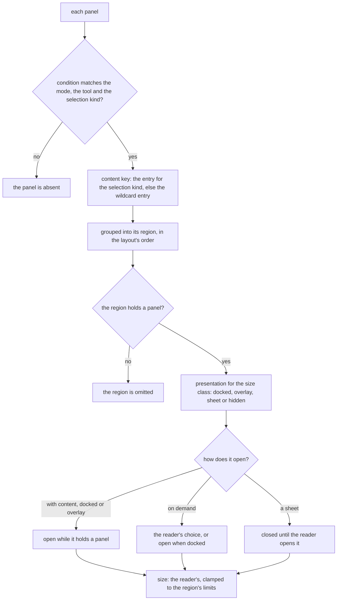

# Headless editor layout engine

A Vue package that holds an editor's layout as data and resolves it for what the reader is doing and the window they are in. It is the engine of the [editor layout program](../resource-editor-layout-program/design.md), and the [editor shell](../resource-editor-shell/design.md) is its only consumer. Its shape follows the [package shape](../architecture-headless-package-shape/design.md): pure functions and the composable that keeps their state, from one entry.

Today nothing is built of it, and each editor arranges its own screen in its own component. After this change an editor hands the engine a layout, and the engine answers with the regions to draw.

## How it works

A layout is plain data. It names **regions**, each placed at one edge of the window, and **panels**, each belonging to one region and carrying the condition it is shown under and the content it shows. The window's remaining space is the canvas, which the layout names once, so every layout has one and a resolved layout always answers it.

Resolving is one pure function. It reads the layout, the context, the window's size class and the reader's state, and answers the regions to draw, each with its presentation, its size and the limits that size is held between, whether it is open and the panels it holds.



**A region opens in one of two ways.** A region that opens with its content, which is the contextual panel, is open whenever it holds a panel, so a selection brings its properties into view without a click. A region that opens on demand, which is a palette or a layers tree, is open or closed by the reader and starts open when it is docked. A region presented as a sheet is always on demand, so a phone is never covered by a panel the reader did not ask for.

**The reader's state is apart from the layout.** It holds each region's size, whether each on-demand region is open and each tabbed region's active panel. Its functions return a new state and never change the one they were given. A stored value is read back in two steps: a schema checks its shape, and then the layout drops every id it no longer names and clamps every size to its limits. A value that is not a state is the default state, so a layout that changes between releases never meets a stale setting.

**The size class is an input, not something the package reads.** The shell derives it from the display composable the app already has, which reads the one breakpoint scale through Vuetify 0, so the package holds no width, no cut and no listener, and the [responsive](../../specs/architecture/responsive/design.md) rule that one scale exists in the repo holds without a second reading of it.

## Model

| Concept      | What it is                                                                                                                                                                                              |
| :----------- | :------------------------------------------------------------------------------------------------------------------------------------------------------------------------------------------------------ |
| Region       | An id, an edge (top, bottom, start, end), optionally a different edge for a size class, a presentation for each size class, size limits, a default size, and whether it opens with content or on demand |
| Canvas       | The id the layout names once, beside its regions and panels, which a resolve always answers                                                                                                             |
| Panel        | An id, the region it belongs to, a condition and a content by selection kind with a wildcard entry                                                                                                      |
| Condition    | Three lists, mode, tool and selection kind; a missing or empty list matches anything                                                                                                                    |
| Context      | The mode, the tool and the selection, a kind that is none when nothing is selected, and a count                                                                                                         |
| Size class   | Compact, medium or expanded, given by the caller                                                                                                                                                        |
| Reader state | Sizes, which on-demand regions are open and the active panel of each tabbed region, each keyed by the id it is about                                                                                    |
| Finding      | One thing the layout check reports: a selection kind with no content, a content key nobody registered, a duplicate id, a panel in a region that does not exist                                          |

The edges are `start` and `end`, not left and right, so a layout is correct in a right-to-left language without a second layout.

## Decisions

- **Conditions are matches, not functions.** Each editor writes its layout as a typed object, and a match can be read, listed and checked, which a function cannot. A condition that needs more than a mode, a tool and a selection kind is a sign the context lacks a field, and the context grows it. Rejected: a predicate per panel, which cannot be checked for coverage and cannot be written into a design.
- **Content is chosen by the selection kind inside the panel.** One properties panel holds an entry per kind and a wildcard, so the layout has one panel where it would otherwise have one per kind, each with its own condition. Rejected: one panel per selection kind, which makes the layout a list of conditions that must be kept disjoint by hand.
- **A layout check is part of the package.** It takes the editor's selection kinds and registered content keys and reports every gap. The shell's tests run it for each editor, so a new selection kind with no panel fails a test, not a reader. Rejected: leaving it to the shell, which would then check by drawing.
- **The package holds no breakpoint, no pointer handling and no animation.** A resize gesture is the existing resize handle's; the shell hands the resolved size to it and writes what it answers through the package's resize, which clamps with the clamp VueUse already exports. Rejected: a size-class function in the package, which would read widths a second time beside the app's display composable. Rejected: the package owning the gesture, which would give it a DOM dependency and a second reading of the pointer.
- **There is no docking.** A region is at one edge and a reader does not move a panel to another. This is the part of the docking engines this package leaves out, and the [rejected docking layout](../../rejected/resource/editor-docking-layout/design.md) records why.
- **The package holds the composable.** One composable takes the layout and a reactive context as values or getters, keeps the reader's state and answers the resolved layout as one computed value, so nothing is derived by hand, no watcher copies one ref into another, and the shell calls it once. The functions stay pure and are exported beside it, which is how they are tested. Rejected: leaving the wiring to the shell, which would write it once per editor, and a framework-free package with the composable in a subpath, which the [package shape](../architecture-headless-package-shape/design.md) rejects.
- **The canvas is named by the layout, not made a region.** The layout holds one canvas id beside its regions and panels, so every layout has exactly one by its type, and a region's edge is always one of the four edges. A check then never counts canvases, and a resolve always answers the canvas. Rejected: a region whose edge is the canvas, which lets a layout have none or two and needs a check to find which.
- **A hidden region is answered, closed.** A region presented as hidden for a size class stays in the resolved layout with that presentation and closed, so the shell reads one answer for every region and draws none of the hidden ones. Rejected: omitting it, which would make the answer's shape depend on the size class.
- **A tabbed region shows the reader's panel, or its first present panel.** A region holding several present panels shows the panel the reader chose while that panel is present, and its first present panel otherwise. The stored choice is left as it was, so it returns when the context brings its panel back. Rejected: writing the fallback into the reader's state, which would overwrite a choice the reader made.
- **A stored state is read whole or defaulted.** The schema requires all three maps, with each key a short id and each size a non-negative number. A value that fails it is the default state as a whole, since a partly read state has no origin anyone can name, and the reset is the migration. A value that passes is fitted to the layout. Rejected: keeping the entries that pass, which would keep a half-read state, under the rule that persisted data holds only its latest shape.
- **A toggle takes the open state the region is shown in.** A region the reader has never toggled opens by its presentation, so the stored state cannot say whether it is open. The caller passes the resolved state and the function stores its opposite. Rejected: writing the derived open state into the reader's state on every resolve, which would store a value the layout can compute.
- **A selection kind is a string, and an empty one is none.** An editor names its own selection kinds, modes and tools, so the package holds them as strings. The empty string is no selection, since an enum takes no `None` member under the absent-values rule. Rejected: a `None` member on a selection kind enum.
- **The clamp comes from `@vueuse/core`.** `clamp` is defined by `@vueuse/shared` and re-exported by `@vueuse/core`, which the app depends on directly and which genshin-world already names as a peer. The package imports it from `@vueuse/core` and names `@vueuse/shared` nowhere. Rejected: a local clamp, which would be a second copy of one the repo takes from VueUse.
- **The entry is the barrel the build generates.** The one entry is `src/index.ts`, generated from every module under `src`, and the manifest's `source` arm points at it. The generator's placeholder entry is removed, since its one constant is not part of the package. Rejected: a hand-written barrel, a second list to keep in step with the modules.
- **A small bundle is a design input.** Every function is its own module and the package declares no side effects, so a consumer that uses the resolve and the resize ships only those. The bundle is held by the [bundle sizes](../../specs/architecture/bundle-sizes/design.md) record, which a fresh build is checked against, and not by a ceiling in a package test: a ceiling per package is the [rejected bundle size ceilings](../../rejected/architecture/bundle-size-ceilings/design.md), and the record replaced it. The bundle is a few kilobytes gzipped, the magnitude the design names. Its one runtime dependency is the shared package, and Vue, `@vueuse/core` and the schema library are peers the app already ships.
- **The composable's inputs are read when they change, and its state is passed in once.** The layout, the context and the size class are `MaybeRefOrGetter`s, since the resolved layout is computed from them, and the initial reader state is a plain value, read once. The app passes in the state its store holds, read through `parseReaderState`, and stores the state the composable exposes.
- **The composable's functions take an id, and an id the layout does not name changes nothing.** A resize finds its region in the layout and a toggle finds its region in the resolved layout, which is where the open state it turns over is answered. The shell calls them with ids it drew from the resolved layout, so a missing id is a stale one, which the reader state already tolerates. Rejected: taking the region object, which would make the shell hold the layout's objects beside the ids it draws.
- **The reader's state is exposed as a computed, so only the three functions change it.** A writable ref would let a caller set a state none of the functions made, which nothing else checks. Rejected: exposing the ref itself.
- **The composable answers its own type.** The build's declarations need an explicit return type on an exported function whose answer is a shorthand object (`TS9016` under `isolatedDeclarations`), so the answer is `EditorLayout`, as the grid package names its composable's answer `GridLayout`.
- **A selection kind is uncovered when no panel covers it, and the check reads neither the mode nor the tool.** A panel covers a kind when its condition admits the kind and its table gives the kind a content key, its wildcard included, since the resolve drops a panel with no content. The check takes no context, so a kind covered under one tool only counts as covered. Rejected: a finding for each panel that admits a kind without content, which would flag a panel another panel makes unnecessary.
- **Duplicate ids are checked among regions and among panels, never across them, and the canvas is not checked.** The reader's state keys regions and panels in separate maps, so one string on a region and a panel names two things and is not ambiguous, and a panel named as its region is a valid layout. The canvas is named once by the type, so it cannot repeat. Each duplicate, and each unregistered key, is reported once however many times it repeats. Rejected: one id space for the whole layout, which would reject a panel named after its region.

## What the layout libraries settled

This is not an absorption, since no dependency is replaced, but its ideas are borrowed from packages that are, and the way each was taken is recorded as an absorption's Upstream table would.

| Behaviour                                         | Seen in                                      | Taken as                                                                         |
| :------------------------------------------------ | :------------------------------------------- | :------------------------------------------------------------------------------- |
| Layout is serialisable, panels are named by id    | FlexLayout, rc-dock, golden-layout, Dockview | Panels and regions carry stable ids, and the reader's state names them           |
| The reader's sizes are kept apart from layout     | FlexLayout, Lumino                           | The reader state, parsed against the layout so a stale id is dropped             |
| A panel has a minimum, a maximum and can collapse | Zag, Dockview                                | Size limits on a region, and an on-demand region the reader closes               |
| A splitter is operated from the keyboard          | WAI-ARIA window splitter, Zag                | Already the app's resize handle, which the shell reuses; the package only clamps |
| A slot can be hidden or replaced by the embedder  | tldraw, Puck                                 | A panel absent under its condition, and a content key the editor registers       |
| Toolbar items overflow past a width               | tldraw, Excalidraw                           | Not the engine's: the shell's toolbar folds its own items                        |
| Floating, popout and drag-to-dock                 | Dockview, golden-layout, Lumino              | Left out, as the rejected docking layout records                                 |

Nothing was copied. The package is written from these behaviours, so no licence text comes with it.

## Name

`vue-editor-layout-headless` is the convention name, which follows the convention the package shape settles. The package is new, so no consumer is moved, and the name is fixed when the package lands under the program's task 1.2, before any editor runs on it. The program's rename task 3.0 covers only the two legacy packages that ship a Vue abstraction, the block editor and the survey engine.

## Not built

- **Layouts a reader edits.** A reader resizes and opens and closes regions. They do not add, move or remove them.

## Package

```text
packages/vue-editor-layout-headless/
  src/models/        Layout, Region, Panel, Condition, Context, SizeClass, RegionEdge, RegionPresentation,
                     RegionOpening, ReaderState (with its schema), Finding, FindingKind, RegionPlacement,
                     the resolved layout, region and panel, and EditorLayout, the composable's answer
  src/services/      resolveLayout and the functions it is built from, resizeRegion, toggleRegion,
                     setActivePanel, parseReaderState, checkLayout, one function to a file
  src/composables/   useEditorLayout, the reader's state and the resolved layout from a reactive context
  src/index.ts       the barrel the build generates
```

## Key files

| File                                                                   | Role                                                                                                |
| :--------------------------------------------------------------------- | :-------------------------------------------------------------------------------------------------- |
| `apps/web/app/composables/ui/useUiDisplay.ts`                          | the app's one reading of the breakpoint scale, from which the shell derives the size class          |
| `packages/vue-grid-layout-headless/package.json`                       | the manifest the new package's follows, with Vue as its peer, as the grid package's does            |
| `packages/vue-editor-layout-headless/src/services/resolveLayout.ts`    | the resolve: which regions a context shows, each with its presentation, size, open state and panels |
| `packages/vue-editor-layout-headless/src/services/parseReaderState.ts` | the read of a stored state: the shape schema, then the fit to the layout                            |

## Sources

- [FlexLayout](https://github.com/caplin/FlexLayout), [rc-dock](https://github.com/ticlo/rc-dock), [golden-layout](https://github.com/golden-layout/golden-layout) and [Dockview](https://github.com/mathuo/dockview): a serialisable layout naming panels by id, kept apart from the reader's own state.
- [Zag's splitter](https://zagjs.com/components/react/splitter): panel limits and a controlled size.
- [WAI-ARIA window splitter](https://www.w3.org/WAI/ARIA/apg/patterns/windowsplitter/): the keyboard contract the resize step follows.
- [tldraw's UI components](https://tldraw.dev/sdk-features/ui-components) and [Puck's overrides](https://next.puckeditor.com/docs/api-reference/overrides): a region's content replaced or hidden by the editor that embeds it.
- [Material 3 window size classes](https://m3.material.io/foundations/layout/applying-layout/window-size-classes): compact, medium and expanded.
