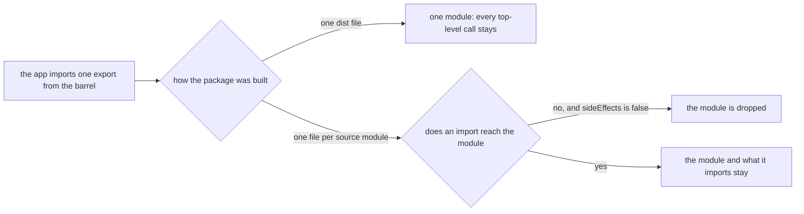

# Design

## Context

Every package here builds through a shared tsdown factory into one `dist/index.js` behind a generated barrel. The app, and every package that imports a sibling, reaches that file through the `default` export arm. The factory's `sideEffects: false` is a promise to the consumer's bundler that an unused module can go, but a bundler's unit of "module" is the file, so a one-file package offers it nothing to drop.

## Decisions

### Build unbundled

The base factory sets `unbundle: true`, so the build writes one file per source module and the generated barrel stays the one entry. The consumer's bundler then reads the barrel's `export *` lines, follows only the modules an import reaches and drops the rest, because the package says no module runs on import. The repo's rule of one exported function or type per file means a module is already the size of one thing a consumer asks for.

Rejected: marking calls as pure in the built file. It needs a list of call names kept in step with the code (a drizzle table builder, a schema factory, a parser factory), a list that goes stale silently and that no test can fail.

Rejected: a subpath entry for each cheap part (a client schema entry, a subpath for one helper). It is the same cause answered one name at a time, and each entry is a contract a package owes (`.agents/skills/build/references/subpaths.md`).

Rejected: per-file `exports` in the manifest. The `.` export is what every sibling imports and what the size record reads, and unbundled output keeps it.

### Vendored files go under `vendor`

An unbundled build writes a vendored dependency's files at the path they were read from, under a `node_modules` folder, which `npm pack` never ships: the published package would reference declaration files its tarball lacks. The factory renames that folder through the output's file-name sanitizer, which also has to keep the three characters the default sanitizer replaces, since a function replaces the default, and drops the leading dot of a folder, since pnpm keeps its packages under a hidden `.pnpm` folder and CI's artifact upload skips a hidden folder: the vendored files never reached the app build, which failed to resolve its import of one. A workspace test now fails a `dist` holding a hidden folder.

Rejected: externalizing the vendored dependencies. They are vendored on purpose (`.agents/skills/build/references/dependency-placement.md`), and an external type package would split a consumer's types in two.

### Vue stylesheets stay one file

A Vue package merges its stylesheets into one `style.css`, which a page imports once. An unbundled build splits CSS per module unless `css.splitting` is turned off, so the factory turns it off. The package answers `sideEffects` with `["**/*.css"]` so a bundler keeps the page's import of the sheet.

Rejected: a stylesheet beside each component, imported by its module (`css.inject`), so a page loads only the styles of the components it reaches. Node loads a Vue package's `dist` in the scripts and benchmarks that read its data and cannot load a `.css` file, so the benchmarks failed on the first import of the package; and the sheets are small and one page mounts nearly all of them, so the saving is small beside the cost every consumer pays to be CSS-aware.

### Deploy artifacts and programs stay one file

The Functions app is a deploy artifact the host opens cold and installs nothing for, so one vendored file beats a file per module. The infrastructure program is run once and imported by nothing. Each sets `unbundle: false`; the Functions bundle still shrinks, because it now vendors the unbundled packages and drops what nothing reaches.

### What stays heavy

A module that runs drizzle at import stays heavy wherever it is imported: the message entity classes and the schemas derived from a table call the table builder and the schema factory when the module loads. Unbundling cannot change that, because the work is real. The roadmap's question about a second definition of those entities is still open, now over the names that need drizzle and no others.

## Measured

Each reading bundled a probe that imports names from the schema or shared package's built output through Vite, minified, once from the one-file build and once from the unbundled build.

| Import                                  | One file              | Unbundled                                           |
| :-------------------------------------- | :-------------------- | :-------------------------------------------------- |
| One enum from the schema package        | over a megabyte       | under a kilobyte                                    |
| `jsonDateParse` from the shared package | tens of kilobytes     | under a kilobyte                                    |
| `takeOne` from the shared package       | tens of kilobytes     | a few dozen bytes                                   |
| Every value name the app's client reads | hundreds of kilobytes | hundreds of kilobytes, from the drizzle-bound names |

The last row is the union of every name the client imports from the schema package, so it shows the floor a route importing all of them pays, not what one route pays. Alone, most of those names are under a few kilobytes unbundled. The names that stay heavy are the message entity constructors and the schemas derived from a table, which the client's input models build their forms and procedure inputs from, a few dozen in all. The app's own client bundle report after the change puts drizzle's core at tens of kilobytes gzipped in the entry chunk, and zod at over a hundred, every locale included, since `drizzle-orm/zod` uses the namespace as a value. Those are the cost of the drizzle-bound names, so the roadmap's question narrows to a second definition of those names alone.

## Key files

| File                                                                      | Role                                                                        |
| :------------------------------------------------------------------------ | :-------------------------------------------------------------------------- |
| `packages/configuration/src/services/getTsdownConfiguration.ts`           | the base factory: unbundled output and the vendor folder name               |
| `packages/configuration/src/services/getTsdownConfigurationVue.ts`        | the Vue factory: one `style.css` and no module importing a stylesheet       |
| `packages/configuration/src/services/getTsdownConfigurationNuxtModule.ts` | the Nuxt module factory, which already builds unbundled for its runtime     |
| `scripts/src/services/bundleSizes/rollUpBundleSizes.ts`                   | the size record's roll-up of a package's modules into one row per extension |
| `.agents/skills/build/references/barrels.md`                              | the barrel page, which states the one-file shape this change replaces       |
| `.agents/skills/build/references/subpaths.md`                             | the test a subpath must pass, which now also names this cause               |
| `openspec/specs/architecture/dependency-admission/design.md`              | the client bundle paragraph whose workarounds this change makes unneeded    |

## Notes

- A node script that imports a package's `dist` opens many small files in place of one. The scripts and tests here reach packages through the `source` condition, so only a deploy artifact or a published consumer pays it.
