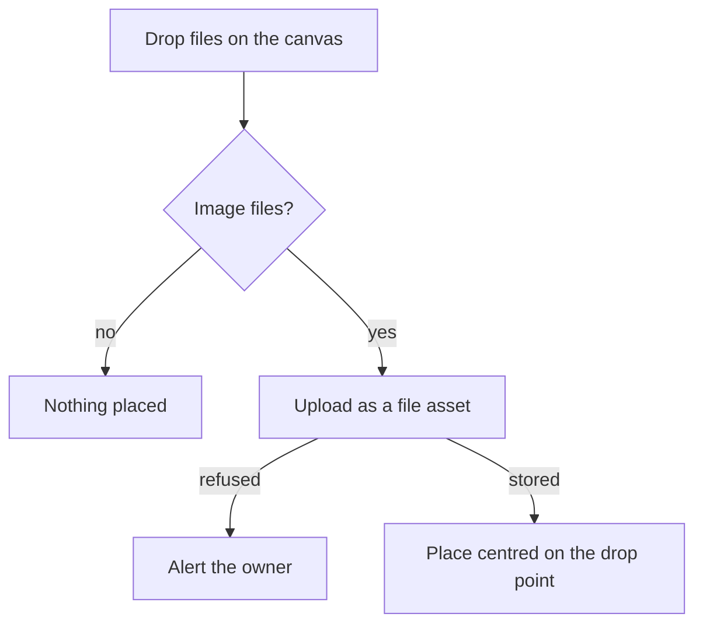

## Context

The canvas takes a paste of image files, and the insert uploads each image file as a file asset of the whiteboard and places its element centred on the centre of the view. A drop does nothing today. The image element holds the id of its file and its box, and the element draws the file's address as an image, with no name for it. The export draws each image by the same address. The tool lock is a toggle in the editor's store, which the toolbar's lock button calls, and the keyboard commands register each tool's key and are not fired while a field has focus.

## Gap analysis

Each row is a feature of Excalidraw, the reference product, with the verdict this change gives it.

| Feature                                      | Verdict                                                                                                   |
| -------------------------------------------- | --------------------------------------------------------------------------------------------------------- |
| Image insert                                 | Built here: a drop onto the canvas is added, and the picker and paste keep their behaviour                |
| Drag and drop an image onto the canvas       | Built here: the dropped image is placed centred on the point it was dropped                               |
| Image alt text                               | Built here: each image holds alt text, set from the panel, which names it on the canvas and in the export |
| Tool lock (tool stays in hand after one use) | Built here: the Q key toggles the lock the toolbar already has                                            |

## Decisions

- **A drop is placed where it lands.** The dropped image is centred on the point the pointer released it at, as a note places a dropped image where it lands. Rejected: centring a dropped image on the view, as paste does, which would leave the reader moving each dropped image to where it was dropped.
- **A drop uses the insert a paste uses.** Both take the same image types and report a failed upload the same way, so the two cannot drift apart. Rejected: a second insert for drops, which would accept another set of types and alert in another way.
- **A file that is not an image is ignored.** Non-image files are dropped the way non-image paste is: nothing is placed.
- **Alt text is one string, empty when none is set.** An image with no alt text holds the empty string, as the absent-value rule keeps a string as the empty string and not as a missing value. Rejected: an optional field, where a missing value and an empty one would mean the same thing in two ways.
- **Alt text names the image to assistive technology.** The image is given an image role and an accessible name from its alt text, on the canvas and in the SVG export, with nothing drawn on the picture. Rejected: a caption drawn on the image, which would change the picture the reader sees.
- **Alt text is set in the properties panel.** The panel already holds every control for a selected element, so the field sits there, committed when the owner leaves it or presses Enter. Rejected: a popover opened from the image, which would be a second place for the same setting.
- **Stored images are rewritten once.** Adding the field makes each stored image fail its parse until it holds the field, so a one-time rewrite sets empty alt text on every stored image. Rejected: a default on the field, which would let an image parse without the rewrite.
- **Q is a registered command.** It is bound with the other keys of the canvas, so the shortcuts dialog lists it and it does not fire while a field has focus, as the other keys do not. Rejected: a key on the toolbar's lock button alone, which the shortcuts dialog would not list.
- **Only Q is added.** The other letter keys wait on their tools, as the whiteboard design already records.

## Rejected

- Placing a dropped image at the centre of the view.
- A caption drawn over an image as its alt text.

## Risks and trade-offs

- A drop from outside the browser carries files only when the source offers them, so a drag of a picture from another page with no file behind it places nothing.
- The rewrite runs on each store until it reports that no image lacks the field, so an image saved during the run is caught by the next pass.

## How it works

A drop either places an image or places nothing, and an upload the server refuses alerts the owner and places nothing.



## Key files

| File                                                                                 | Role                                                                                                                      |
| :----------------------------------------------------------------------------------- | :------------------------------------------------------------------------------------------------------------------------ |
| `apps/web/app/components/Resource/Whiteboard/EditorCanvas.vue`                       | the canvas, which takes the paste and now the drop, and reads the point a drop lands on                                   |
| `apps/web/app/composables/whiteboard/useInsertWhiteboardImages.ts`                   | uploads image files as file assets and inserts their elements, at the centre or at a given point                          |
| `apps/web/app/services/whiteboard/createWhiteboardImageElement.ts`                   | the image element a placement creates, centred on a point, with empty alt text                                            |
| `apps/web/app/services/whiteboard/getCentredPosition.ts`                             | the top-left corner of a box centred on a point, which the image placement uses                                           |
| `apps/web/app/services/whiteboard/gesture/getWorldPoint.ts`                          | the document point a screen point lands on, which a drop's point is read through                                          |
| `apps/web/app/components/Resource/Whiteboard/ElementImage.vue`                       | draws an image element from its file, and now names it by its alt text                                                    |
| `apps/web/app/components/Resource/Whiteboard/EditorPropertiesPanel.vue`              | the panel of one selected element, which mounts the alt text field for an image, keyed by its element                     |
| `apps/web/app/components/Resource/Whiteboard/EditorPropertiesAltText.vue`            | the alt text field of an image, committed once when the owner leaves it or presses Enter, and shown as an undo changes it |
| `apps/web/app/components/Resource/Whiteboard/EditorToolbar.vue`                      | the toolbar's lock button, whose key is now listed                                                                        |
| `apps/web/app/composables/whiteboard/useWhiteboardKeyboard.ts`                       | registers the Q key beside the tool keys                                                                                  |
| `apps/web/app/store/resource/whiteboard/editor.ts`                                   | the tool lock's state, and the toggle the key calls                                                                       |
| `packages/vue-block-editor-headless/src/models/ImageElement.ts`                      | the image element, which gains the alt text                                                                               |
| `packages/vue-block-editor-headless/src/models/PositionedElementProperty.ts`         | the property a command sets, which gains the alt text                                                                     |
| `packages/vue-block-editor-headless/src/services/updatePositionedElementProperty.ts` | replaces one property, the alt text among them                                                                            |
| `packages/vue-block-editor-headless/src/services/export/toImageSvg.ts`               | draws an image in the SVG export, which now names it by its alt text                                                      |

New files, created by the change:

```text
apps/web/app/components/Resource/Whiteboard/ElementImage.test.ts     the image's role and accessible name, tested without a browser
apps/web/app/components/Resource/Whiteboard/EditorPropertiesAltText.vue       the alt text field a panel mounts for an image, a component of its own so the panel only mounts it
apps/web/app/components/Resource/Whiteboard/EditorPropertiesAltText.test.ts  the field's commit on Enter, its no-op when unchanged, and its follow of an undo
```

## Sources

- [Excalidraw](https://github.com/excalidraw/excalidraw): the reference for a dropped file and for the lock key. Taken: the drop overlay named in packages/excalidraw/components/FileDropOverlay.tsx, and the lock key named in packages/excalidraw/actions/shortcuts.ts. The placement on the drop point, the alt text and its export are this design's, since the reference names none of them.
