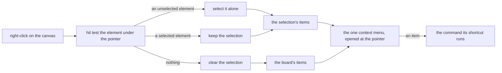

## Context

The app has one context menu, mounted once and opened at a point by a target that hands over its items, and a list of thousands of rows opens it the same way a single canvas does. The whiteboard's commands already exist as the keyboard's: copy, cut, duplicate, delete, select all and a paste that the canvas's paste event takes. Nothing opens them from the pointer.

## How it works

The selection is settled before the items are built, so the menu is always about what is selected when it opens, as a drawing board's is.

## Decisions

- **The menu is built from the keyboard's commands.** Each item calls the function its shortcut calls, so a command is written once and the menu cannot drift from the keys. The alternative was menu handlers of its own, which would copy cut, duplicate and delete and let them differ.
- **A right-click selects before it opens.** An element under the pointer that is not selected becomes the selection, and one already selected keeps it, so a right-click on a member of several elements acts on all of them. The alternative was leaving the selection alone, which opens a menu about elements the owner did not point at.
- **The empty canvas has a menu of its own.** Paste, select all and the two view commands are the board's, not a selection's. The alternative was no menu on empty canvas, which leaves paste reachable only by key.
- **Paste reads the clipboard when chosen.** The canvas's paste event cannot fire from a menu, so the item reads the clipboard text and hands it to the same paste the event uses. A read the browser refuses says so in an alert and pastes nothing. The alternative was leaving paste out of the menu, which makes it the one command the menu cannot take.
- **Stacking is offered for one element.** The four steps read one element's place in the order, so they are listed for a single selection. A stack of several is the arrange change's.
- **The browser's menu stays on Shift.** A Shift right-click opens the browser's own menu, as every context menu in the app does.

## Key files

| File                                                                    | Role                                                       |
| ----------------------------------------------------------------------- | ---------------------------------------------------------- |
| `apps/web/app/composables/whiteboard/useWhiteboardKeyboard.ts`          | the commands the menu's items call                         |
| `apps/web/app/composables/ui/useContextMenu.ts`                         | hands the pointer's point to the target that builds items  |
| `apps/web/app/components/Resource/Whiteboard/Editor.vue`                | opens the menu over the canvas                             |
| `apps/web/app/components/Resource/Whiteboard/EditorPropertiesOrder.vue` | the stacking steps, which the menu repeats for one element |
