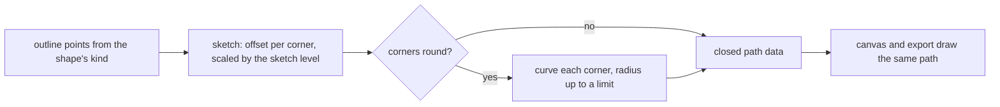

This change builds on the [stroke-and-fill change](../resource-whiteboard-stroke-and-fill/design.md), which adds the colour and width fields and the panel controls this one extends, so it lands after that change.

## Context

A shape's outline, a sticky note's box and an arrow's route are sketched by a fixed offset on each point. The offset is keyed on the element's id and the point's index, and its reach is a limit constant in the export. A shape's outline is a polygon of its corners, so every shape corner is sharp today. An ellipse is a sampled outline with no corner.

A freehand stroke is drawn unsketched on purpose: the export's comment says the hand that drew it is the look. It draws as a polyline through the points the pointer sampled, so a quick stroke has a visible corner at each sample. The features this change takes are the rough outline, sloppiness, edge roundness, freehand smoothing and the freehand tool's look. The rough-outline row and the sloppiness row describe one control, since the reference's architect level is the one that drops the sketch.

## How it works

A shape's outline comes from its kind. The sketch moves each of its corners by an offset keyed on the element and the corner's index, with the reach scaled by the element's sketch level. A shape with round corners then joins the sketched corners with curves. So the order is outline, sketch, round, and a round corner follows the sketch it is drawn on. A freehand stroke takes its own path: its stored points are joined by a smooth curve, and the same path data goes to the canvas and the export.



## Gap analysis

The shape-look features of the reference whiteboard, with the verdict this change gives each.

| Feature                                          | Verdict                                                                                                                                 |
| ------------------------------------------------ | --------------------------------------------------------------------------------------------------------------------------------------- |
| Rough hand-drawn outline                         | Built: the architect level draws the outline without its sketch, so the sketch level is the roughness control.                          |
| Sloppiness (architect, artist, cartoonist)       | Built on shape outlines, sticky note boxes and arrow routes. Artist is the sketch the outlines draw today.                              |
| Edge roundness (sharp or round, adaptive radius) | Built on shapes except the ellipse, which has no corner. Sharp is the default.                                                          |
| Freehand smoothing                               | Built on freehand strokes as one curve along the stored points, with no control.                                                        |
| Freehand (draw)                                  | Built as the tool's look, which is the smoothing above. Its width is in the stroke-and-fill change, and its pressure taper is deferred. |

## Decisions

- **Sloppiness is three levels, and artist is today's sketch.** Architect draws no offset, artist draws the offset the outlines draw today, and cartoonist draws a larger one. The level amplitudes sit in the export constants beside the offset limit they scale. Artist as the default keeps every stored outline's look. The alternative was a free amplitude number, which the owner would have to tune and the validator would have to bound. The reference's three levels are the vocabulary the owner knows.
- **One control covers both sketch rows.** The rough-outline row asks for an architect level that drops the sketch, and the sloppiness row asks for three levels. They are one field, since architect is the level that drops it. The alternative was a sketch switch beside a level, which would be two controls that disagree at architect.
- **A stored element reads each new field's default.** The sketch level is an enum whose default is artist, and the corner setting is an enum whose default is sharp, so a stored outline keeps the look it draws today. An enum takes no absent member, so the default is a value and not a missing key. The alternative was an optional field, whose absence would draw as no sketch and so change every stored outline.
- **The level applies to every sketched element: shapes, sticky notes and arrows.** These are the three the export sketches today. A freehand stroke is not sketched, since the hand that moved the pointer is its look, and text is not an outline. The alternative was the level on strokes too, which would sketch the one element the design keeps unsketched.
- **The sketch moves the corners before they are rounded.** The sketch offsets each polygon corner, and rounding then joins the sketched corners with curves. The alternative was rounding first, which would give each sampled point of every arc its own offset and make each rounded corner jitter.
- **A round corner's radius grows with the shape's size up to a limit.** The radius is a share of the shorter side, capped, so a small shape keeps its corners and a large one does not round to a pill. The alternative was one fixed radius, which rounds a small box too far or leaves a large one barely rounded. The share and the cap sit in the export constants.
- **Corners apply to shapes, not sticky notes.** The corner setting sits on the shape model, as the reference has it, and a sticky note is a card whose corners stay sharp. The alternative was the setting on sticky notes too, which no row asks for.
- **Every shape with corners takes the rounding, and the ellipse does not.** The rounding works on the polygon every other outline already is, so the rectangle, process, terminal, predefined process, input and output, annotation, diamond and decision all take it. The alternative was a rounding per kind, which would copy one routine into each shape.
- **Smoothing has no control and stores nothing new.** Every freehand stroke draws as a curve along its stored points, so the stored points stay as the pointer passed them. A stroke saved before the change draws smoothed with no rewrite. The alternative was smoothing the points when the stroke is drawn, which would change the stored document, and this change needs no model change.
- **Smoothing is our own path function.** The curve is a quadratic through the midpoints between stored points, written in the export's path code. The alternative was the stroke library the reference uses, a new third-party dependency, and the whiteboard takes no new third-party dependency ([the rejected third-party engine](../../rejected/resource/whiteboard-third-party-engine/design.md)).

## Rejected

- A double stroke per outline. The whiteboard design settles one sketch per outline, and the sketch levels carry the hand-drawn look.
- A smoothing toggle. No row asks for one, and the reference has none in its interface.

## Risks and trade-offs

- A freehand stroke already on a board draws softer on the next view, since it is now a curve along the same points. This is the look the change is for, and no stored point moves.
- A stroke with few points draws with few curves, so a short stroke stays close to a polyline. Accepted.
- A label is centred in its box, and a round corner removes only the corner's point, so text near a corner of a small shape at the cartoonist level can touch the curve. The owner can choose a larger shape or a smaller level.
- The canvas and the export must read the same path functions, or a sketch level or a corner would draw differently in each. Each new path function is one function both call.

## Sources

- [Excalidraw](https://excalidraw.com/): the reference for the three sketch levels, the architect level that draws no sketch, the rounded corners with a size-based radius, and the smoothed freehand line. The whiteboard takes the behaviour and none of its code or packages.

## Key files

Existing files this change touches, with the role each plays after it.

| File                                                                                 | Role after the change                                                                                     |
| :----------------------------------------------------------------------------------- | :-------------------------------------------------------------------------------------------------------- |
| `packages/vue-block-editor-headless/src/services/export/constants.ts`                | the sketch offset limit, the amplitude of each sketch level, and the corner radius share and cap          |
| `packages/vue-block-editor-headless/src/services/export/getSketchOffset.ts`          | the hand-drawn offset of one key, scaled by the element's sketch level                                    |
| `packages/vue-block-editor-headless/src/services/export/getSketchedPoints.ts`        | moves each outline point by its offset at the element's sketch level                                      |
| `packages/vue-block-editor-headless/src/services/export/toSketchedPathData.ts`       | the open sketched path of a route, drawn at the element's level                                           |
| `packages/vue-block-editor-headless/src/services/export/toClosedSketchedPathData.ts` | the closed outline of a shape or sticky note: sketched at its level, then rounded at its corners when set |
| `packages/vue-block-editor-headless/src/services/export/toPathData.ts`               | the polyline path of a sketched outline or route, no longer used for a freehand stroke                    |
| `packages/vue-block-editor-headless/src/services/export/toShapeSvg.ts`               | draws a shape's outline at its level and corners                                                          |
| `packages/vue-block-editor-headless/src/services/export/toArrowSvg.ts`               | draws an arrow's route at its level                                                                       |
| `packages/vue-block-editor-headless/src/services/export/toStickyNoteSvg.ts`          | draws a sticky note's box at its level                                                                    |
| `packages/vue-block-editor-headless/src/services/export/toStrokeSvg.ts`              | draws a freehand stroke through the smoothed path                                                         |
| `packages/vue-block-editor-headless/src/services/getShapeOutline.ts`                 | the corner points of each shape kind, which the rounding joins                                            |
| `packages/vue-block-editor-headless/src/models/ShapeElement.ts`                      | the corner setting, an enum with a default                                                                |
| `packages/vue-block-editor-headless/src/models/ArrowElement.ts`                      | the sketch level, an enum with a default                                                                  |
| `packages/vue-block-editor-headless/src/models/StickyNoteElement.ts`                 | the sketch level, an enum with a default                                                                  |
| `apps/web/app/components/Resource/Whiteboard/ElementShape.vue`                       | draws a shape's outline with the closed path at its level and corners                                     |
| `apps/web/app/components/Resource/Whiteboard/ElementArrow.vue`                       | draws an arrow's route at its level                                                                       |
| `apps/web/app/components/Resource/Whiteboard/ElementStickyNote.vue`                  | draws a sticky note's box at its level                                                                    |
| `apps/web/app/components/Resource/Whiteboard/ElementStroke.vue`                      | draws a freehand stroke through the smoothed path                                                         |
| `apps/web/app/components/Resource/Whiteboard/EditorPropertiesPanel.vue`              | composes the sketch and corner controls for one selected shape or sticky note                             |
| `apps/web/app/components/Resource/Whiteboard/EditorPropertiesArrowPanel.vue`         | composes the sketch control beside the arrow's route                                                      |

New files, in a tree:

```text
packages/vue-block-editor-headless/src/services/export/toSmoothedPathData.ts   a freehand stroke's curve along its stored points
packages/vue-block-editor-headless/src/services/export/toRoundedPathData.ts    a closed outline with each sketched corner curved by the radius
apps/web/app/components/Resource/Whiteboard/EditorPropertiesSketch.vue         the sketch level and corner controls of one element
```
