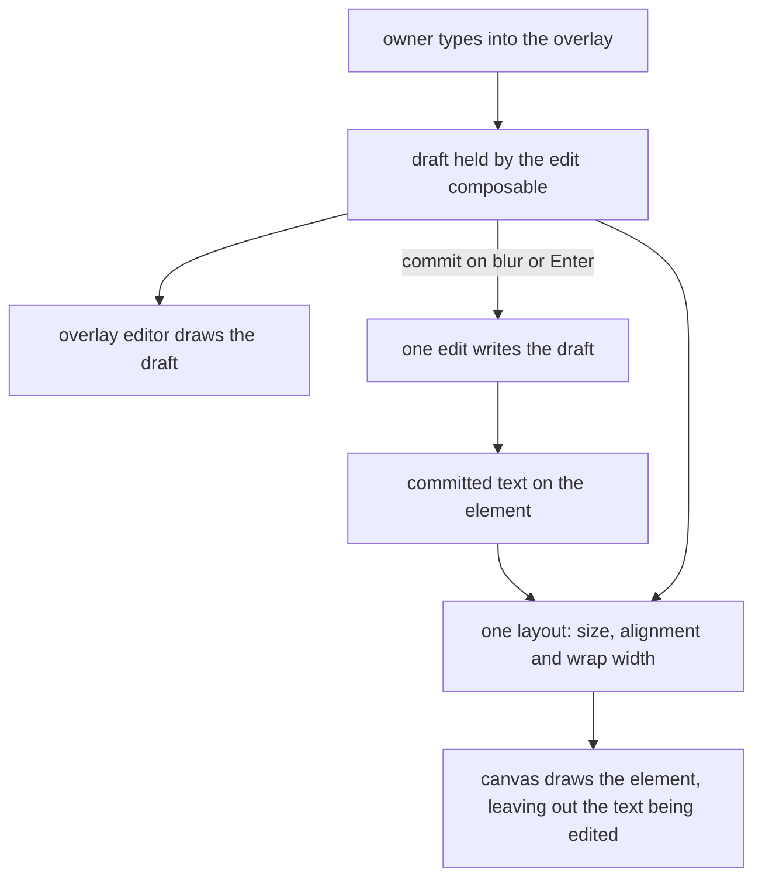

This change builds on the stroke-and-fill and shape-look changes, which have shipped into the [whiteboard design](../../specs/resource/whiteboard/design.md) and added the fields and the panel controls this one extends.

## Context

Every text on the whiteboard is drawn by one layout. The wrap estimate reads a character width that comes from the one size constant, the line step is a fixed constant, and the baseline sits a size below a corner or a third of a size below the middle of a centred block. The anchor is set by each element's kind in the placement function: a shape and a sticky note centre their text, a text box starts at its corner, and an arrow's label sits at its route's midpoint, wrapped at a fixed label width. A text box stores its width and no height, since its lines set its height. The canvas and the export both draw from these functions, so they break a text at the same words.

Text is edited in place. The draft lives in the edit composable and is written on commit, while the element keeps drawing its committed text until then. The overlay textarea shows the draft at the placement anchor, so when the owner commits, the element's lines move to the committed text's layout.

The features this change takes are the text tool, the text preview while typing, font size, text alignment, text wrapping and the auto-resizing text box. Font families are a separate deferred row, since they need bundled font files and a width measure the estimate can read.

## How it works

The draft and the committed text feed one layout. While an element is edited, the layout reads the draft, and at other times it reads the committed text. The same size, alignment and wrap width apply to both, so the overlay draws the draft where the committed text will sit. Commit writes the same text through one edit, so the text is drawn in the same place before and after it.



## Gap analysis

The text features of the reference whiteboard, with the verdict this change gives each.

| Feature                               | Verdict                                                                                                                                           |
| ------------------------------------- | ------------------------------------------------------------------------------------------------------------------------------------------------- |
| Text tool                             | Built through the controls below: the placed text box takes the size, alignment and auto width its element offers. Its placed width is unchanged. |
| Text preview while typing             | Built: the element draws the draft in its layout while it is edited, and draws its committed text again on Escape.                                |
| Font size (S 16, M 20, L 28, XL 36)   | Built as four steps on the text of a shape, a sticky note, a text box and an arrow's label. The smallest is the size text draws at today.         |
| Text alignment and vertical alignment | Built for a shape, a sticky note and a text box. An arrow's label stays centred at its midpoint.                                                  |
| Text wrapping                         | Built as an unwrapped mode on a text box. A shape's and a sticky note's text keeps wrapping at the element's width.                               |
| Auto-resizing text box                | Built as the unwrapped mode with the box sized to its widest line, so it is the same flag as the text wrapping row.                               |

## Decisions

- **Four sizes, and the smallest is today's size.** The sizes are the reference's four steps. The smallest is the size text draws at today, so no stored text changes size. The alternative was the reference's second step as the default, which would make every existing label a quarter larger than the box it was sized for.
- **Line step and character width follow the size.** The wrap estimate and the line step are scaled from the size, so a larger text wraps to its box by the rule the export uses. The alternative was a larger font drawn with the estimate for the smallest size, which would wrap a large text as if it were small and run its lines past the box.
- **A stored element reads each new field's default.** The size is an enum whose default is the smallest step, and the wrap is a flag whose default is wrapped, so a stored text draws as it does today. An enum takes no absent member, so the default is a value. Alignment is the one field whose absence means the kind's own alignment, which no value names, so it is an optional property, as the absent-values rule keeps for that case.
- **Size applies to every text, and alignment does not reach an arrow's label.** A label's size changes its lines but not its place. Alignment would move the label off the midpoint it is placed at. The alternative was alignment on labels, which moves each label away from its anchor.
- **Vertical alignment applies to shapes and sticky notes.** A text box's height follows its lines, so there is no box to align within. The alternative was vertical alignment on text boxes, which would have nothing to align within.
- **An absent alignment is the kind's own alignment.** A shape's and a sticky note's text is centred, and a text box's text starts at its corner, as the placement already does, so no stored text moves. The alternative was a stored left default for every kind, which would move every existing label off centre.
- **Auto width is the unwrapped flag, and it applies to text boxes only.** Auto width is the unwrapped mode with the box sized to its text, so one flag does both. A width handle dragged on an auto-width text box sets the box back to a wrapped width at the dragged width, since a box the owner sizes by hand is a wrapped one; a height handle leaves the flag alone. A text in a shape or a sticky note stays wrapped, since an unwrapped line would run out of its outline. The alternative was the flag on shapes, which would need the shape's own width to follow its text and so resize the shape.
- **Auto width is measured by the estimate that wraps.** The widest line's width comes from the same estimate that wraps, so the box and its lines agree on the canvas and in the export. The alternative was measuring the rendered text in the browser, which the export cannot read, so the box and the export would fall out of step. The whiteboard design already settles the estimate.
- **The draft is laid out as the committed text is, in the overlay.** The canvas keeps hiding an element's committed text while it is edited, as it did before this change, so the draft is drawn by the overlay editor and not by the element. The overlay takes the placement the draft has as its own text: its size, alignment and wrap, and for an auto width text box the width of the draft's widest line, which is the width the commit stores. So the committed text is drawn where the draft was, and committing does not move it. The alternative was drawing the draft inside the element, which would draw the text twice while it is edited unless that hiding were undone, and the hiding is settled. The overlay remains the input.
- **The export draws committed text only.** The export is drawn from the saved document, and a draft is not saved until commit, so an export never holds a draft. This follows the whiteboard design's decision that the export is drawn from the model.

## Rejected

- Font families in this change. They need bundled font files and a width measure, which the estimate does not give, so they wait as their own deferred row.
- A stored height for a text box. A text box's height still follows its lines, as now.
- Auto width on shapes and sticky notes. See the decision on the flag.

## Risks and trade-offs

- A larger size wraps onto more lines, so the text of a shape can outgrow its box at the largest size. The owner can choose a larger shape or a smaller size.
- The estimate may draw a line wider or narrower than its box, as the whiteboard design already records. Auto width trusts the estimate, so a box can sit a little wider or narrower than its text in a browser. This is accepted for the same reason the wrap estimate is.
- The line step changes with the size. A label at the smallest size keeps the step it has today.
- Auto width writes the box width on commit, and the draft drives it while typing. Each commit is one edit, so an undo reverts the text and its width together.

## Sources

- [Excalidraw](https://excalidraw.com/): the reference for the four text sizes, the text alignment controls, the wrap toggle and the auto-resizing text box. The whiteboard takes the behaviour and none of its code or packages.

## Key files

Existing files this change touches, with the role each plays after it.

| File                                                                         | Role after the change                                                                                                             |
| :--------------------------------------------------------------------------- | :-------------------------------------------------------------------------------------------------------------------------------- |
| `packages/vue-block-editor-headless/src/services/export/constants.ts`        | the one size constant becomes the four steps, with the line step and the character width scaled from the size                     |
| `packages/vue-block-editor-headless/src/services/export/getTextPlacement.ts` | the anchor and the box of a text, by its element's alignment and kind                                                             |
| `packages/vue-block-editor-headless/src/services/export/getTextLayout.ts`    | the baseline and line steps of a text at its size and alignment                                                                   |
| `packages/vue-block-editor-headless/src/services/export/getWrappedLines.ts`  | wraps a text at its element's width, or leaves it whole in auto width                                                             |
| `packages/vue-block-editor-headless/src/services/export/wrapParagraph.ts`    | the wrap rule, which takes the size's character width                                                                             |
| `packages/vue-block-editor-headless/src/services/export/getTextWidth.ts`     | the width estimate of a line at a size, which auto width reads                                                                    |
| `packages/vue-block-editor-headless/src/services/export/toTextSvg.ts`        | writes a text at its size, alignment and colour                                                                                   |
| `packages/vue-block-editor-headless/src/services/export/toElementTextSvg.ts` | the text of one element at its own size and alignment                                                                             |
| `packages/vue-block-editor-headless/src/models/TextElement.ts`               | the text box's optional size, alignment and wrap setting                                                                          |
| `packages/vue-block-editor-headless/src/models/ShapeElement.ts`              | the shape's optional size, horizontal and vertical alignment                                                                      |
| `packages/vue-block-editor-headless/src/models/StickyNoteElement.ts`         | the sticky note's optional size, horizontal and vertical alignment                                                                |
| `packages/vue-block-editor-headless/src/models/ArrowElement.ts`              | the arrow's optional label size                                                                                                   |
| `apps/web/shared/models/resource/whiteboard/WhiteboardElement.ts`            | the element schema an agent reads, which describes each new field                                                                 |
| `apps/web/app/components/Resource/Whiteboard/Label.vue`                      | draws a text at its element's size, alignment and colour, and leaves it out while it is edited, since the overlay holds the draft |
| `apps/web/app/components/Resource/Whiteboard/EditorTextEdit.vue`             | places the overlay at the text's anchor for its alignment                                                                         |
| `apps/web/app/composables/whiteboard/useWhiteboardTextEdit.ts`               | unchanged: the draft stays in the composable, and the overlay draws it                                                            |
| `apps/web/app/services/whiteboard/text/getTextEditOperations.ts`             | the commit writes the draft as one edit, and the core sets an unwrapped text box's width in that same edit                        |
| `apps/web/app/components/Resource/Whiteboard/EditorPropertiesPanel.vue`      | composes the text controls for one selected shape, sticky note or text box                                                        |
| `apps/web/app/components/Resource/Whiteboard/EditorPropertiesArrowPanel.vue` | composes the size control for an arrow's label                                                                                    |

New files, in a tree:

```text
apps/web/app/components/Resource/Whiteboard/EditorPropertiesText.vue   the size, alignment and wrap controls of one element
packages/vue-block-editor-headless/src/models/TextSize.ts                          the four sizes a text draws at
packages/vue-block-editor-headless/src/models/HorizontalAlignment.ts               the horizontal alignment a text sets
packages/vue-block-editor-headless/src/models/VerticalAlignment.ts                 the vertical alignment a text sets
packages/vue-block-editor-headless/src/services/getHorizontalAlignment.ts          the alignment a text draws at, its kind's own until one is set
packages/vue-block-editor-headless/src/services/getVerticalAlignment.ts            the vertical alignment a shape's or sticky note's text draws at
packages/vue-block-editor-headless/src/services/export/getAutoTextWidth.ts         the width an unwrapped text takes
packages/vue-block-editor-headless/src/services/export/getTextLineHeight.ts        the step from one line of a text to the next
apps/web/app/services/whiteboard/text/getDraftPlacement.ts                         the placement a draft is drawn at while it is edited
apps/web/app/services/whiteboard/text/constants.ts                                 the text choices the panel offers and the overlay's anchor maps
```
