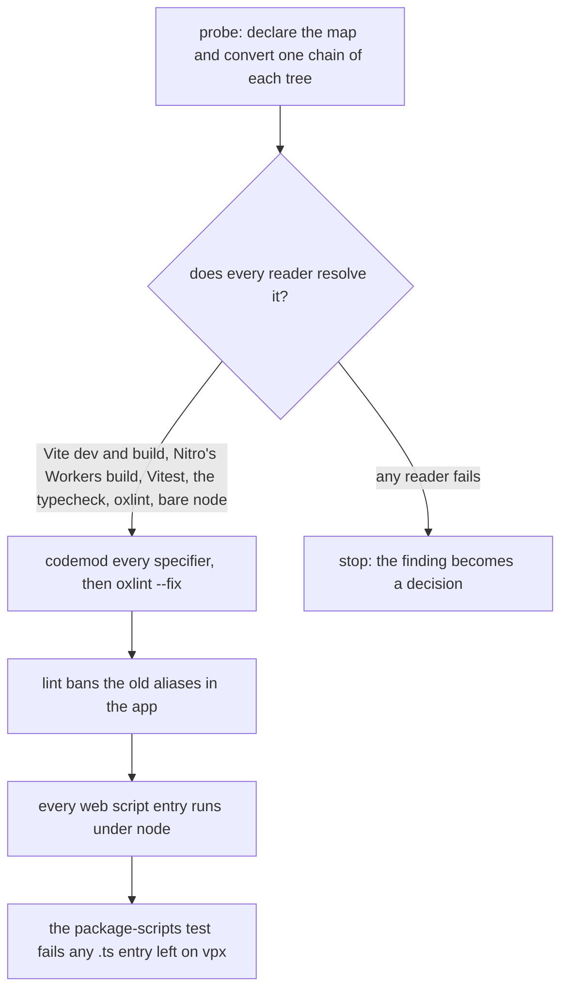

# One way to address a package's own source — design

## Context

A package's own files are reached two ways. Every package under `packages/*`, the repo-root `scripts` and the repo root's own folders declare subpath imports in their manifest (`"#src/*": "./src/*.ts"`), and the lint bans anything else there (the file-organization skill, `references/import-aliases.md`). The web app instead imports through the aliases Nuxt generates into its four tsconfigs and its Vite and Nitro configs: `@/` for `app/`, `@@/` for the app's root, and Nuxt's own `#shared/` and `#server/`. Nuxt reads those aliases and Node does not, so a script under `apps/web/scripts` that reaches app code cannot run under `node`, and runs under `vpx --tsconfig tsconfig.root.json` instead. That is the last reason the repository runs a script under `vpx` once the value-sets change has removed every `enum` (`openspec/specs/architecture/value-sets/design.md`).

## Goals

- One way for any package to address its own source: the subpath imports its manifest declares.
- Every `.ts` script runs under `node`.
- Nuxt's aliases and the manifest never disagree about where a name points.

## Decisions

### The web app declares its trees in its manifest

```json
"imports": {
  "#configuration/*": "./configuration/*.ts",
  "#package.json": "./package.json",
  "#scripts/*": "./scripts/*.ts",
  "#server/*": "./server/*.ts",
  "#shared/*": "./shared/*.ts",
  "#src/*.vue": "./app/*.vue",
  "#src/*.png": "./app/*.png",
  "#src/*": "./app/*.ts",
  "#uno.config": "./uno.config.ts"
}
```

`#src` is the name every package already gives its source, so the app's `app/` folder takes it. A file that is not TypeScript is imported with its extension, so each extension the app imports (`.vue`, `.json`, and each asset kind: images, audio, stylesheets, raw sources) has its own pattern, as `genshin-world`'s manifest declares `#src/*.json` and `#src/*.vue`; Node, TypeScript and Vite all pick the longest matching key. The listing above shows the shape; the manifest holds one `#src/*.<ext>` entry per extension the app imports or globs. A specifier names its file: a folder's index is written `#src/store/achievement/index`, as every package writes it, since a subpath import never resolves a folder. A Vite glob reads through the same names (`import.meta.glob("#src/…")`), as `genshin-world`'s do. `#shared` and `#server` keep the names Nuxt already gives those folders, and point at the same folders. A root file a module imports (the UnoCSS configuration, the manifest itself) takes a named entry of its own. A Nuxt option Nuxt resolves from its own package, the `css` entries, cannot see the manifest and names the app's sheets through Nuxt's `@/` alias; it is a configuration value, not an import.

**Rejected — `#app/*` for the app's source:** Nuxt owns `#app`, which resolves to its own runtime (`nuxt/app`); declaring it would shadow Nuxt's import in the app and break every module reaching Nuxt's runtime through it. **Rejected — keeping `@/` and `@@/` and the `vpx` runner:** two ways of addressing source, and a second runner kept only because Node cannot read one of them. **Rejected — tsconfig `paths` alone:** Node ignores them, which is the problem.

### Nuxt's aliases and the manifest agree, and a test holds them to it

Nuxt keeps generating `#shared` and `#server` as aliases, and Vite and Nitro read Nuxt's alias before a manifest's map. Both point at the same folder, and a test in `apps/web/configuration` resolves each name both ways and fails if they diverge. Nuxt also resolves a folder to its index where a subpath import does not, which is why every specifier names its file: then the two resolve every specifier alike, not only every folder. That covers the one way a later Nuxt default could split them. Nuxt still generates `@/` and `@@/` for its own modules; nothing in the app imports through them, because the lint refuses them and `~/`, `~~/` (`WEB_IMPORT_PATTERNS` in `oxlint/importRestrictions.ts`). `shared/`'s boundary ban names `#src/`.

### A `#` name takes no query; a query is a glob option

A subpath import substitutes the whole specifier into its pattern, query included, so `#src/a.html?raw` names `./app/a.html?raw.ts`, which the production build failed on. An image is imported plainly, its default export the URL (a glTF model through `assetsInclude`), and a `?raw`, `?url` or `?worker` read passes the query as an `import.meta.glob` option, which Vite resolves through `#src` in the build, the dev server and Vitest. A package specifier keeps its query (`genshin-world/terrainTileWorker?worker`), since a package export does not substitute it. The lint refuses a query on a `#` name in every tree. **Rejected — Nuxt aliases generated from the manifest:** two resolvers to keep in step. **Rejected — keeping `@/` for queried imports:** two ways of addressing source.

### The conversion is one codemod commit, and the probe comes first

The rewrite is a specifier substitution (`"@/` to `"#src/`, `"@@/scripts/` to `"#scripts/`, `"@@/configuration/` to `"#configuration/`, and the root files to their names), applied to imports, `vi.mock` paths, dynamic imports and Vite globs alike, with `/index` appended wherever a specifier names a folder (in `#server/` too) and a pattern added to the manifest for each extension it meets. The flow map's own table of source aliases (`apps/web/scripts/flowMap/constants.ts`) is keyed by the new names in the same commit. It lands in one commit with the import order perfectionist's fix writes for `sort-imports` alone, since `/index` moves a specifier within its block. The probe ran as the conversion's own verification: the production build emits every asset the baseline did, the typecheck, the suite and both linters pass, and every script starts under `node`.



### Every script runs under `node`, and the test says so

With no `enum` and no alias left, the web app's script entries become `node scripts/…/index.ts`, and `scripts/src/workspace/packageScripts.test.ts` fails any script entry that runs a `.ts` file under `vpx`. Its stripping walk follows only `#src/` imports today, and it skips a specifier whose file it cannot find, so it cannot yet judge the web app's `#scripts/`, `#shared/`, `#server/` and `#configuration/` imports or its `#src/` tree at `app/`. Extending the walk to follow every `imports` entry the entry's own package declares, and failing an unresolved one instead of skipping it, is part of task 3.1, since the app declares those entries in task 1.1. The package-scripts skill's rule becomes one line: a `.ts` script runs under `node`. **Rejected — removing the `vpx` binary:** it is vite-plus's runner, and vite-plus stays for tests, lint and builds; only its use as a script runner ends.

## Key files

| Path                                                              | Role                                                             |
| :---------------------------------------------------------------- | :--------------------------------------------------------------- |
| `apps/web/package.json`                                           | the web app's subpath imports and its script entries             |
| `apps/web/configuration/typescript.ts`                            | the Nuxt TypeScript options beside which the alias test sits     |
| `oxlint/importRestrictions.ts`                                    | `WEB_IMPORT_PATTERNS`: the old aliases and a query on a `#` name |
| `apps/web/configuration/imports.test.ts`                          | Nuxt's `#shared` and `#server` and the manifest reach one folder |
| `scripts/src/workspace/packageScripts.test.ts`                    | strips each `node` entry's modules; fails a `.ts` entry on `vpx` |
| `.agents/skills/file-organization/references/import-aliases.md`   | the alias map, rewritten for one way                             |
| `.agents/skills/package-scripts/references/typescript-scripts.md` | the runner rule, reduced to `node`                               |
