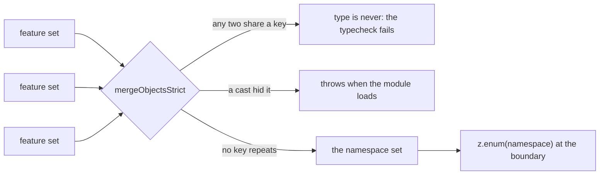

# One value set — design

## Context

The repository declares several hundred closed sets of named values: element kinds, permission bits, message types, achievement names, scene and texture keys. The proposal's Why gives the two forms and the merge's defect. The decisions below settle the one form, how a member is typed, and the merge's check. Nothing has collided yet, and nothing would say so if it did.

## Goals

- One declaration form for every set, in every package, loadable by every runtime the repository uses.
- The compiler, not a list, keeps the other form out.
- One merge, which refuses a collision in its type and at load.

## Decisions

### A set is an `as const` object with a type of the same name

```ts
export const ThemeMode = { Dark: "dark", Light: "light", System: "system" } as const;
export type ThemeMode = (typeof ThemeMode)[keyof typeof ThemeMode];
```

Call sites read exactly as an enum's (`ThemeMode.Dark`), `Object.values(ThemeMode)` is typed `ThemeMode[]`, and Zod reads the object directly (`z.enum(ThemeMode) satisfies z.ZodType<ThemeMode>`). It is plain JavaScript with types on top, so every runtime loads it, and it is the form the TypeScript handbook recommends for keeping code aligned with JavaScript. A numeric set (a permission bitfield) is the same object with number values. The rules that already govern a set stay as the typescript skill states them: members are PascalCase with the outside spelling kept in the value, a values array is exported only when something reads it, and a `Set` only when something asks `.has`.

**Rejected — keep `enum`, with the exception list:** two forms of one idea, the list goes stale whenever a graph changes what it loads, and an `enum` reaching a stripped graph fails only when that graph runs. **Rejected — a string-literal union with an `as const` array as the source:** there is no member to name, so every call site spells the literal and a rename is a search. **Rejected — the Zod schema as the source (`z.enum([...])`):** every module reading a set would load Zod, the plugins' bare-`node` graphs and the client's hot paths among them. **Rejected — a helper function that declares a set:** the two lines are the language's own idiom, and a helper would add a name to learn and nothing to check.

### A member used as a type is `typeof` the member

A discriminant reads `type: typeof SurveyNodeType.Text`. **Rejected — a type-only namespace beside each set, so `SurveyNodeType.Text` stays a type:** a type-only namespace is erasable, but it is a third declaration per set restating every member, which is the duplication this change removes.

### A plain literal assigns to a set

An `enum` is nominal: `"dark"` does not assign to `ThemeMode`. An `as const` object's type is the union of its values, so it does. This is accepted. The runtime value is identical, a rename of a value still fails every literal that spelled the old one, and `literal-union/no-string-literal-union` still keeps an inline union out of annotations. **Rejected — a type-aware rule requiring the member at every site:** there is no failure it would catch.

### `erasableSyntaxOnly` is the enforcer

The shared base (`packages/configuration/tsconfig.base.json`) and the web app's Nuxt TypeScript options (`apps/web/configuration/typescript.ts`) both turn on `erasableSyntaxOnly`. Nuxt generates four standalone tsconfigs and none extends the base, so the base alone would leave the app unchecked; `tsConfig.compilerOptions` reaches all four, and `apps/web/configuration/typescript.test.ts` holds the option there as it holds the other restated ones. The compiler refuses an `enum`, a namespace with runtime code, a parameter property and an `import =`. Nothing in the repository uses the other three today: every namespace is a type-only augmentation in a declaration file. The compiler sits first on the enforcement ladder (`openspec/specs/architecture/enforcement-ladder/design.md`), so no lint rule or list is written for it. With no form left that a stripped graph cannot load, nothing exists to keep an `enum` away from one: the typescript skill holds no list of `as const` exceptions, an import alias is the one thing that moves a script to `vpx`, the persona plugin's copy of `genshin-text` is the source with only its alias re-aimed, and `ExportsGeneration`, which tsdown loads through stripping, is a value set like any other.

A set's key is named by the same lint rule an `enum` member was: `no-restricted-syntax` refuses a lowercase, underscored or all-capitals key on an exported PascalCase `as const` object whose values are literals (`packages/configuration/eslint/typescriptRules.js`). The map rule reads `value-set-map/no-literal-map-key`.

### The merge refuses a collision, at every pair and at load

`mergeObjectsStrict` stays the one way to combine sets, since its callers merge sets a feature owns into the namespace they share and an exhaustive `switch` over one feature's subset still needs that subset as its own set. Its type compares every set with every other, so a key shared by any two makes the result `never`. Its runtime walks the keys once and throws an `InvalidOperationError` naming the repeated key, so a collision the type cannot see (a set built from a cast) fails when its module loads, in every test that imports it. The same merge serves maps keyed by a set's members (the clicker's upgrade map), which have the same hazard.

**Rejected — object spread (`{ ...A, ...B } as const`):** the later key silently wins, the defect this change fixes. **Rejected — declaring the whole namespace once and its subsets as arrays of its members:** the namespace would sit apart from the features owning its members, and every feature adding a member would edit one shared file.



### A set mirroring outside data is generated, not merged

The dungeons' texture and sound keys are merges of a dozen hand-written sets restating the names of files in a bucket. Where a set mirrors data the repository does not author, the generator that reads the data writes the one set: `FileKey` from the dungeons bucket's listing, the Tiled property types from the Tiled project. The generators write the `as const` form (`createValueSetString`). The dungeons' asset merges go when the `migrate-assets` branch lands.

## Migration

The conversion is mechanical, so it is one throwaway codemod run per package, never a hand sweep: each `enum` becomes its object and type, each member in a type position becomes `typeof` the member, and the generators are re-run. Everything else an `enum` does carries over: `z.enum`, `Record<X, …>`, mapped types over a set, a Drizzle column built from a set's values, a member as an interface's computed key, and serialized values. One use needs a hand edit, made in its own commit before the codemod: a numeric set read back from a number to its member name (the Lua opcode names), which takes a map written beside the set. An unfiltered `Object.values` over a numeric set changes for the better, since its result today also holds the reverse mapping's name strings. A package is converted whole in one commit, and the base and the Nuxt options turn `erasableSyntaxOnly` on in the commit converting the last, so no package holds both forms. Every `scripts` entry runs under `node`: `scripts/src/workspace/packageScripts.test.ts` strips every module a `node` entry reaches with Node's own stripper. The web app's scripts stay on `vpx` for the Nuxt aliases they reach.

## Sources

- TypeScript handbook, [Enums — Objects vs Enums](https://www.typescriptlang.org/docs/handbook/enums.html): the `as const` object keeps a codebase aligned with JavaScript.
- TypeScript 5.8 release notes, [The `--erasableSyntaxOnly` Option](https://www.typescriptlang.org/docs/handbook/release-notes/typescript-5-8.html): refuses `enum`, namespaces with runtime code, parameter properties and `import =`, so a file can be stripped to JavaScript.
- Node.js, [Modules: TypeScript — Type stripping](https://nodejs.org/api/typescript.html): an `enum` declaration needs transformation and errors under stripping, and the transform flag is removed.
- Zod, [Enums](https://zod.dev/api#enums): `z.enum` accepts an enum-like object literal.

## Key files

| Path                                                         | Role                                                                     |
| :----------------------------------------------------------- | :----------------------------------------------------------------------- |
| `packages/configuration/tsconfig.base.json`                  | the base every package tsconfig extends; `erasableSyntaxOnly`            |
| `apps/web/configuration/typescript.ts`                       | the Nuxt options reaching the app's four tsconfigs; the same flag        |
| `scripts/src/services/genshinText/getPersonaModuleSource.ts` | the persona copy: the source, its alias re-aimed                         |
| `scripts/src/workspace/packageScripts.test.ts`               | strips every module a `node` script reaches, proving each move off `vpx` |
| `packages/shared/src/util/object/mergeObjectsStrict.ts`      | the one merge, throwing on a repeated key                                |
| `packages/shared/src/util/types/MergeObjectsStrict.ts`       | its type, comparing every pair                                           |
| `apps/web/scripts/util/createValueSetString.ts`              | the set generator                                                        |
| `packages/configuration/eslint/typescriptRules.js`           | the member-naming selector, on the object's keys                         |
| `scripts/src/oxlint/valueSetMap.ts`                          | a constant map keyed by a set's members                                  |
| `scripts/src/oxlint/literalUnion.ts`                         | the literal-union rule, whose message names the new form                 |
| `.agents/skills/typescript/references/value-sets.md`         | the set conventions                                                      |
