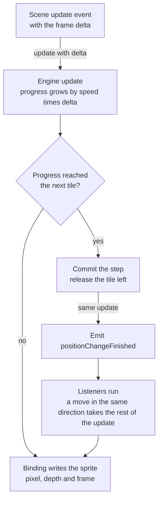

# grid-engine-headless

A headless grid movement package of ours replaces grid-engine: tile collision, characters on integer tiles that step in four directions, five typed events, and no Phaser, rxjs or other runtime dependency. A thin binding in the dungeon world draws it on Phaser's sprites, and the swap moves the world's call sites onto it in one commit.

## Scope

Today the dungeon world attaches grid-engine as a Phaser scene plugin. Its characters, NPC patrols, the player's steps and the encounter and interaction checks all go through that plugin, and the app's shared code mirrors its direction enum because importing the plugin's root loads Phaser.

This change adds the design and the build checklist. It adds no code, no package and no catalog or lockfile change. The build is the checklist in `tasks.md`, and it begins only after this design is accepted.

## How it works

The package holds the grid: which tiles block, where each character stands, which way it faces, and how far through its current step it is. It has no notion of pixels. The app's binding owns the Phaser objects. Each frame the scene's update event hands the frame's delta to the engine, and the engine's order of work is what makes a listener's call land where it should.



The commit and its event come before the sprite is written, so a listener sees the character on its new tile. A step starts only from a `move` call, and the distance a step passes its end waits for the next move in its direction (the rule is in Decisions), so a listener that asks for nothing stops the character on its tile, the stop the upstream tracker's #528 reports as missed.

## Key files

| File                                                                               | Role after the change                                                                                                 |
| ---------------------------------------------------------------------------------- | --------------------------------------------------------------------------------------------------------------------- |
| `apps/web/app/services/dungeons/tilemap/createTilemapAssets.ts`                    | Reads the collision grid from the tilemap and makes the world's engine, replacing the plugin's create call            |
| `apps/web/app/store/dungeons/world/scene.ts`                                       | Holds the world's engine next to the tilemap it was made for, marked raw                                              |
| `apps/web/app/pages/dungeons.vue`                                                  | Stops registering grid-engine as a scene plugin                                                                       |
| `apps/web/app/types/vue-phaserjs.d.ts`                                             | Stops augmenting the scene's plugins with grid-engine's type                                                          |
| `apps/web/app/components/Dungeons/World/Character/Index.vue`                       | Attaches each character's sprite through the binding and subscribes to the five events, releasing them on teardown    |
| `apps/web/app/components/Dungeons/World/Character/Player.vue`                      | Teleports the player through the engine's position call, and reads the events the character already listens to        |
| `apps/web/app/components/Dungeons/World/Character/Npc.vue`                         | Types its direction and its movement from the core instead of grid-engine                                             |
| `apps/web/app/components/Dungeons/World/Map/Foreground.vue`                        | Unchanged in code; its depth rule holds because the binding keeps the player sprite's depth the way the plugin set it |
| `apps/web/app/models/resolvers/dungeons/world/MovementInteractionInputResolver.ts` | Moves the player through the core and checks whether the player is registered                                         |
| `apps/web/app/services/dungeons/scene/world/moveNpcs.ts`                           | Moves each patrolling NPC through the core and reads whether the next tile is blocked                                 |
| `apps/web/app/services/dungeons/scene/world/interaction/interactWithNpc.ts`        | Turns the NPC towards the player through the core                                                                     |
| `apps/web/app/services/dungeons/scene/world/constants.ts`                          | Types the walking animation mappings with the core's frame types                                                      |
| `apps/web/app/models/dungeons/scene/world/Character.ts`                            | Types a character's walking mapping and single-sided direction with the core's types                                  |
| `apps/web/app/services/dungeons/scene/world/readNpcs.ts`                           | Types its positions and directions with the core's types                                                              |
| `apps/web/app/store/dungeons/world/player.ts`                                      | Checks the respawn direction against the core's direction values instead of the engine's enum                         |
| `apps/web/app/services/dungeons/UI/input/checkIsMovingDirection.ts`                | Reads the core's direction values, with the no-direction value excluded as now                                        |
| `apps/web/app/models/dungeons/tilemap/TileProperty.ts`                             | Keeps the collision property name the binding reads from the tiles                                                    |
| `apps/web/shared/test/setup.ts`                                                    | Loses the module mock of grid-engine, which existed only because importing it loads Phaser                            |
| `pnpm-workspace.yaml`                                                              | Loses the grid-engine catalog entry in the swap commit                                                                |
| `apps/web/package.json`                                                            | Depends on the new package instead of the catalog entry                                                               |
| `.agents/ledgers/dependencies.md`                                                  | Loses the grid-engine row in the swap commit, the catalog's own verdict record                                        |
| `.agents/ledgers/naming/dungeons.md`                                               | Its row for the `gridEngine` folder is swept with that folder's deletion                                              |
| `.agents/skills/naming/references/value-set-members.md`                            | Its example of a mirror of the engine's direction is rewritten, since the mirror is gone                              |
| `openspec/specs/dungeons/world/design.md`                                          | Its movement paragraph is rewritten as built at the swap                                                              |
| `openspec/specs/dungeons/scenes-and-input/design.md`                               | Its note that the plugin is registered on the dungeon page is rewritten as built at the swap                          |
| `openspec/rejected/dungeons/diagonal-movement/design.md`                           | Its note that the engine runs four-directional is reworded to the core, and the decision it records stands            |
| `openspec/specs/architecture/dependency-admission/design.md`                       | Gains the package in its precedent section once the swap lands                                                        |

The package and the binding are new paths, so they are not listed here. Their layout is in "Layout" below. The swap deletes the two position-change models, the two direction maps and the shared direction mirror, so they are not listed either: the core's event payloads, its `Direction` and the app's shared imports replace them.

## Survey: the calls the app makes

The engine's instance is called from a handful of files of the web app, its types are imported across several dozen more, and no package in the repository calls it. The table is every grid-engine member the app reaches, with where it is reached.

| grid-engine member                                                                                                                 | Reached from                                         | Replacement                                                                                                                    |
| ---------------------------------------------------------------------------------------------------------------------------------- | ---------------------------------------------------- | ------------------------------------------------------------------------------------------------------------------------------ |
| `create` with `characters`, `collisionTilePropertyName`, `numberOfDirections`                                                      | `createTilemapAssets.ts`                             | A collision grid read by the binding, and the core's create. Four directions are the only mode, so the direction count is gone |
| `addCharacter` with `id`, `sprite`, `walkingAnimationMapping`, `startPosition`, `facingDirection`, `speed`                         | `Character/Index.vue`                                | The binding attaches the sprite and its frames, and the core takes the id, start, facing and speed                             |
| `hasCharacter`                                                                                                                     | `MovementInteractionInputResolver.ts`, `moveNpcs.ts` | The same name, a plain boolean                                                                                                 |
| `move`                                                                                                                             | `MovementInteractionInputResolver.ts`, `moveNpcs.ts` | The same name, a result, failing for an unknown character or a diagonal                                                        |
| `turnTowards`                                                                                                                      | `interactWithNpc.ts`                                 | The same name, a result                                                                                                        |
| `isBlocked` with a position                                                                                                        | `moveNpcs.ts`                                        | The same name, with the layer and group arguments gone                                                                         |
| `setPosition`                                                                                                                      | `Player.vue`                                         | The same name, a result, failing for an unknown character                                                                      |
| `getFacingDirection`                                                                                                               | `Character/Index.vue`, twice                         | Gone: the position events carry the direction, so no listener reads the engine back                                            |
| `movementStarted`, `movementStopped`, `directionChanged`, `positionChangeStarted`, `positionChangeFinished`                        | `Character/Index.vue`                                | Five typed events, each subscribed through the engine's on method, which returns its unsubscribe                               |
| The scene plugin registration                                                                                                      | `pages/dungeons.vue`, `types/vue-phaserjs.d.ts`      | Gone: the engine is held by the world's store                                                                                  |
| The `Direction`, `Position`, `FrameRow`, `WalkingAnimationMapping` and `NumberOfDirections` types, and the direction enum's values | several dozen files                                  | The core's own types, with one direction vocabulary                                                                            |

The app never calls the following, so the package leaves them out: `moveTo`, `moveRandomly`, `follow`, `stopMovement`, `findShortestPath` and the other pathfinding members, the queued-movement members, `getMovement`, `getMovementProgress`, `getPosition`, `getState` and `setState`, the speed getter and setter, `getTilePosInDirection` and `getTileCost`, labels, collision groups, `collidesWithTiles`, `ignoreMissingTiles`, character layers and their transitions, containers and sprite setters, offsets and the depth offset set through configuration, the walking mapping setter and getter, `characterShifted`, `steppedOn`, `removeCharacter`, `removeAllCharacters`, `getAllCharacters`, `getCharactersAt`, `rebuildTileCollisionCache` and the tile collision cache, `layerOverlay` and `tiledProject`.

## What grid-engine does that the app depends on

grid-engine's source is not in the installed package, which ships minified bundles and declaration files. The behaviour below is read from those declarations, the upstream tracker and the bundle's property names, and the build's first task pins each item with a characterization against the installed package before any of it is written.

- **Movement.** A character advances by its speed in tiles per second against the scene's update delta, and its default speed is four tiles per second. A step's progress is a value from zero to a thousand on the way to the next tile. An update that carries a step past that value drops the excess, and the next step starts from zero on the following update, so the time a run takes depends on the update's delta: one update of a second commits one tile where four updates of a quarter second commit four. The #419 pin does not catch this, since its splits all divide a step evenly. The core carries the excess into the next step as Decisions records.
- **Collision.** A tile blocks when the collision property the config names is set on a tile of any layer at that position. A position with no tile on any layer blocks too, which is the documented default. Characters block each other by default, and a moving character also blocks the tile it has left until it has left it.
- **Facing.** A character faces the direction of its last step or turn. A move into a blocked tile turns the character without moving it. A move while the character is already moving is ignored.
- **Events.** `positionChangeStarted` fires when a step starts and `positionChangeFinished` when it is committed. `movementStarted` and `movementStopped` bracket a run of steps. `directionChanged` fires on a facing change that is not part of a step, once per change.
- **Teleport.** `setPosition` places the character at once, stops any movement, and emits the position events, as documented.
- **Sprite placement.** A sprite sits on its tile horizontally centred, which is half the tile width less half the sprite's displayed width, and bottom aligned, which is the tile height less the sprite's displayed height. The custom offsets are added to that.
- **Depth.** Each tile layer gets a depth from zero upward in the order the tilemap lists them, and a character's depth is the count of tile layers less one, plus its bottom edge in whole pixels, padded to seven digits and so below one. The installed bundle's `setLayerDepths` and `getPaddedPixelDepthSprite` give these values (read in task 1.6), and the app's maps set no `ge_` layer property, so the always-on-top and height-shift rules are not reached. A lower character draws in front, and the foreground's depth rule reads the player sprite's depth plus one.
- **Walking frames.** On each step the sprite shows the walking frame of the foot the last step did not use, and the standing frame of its facing when it stops or turns. The mapping's frames are `standing`, `leftFoot` and `rightFoot` for each direction.
- **Re-create.** `create` on a new tilemap discards the characters of the old one, which the world relies on when it switches tilemaps.
- **Errors.** A call for an unknown character, or made before `create`, throws. The app does not catch it.

## Upstream audit

The tracker was read whole, read-only, through `gh api`: 542 items, 267 issues and 275 pull requests, with 842 issue comments and 20 review comments. The installed copy read alongside is grid-engine 2.54.0. Every item has one verdict with its proof, typed by hand, and the counts count each item once. A proof is the item's body and comments where they say something. Where a body and its comments are empty, the proof is the change that closed the item (a commit, a pull request or a label), the app's survey table, or the installed package. 226 items have neither a body nor a comment, and each proof states the basis it rests on. A pull request that closes an issue takes that issue's verdict, and a dependabot bump is checked against the installed manifest.

The classes are the triage classes of `dependency-admission`, with the cases this audit needed:

- **In scope, defect**: reproduced against the installed package, fixed upstream and kept as a pin (its test passes on the installed package too), or replaced by construction.
- **In scope, feature**: wanted by the design and implemented, or implemented by construction.
- **Out of scope**: the behaviour lives in a dependency, a tool or a consumer we do not inherit. The dependency bumps are here.
- **Declined**: a feature the app never calls and no design of ours needs. The groups below name the design's declined decisions.
- **False positive**: a report that does not reproduce, a usage question, a documentation gap, a duplicate, or housekeeping.

A defect that a maintainer confirmed and a later release fixed stays in scope, with its test as the pin. A report that does not reproduce on the installed package is a false positive.

| Class             | Issues | Pull requests | Total |
| :---------------- | :----- | :------------ | :---- |
| In scope, defect  | 24     | 16            | 40    |
| In scope, feature | 20     | 14            | 34    |
| Out of scope      | 29     | 100           | 129   |
| Declined          | 119    | 111           | 230   |
| False positive    | 75     | 34            | 109   |
| Total             | 267    | 275           | 542   |

The total is the 542 items read, each counted once. The 71 pull requests from dependabot name no runtime or peer dependency of 2.54.0 (`rxjs`, `mnemonist`, `tiled-property-flattener`, `phaser`), so they are out of scope. Open at the audit: issues #362, #537, #538, #539 and #551, and pull requests #592, #593 and #596.

**Reproductions and the characterization.** Task 1.1 ran against the installed grid-engine 2.54.0 in a throwaway Vitest config in the scratch folder, not committed. The installed root imports Phaser at module scope and throws in Node (`window is not defined`, the #553 defect), so the run stubbed the bundle's Phaser import, providing the one value the probes read, `Tilemaps.Orientation`. The results:

- **#528 reproduces.** A `stopMovement` in a `positionChangeFinished` listener on tile 2 leaves the character on tile 3. The pin is the stop variant; the move variant is the test plan's listener rule, and both belong in task 1.4.
- **#551 does not reproduce.** A `moveTo` stopped at every 10 ms from 0 to 400 ms, then a `setPosition` to a third tile, leaves no tile blocked, and so does a `setPosition` during a step. The teleport-release test stays as the pin.
- **#183 does not reproduce.** The installed package changes facing and emits `directionChanged` for the four directions and for the four diagonals.
- **Characterization, nine probes, all passing:** a tile with the collision value blocks a move, and the character turns without moving; a position with no tile blocks; a position outside the grid blocks, and a move out of it is refused; a moving character blocks the tile it has left until it has left; a turn during a step is ignored, and facing stays the step's direction; a diagonal move in four-direction mode is refused and logged, not thrown; a teleport mid-step places the character at once; one tile takes 250 ms at four tiles a second, at update steps of 5 ms and 50 ms; an eight-direction `turnTowards` emits each diagonal.

**In scope.** One row per in-scope issue. Its pull requests are cited in the proof and are 30 in all: #11, #18, #38, #41, #61, #74, #84, #94, #98, #113, #137, #147, #169, #188, #214, #286, #294, #296, #308, #320, #322, #324, #353, #364, #407, #420, #437, #438, #510, #556.

| Issue | What it reports                                                         | Verdict                                    | Proof                                                                                                                                                                                                                                                                                                                                                                                                                                 |
| :---- | :---------------------------------------------------------------------- | :----------------------------------------- | :------------------------------------------------------------------------------------------------------------------------------------------------------------------------------------------------------------------------------------------------------------------------------------------------------------------------------------------------------------------------------------------------------------------------------------ |
| #9    | A character added at runtime                                            | In scope, feature                          | Body asks for adding players at runtime; the reply says it shipped in 1.2.0; addCharacter after create is in the core's public API and the app calls it on each attach                                                                                                                                                                                                                                                                |
| #12   | Error handling                                                          | In scope, feature, by construction         | Body and comments empty; closed by the commit "close #12: improve error handling" (754a407). The error reporting the maintainer announced on #9 is the typed GridEngineError result of the core                                                                                                                                                                                                                                       |
| #14   | A removed character stays in the tilemap                                | In scope, defect, replaced by construction | Bug: removeCharacter leaves the character in the tilemap; replaced by construction, since no removal call exists and each tilemap change makes a new engine (test: a new engine has no character of the previous one)                                                                                                                                                                                                                 |
| #16   | Type declarations not found                                             | In scope, defect, fixed upstream           | Bug: type declarations not found by TypeScript; reproduced by the maintainer, fixed in 1.2.2 (PR #18); pin: the replacement's build emits its declarations, checked by the publish checks                                                                                                                                                                                                                                             |
| #31   | A multi-atlas player sprite                                             | In scope, feature                          | Asks whether a multi-atlas player sprite works; answered by the custom animation mapping (#33, released 1.4.0). The binding holds each character's frames, so the walking-frame sequence test covers it                                                                                                                                                                                                                               |
| #33   | Custom mapping of animation frames                                      | In scope, feature                          | Custom mapping of animation frames, released 1.4.0; the binding's walking mapping (standing, leftFoot, rightFoot per direction) is the replacement, pinned by the walking frame sequence test                                                                                                                                                                                                                                         |
| #35   | A tall character drawn at the wrong depth                               | In scope, defect, fixed upstream           | Bug: a tall character drew at the wrong depth; fixed upstream in PR #41 (bugfix/#35); pin: the binding's depth rule for tile layers and characters                                                                                                                                                                                                                                                                                    |
| #43   | A custom offset for the player sprite                                   | In scope, feature                          | Custom offset for the player sprite, released with PR #61; the binding's placement adds the custom offsets to the grid placement, pinned by the placement table                                                                                                                                                                                                                                                                       |
| #58   | A facing direction in the character config                              | In scope, feature                          | Set facingDirection in the character config; the core's addCharacter takes facingDirection, and the app passes it (survey table)                                                                                                                                                                                                                                                                                                      |
| #62   | A custom name for the collision property                                | In scope, feature, moved to the binding    | Configurable collision property name; moved to the binding, since the core takes a tile grid and the binding reads the app's property name from the tiles                                                                                                                                                                                                                                                                             |
| #86   | A cleanup method for scene restarts (memory)                            | In scope, defect, replaced by construction | Memory leak on scene restart, replaced by construction: the maintainer found the plugin creates no sprites and the leak was characters left in the tilemap; the core makes a new engine per tilemap (test: a new engine has no character of the previous one, #14 and #287)                                                                                                                                                           |
| #93   | A moving character blocks the tile it leaves                            | In scope, feature, behaviour kept          | In scope, behaviour kept: a moving character blocks the tile it leaves until it has left (test: a moving character blocks the tile it leaves until it has left, #93)                                                                                                                                                                                                                                                                  |
| #97   | movementStarted fires on every tile                                     | In scope, defect, reproduced               | Bug: movementStarted fired on every tile. Reproduced on installed 2.54.0 (task 1.8): a three-tile run chained from a positionChangeFinished listener emits movementStarted twice, and a move issued before every update emits it once per tile, so the 1.15.0 fix (PR #98) does not hold for these runs. Pin: movementStarted brackets a run of steps, the core test named for #97 and #121, which fails on the installed package     |
| #106  | Set a tile position directly                                            | In scope, feature                          | Set a tile position directly; shipped as setPosition (PR #113, the core's setPosition is in the public API and the app calls it at Player.vue)                                                                                                                                                                                                                                                                                        |
| #107  | Characters without a sprite                                             | In scope, feature, by construction         | Characters without a sprite; the core holds characters with no sprite, and the binding attaches one, so the feature is by construction (closed in 2.17.0 upstream)                                                                                                                                                                                                                                                                    |
| #111  | setPosition does not stop a move in progress                            | In scope, defect, fixed upstream           | Defect: setPosition did not stop an in-progress move; fixed upstream in 1.13.0 (setPosition stops the movement and places the character at once). Pin: a teleport mid-step places the character at once and stops its step, the core test named for #109 and #111. Recorded on installed 2.54.0 (task 1.8): the placement and the stop pass, but the teleport emits positionChangeFinished twice, where the core emits it once        |
| #119  | More options for moveTo and the walking animation                       | In scope, feature (split)                  | Split: the arrival observable is the core's movementStopped, the walking mapping is the binding's frames, both in scope; the moveTo timeout part is declined (the path-blocked strategies)                                                                                                                                                                                                                                            |
| #121  | movementStarted fires on every step with moveTo                         | In scope, defect, reproduced               | Bug: movementStarted fired on every step with moveTo. The pin is the test named for #97, which fails on the installed package for the chained and the per-update runs (task 1.8); moveTo itself was not probed                                                                                                                                                                                                                        |
| #126  | The Phaser vector replaced by the engine's own                          | In scope, feature, by construction         | Replace the Phaser vector with the upstream's own in 2.0.0; the core imports no Phaser and its positions are plain x and y, so the feature is by construction                                                                                                                                                                                                                                                                         |
| #136  | setPosition throws for an unknown character                             | In scope, defect, replaced by a result     | Defect: setPosition throws for a character; replaced by a result, the design's setPosition returns an error for an unknown character (test: setPosition for an unknown character returns an error); fixed upstream in 2.2.1 (PR #137)                                                                                                                                                                                                 |
| #142  | Export the Direction vocabulary                                         | In scope, feature                          | Expose the Direction vocabulary; the core exports Direction as a value set and the app shares it (design, Public API)                                                                                                                                                                                                                                                                                                                 |
| #159  | movementStopped names the tile behind the stop                          | In scope, defect, fixed upstream           | Bug: movementStopped named the tile behind the stop; fixed upstream in 2.4.1 (PR #169 bugfix/#159). Pin: movementStopped names the tile the character stopped on (task 1.5)                                                                                                                                                                                                                                                           |
| #213  | isBlocked for a tile or a character                                     | In scope, feature                          | isBlocked for a position with a blocking tile or a character (2.12.0); in the design's public API, with the test isBlocked is true on a tile another character occupies (#213)                                                                                                                                                                                                                                                        |
| #109  | A position change during a move is ignored                              | In scope, defect, fixed upstream           | Fixed upstream by the setPosition change of 1.13.0 (#111): the maintainer had a position change during a move ignored, by design, and the 1.13.0 release says setPosition implements the desired behaviour; the installed package places the character at once (characterized). Pin: a teleport mid-step places the character at once (characterization, task 1.1). The reporter's scene restart was not reproduced in the thread     |
| #185  | A character cannot walk over its spawn tile after a scene switch        | In scope, defect, fixed upstream           | Fixed upstream in 2.9.1 (PR #188, fix setPosition): the maintainer traced the spawn-tile block to setPosition. The reporter's residual failure was their own scene init. Pin: the teleport release test (task 1.5)                                                                                                                                                                                                                    |
| #287  | Removed characters leak memory                                          | In scope, defect, replaced by construction | Removed characters leak memory (fixed 2.17.2); replaced by construction, since the core makes a new engine per tilemap and no removal call exists (test: a new engine has no character of the previous one, #14 and #287)                                                                                                                                                                                                             |
| #293  | Movement observables unsubscribe too early                              | In scope, defect, fixed upstream           | Bug: movement observables unsubscribed too early; fixed upstream in 2.7.2 (PR #294). Pin: a listener stays subscribed until it unsubscribes (design, Events)                                                                                                                                                                                                                                                                          |
| #295  | A grid character independent of pixels                                  | In scope, feature, by construction         | Make the grid character independent of pixels with a movement progress; the core is pixel-free by construction (design decision)                                                                                                                                                                                                                                                                                                      |
| #297  | A server-ready headless engine                                          | In scope, feature, by construction         | Headless, server-ready GridEngine; the core is headless by construction (imports no Phaser). The upstream's own headless entry is not used, since its root still loads Phaser (#553)                                                                                                                                                                                                                                                  |
| #306  | Snapping lost after 2.17.0 (sprite offset)                              | In scope, defect, fixed upstream           | Bug: the character stopped snapping to the grid after 2.17.0 because of a default offset; fixed upstream in 2.19.1 (PR #308). Pin: the placement table in the binding's tests (design)                                                                                                                                                                                                                                                |
| #318  | A headless GridEngine                                                   | In scope, feature, by construction         | Headless GridEngine that runs on a server (closed 2.26.0); the core is headless by construction, same verdict as #297                                                                                                                                                                                                                                                                                                                 |
| #319  | turnTowards does not emit directionChanged                              | In scope, defect, fixed upstream           | Bug: turnTowards changed the facing without directionChanged; fixed upstream in 2.21.1 and 2.21.2 (PR #320). Pin: turnTowards fires directionChanged when the facing changes (design, #319)                                                                                                                                                                                                                                           |
| #321  | turnTowards fails on the diagonal directions                            | In scope, defect, fixed upstream           | Bug: turnTowards failed for the diagonal directions; fixed upstream in 2.21.2 (PR #322). In scope because the core keeps all nine values; the pin is turnTowards fires directionChanged when the facing changes, over the diagonals                                                                                                                                                                                                   |
| #323  | directionChanged repeats against an obstacle                            | In scope, defect, fixed upstream           | Bug: directionChanged emitted repeatedly against an obstacle and on repeated turns; fixed upstream (PR #324). Pin: directionChanged fires once per change of facing (design, #323)                                                                                                                                                                                                                                                    |
| #338  | A setting to let positions with no tile open                            | In scope, documented default kept          | In scope, documented default kept: a position with no tile blocks movement (test: a position with no tile blocks movement, #505 and #338). The option that would let such positions open is left out, since no map of ours sets it (PR #350 adds it, declined)                                                                                                                                                                        |
| #352  | A crash on a tilemap with no layers                                     | In scope, defect, fixed upstream           | Bug: the engine crashed on a tilemap with no layers; fixed upstream in 2.25.1 (PR #353). Pin: the binding's collision-grid read over a tilemap with no layers (a case to add to task 1.6)                                                                                                                                                                                                                                             |
| #419  | Step speed depends on the update rate                                   | In scope, defect, fixed upstream           | Bug: moveTo and queued movement sped differently at different update rates; fixed upstream in 2.33.1 (PR #420). Pin: a step takes the same time at any split of one second of updates (design, #419)                                                                                                                                                                                                                                  |
| #428  | A clearer error for a tilemap layer with no tilemapLayer                | In scope, feature, by construction         | A clearer error for a tilemap layer missing its tilemapLayer property; the core's error type has an InvalidGrid kind (design, Public API), and the binding's read of the layer is the same check                                                                                                                                                                                                                                      |
| #435  | Declarations unresolved under module NodeNext                           | In scope, defect, fixed upstream           | Bug: type declarations unresolved under module NodeNext for the headless entry, used on a server; fixed upstream in 2.38.1. Pin: the core's declarations resolve under NodeNext (task 1.2 publish checks)                                                                                                                                                                                                                             |
| #495  | Phaser must be a global variable                                        | In scope, defect, replaced by construction | Bug: the engine needed a global Phaser variable; replaced by construction, since the core imports no Phaser and the binding imports Phaser (pin: importing the core loads no Phaser module, #553)                                                                                                                                                                                                                                     |
| #505  | Collisions on empty tiles, undocumented                                 | In scope, documented default kept          | In scope, documented default kept: a position with no tile blocks movement (test: a position with no tile blocks, #505 and #338). The documentation request is answered in the spec at archive                                                                                                                                                                                                                                        |
| #528  | A move started in a positionChangeFinished listener takes one more tile | In scope, defect, reproduced               | Reproduced on installed 2.54.0: a stopMovement in a positionChangeFinished listener on tile 2 leaves the character on tile 3, one tile more than asked. The maintainer kept the emit order by design, so a stop has to come from positionChangeStarted, and accepted that workaround; the design fixes it, since a stop in the listener must stop the next step. The pin is a stop from a position listener, which stops on that tile |
| #551  | A teleport after an interrupted move leaves the old tile blocked        | In scope, defect, pin (not reproduced)     | Pin, not reproduced: moveTo to a tile two away, stopped at every 10 ms from 0 to 400 ms, then setPosition to a third tile, and a setPosition during a step; no blocked tile is left on the installed 2.54.0 (characterization, task 1.1). Kept as the teleport-release pin (test: a teleport releases the tile a moving character left)                                                                                               |
| #553  | Importing the package loads Phaser                                      | In scope, defect, fixed by construction    | Bug: importing the package loads Phaser, which breaks server code. Reproduced in Node against the installed 2.54.0: the root import throws "window is not defined" (Phaser loads at module scope). The upstream fixed the symptom in 2.52.1 and the import still loads Phaser. In scope, fixed by construction: the core imports no Phaser (test: importing the core loads no Phaser module, in Node)                                 |

**Decided against.** The groups below name the declined, out-of-scope and false-positive items the design rests on. Every other item is counted in the class table by its verdict; each one's proof is in the hand-typed verdict map the audit runs on, which is working evidence and is not committed.

| Group                                                                                                          | Items                                                                                                                                                                                                                                         | Verdict        | Why                                                                                                                                                                |
| :------------------------------------------------------------------------------------------------------------- | :-------------------------------------------------------------------------------------------------------------------------------------------------------------------------------------------------------------------------------------------- | :------------- | :----------------------------------------------------------------------------------------------------------------------------------------------------------------- |
| Pathfinding, its strategies and its exposure                                                                   | #85, #104, #122, #123, #124, #125, #130, #133, #141, #143, #145, #146, #243, #251, #270, #277, #303, #305, #336, #340, #373, #376, #378, #380, #389, #418, #463, #470, #474, #478, #564, #565, #568, #569, #570, #571, #572, #573, #574, #590 | Declined       | pathfinding is outside the survey table (the app never calls it) and the design declines it                                                                        |
| Targeted and queued movement: moveTo, follow, moveOnPath, the move observables                                 | #10, #17, #22, #23, #24, #25, #28, #29, #30, #37, #87, #110, #112, #134, #171, #178, #239, #241, #368, #390, #399, #401, #440, #458, #459, #476, #487, #490, #491, #519, #527, #529, #536, #584, #591, #594                                   | Declined       | moveTo, follow and queued movement are not called by the app (survey table) and are declined                                                                       |
| Random, radius and flee movement                                                                               | #3, #4, #5, #6, #7, #269, #271, #464, #525, #599                                                                                                                                                                                              | Declined       | moveRandomly and the radius movement are not called (survey table); flee is beyond the core's surface                                                              |
| Character layers, their collisions and depths                                                                  | #201, #202, #203, #206, #209, #273, #282, #362, #392, #396, #408, #415, #422, #424, #429, #452, #461, #512, #597                                                                                                                              | Declined       | none of the three maps uses a character layer; the design declines them (#362, #201, #202, #206, #408, #422, #452, #512)                                           |
| Containers and their depth                                                                                     | #40, #42, #326, #451, #453, #455, #456, #516, #517, #518                                                                                                                                                                                      | Declined       | the app places sprites only (survey table); the design declines containers and their depth (#451, #516, #517)                                                      |
| Isometric, eight-direction, multi-tile and height-shift maps                                                   | #82, #89, #90, #116, #221, #223, #250, #254, #256, #307, #314, #325, #327, #357, #450, #454, #467, #468, #469, #485, #486                                                                                                                     | Declined       | none of our maps uses them; the core is four-direction and the rest of the tracker's map features are declined                                                     |
| One-way and collision options: collision groups, ignored and non-colliding characters, the missing-tile option | #46, #50, #108, #164, #175, #179, #219, #220, #226, #230, #258, #260, #337, #350, #359, #360, #430, #439, #444                                                                                                                                | Declined       | characters block each other and a position with no tile blocks (kept under #338 and #505); the options that open them are not built                                |
| Tile-entered streams, contact and observables beyond the five events                                           | #48, #54, #235, #244, #255, #265, #268, #539                                                                                                                                                                                                  | Declined       | the app reads the five events; the design's declined group (#244, #539)                                                                                            |
| Cancellable, revertable, spot-walk, fixed-facing and jump movement                                             | #475, #514, #534, #537, #538, #600                                                                                                                                                                                                            | Declined       | the design's declined group (#475, #534, #537, #538)                                                                                                               |
| Save and load, labels, speed and offset setters, the state, and the version                                    | #34, #131, #242, #263, #299, #300, #394, #397, #409, #410, #442, #445, #446, #501, #502, #522, #598                                                                                                                                           | Declined       | the app calls none of these (survey table); labels are not in the core's surface                                                                                   |
| Owned by a dependency or the consumer's bundler                                                                | #26, #32, #148, #149, #227, #278, #315, #423, #447, #477, #481, #482, #483, #499, #524                                                                                                                                                        | Out of scope   | the behaviour lives in Phaser (arcade physics, the peer range, sprite origin), in the framework's SSR, in the consumer's ts-loader, or in the app's input resolver |
| Named in the design: the sprite placement and the key-press decisions                                          | #224, #432, #503, #257                                                                                                                                                                                                                        | False positive | usage or the reporter's setup, or not reproduced; the design records each as a false positive                                                                      |
| Snapping to the grid when a move stops                                                                         | #341                                                                                                                                                                                                                                          | Declined       | the design declines it: no caller wants it, and the owner declined it as against grid movement                                                                     |

**Pins the test plan named late.** These pins had no named test. The test plan and tasks 1.2 to 1.6 now name them: #97 and #121 in 1.4, #109 and #111 in 1.5, #107 in 1.3, #352 and #428 in 1.6, #16 and #435 in 1.2, and the ignored turn during a step, characterized above, in 1.4.

## Public API

Planned signatures, fenced because the names are not in the tree yet. The build confirms each against the tree.

```ts
// The vocabulary of directions, as a value set: the app's own, with the same keys and values as today
export const Direction = {
  DOWN: "down",
  DOWN_LEFT: "down-left",
  DOWN_RIGHT: "down-right",
  LEFT: "left",
  NONE: "none",
  RIGHT: "right",
  UP: "up",
  UP_LEFT: "up-left",
  UP_RIGHT: "up-right",
} as const;
export type Direction = (typeof Direction)[keyof typeof Direction];

export interface Position {
  x: number;
  y: number;
}

export interface CharacterConfig {
  id: string;
  startPosition?: Position; // absent: the origin
  facingDirection?: Direction; // absent: down
  speed?: number; // absent: four tiles per second
}

// A tile is blocking (true), open (false), or absent on every layer (undefined), and an absent tile blocks
export interface GridEngineConfig {
  tiles: ReadonlyArray<ReadonlyArray<boolean | undefined>>;
  characters?: CharacterConfig[];
}

export interface GridEngineError {
  kind: GridEngineErrorKind; // UnknownCharacter, OutsideGrid, DiagonalMove, InvalidGrid, InvalidSpeed
  id?: string;
  position?: Position;
}

export interface GridEngineEvents {
  movementStarted: { id: string; direction: Direction };
  movementStopped: { id: string; position: Position };
  directionChanged: { id: string; direction: Direction };
  positionChangeStarted: { id: string; exitTile: Position; enterTile: Position; direction: Direction };
  positionChangeFinished: { id: string; exitTile: Position; enterTile: Position; direction: Direction };
}

// The reader's view of a character: the tile it stands on, its facing, and its step's progress, zero when no step is under way
export interface CharacterState {
  facingDirection: Direction;
  position: Position;
  progress: number;
}

export interface GridEngine {
  addCharacter: (config: CharacterConfig) => Result<void, GridEngineError>;
  checkHasCharacter: (id: string) => boolean;
  checkIsBlocked: (position: Position) => boolean;
  move: (id: string, direction: Direction) => Result<void, GridEngineError>;
  on: <TEvent extends keyof GridEngineEvents>(
    event: TEvent,
    listener: (payload: GridEngineEvents[TEvent]) => void,
  ) => () => void;
  readCharacter: (id: string) => Result<CharacterState, GridEngineError>;
  setPosition: (id: string, position: Position) => Result<void, GridEngineError>;
  turnTowards: (id: string, direction: Direction) => Result<void, GridEngineError>;
  update: (delta: number) => void;
}

export const createGridEngine: (config: GridEngineConfig) => Result<GridEngine, GridEngineError>;
```

Queries that cannot fail return plain values, and the calls that can fail return a result, so a failure is a value the caller must read. The payloads carry the facing direction, so no listener reads the engine back. Each payload's `id` is the character's identity, where grid-engine calls it `charId`.

The binding is the part that knows Phaser. It reads the tilemap into the `tiles` grid, makes the engine, and per character holds the sprite and its walking frames in its own closure, so no Phaser object enters the engine or the store.

## Layout

```text
packages/grid-engine-headless/        ← the package: a manifest, a README, its source, and no Phaser import
  src/models/                         ← the types: Direction, Position, the config, the events, the error
  src/services/                       ← the functions the core exports: the engine's factory and the direction table
  src/internal/                       ← the collision rule, the steps and the commit, private to the package
  src/index.ts                        ← the entry: the barrel the build generates from the modules outside src/internal
apps/web/app/services/dungeons/gridEngine/   ← the binding: the collision read, the placement, the depth, the frames
```

The binding's folder is the one feature that consumes it, which is the world, and it replaces the existing `models/dungeons/gridEngine` folder's position-change types.

## Decisions

- **The core imports no Phaser, no rxjs and no tiled-property-flattener, and its one runtime dependency is neverthrow.** Alternative: keep grid-engine's headless class, which the package exports beside its Phaser plugin. Rejected: the one entry imports Phaser at module scope, so a server or a test loads Phaser to reach the class, and the class still carries rxjs, mnemonist and the Tiled reader.
- **The binding lives in the app, beside the world that is its only consumer.** Alternative: vue-phaserjs, which is the repository's Vue integration of Phaser's objects. Rejected: a movement rule set would make that package know the dungeon's grid, and it has no plugin or scene-attach pattern to reuse. Alternative: a package of its own, or a subpath of the core. Rejected: one consumer is not a shared package, and a subpath would give the core a Phaser peer it must not have.
- **The core is pixel-free.** Progress is a fraction of a tile and the binding maps tiles to pixels. Alternative: the core carries pixel positions, as grid-engine's character does. Rejected: the pixel map is the one thing a headless engine must not know, and grid-engine's own tracker asked for the same split for the same reason.
- **Four directions only, with the nine-value vocabulary kept.** A move in a diagonal direction fails with a diagonal-move error, and a turn may face any of the nine. Alternative: drop the diagonal members. Rejected: the walking mappings and the saved respawn direction hold them, and removing them changes stored data.
- **`Direction` is a value set, not a TypeScript enum.** Alternative: a TypeScript enum, as grid-engine exports. Rejected: two enums with the same members are still two types, which is the reason the mirror exists.
- **The no-direction value stays.** Alternative: the absent form, undefined. Rejected: the saved respawn location holds a direction, so changing the value is a stored-data change that this swap does not own.
- **No character layers, containers, pathfinding, queues, labels, collision groups or tile caches.** Alternative: the full surface, for later use. Rejected: none is called, and each is a feature the rejected and deferred pages would have to justify first.
- **The engine exposes a read of a character's tile, facing and progress.** The binding draws a sprite between two tiles, so it needs the step's progress on every frame, and no event carries it. Alternative: the binding keeps its own copy of each step from the events. Rejected: the copy drifts from the engine's step at the first listener's move. The first Public API block left this read out, and the build added it: `readCharacter` returns a copy of the tile, the facing and the progress, and is pinned by the test that reads a step's progress at the midpoint and after its commit.
- **Events are typed and carry `id` and `direction`.** Alternative: the streams and a facing getter. Rejected: the app's type extraction from stream signatures is the cost, and the facing getter is the read-back the payload removes.
- **Each `create` makes a new engine.** Alternative: clear the old one in place. Rejected: a new instance has no state to clear, and its listeners are dropped with the old one, so a stale character or listener cannot survive a tilemap change.
- **The binding's walking frame and placement differ from the plugin's, on purpose.** While idle it shows the standing frame, where the plugin shows a stray foot frame before the first step. The midpoint flip to standing follows the binding's own progress, where the plugin lags it by one sample. The binding also draws the sprite in the frame the engine stepped, so the pixel never lags the progress the engine reports, which the plugin's sprite did by one sample. Alternative: copy the plugin's frames and its lag. Rejected: the idle foot frame is a stray, and the lag is the plugin's own one-sample reading of the progress the engine reports.
- **A step's excess carries into the next step in its direction.** A move waiting when an update starts takes the excess the last update held back, and a move a listener asks for at a commit takes what its own update has left, or waits for the next update when nothing is left; so one update can run on across the steps it ends. A move in another direction, an update with no move waiting, a blocked next tile or a teleport drops the excess, and the character stops on the tile it reached. Alternative: carry only into a listener's move in the same update, the shape a listener chain alone would need. Rejected: the world asks its moves from input before each update and no listener asks, so that shape would leave its walk frame-rate dependent. Alternative: the excess is dropped at each commit. Rejected: one update of a second commits one tile where four updates of a quarter second commit four, which is the #419 defect.
- **A door or a respawn places the player before its character joins the new engine.** `switchToTilemap` takes the target tile with the tilemap key, read from the target map before the switch, and the player's position is written before the remount, so `addCharacter` on a smaller map never sees the old map's tile. Alternative: teleport after the switch, as the effect did. Rejected: the new engine refuses a start outside its grid, so the player was never added and stood still.
- **A teleport emits the position events, as the documentation says.** Alternative: a teleport emits nothing. Rejected: the world's listeners rely on the position of the player changing, and the documented contract is the one the owner wrote.
- **A position with no tile blocks.** Alternative: open, as the option would give. Rejected for the default: the documented default blocks, and the map edges depend on it.
- **The engine is stored in the world's store, marked raw.** Alternative: a scene-level plugin property. Rejected: a plugin is registered on the scene object and typed by augmentation, and it lives as long as the scene, not the tilemap.
- **`addCharacter` with an id already in use replaces that character silently.** The new character takes the id, with its own start, facing and speed, and the call returns ok. A run the replaced character was in is dropped with it, so no movement-stopped or position-change-finished event follows for it. Alternative: return an error for a duplicate id. Rejected: the replace is kept as decided, and the error is not added to the engine's contract.
- **The sprite writers are held by the world store, keyed by character id.** The binding's writer is a closure over the sprite and the walking frame, as the Binding paragraph says, but the store keeps the writers in a map, not the sprites. Each frame `updateGridEngine` steps the engine and then draws every writer, so a sprite shows the state its frame's step left. Alternative: each character subscribes to the scene's update, which orders its write against the engine's step only by registration order. Rejected: the write must follow the engine's step.
- **Direction's members are PascalCase, `Down` and `UpLeft`.** The naming rule's casing, which the core's value set already follows, so the swap renames every member the app took from the mirror to match. The values are unchanged, so no stored data moves.
- **`/dungeons` stays `ssr: false`.** The removal test could not be read. With the rule removed, the dev server's server render of `/dungeons` was cancelled by the Workers runtime as hung after 243 s. The same server gave no answer for `/about` in 400 s or for `/` in 300 s, so the hang is the server's, not the page's, and there is no render to judge. The rule keeps its comment, which names the rex plugin imports the page makes as reading Phaser's globals at module evaluation; no run has confirmed which import needs `window`.

## Migration

The swap is one commit. The old and the new never meet at one site, because two direction types that carry the same strings are still two types to the compiler, so a site that calls the plugin and reads the core's direction cannot compile in between. A site either calls the plugin with the plugin's types or the core with the core's types.

```mermaid
flowchart LR
  core["Core package<br/>no app call site"]
  binding["Binding in the app<br/>not wired"]
  sweep["Sweep first<br/>unswept ledger units"]
  swap["Swap commit<br/>call sites, types, deletions"]
  verify["Verify<br/>typecheck, driven run, sizes"]
  archive["Archive<br/>specs as built"]
  core -->|"tests green"| binding
  binding -->|"unit tests green"| sweep
  sweep -->|"own commit"| swap
  swap -->|"deletes the catalog entry"| verify
  verify -->|"gates pass"| archive
```



The order is the core first, with its own tests and no app call site, then the binding, unwired, with its own tests. Then, where the swap touches a file an open sweep ledger still lists as unswept, that file is swept first in its own commit, as the repository's sweep rule asks. Then the swap commit. It carries these groups, in this order for review:

- the plugin's registration and the scene's type augmentation, both removed;
- the world's wiring: the tilemap creation, the store's engine and the binding's attach;
- the character, player, NPC and input call sites, moved to the core's calls and events;
- the type-only imports and the direction values across several dozen files, found by `git grep -l "grid-engine" -- apps packages` and changed in the same commit;
- the deletions: the mirror, its maps, the derived event types and the test mock;
- the catalog entry, the app's dependency line and the lockfile records, which go with the last import;
- the residue sweep, in the same commit: the ledgers' rows, the value-set skill's example and the world's design prose, as the `dependency-absorption` skill's residue sweep requires.

A revert is one commit's revert, which restores the plugin, the mirror and the catalog entry together.

## Size and dependency weight

The absorb score reads the client bundle report and the install. For grid-engine those are about 69 KB gzipped in the client, and its install is the package with three dependencies, where rxjs is by far the largest. Its standalone ESM bundle is about 65 KB gzipped, with rxjs, mnemonist and tiled-property-flattener inlined and only Phaser external. Its root imports Phaser at module scope.

| Measure                  | grid-engine today                                         | grid-engine-headless                                          |
| ------------------------ | --------------------------------------------------------- | ------------------------------------------------------------- |
| Runtime dependencies     | rxjs, mnemonist, tiled-property-flattener                 | neverthrow, which the client already ships                    |
| Peer dependencies        | phaser                                                    | none; the binding is app code and uses Phaser                 |
| Import without Phaser    | loads Phaser at module scope                              | loads nothing outside the package                             |
| Client gzipped bytes     | 77,086 bytes in the `nuxt analyze` report at `b2fbed9b6d` | 6,253 bytes in the report at `7eb0afeeab`                     |
| Surface the app reaches  | the calls, the getter and the streams in the survey table | the methods and the events in the public API                  |
| Surface on offer         | about seventy methods and about eight streams             | the methods and the five events in the public API             |
| Lockfile records removed | none                                                      | the three dependencies, when the swap removes the last import |

The verify step measured both builds with `nuxt analyze --no-serve` (the score's own run, `CLIENT_BUNDLE_REPORT_PATH` set): the client's gzipped total is 8,386,344 bytes at `b2fbed9b6d` and 8,316,740 at `7eb0afeeab`, a net change of -69,604 bytes. The grid-engine share is 77,086 bytes of the report, which is above the "about 69 KB" figure this section started from, so the size claim rests on the measured net change rather than on that figure. The headless core is 6,253 bytes, and neverthrow's 2,695 bytes were already in the client. The rxjs, mnemonist and tiled-property-flattener modules are inlined into grid-engine's bundle, so they carry no separate bytes in the report. `pnpm ai:dependencies:score` no longer lists grid-engine.

## Test plan

Each test below earns its line: each is a rule with branches or a regression that the upstream tracker reports. Each is written first and seen failing, and each upstream defect's test is first run against the installed package.

- Collision: a blocking tile blocks; a position with no tile blocks; a moving character blocks the tile it has left until it has left; characters block each other; a character added without a sprite is placed and blocks (#107).
- Steps and turns: a run covers the same tiles in one second at any split of updates, and at 20 ms and 4 ms when its move is asked before each update (#419); a move while moving is ignored; a move into a blocked tile turns once and emits once; a move from a position listener starts on the next update when nothing is left of its update, and a stop from one stops on that tile (#528); a stop at a tile with a large delta lands on it, and the excess is dropped by an update with no move, by a move in another direction and by a teleport; `movementStarted` fires once per run of steps, not per tile (#97, #121); a turn during a step is ignored and the facing stays the step's direction (the characterization of task 1.1).
- Events and teleport: a listener stays subscribed until it unsubscribes; `movementStopped` names the tile the character stopped on; a teleport releases the tile a moving character left; a new engine has no character of the previous one; setPosition for an unknown character returns an error; a teleport mid-step places the character at once and stops its step (#109, #111); a teleport from a `movementStarted` or `positionChangeStarted` listener is not undone by the step that raised it; a raise runs the listeners subscribed when it began, so one that subscribes again runs once; a function subscribed twice runs twice, and each unsubscribe removes one; the engine keeps its own copy of a position passed to `addCharacter` or `setPosition`, so a caller that changes that object later moves nothing.
- Import: the core loads no Phaser module in a Node environment; the emitted declarations resolve under module NodeNext (#16, #435).
- Binding: the placement table for the sprite offset; the depth rule for the tile layers and a character; the frame sequence on steps, stops and turns; the collision grid read from a tilemap's collision property; a tilemap with no layers reads no collision (#352); a layer without its tilemapLayer property is refused with an InvalidGrid result that names the layer (#428).
- Driven run: the swapped world walked in Chrome on the dev server, by the run-app skill, with no committed suite. Over 1,901 samples of the player, each taking the sprite's pixel, depth and frame beside the engine's state on an animation frame, the placement and depth matched the binding's rules in every sample. The frame matched in every sample but three, each the first sample after a tilemap switch, before the walking frame is drawn again. The first idle sample shows the standing frame (7, facing down), not the plugin's stray frame. The walk moved one tile on one tap, three taps left, and a 1.1 s hold right, from (3,22) to (8,22). A wall above (5,20) turned the player up without moving, and a second bump raised no event. The idle NPC Smith turned to face the player on a held confirm, which opened the dialog. A teleport from (5,21) at progress 400 placed the player on (9,24) at once, emitted one start, one finish and one stop, and the step did not commit its old tile. A step onto an encounter tile raised the encounter counter from 0 to 1, with no battle. A respawn from (10,16) in Home placed the player on (9,4) in the interior at zero progress, healed the party and opened the healing message. The two doors, (5,8) inside and (6,20) in Home, arrived on (6,21) facing down and on (5,7) facing up, and each tilemap made a new engine that held only its own characters. The foreground's depth was the sprite's plus one in both tilemaps, and it sat above the sprite in every sample but one, taken during a door's switch: the door and the respawn both run under a fade, so the frame is dark. The console showed no error or page error in the run.

Not earned: the direction values, which typecheck already holds; the README; the swap's own mechanics, which are one-time and are verified by the typecheck and the run; and the ledger and spec prose, which the repository's existing enforcers hold.

## Alternatives rejected

- **Keep grid-engine and patch it.** Rejected: the three runtime dependencies stay, the root still loads Phaser, and the repository would carry a fork of a surface it mostly does not use.
- **Port grid-engine's source.** Rejected: its source is not in the installed package, and the absorption standard is a rewrite from the surface's behaviour, not a port of its structure.
- **Use the headless class beside the plugin.** Rejected for the reasons in the decisions above.
- **Put movement rules in vue-phaserjs.** Rejected: that package is the Vue integration of game objects and would learn the dungeon's grid.
- **Carry pathfinding, diagonal movement or character layers for future maps.** Rejected: no caller exists, and the diagonal decision already stands in the rejected pages.
- **Make the engine reactive.** Rejected: the engine writes per frame, and a reactive wrapper would proxy its state; the store holds it raw.

## Notes

- **Teleports roll the encounter a step onto grass rolls.** The position events fire on a teleport, so the player's encounter check runs there as it does today. Whether a teleport should roll an encounter is a product question outside this package.
- **The residual upstream verdicts are settled.** #528 reproduces against the installed package and is an in-scope defect; #551 does not, and its teleport-release test stays as a pin. The Upstream audit records both.
- **The build may become a program.** When the binding and the swap prove to be separate responsibilities, the checklist splits into a program, as the openspec page-shape rule asks. This change holds the whole checklist as its owner asked.
- **A dungeons roadmap item is not added here.** The admission page places an absorption's backlog on the roadmap of the area whose component carries the dependency; that item is a follow-up this change does not write.
- **A long update walks the distance it covers.** The excess is spent as the steps it covers, so an update of a long delta walks the character through several tiles where one tile was walked before. Whether the world's frame delta can be that long is the driven run's check (2.3), since the core does not cap the delta it is given.
- **The dev server's first request waits on Nitro's reload, which has a default limit.** On this machine a cold dependency re-bundle can run past the 120 s reload limit, and the request then answers 503 with the reload error. The driven run waited for the server's ready line and warmed it with one `/dungeons` request, which answered 200 in 53 s. The limit is raised with `NITRO_DEV_RELOAD_TIMEOUT` when a reload is known to be long.
- **The `/dungeons` `ssr: false` rule stays, and its removal is not decided.** With the rule removed, the server render of `/dungeons` was cancelled as hung after 243 s, and `/about` and `/` gave no answer in the same server. The render was never read, so no Phaser error is known and the rule's comment is the only account of why the page is client-only. A later run with a healthy server render decides it: if the page renders, the rule and its comment go together.
- **The core's build cache can restore a stale `dist`.** `pnpm dev` runs `build:packages`, which restored the core's `dist/index.js` from an earlier build after the package's entry had changed, so the app could not import `DirectionDeltaMap`. A direct `tsdown` build wrote the right file, and the next `pnpm dev` restored the old one. The cause was the per-package build cache excluding `src/index.ts` from every package's inputs (`vite/services/createBuildCache.ts`, fed by `PACKAGE_REWRITTEN_PATTERNS` in `vite/services/constants.ts`). That exclusion is right for a generated barrel, and the core's entry was hand-written, so an edit to it never invalidated the build. The core's entry is generated now, like every package's, so the same exclusion holds for all of them.

## Sources

- [grid-engine](https://github.com/Annoraaq/grid-engine), the upstream repository. Its source is not in the installed package, so behaviour was read from the shipped declarations and bundles, and from the tracker below.
- [grid-engine issues](https://github.com/Annoraaq/grid-engine/issues), the tracker every verdict above is read from, with its comments.
- [grid-engine pull requests](https://github.com/Annoraaq/grid-engine/pulls), read as the issues they close; the fixes cited above are #319's [#320](https://github.com/Annoraaq/grid-engine/pull/320) and [#322](https://github.com/Annoraaq/grid-engine/pull/322), #323's [#324](https://github.com/Annoraaq/grid-engine/pull/324), #419's [#420](https://github.com/Annoraaq/grid-engine/pull/420), #293's [#294](https://github.com/Annoraaq/grid-engine/pull/294), #159's [#169](https://github.com/Annoraaq/grid-engine/pull/169) and #93's [#94](https://github.com/Annoraaq/grid-engine/pull/94).
- The package's README, which links the documentation site; the site was not fetched, and the README's description of the headless and plugin entries is what this design reads.
- [The dependency admission page](../../specs/architecture/dependency-admission/design.md), for the verdict, the stop list, the adapter branch and the standard an absorption meets.
