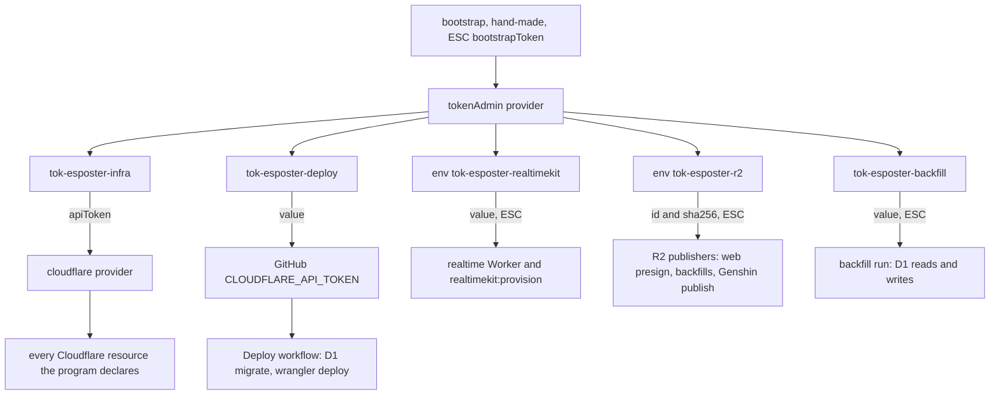

# Design

## Decisions

**One token per consumer, merged only where it costs nothing.** A consumer is the infra provider, the Deploy workflow, RealtimeKit, an environment's R2 publisher, or a backfill's D1 access. The table below holds each consumer's permission groups, all read by name from the account's own list (`GET /accounts/{account_id}/tokens/permission_groups`).

| Account token (Cloudflare name)                                 | Consumer                                                                                                         | Permission groups                                                                                                                                                                                                                                                                  | Scope                                                                                         | Value goes to                                                                                             |
| :-------------------------------------------------------------- | :--------------------------------------------------------------------------------------------------------------- | :--------------------------------------------------------------------------------------------------------------------------------------------------------------------------------------------------------------------------------------------------------------------------------- | :-------------------------------------------------------------------------------------------- | :-------------------------------------------------------------------------------------------------------- |
| `bootstrap` (hand-made, ESC `bootstrapToken`)                   | `tokenAdmin` provider, the token module only                                                                     | Account API Tokens Write                                                                                                                                                                                                                                                           | account                                                                                       | nowhere: it only creates the tokens below                                                                 |
| `tok-esposter-infra`                                            | the `cloudflare` provider, every resource the program declares                                                   | Account Settings Read, D1 Write, Queues Write, Workers R2 Storage Write, Workers Scripts Write; zone: Zone Read, Zone Write, DNS Write, Zone DNS Settings Write, Zone Settings Write, Zone Transform Rules Write, Workers Routes Write, Bot Management Write, Cache Settings Write | account, zones of the account                                                                 | nowhere: the provider's `apiToken` in state                                                               |
| `tok-esposter-deploy`                                           | the Deploy workflow: D1 migrations and `wrangler deploy` of the three Workers                                    | Account Settings Read, D1 Write, Workers Scripts Write, Queues Write                                                                                                                                                                                                               | account                                                                                       | the GitHub secret `CLOUDFLARE_API_TOKEN`                                                                  |
| `dev-tok-esposter-realtimekit`, `prod-tok-esposter-realtimekit` | RealtimeKit: the realtime Worker's calls and `realtimekit:provision`                                             | Realtime Admin                                                                                                                                                                                                                                                                     | account                                                                                       | ESC `<env>_REALTIMEKIT_API_TOKEN`                                                                         |
| `dev-tok-esposter-r2`, `prod-tok-esposter-r2`                   | the environment's R2 publishers: the web Worker's presigned urls, the backfills, the Genshin publish             | Workers R2 Storage Bucket Item Write                                                                                                                                                                                                                                               | each bucket of the environment, as `com.cloudflare.edge.r2.bucket.<account>_default_<bucket>` | ESC `<env>_R2_ACCESS_KEY_ID` (the token's id) and `<env>_R2_SECRET_ACCESS_KEY` (the SHA-256 of its value) |
| `tok-esposter-backfill`                                         | a backfill run: its D1 reads and writes through the D1 HTTP API, the `core` database of the environment it names | D1 Write                                                                                                                                                                                                                                                                           | account                                                                                       | ESC `CLOUDFLARE_BACKFILL_API_TOKEN` (the value, loaded by the run as `CLOUDFLARE_API_TOKEN`)              |

The merges considered and refused:

- **Deploy with infra.** The Deploy workflow needs four groups the infra token also holds, and none of the infra token's zone groups. A merged token would give the Deploy workflow DNS, bot management and transform rules it does not call, and it runs on every push, so the widening would be the one a CI run exercised. The two stay apart.
- **RealtimeKit's runtime with its provisioning.** Merged, because both make Realtime Admin calls and nothing else. Provisioning used to need the account's token permissions to make and roll the runtime token. Pulumi now makes that token, so the provisioning token no longer needs them, and one token serves both without widening either.
- **R2 across environments.** Kept apart, because the dev and prod buckets are separate blast radii and each environment's publishers should hold only their own.

**Bootstrap order.** The token module's provider takes its key from config, so the `AccountToken` resources need only the bootstrap. The `cloudflare` provider takes `apiToken` from the infra token's output. That is a data dependency, so the engine creates the infra token before it configures the provider, and no `dependsOn` is written.

Pulumi cannot preview the provider's resources until the infra token exists, because their provider configuration is unknown until then. So the first apply is read after it runs, not before. The expected plan on that first run is seven creates, one provider create, one provider leaving state, and an update to each Cloudflare resource's provider with no replacement. A replacement would be refused by `protect: true`, so a surprise stops the apply rather than deleting a bucket.

**Derived R2 pair.** The pair is derived from the token as the credentials page states (`.agents/skills/security/references/credentials.md`). The digest's encoding is hex, confirmed by the signed request of task 2.6.

**ESC keys keep their names.** A Worker secret's ESC key is `<env>_<NAME>`, because the deploy reads it by that name (`.github/actions/gather-worker-secrets`). The R2 and RealtimeKit keys therefore keep their names and take the new values, and the hand-made values are overwritten in place rather than deleted.

**Names.** Tokens are named by `apps/infra/docs/cloudflare/naming-conventions.md`. The bootstrap token keeps its name `bootstrap`, which the convention does not apply to, because it is the one hand-made token and nothing renames it.

**Outputs over copies.** Each value a person or a workflow needs is a stack output in "apps/infra/src/cloudflare/outputs/", and the write to ESC is one `pulumi env set` per key, which is why no script is added for it.

**Backfill's D1 credential.** The Deploy token's value goes only to the GitHub secret `CLOUDFLARE_API_TOKEN`, which no session can read back, so a backfill cannot borrow it. The backfill consumer has its own `AccountToken`, `tok-esposter-backfill`, holding the D1 group alone. A backfill reaches D1 through the D1 HTTP API, the endpoint `db:migrate` uses (`packages/db-schema/drizzle.config.ts`). The Deploy workflow's `db:migrate` step passes under D1 Write, and its migrator reads `__drizzle_migrations` before it writes, so the one group covers both the reads and the writes a backfill makes. The scope is the account, as the Deploy token's is, so the token reaches the `core` database of each environment; a per-environment pair, as R2 has, would be two resources. The value reaches ESC as `CLOUDFLARE_BACKFILL_API_TOKEN` from the `backfillApiToken` output, and `.agents/skills/backfills/references/the-run.md` step 3 names that key. It is one account token, not one per environment as R2's are: D1's permission group is granted on the account and cannot be scoped to one database, so a per-environment pair would grant the same reach twice.

## Inventory and verdicts

Read with the bootstrap: the account holds `bootstrap`, `tok-esposter-infra`, `tok-esposter-r2`, `dev-tok-esposter-realtimekit` and `prod-tok-esposter-realtimekit`. `bootstrap` expires, so its owner renews it when it does; the other four do not expire. Every credential the repository or ESC refers to is listed here with a verdict.

| Credential                                                                                         | Where it is held                                                            | Verdict                                                                                                                                |
| :------------------------------------------------------------------------------------------------- | :-------------------------------------------------------------------------- | :------------------------------------------------------------------------------------------------------------------------------------- |
| account token `tok-esposter-infra`                                                                 | the provider (ESC `pulumiConfig.cloudflare:apiToken`) and the GitHub secret | replaced by the resource of the same name, then deleted by its id                                                                      |
| ESC `pulumiConfig.cloudflare:apiToken`                                                             | ESC                                                                         | deleted once the provider reads the output                                                                                             |
| GitHub secret `CLOUDFLARE_API_TOKEN`                                                               | the repository                                                              | kept, its value now the deploy token's, set by the apply                                                                               |
| account token `tok-esposter-r2`                                                                    | ESC `<env>_R2_*` keys                                                       | replaced by the two `tok-esposter-r2` resources, then deleted by its id                                                                |
| ESC `pulumiConfig.esposter-infra:dev_R2_ACCESS_KEY_ID`, `_SECRET_ACCESS_KEY`, and the `prod_` pair | ESC                                                                         | values replaced in place by `pulumi env set`, keys kept                                                                                |
| account tokens `dev-tok-esposter-realtimekit`, `prod-tok-esposter-realtimekit`                     | ESC `<env>_REALTIMEKIT_API_TOKEN`                                           | replaced by the resources of the same names, then deleted by their ids once the Deploy that puts the realtime Worker's secret is green |
| ESC `pulumiConfig.esposter-infra:<env>_REALTIMEKIT_API_TOKEN`                                      | ESC                                                                         | value replaced in place                                                                                                                |
| ESC `cloudflareBootstrapToken`                                                                     | ESC                                                                         | deleted: it has expired                                                                                                                |
| ESC `bootstrapToken`                                                                               | ESC, top level                                                              | kept, and wired to `pulumiConfig.esposter-infra:CLOUDFLARE_BOOTSTRAP_API_TOKEN`                                                        |
| account token `bootstrap`                                                                          | Cloudflare                                                                  | kept; never rotated or deleted, and renewed by the owner when it expires                                                               |
| local copies of R2 and Cloudflare values in "apps/web/.env" and "apps/web/.env.production"         | the developer's machine, not tracked                                        | refreshed from ESC by hand after the apply                                                                                             |
| ESC `pulumiConfig.esposter-infra:CLOUDFLARE_BACKFILL_API_TOKEN`                                    | ESC                                                                         | new: written once from the `backfillApiToken` output, the backfill run's D1 credential; absent from ESC until that write               |

## Key files

| File                                                                     | Role                                                                                         |
| :----------------------------------------------------------------------- | :------------------------------------------------------------------------------------------- |
| "apps/infra/src/cloudflare/providers/tokenAdminProvider.ts"              | the bootstrap provider, used by the token resources only                                     |
| "apps/infra/src/cloudflare/providers/cloudflareProvider.ts"              | the explicit provider for every Cloudflare resource, its `apiToken` the infra token's output |
| "apps/infra/src/cloudflare/resources/accountTokens/"                     | one `AccountToken` per consumer                                                              |
| "apps/infra/src/cloudflare/services/getAccountTokenPermissionGroupId.ts" | the one helper: a permission group's id by name, shared by the token resources               |
| "apps/infra/src/cloudflare/outputs/"                                     | the stack outputs the ESC writes read                                                        |
| `apps/infra/src/github/secrets/cloudflareApiToken.ts`                    | the GitHub secret, now the deploy token's value                                              |
| "apps/infra/src/cloudflareConfiguration.ts"                              | deleted: its provider namespace read `cloudflare:apiToken`                                   |
| `scripts/src/services/realtimeKit/applyRealtimeKitActions.ts`            | the token branch is removed, the token is Pulumi's                                           |
| `apps/infra/docs/cloudflare/naming-conventions.md`                       | the token names                                                                              |
| `.agents/skills/security/references/credentials.md`                      | the rules this change carries                                                                |

## Notes

- Nothing here replaces a resource on its first apply, and `protect: true` stays on every token and every resource. Rolling a RealtimeKit token later is a replacement, which means lifting its protection for that one run and putting it back, and it is not part of this change.
- The permission groups were read from the account on the day of writing. If Cloudflare renames one, the data source's lookup fails the preview by name, which is the signal to change the name in code.
