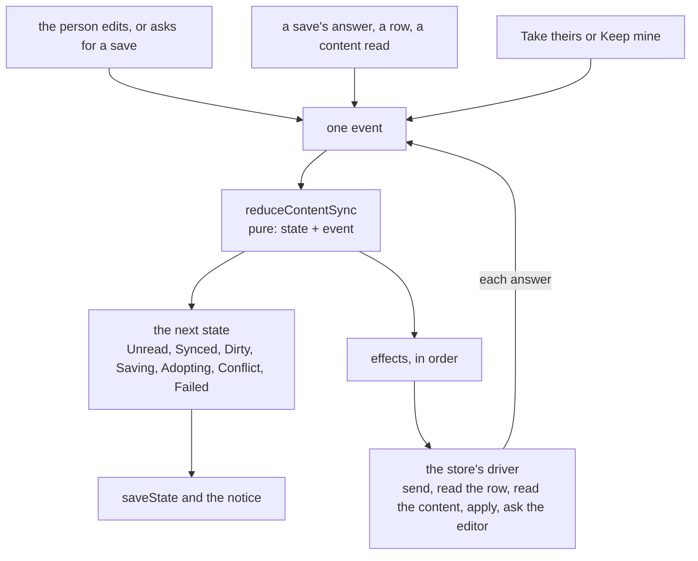

# Content sync

## Context

Every resource type writes its content through `useResourceStore().saveContent`, and every open resource hears other writers' saves through the watch on its row ([live edits](../../specs/architecture/ai-native-resources/live-edits/design.md)). Where one opening's content stood with the server was spread across about ten flags and variables, so each new interleaving of a save's answer, a late row and an edit needed another condition, and the whiteboard's fast drag found one that was missing.

## How it works

Each opening of a resource holds one value of `ContentSyncState`, a discriminated union on `ContentSyncKind`. Every input is an event: the person's edit, a save asked for, a save's answer or refusal, a row the watch brings, a content read, and the notice's two answers. `reduceContentSync` is a pure function from a state and an event to the next state and a list of effects. The store's driver runs the effects in order — send a save, read the row, read the content, apply a read, ask the editor for its content — and turns each answer back into an event.

The rules the reducer states once:

- **The server's content version is the only clock.** A save is sent at the version the opening confirmed, and the server's compare-and-set refuses it if another writer moved the version on. A row at or below the confirmed version is never another writer's, which is what makes a late row of the device's own earlier save harmless.
- **One save in flight, the latest wins.** A save asked for while one is in flight replaces the waiting snapshot, so a burst of edits costs at most two network saves: the one in flight and one carrying the latest content.
- **Another writer's content never lands over an unsaved edit.** Synced adopts a newer row; Dirty, Failed, an edit during Saving and an edit during Adopting all become Conflict, which waits for the person.
- **A stale refusal is a conflict.** It reads the row for the version that moved on and offers the same choice as another device's save.
- **A failed save stays on screen.** Failed keeps the edit; the next edit asks again.

The reducer is constant time per event, and the driver keeps one machine for the opening on screen and one for each closed opening whose save is still in flight.

## Decisions

- **A discriminated union over flags.** Each kind carries only the fields true in it — a save in flight carries what it sent, a conflict the version it is against — so a combination that cannot happen cannot be written down, and every `switch` over the kind is exhaustive under the typecheck. Independent flags were rejected: the old store's bugs were all combinations nothing ruled out.
- **A pure reducer with effects as data,** the Elm architecture's update returning a model and commands. The driver does the I/O, so the reducer is checked without a network or a store. A reducer that ran its own I/O was rejected: its interleavings could only be tested through mocks.
- **Server-authoritative versions over a CRDT.** The server already compare-and-sets on `contentVersion`, as Figma's and Replicache's servers are the authority their clients' pending changes wait on. A CRDT would merge two people's edits to one document, which no resource type asks for, at the cost of a merge function per content type.
- **Invariants proven per transition, not by exploring interleavings.** The transition check applies every event, with each relation its parameters can bear to the state, to every state shape, and holds each invariant across the step. An invariant that holds initially and is preserved by every step holds in every reachable state, so the check costs states times events and explores no sequence. An explicit-state search over the opening, the server and a network answering in any order was built and rejected: its state count is the combinatorial blow-up model checking calls state explosion, and even with symmetry reduction and settled rows abstracted away it did not finish at two other writes. Everything it caught — a late own row adopted, an edit overwritten during an adoption — the transition check catches as a broken invariant on one step.
- **No benchmark.** The reducer is a constant-time switch over a handful of fields per event, far below the network round trip each save costs; what the design minimises is round trips, and its bound — at most two saves per burst — is stated rather than measured.

## Key files

| File                                                                             | Role                                                                   |
| -------------------------------------------------------------------------------- | ---------------------------------------------------------------------- |
| `apps/web/app/models/resource/contentSync/ContentSyncState.ts`                   | the union of states, one interface per kind                            |
| `apps/web/app/models/resource/contentSync/ContentSyncEvent.ts`                   | every event an opening's content can meet                              |
| `apps/web/app/models/resource/contentSync/ContentSyncEffect.ts`                  | the effects the reducer asks the driver to run                         |
| `apps/web/app/services/resource/contentSync/reduceContentSync.ts`                | the reducer                                                            |
| `apps/web/app/services/resource/contentSync/checkContentSyncTransitions.test.ts` | the invariants, held across every event from every state               |
| `apps/web/app/store/resource/index.ts`                                           | the driver: one machine per opening, its effects and the derived state |

## Sources

- [The Elm guide's HTTP chapter](https://guide.elm-lang.org/effects/http.html) — `update` returns the new model and a command the runtime performs, the shape of the reducer and its effects.
- [How Figma's multiplayer technology works](https://www.figma.com/blog/how-figmas-multiplayer-technology-works/) — the server is the authority, and a client keeps its unacknowledged changes over the server's.
- [How Replicache works](https://doc.replicache.dev/concepts/how-it-works) — a client's mutations stay pending until the authoritative server confirms them.
- [RFC 9110, conditional requests](https://www.rfc-editor.org/rfc/rfc9110#name-conditional-requests) — a write conditional on the version the client read, refused when it moved, which prevents lost updates.
- [Model checking](https://en.wikipedia.org/wiki/Model_checking) — explicit-state exploration and the state explosion that rules it out here.
- [Loop invariant](https://en.wikipedia.org/wiki/Loop_invariant) — a property true at the start and preserved by every step is true after any number of steps, the induction the transition check rests on.
