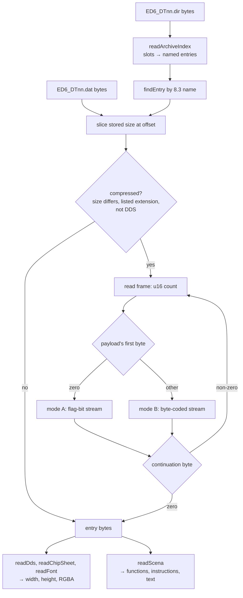

# ED6 Formats Reader

A TypeScript package that reads the Trails in the Sky trilogy's PC data (archives, images and scenario scripts) from bytes the caller hands it, so a later viewer or modding tool needs no other language and no native dependency.

## Scope

Nothing in the repository reads these games today. This change adds the package, `ed6-formats`, and a `scripts` command that runs it over an install. It reads the PC releases of FC, SC and the 3rd, which share one engine and one archive scheme. Models, maps, battle and animation scripts, writing archives back and the 3D remake are outside it (the proposal's "Not in this change").

The package never opens a file itself. Each reader takes a `Uint8Array` and returns plain data, so the same code runs in Node, in a worker, or in a browser that was handed a folder through the File System Access API. The caller owns the I/O and the package owns the bytes.

## What the installs hold

These facts were measured on the owner's GOG installs of all three games by a throwaway probe, which is not part of the change, and they agree with the community sources below:

- **Archives** are `ED6_DTnn.dat` files, each indexed by an `ED6_DTnn.dir` beside it. A `.dat` with no `.dir` is a video. Each game has a few dozen archives holding tens of thousands of entries and a few gigabytes of data. Fan patches such as the voice mod repack the archives in place and keep the originals beside them as `zBAK-` copies, so a reader lists only the `ED6_DT[0-9A-F]{2}.dir` names.
- **The index** opens with the magic `LB DIR`, a `0x1A 0x00` pair, a little-endian `u32` slot count and a `u32` zero. A fixed array of 36-byte slots follows, one per slot counted: a 12-byte name padded with spaces before its extension (`T0001   ._SN`), then six little-endian `u32` fields in the order the community names them: a second timestamp, the stored size, an allocation size, a field that repeats the stored size for most entries, the timestamp, and the offset into the `.dat`. A slot whose ninth character is not `.`, or whose name is `/_______.___`, is empty.
- **No field holds the uncompressed size.** The field the community calls `uncompress_size` is a rounded allocation (`0x4000` for a small script). An entry is compressed when its stored size differs from that allocation or its extension is on the community's list (`_X3`, `_OP`, `_CL`, `_CT`, `_EF`, `_EN`, `_EP`, `_HD`, `_LM`, `_MH`, `_DS`, and `_X2` outside `ED6_DT16`). An entry whose bytes start with `DDS` is stored raw. On all three installs every entry that rule marks compressed decodes to its last byte, except thirteen monster tables in the second game's `ED6_DT30` (the Open question).
- **Compression** is a sequence of frames. Each frame is a `u16` byte count, a payload, and one continuation byte, where zero ends the entry. A payload whose first byte is zero is mode A, a least-significant-bit-first flag stream of literals, back-references of up to `0x1FFF` bytes and runs. Any other first byte is mode B, a byte-coded stream of literal runs, fills and back-references. Each frame's window starts empty, so no reference crosses a frame. Almost everything is mode A, and mode B turns up in the second and third games' `._DS`, `._X2` and `._X3` entries and in the `._VS` entries. The opcode-level layout of both modes is in the uyjulian script (Sources), which is the specification this package ports.
- **`._DS`** is a whole DDS file under another extension, raw in the first game and compressed in the other two. Every one on the three installs is uncompressed 16- or 32-bit RGB with no block compression, so reading one is a DDS header and a pixel copy.
- **`._CH`** is a headerless pixel array in 4444, 1555 or 8888 ARGB, with no width, height or format stored. **`._CP`** is the layout that composes a chip sheet out of 16×16 tiles of its `._CH`: tiles may repeat, a null tile is transparent, and each frame is 256×256, the next drawn below it. The `._CP` record layout is not published anywhere, so the build reads it from Kiseki-Texture-Tool's source and confirms it against the install.
- **`._DA`** is a font, one grey byte per pixel, named by its glyph size from `FONT8._DA` up to `FONT192._DA`.
- **`._SN`** is a scenario script, in `ED6_DT01` for the first game and `ED6_DT21` for the others. Its strings are Shift JIS (Microsoft's code page 932), in the English releases too. Falcom's own tables reuse a few code points, the heart drawn by the code point for `㈱` among them.
- **Music** is not archived: it is loose OGG Vorbis under `BGM`, looped by `LOOPSTART` and `LOOPLENGTH` comments, which any OGG reader already handles. Nothing in this change reads it.

## How it works



The three readers stand alone. `ed6-formats/archives` knows nothing of images or scripts, and the image and scena readers take entry bytes from anywhere: an archive, a loose file a fan patch left, or a test fixture.

- **Archives.** `readArchiveIndex` returns the named entries with their sizes, timestamp and offset. `readEntry` takes an entry and its `.dat` bytes, either the whole file or just the slice the caller read at the offset, and returns the entry's bytes, decompressed when the rule says so. A frame that runs past its payload, a back-reference before the start of its window, or a stream that does not end at its continuation byte is an error naming the entry, never a short result.
- **Images.** Each reader returns `{ width, height, rgba }` with straight alpha, which is what an `ImageData`, a canvas or a three.js `DataTexture` takes. A `._CH` stores no size or pixel format, so the caller passes the format and width, or the reader takes them from a table of known sheets keyed by name. A chip sheet takes its `._CH` and `._CP` together.
- **Scena.** `readScena` returns the file's header, its functions, and each function's instructions as an opcode name and its operands, with text operands decoded to strings. An opcode the table does not know stops the read with an error naming its offset, never a guess at its length, since every later instruction would be read out of step.
- **The dump command.** It walks an install's archives, reads every entry through the package, and writes counts per extension (read, decoded, failed, with the first failure's name) and, when asked, the decoded files to a folder outside the repository. That count, run on all three installs, is how the package is shown to read the real data, since no game file is ever committed or reaches CI.

## Decisions

- **Written from the formats, not ported from GPL code.** Every package in the repository is Apache-2.0. Kiseki-Texture-Tool, skytrails-replacer and OpenSora are GPL-3.0, so porting their code would make the package GPL. They are read for facts about the formats, such as a record's fields and a pixel order, and the code is written fresh. The uyjulian decompressor is MIT, so its two modes are ported directly with its notice kept. Calmare, Factoria, Falcompress, falcom-sjis, EDDecompiler and ED6ASDecompiler state no licence, which reserves every right, so they are references only, the same as the GPL projects.
- **DataView over Kaitai Struct.** The only published `.ksy` files (skytrails-replacer's `dir.ksy` and `_X3.ksy`) are GPL-3.0, and the formats in this change are fixed records a few fields long, so a generated parser and its runtime would add a dependency and a build step for no gain. The compressors are bit streams, which Kaitai does not describe anyway.
- **The platform's Shift JIS decoder.** `TextDecoder("shift_jis")` is the WHATWG decoder, which maps code page 932's extensions, and it ships in Node and every browser. A decoder of our own built from Falcom's tables (as falcom-sjis does) was rejected until a byte proves the platform wrong. The dump command counts every `U+FFFD` a script decodes to, and Falcom's few reused code points are swapped after decoding in one small table, not in the decoder.
- **A `._CH` format table, not a guess.** Kiseki-Texture-Tool guesses a sheet's pixel format by filters and is right about 95% of the time, which means about one sheet in twenty comes out garbled with no error. A table keyed by file name and byte length, seeded from the uyjulian script's MIT table and completed from the dump's failures, is exact for the sheets it lists and errors on the rest.
- **Bytes in, data out.** A package that opened paths itself would bind it to Node. Taking `Uint8Array` keeps it usable from a browser handed a folder, which is the one place a viewer of the owner's own install could run without the data leaving the machine.
- **No recreation of the games.** The package is a reader. A playable runtime would rebuild the games out of their own art, text and music, which is outside what this repository builds, and the first game already runs natively from the owner's copy through the static recompilation (Sources).

## Open question

- **What marks the thirteen raw monster tables.** In the second game's `ED6_DT30`, thirteen `MS*._DT` entries have a stored size below their allocation of 2048, yet their bytes are not a frame stream. They are most likely stored raw, and some field (the second timestamp is the first suspect) says so. The build reads those slots against their neighbours, and if no field explains them, a failed decode falls back to the raw bytes for that one archive. Either answer leaves the requirements as they are.

## Key files

| File                   | Role                                          |
| :--------------------- | :-------------------------------------------- |
| `AGENTS.md`            | the package table gains the `ed6-formats` row |
| `scripts/package.json` | the dump command's script                     |

The package and the command are new files:

```text
packages/ed6-formats/
  package.json, README.md, tsdown.config.ts, vitest.config.ts, tsconfig.json
  src/
    archives/    readArchiveIndex, readEntry, decompressFrames (modes A and B)
    images/      readDds, readCharacterSheet, readChipSheet, readFont, the ._CH format table
    scena/       readScena, the opcode table, the text decoder and its Falcom substitutions
scripts/src/ed6/
  dumpInstall.ts
```

## Sources

- [uyjulian's Sky dat/dir extraction script](https://gist.github.com/uyjulian/bb0400c3768ea33be395a22df61a0c70) (MIT): the index layout, the compressed-entry rule, both decompression modes at opcode level, and the table of `._CH` sheet sizes and pixel formats. Ported directly.
- [LB-ARK](https://github.com/Aureole-Suite/LB-ARK) (no licence stated): the archive naming (`ED6_DT00` to `ED6_DT3F`), the `.dat` with no `.dir` being a video, the 8.3 names, and every font living in one fixed archive. Facts only.
- [skytrails-replacer](https://github.com/spillerrec/skytrails-replacer) (GPL-3.0): its `specifications/dir.ksy` confirms the index fields, and its viewer is the reference for the later model change. Facts only.
- [Kiseki-Texture-Tool](https://github.com/Sewer56/Kiseki-Texture-Tool) (GPL-3.0): `._DS` as a hidden DDS, `._CH` as headerless 4444, 1555 or 8888 pixels, and `._CP` composing 16×16 tiles into 256×256 frames. The `._CP` records are read from its source. Facts only.
- [Aureole and the Aureole Suite](https://github.com/Kyuuhachi/Aureole) (no licence stated): Calmare decompiles the scenario scripts of every game from FC to Azure, and is the first reference for the scena opcode table. Facts only.
- [falcom-sjis](https://github.com/Aureole-Suite/falcom-sjis) (no licence stated): Falcom's games encode the heart with the code point for `㈱`, among a few similar substitutions. Facts only.
- [EDDecompiler](https://github.com/Ouroboros/EDDecompiler) (no licence stated): scena files are the `._SN` entries of `ED6_DT01` and `ED6_DT21`, and the English release is code page 932. Its `Decompiler/Instruction` folder is the second reference for the opcode table. Facts only.
- [Trails Research Group documentation](https://github.com/Trails-Research-Group/Doc): the index of the community's tools per format, and the BGM tutorial's OGG facts (192 kbps stereo at 44.1 kHz, looped by `LOOPSTART` and `LOOPLENGTH`).
- [Trails in the Sky FC recompiled](https://github.com/soyjxck/trails-in-the-sky-fc-recomp) (MIT): a static recompilation of the first game's executable to C, built from the owner's own copy of the build dated `2022-09-22`. It is the reference for engine behaviour if a format question cannot be settled from the data, and the reason this change builds no runtime.
- [OpenSora](https://github.com/rds1983/OpenSora) (GPL-3.0): a C# viewer of the first two games' images, models, animations and scenes. It shows the viewer a later change could build. Nothing is taken from it.
