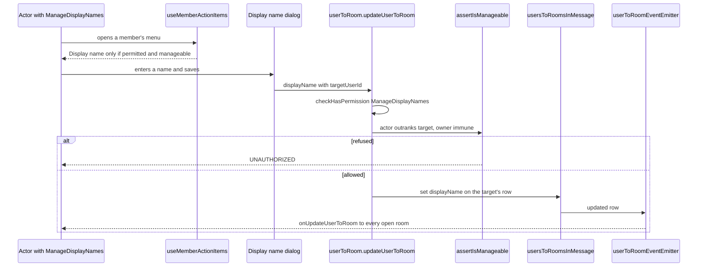

# Member display names

A holder of `ManageDisplayNames` sets another member's room display name through the existing display-name path, which the server guards with the permission and with hierarchy, and the member action list offers that path where the holder may use it.

## Scope

Today `updateUserToRoom` accepts a `targetUserId` with a display name, checks the permission, and writes the row. The path has no hierarchy check and no interface. The change adds the hierarchy guard the moderation procedures already use, one menu item, and a dialog. It changes no schema and adds no procedure.

## Decisions

- **The guard is `assertIsManageable`, not a new check.** The moderation procedures call it beside the permission check, and the [RBAC design](../../specs/esbabbler/rbac/design.md) names it as the one guard for a member-targeting action. A second helper for display names would be the copy that guard exists to prevent. The alternative, checking only the permission and trusting the client to hide the item, is the bypass the RBAC design describes.
- **The guard runs for a target other than the actor.** A self-edit keeps the path it has today, with no permission required, since a member always may name themselves.
- **The item lives in `useMemberActionItems`.** That composable already builds the list for both the profile's overflow menu and the row's context menu, and it already gates kick and ban by permission and manageability on the client. The display name item joins it, so it cannot appear on one surface and not the other.
- **The dialog reuses `DisplayNameField`.** The field already carries the length limit and the rule that an empty value falls back to the account name. A second field would drift from the first.
- **No moderation audit entry.** The alternative is a new admin action type. That type is enumerated in the moderation design across several places, and a display name is not a sanction the moderation log exists to record. The decision is recorded here, so a later reader does not take its absence for an oversight.
- **Last write wins.** The field holds one name, so a moderator's rename and the member's own edit overwrite each other, and the later save is the one every member sees.

## How it works



The client's check and the server's check read the same rule, `checkIsMemberManageable`, so the item is hidden exactly where the server would refuse. The server's answer is the one that counts; the hidden item is only the reason the refusal is rare.

## Key files

| File                                                                                    | Role                                                                               |
| --------------------------------------------------------------------------------------- | ---------------------------------------------------------------------------------- |
| `apps/web/server/services/message/updateUserToRoom.ts`                                  | the display-name path; gains the hierarchy guard for a target other than the actor |
| `apps/web/server/services/room/rbac/assertIsManageable.ts`                              | the hierarchy guard the path now calls, reused unchanged                           |
| `apps/web/shared/services/room/rbac/checkIsMemberManageable.ts`                         | the pure rule both sides evaluate                                                  |
| `apps/web/server/trpc/routers/userToRoom.ts`                                            | the procedure, unchanged in its input and its route                                |
| `apps/web/shared/models/db/userToRoom/UpdateUserToRoomInput.ts`                         | the input rule that a target requires a display name, unchanged                    |
| `apps/web/app/composables/message/user/useMemberActionItems.ts`                         | the one list both member menus read; gains the Display name item                   |
| `apps/web/app/models/message/user/MemberDialogType.ts`                                  | gains the display-name dialog's value                                              |
| `apps/web/app/store/message/room/role.ts`                                               | the actor's own permissions and standing on the client                             |
| `apps/web/app/components/Message/Model/Room/Settings/Type/Profile/DisplayNameField.vue` | the field the dialog reuses                                                        |
| `apps/web/app/components/Message/Model/Room/Settings/Type/Member/List.vue`              | the members panel, whose row menu shows the item                                   |

A new file, in the tree form the design template asks for:

```text
apps/web/app/components/Message/Model/Room/Member/DisplayNameDialog.vue   the display name dialog, mounted once by the member dialog host
```

## Notes

- Nothing notifies the renamed member. The new name reaches every open view of the room through the same subscription a self-service change uses.
- The display name item is not offered to a holder of the permission who targets themselves. A self-edit is already on the My Profile tab, and offering it twice would show two entries for one field.
- The [display names design](../../specs/esbabbler/display-names/design.md) line that admits the surface is missing is rewritten when this change archives.
