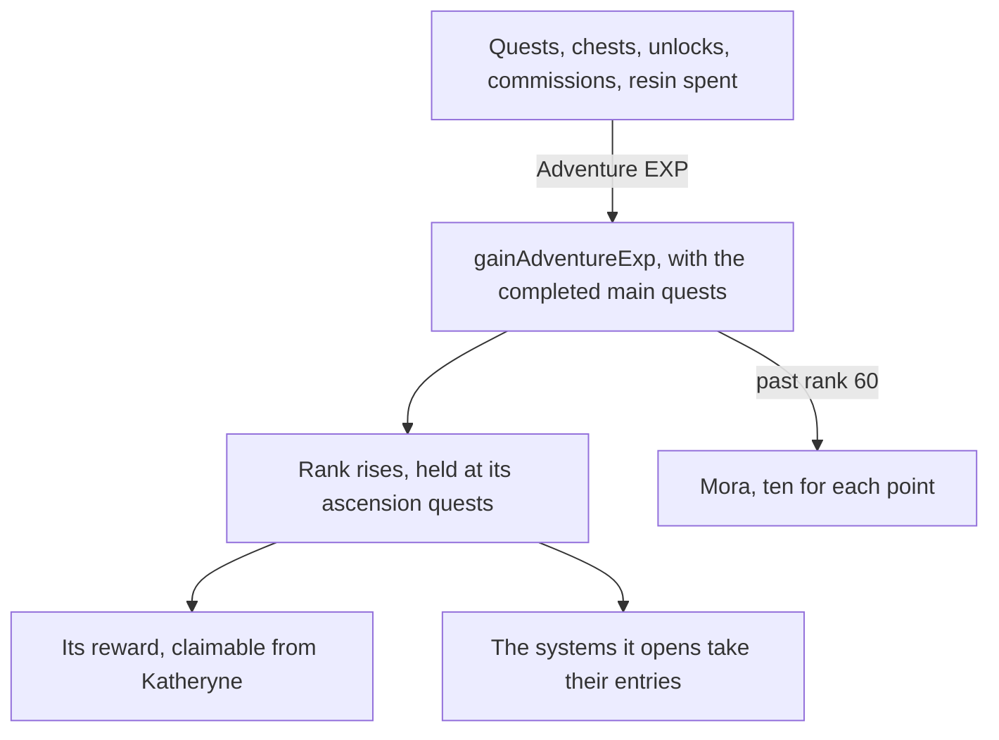

# Adventure Rank

The [Adventure Rank](../../specs/genshin/adventure-rank/design.md) page holds the rank, its holds, the World Level, the enemies it raises, the profile card and the World Level dialog. What remains reaches the player through other pages: the Adventure EXP that the commission, domain, boss and Forge claims give, and the rewards each rank hands out. Each waits on its own page, so each is built there.

## Decisions

- **Every source states its own EXP.** Quests, chests, Teleport Waypoints and statues unlocked, Oculi, commissions and the handbook's Experience chapters each give Adventure EXP their own page or table sets, and spending Original Resin gives five for each one spent ([original resin](../../specs/genshin/original-resin/design.md)). Each source's page adds it through `gainAdventureExp`, which takes the completed main quests and returns the Mora a gain past rank 60 pays.
- **A rank's reward is claimed from Katheryne.** Each rank's reward is its `rewardId` in `PlayerLevelExcelConfigData`, joined to the reward row it names in `RewardExcelConfigData` and published with the level table. Talking to Katheryne at any branch of the Adventurers' Guild gives every reached rank's reward not yet claimed, once, as the game hands it out. Provisional: one talk paying all of them at once is the reading here, since the game's own talk is not read.
- **What a rank opens is stated by its system.** Each page names the rank its system opens at, from the wiki's table of unlocks, since the game's own open-state table names each system only by a number. The Paimon menu's entry for a system not yet open stays disabled, as it already is for one not built. Of the menu's entries the table names three, Friends at 2, Co-Op Mode at 16 and the Battle Pass at 20 (`ScreenKindOpenRankMap`); the rest are open from the start.
- **The Change World Level prompt is a plain dialog, its layout provisional.** Its button opens the prompt over the World Level dialog; Confirm makes the change through `toggleWorldLevel` and Cancel returns to the dialog. The prompt's frame and choices are the quit prompt's, measured from its 2026 recording; its levels and tips lines are placed by eye until the user's recording `world-level-dialog-2024.mkv` is measured. Its labels are the game's text ids, read through `GameTextKey`.
- **A claimed reward is kept with the player's progress.** The ranks' rewards claimed are kept in the save beside the EXP and the quests' progress ([save data](../../specs/genshin/save-data/design.md)), since the world is the person's own.
- **The claimed ranks are a required save field.** `adventureRankRewardsClaimed` lists the ranks claimed, from rank 2, with no default. A save written before it parses only once the backfill adds it as an empty list, the `backfills` skill's rule.
- **Bosses and ley line outcrops stand at the World Level.** Their enemies and rewards follow the World Level as the wiki gives them, on the pages that build them.

## How it works

## Scope and order

**Left to build, in order:**

1. **The other Adventure EXP sources, as their pages land.** Each calls `gainWorldAdventureExp`; the quests carried by the [quests](../genshin-quests/design.md) page feed the holds as they complete.
2. **The Paimon menu's rank gates**, as the systems' pages open.

Built here: the sources the world reaches (quests, chests, Teleport Waypoints, statues and Oculi, offerings and spent Original Resin), Katheryne's rewards (tasks 2.1 and 2.2), the Paimon menu's rank gates (task 3.1) and the Change World Level prompt.

## Data and measures

- **Read from the game's tables:** each rank's `rewardId` in `PlayerLevelExcelConfigData`, and the reward row it names in `RewardExcelConfigData`, published with the level table.
- **Read from the wiki:** which rank opens each system.

## Key files

| File                                                                                 | Role after the change                                             |
| :----------------------------------------------------------------------------------- | :---------------------------------------------------------------- |
| `packages/genshin-world/src/components/Menu/Paimon/Index.vue`                        | Keeps an entry disabled until its system's rank                   |
| `packages/genshin-world/src/services/handbook/constants.ts`                          | The Experience tab's chapters, once the EXP sources exist         |
| `packages/genshin-world/src/data/regions/mondstadt.json`                             | Katheryne's place among Mondstadt's residents, for the rewards    |
| `packages/genshin-world/src/components/Menu/WorldLevelDialog/Index.vue`              | Its button opens the Change World Level prompt                    |
| `packages/genshin-world/src/components/Menu/WorldLevelPrompt/Index.vue`              | The Change World Level prompt, with the labels from `GameTextKey` |
| `packages/genshin-world/src/services/adventureRank/computeWorldLevelAdjustPrompt.ts` | The levels the prompt shows and whether the change lowers         |
| `packages/genshin-world/src/services/adventureRank/checkIsSystemOpen.ts`             | Whether a Paimon entry is open at the rank held                   |
| `packages/genshin-world/src/services/adventureRank/ScreenKindOpenRankMap.ts`         | The rank each Paimon entry the wiki gates opens at                |
| `packages/genshin-text/src/models/GameTextKey.ts`                                    | The Change World Level prompt's text ids                          |

## Sources

- [Adventure Rank](https://genshin-impact.fandom.com/wiki/Adventure_Rank), Genshin Impact Wiki: rewards from Katheryne at each rank, and the systems each rank opens.
- [Original Resin](https://genshin-impact.fandom.com/wiki/Original_Resin), Genshin Impact Wiki: five Adventure EXP for each resin spent.
- [AnimeGameData](https://github.com/DimbreathBot/AnimeGameData), the community's per-patch dump: `RewardExcelConfigData`, the table the ranks' rewards are read from.

## Reference

- `enemy-level-world-level-1.mkv` to `enemy-level-world-level-9.mkv` — a Hilichurl of the Windrise camp, its name plate's level read at World Level 1, 5 and 9 in turn, each clip with the camp in reach and the World Level set on the Profile. The camp is level 2 at World Level 0, so the provisional rule reads 10, 53 and 84 ([Adventure Rank](../../specs/genshin/adventure-rank/design.md)). `enemy-level-world-level-1.mkv` searched 2026-10-11 on the wiki and YouTube, none found; `enemy-level-world-level-5.mkv` searched 2026-10-11 on the wiki and YouTube, none found; `enemy-level-world-level-9.mkv` searched 2026-10-11 on the wiki and YouTube, none found.
