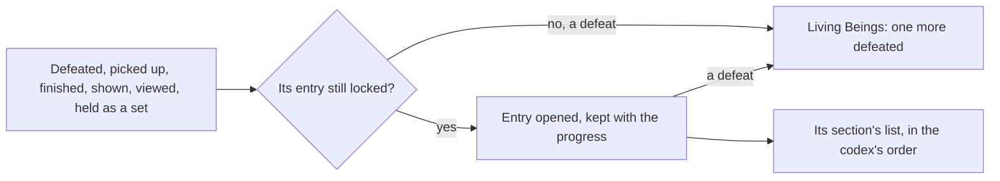

# Archive

The [Archive](../../specs/genshin/archive/design.md) page holds the seven sections, their entries read from the game's codex tables, the bag's opening, the artifact sets' rule and the unlock after its quest. What remains is what the other sections open by doings the world does not have yet.

## Decisions

- **An entry opens when its thing is first met.** A tutorial when shown; a viewpoint when taken in; a quest when finished; a book when picked up; an enemy or an animal when first defeated; an artifact set once all its pieces have been held. Opened entries are kept with the player's progress.
- **Living Beings counts kills.** Each enemy's entry shows how many have been defeated, and each animal's waits on the wildlife's strike, and its model turns on the screen as the game's does, drawn by the [characters](../../specs/genshin/characters/README.md) reader once its model is built.
- **A viewpoint is placed by the scene group record.** Each `ViewCodexExcelConfigData` row names its viewpoint by `groupId` and `configId`, and the [scene group record](../../specs/genshin/scene-groups/design.md) holds it as a gadget member of that group, placed at the official map's Viewpoint point that bears its name. A viewpoint the record leaves without a place is not offered until its place is estimated from the wiki, marked provisional.
- **A viewpoint is taken in where it stands.** Each viewpoint is a place in the world that, reached, offers to be viewed, which opens its entry with its picture as the game does; its picture is drawn by the world from its place, never the game's image.

## How it works

## Scope and order

**This adds, in order:**

1. **Geography's viewpoints**, at the places the scene group record gives each view codex row's gadget member, read from the hosted `sceneGroups/scene3` record.
2. **Wildlife's Living Beings**, once an animal is struck and its kills count.
3. **Tutorials' opening**, once a tip is shown.

The viewpoints wait on the hosted `sceneGroups/scene3` record, which the game-data lock does not publish yet; the other two wait on another unit each, the wildlife's strike and a shown tip.

The artifact sets' caller is wherever the player's artifacts change, which the first artifact drop brings.

## Data and measures

- **Each viewpoint's place:** the record's place on its gadget member, a ground point the official map's fit carried into the game's axes with no height, so the viewpoint stands on the ground where it is read.
- **Books placed in the world:** no world drop is a volume's material yet, so a volume is picked up only once the world places the books.

## Key files

| File                                                            | Role after the change                                |
| :-------------------------------------------------------------- | :--------------------------------------------------- |
| `packages/genshin-world/src/components/World/Enemies/Index.vue` | The defeat that counts toward a living being's entry |
| `scripts/src/services/genshinAssets/enemies/buildEnemyKinds.ts` | Already reads the living beings' codex               |

## Sources

- [Archive](https://genshin-impact.fandom.com/wiki/Archive), Genshin Impact Wiki: entries opened when first obtained or defeated, artifact sets once every piece is held, kill counts and turning models, and Geography's viewpoints.
- [AnimeGameData](https://github.com/DimbreathBot/AnimeGameData), the community's per-patch dump: the codex tables the built sections read, and the view codex naming each viewpoint's group.

## Reference

- `archive-screen.mkv` — the Archive opened from the Paimon menu on the English PC client, a section’s tab and one of its open entries in view, 30 seconds at most; the screen’s places and the sections’ look are measured from it. Partly found 2026-10-11, from the wiki's `File:Archive Menu Home 1.png`; still sought: A video of the Archive opened from the Paimon menu with a section's tab and one open entry in view, 30 seconds at most. The still is the Archive's home, not an open section.
- `book-reader.mkv` — a book opened from the Archive’s Books tab on the English PC client, its title and one page of its text in view, 30 seconds at most; the reader’s places, sizes and colours are measured from it ([Archive](../../specs/genshin/archive/design.md)). Partly found 2026-10-11: the wiki's `File:Archive Menu Books.png`; still sought: A video of a book opened from the Archive's Books tab, its title and a page in view, 30 seconds at most. The still gives the reader's places and look, not its motion.
