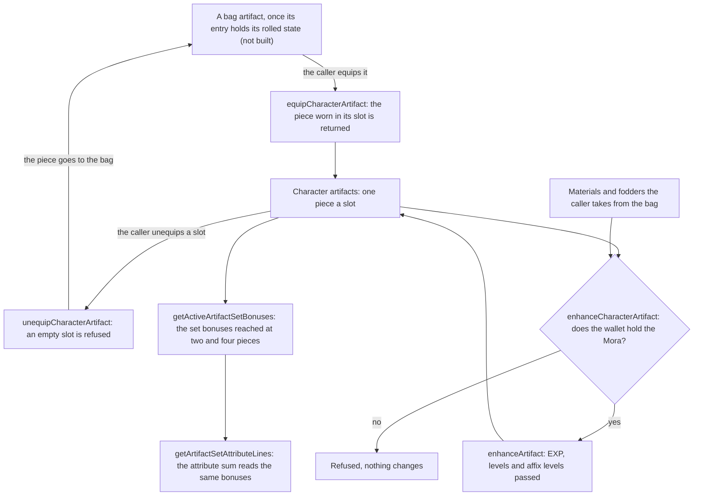

# Artifact screen

A character's five artifact slots are read and changed by services over the character's own artifacts, and the world's
stat tables carry the rarity and EXP tables an enhancement reads. The bag is the caller's: a piece that leaves a character
goes back to it, and a piece that comes from it is the caller's to take out, so none of these services writes the bag.

## How it works



- **Equipping returns what it replaces.** The piece worn in the new piece's slot is the one returned, and the new piece
  takes its place in the array. A character never wears two pieces of one slot, so no other piece can be displaced.
- **Unequipping refuses an empty slot.** The taken-off piece is returned for the caller to put back in the bag.
- **Enhancing is gated on the Mora before anything changes.** The Mora is the materials' EXP plus each fodder's base EXP,
  from `getEnhancementMoraCost`, and a wallet short of it refuses the enhancement the way `enhanceWeapon` refuses one.
  The bonus, the levels and the affix levels are then `enhanceArtifact`'s, unchanged.
- **The set reader is one function.** `getActiveArtifactSetBonuses` reaches each set's bonuses by its piece count, and
  `getArtifactSetAttributeLines` sums what it returns. The Artifacts tab's set-bonus block reads the same list.

## Scope

What works today and what this change adds:

- **Built now:** the three services, the set reader, the two tables read into `StatTables`, and the Artifacts panel's
  five slots, the picked slot's name, the set bonus block and its actions, drawn by its fixture and worn variant in the
  visual suite, and the character screen's Artifacts tab, which passes the panel its words, slot names and the set
  block's state. Their tests are named in the change's tasks, and the existing character, kit and save suites cover what
  they share.
- **Not built, and why:** the picked artifact's main and sub stats in the panel, whose layout the reference frame has
  not been measured for yet, the set bonus lines, which wait on the effect text an artifact set's bonus is written with
  (the artifact table holds the numbers, not that text), the panel's parity reference and approval, equipping from the
  bag, unequipping to it and fodder taken from it. Each of the bag moves needs a bag piece to hold its rolled state, and the bag does not yet: an entry is saved with its level alone
  (`InventoryItemSave`), so a piece cannot leave the bag equipped or enter it as fodder. The character-screen agent's
  change (`agent/w6-character-screen`) makes each bag artifact an individual, rolled at its drop and saved with a unique
  instance id, and that branch lands before this change does.

## Decisions

- **The screen returns, and the world reads the rarity and EXP tables back.** A worn artifact's enhancement needs
  `stats/artifactRarities` for its levels and affix levels, and `stats/artifactExpMaterials` for the EXP each material
  gives. Both are read by `readStatTables` now. The main affix pools stay unread until the drop that rolls an artifact
  reads them. Rejected: deleting the path, since chest drops are being wired to roll artifacts into the bag, and a bag
  piece with nowhere to go is the gap this change closes.
- **Equip and unequip are pure services over the character.** The bag is written by the caller, so the services do not
  reach the chest drop path's files. Rejected: having the service put the displaced piece in the bag, since that writes
  an entry whose shape is not settled.
- **The panel names a slot by its index and holds no artifact model.** Its actions emit the index of the picked slot,
  and the host maps it to the character's artifact through these services, so the panel builds against the `Artifact`
  type rather than a view model of its own.
- **The set block shows the game's own set line once its text is read.** `EQUIP_RELIC_SET_NUM` reads
  `{0}-Piece Set: {1}`, so one key would carry the piece count and its effect, filled by `fillGameTextValues`. Rejected: a
  heading key for each piece count, which splits one sentence the game writes whole. The key joins the enum with the
  lines, since no code names it before then. Until a set's effect text is read, the block lists no lines and says that
  no bonus is active only while none is.
- **The buttons take the artifact page's own words where it has them.** Enhance is `UI_EQUIP_PAGE_LEVEL_UP`, not the
  weapon's `UI_EQUIP_PAGE_LEVELUP_BUTTON` that `WeaponEnhance` keys, since the artifact's own member should not carry the
  weapon's name. Equip is `UI_EQUIP_BUTTON`, and Unequip the one exact "Unequip" the dump holds, the potion buff's remove
  button (see Notes).
- **Enhancing refuses on the Mora in the service.** The gate is in `enhanceCharacterArtifact` rather than left to the
  caller, as `enhanceWeapon` does, so a caller that forgets the check cannot spend Mora it does not hold. The wiki's
  Enhancing section says the same: one Artifact EXP costs one Mora except when recycling a leveled artifact, which the
  fodder's share of its own levelling already gives.

## Save change

None in this change. A worn artifact is saved in full already (`CharacterSave.artifacts`), so equipping and enhancing a
worn piece write nothing new. The bag's artifact entry takes the individual piece, a save change that belongs to the
character-screen agent's branch (`agent/w6-character-screen`), not to this one. This change builds against the `Artifact`
type `rollArtifact` returns and writes no second artifact model. Its dev backfill rule is that change's to state.

## Key files

| File                                                                           | Role                                                                                                                   |
| :----------------------------------------------------------------------------- | :--------------------------------------------------------------------------------------------------------------------- |
| `packages/genshin-world/src/services/artifact/getArtifactSetAttributeLines.ts` | The attribute sum, now over the active set bonuses                                                                     |
| `packages/genshin-world/src/services/character/parseStatTables.ts`             | Parses the rarity and EXP tables beside the existing ones                                                              |
| `packages/genshin-world/src/services/character/readStatTables.ts`              | Fetches the rarity and EXP tables by their keys                                                                        |
| `packages/genshin-world/src/models/character/StatTables.ts`                    | Carries the rarity and EXP maps the enhancement reads                                                                  |
| `packages/genshin-world/src/models/character/RawStatTables.ts`                 | The two tables as they are fetched                                                                                     |
| `packages/genshin-world/src/services/artifact/enhanceArtifact.ts`              | Unchanged: the EXP, levels and affix levels a worn artifact gains                                                      |
| `packages/genshin-world/src/services/artifact/getEnhancementMoraCost.ts`       | Unchanged: the Mora an enhancement costs, checked before it runs                                                       |
| `packages/genshin-interface/src/components/CharacterMenuArtifacts/Index.vue`   | The Artifacts panel: the slots, the picked slot's name, the set bonus block and the actions (its stats are not built)  |
| `packages/genshin-text/src/models/GameTextKey.ts`                              | The panel's ten artifact members: the five slot names, the set block's heading and empty words, and the three actions  |
| `packages/genshin-world/src/services/artifact/ArtifactSlotGameTextKeyMap.ts`   | Each artifact slot by the game's name for it, read by the character screen                                             |
| `packages/genshin-world/src/components/Character/Screen/Index.vue`             | The Artifacts tab's props: the labels, the slot names and the set block's state, from the game text and the tables     |
| `packages/genshin-world/src/services/inventory/addInventoryItem.ts`            | The bag's add, on the chest drop path: the character-screen agent's change, not this one's (not built)                 |
| `packages/genshin-world/src/services/save/toInventorySave.ts`                  | The bag's save of an artifact, on the chest drop path: the character-screen agent's change, not this one's (not built) |

New files, as a tree:

```text
packages/genshin-world/src/
  models/artifact/ActiveArtifactSetBonus.ts
  services/artifact/
    equipCharacterArtifact.ts          (+ .test.ts)
    unequipCharacterArtifact.ts        (+ .test.ts)
    enhanceCharacterArtifact.ts        (+ .test.ts)
    getActiveArtifactSetBonuses.ts     (+ .test.ts)
```

## Notes

- **A piece's identity moves from reference to instance id.** The three services find a piece by its object reference
  (`worn === displaced`, `worn === artifact`), which holds for the pieces one session holds. Once the instance id is on
  `Artifact`, those matches take the id, and equipping from the bag is built on it.
- **The wiki's "Artifact/Enhancement" page does not exist.** The fandom API answers `missingtitle` for it, so the enhancing
  rules are read from the Enhancing section of the [Artifact](https://genshin-impact.fandom.com/wiki/Artifact) page,
  and the EXP and Mora figures from the [Artifact EXP](https://genshin-impact.fandom.com/wiki/Artifact_EXP) page the
  artifact enhancement design already cites.
- **The Artifacts tab's buttons do nothing yet.** The character screen passes the panel its words, but Enhance, Equip and
  Unequip emit into nothing until the bag and fodder moves land, and Equip is disabled meanwhile.
- **The panel's Enhance and Unequip ids are provisional.** The dump's artifact page has no button word of its own for
  either. Enhance takes the equip page's level-up id, which the weapon page shares in its own name, and Unequip is the one
  exact "Unequip" in the dump, the potion buff's remove button. The reference frame checks both before the panel is
  approved, and a different id changes only the enum member's value.

## Sources

- [Artifact](https://genshin-impact.fandom.com/wiki/Artifact), Genshin Impact Wiki: equipping (one piece of each slot, the
  Switch menu), and the Enhancing section (Artifact EXP and Mora, the one-Mora-a-point cost, the next tier every fourth
  level).
- [Artifact EXP](https://genshin-impact.fandom.com/wiki/Artifact_EXP), Genshin Impact Wiki: the EXP each item gives and the
  bonus, as [artifact enhancement](../../specs/genshin/artifact-enhancement/design.md) already cites.
