# The Artifact Strongbox - design

The Crafting Bench's Mystic Offering turns three 5-star artifacts into an Artifact Strongbox, which holds a random piece of a set the player chose. The bag holds each artifact as its own individual (commit `255215890d`), so the offering gives up three of them and rolls one back through `rollArtifact`.

## Facts

The wiki (Fandom, "Mystic Offering" and "Artifact Strongbox") gives: the offering unlocks at Adventure Rank 45 at a Crafting Bench; every three 5-star artifacts offered create one Artifact Strongbox; a strongbox holds a random artifact of the selected set; at most 39 artifacts are offered at once. The wiki gives no odds for the slot, the starting minor affixes or the piece within the set.

```mermaid
flowchart LR
  D["ReliquaryDecompose row: 3 artifacts, rank 5"] --> P["Reward preview: its first item"]
  P --> I["Display item: name text, param is the set id"]
  I --> O["ReliquaryOfferPurchase row: the set's pieces"]
  O --> R["crafting/strongboxes record"]
  R --> C["Offering: three unlocked 5-star bag artifacts"]
  C --> Q["rollStrongboxArtifact: a piece, rollArtifact at 5 stars"]
  Q --> B["Bag: the artifact taken in by the drop pickup"]
```

The dump (7.1) holds the same recipe. `ReliquaryDecompose` has 40 rows, each needing 3 artifacts of rank 5 and capping a batch at 39. A row's reward preview names a `RELIQUARY_ITEM_SMELT` display item whose `param` is a reliquary set id and whose name is "Artifact Strongbox: <set>". The `ReliquaryOfferPurchase` row whose link equals that `param` lists, for each of the five slots, two five-star pieces of the set (starting minor affixes 3 and 4). Every strongbox's pieces are five-star pieces of its own set; the offer row's pieces are the strongbox's pool. Its keys are obfuscated and were renamed at 7.1, so the per-slot lists are read as the numeric pairs they are.

## Decisions

- **The record rides the crafting builder.** `crafting/strongboxes` is a second key of the `Crafting` dataset, published by `genshin:assets crafting` with the recipes. Rejected: a new `GameDataset` member, which adds a scope to publish for one record.
- **The offer row is the pool.** A strongbox holds the pieces its offer row lists. Rejected: every five-star piece of the set from the reliquary table, which is only the same thing if each set has exactly these ten, which the table does not state.
- **Obfuscated keys are read by shape.** The link key is named in the row model, as the repo does for other obfuscated keys. The five slot lists are found as numeric pairs, not by name, so a renamed key does not break the read. Rejected: naming the five lists, which the next key rename would break.
- **The piece is drawn evenly.** The strongbox's piece is one of the set's ten, drawn evenly. Provisional: the wiki gives no odds.
- **One strongbox per offering.** The panel offers three artifacts for one strongbox. Provisional: the wiki's batch of up to 39 artifacts (thirteen strongboxes at once) is not built.
- **The lock is already a saved flag.** `isLocked` is on the saved artifact and required by `artifactSchema`. This change adds no setter and no save field, so it has no backfill to state. The locked check reads the flag. The lock toggle belongs to the artifact screen.
- **Equipped is not a bag state.** A character's worn artifact is not in the bag, so the bag's artifacts are unequipped and the offering checks only the lock.
- **The gate is the wiki's rank.** `MYSTIC_OFFERING_ADVENTURE_RANK` is 45 from the wiki. The dump's tables here do not carry the unlock, so the constant is provisional until the unlock is found.
- **The offering is the bench's last tab.** From the gate, the bench lists the Mystic Offering after its recipe tabs. Picking it takes the bench's screen with the panel, and the panel's Back returns to the bench's first recipe tab. Provisional: the game's place for the tab, and the panel taking the screen over the bench, are not measured, so both wait on a clip.
- **The piece roll is shared.** `rollPieceArtifact` is the step the chest drop already runs after it picks a piece. The chest calls it unchanged.
- **The drop pickup takes the artifact in.** The offering removes the three, then `pickUpDroppedItem` takes the rolled artifact in, so room and overflow behave as they do for a drop.
- **The reader waits on the publish.** `readGameData` takes only keys in `gameDataLock.json`, so the reader's key type-checks only after the main session publishes `crafting/strongboxes`. Pushed before that, the typecheck fails.

## Key files

| File                                                                          | Role                                                                                |
| :---------------------------------------------------------------------------- | :---------------------------------------------------------------------------------- |
| `scripts/src/services/genshinAssets/crafting/toCraftingStrongboxes.ts`        | Joins the four tables into one record per strongbox                                 |
| `scripts/src/services/genshinAssets/crafting/buildCraftingStrongboxes.ts`     | Reads the tables and returns the record under `crafting/strongboxes`                |
| `scripts/src/models/genshinAssets/crafting/ExcelReliquaryDecomposeRow.ts`     | The decompose row: artifact count, rank, reward preview                             |
| `scripts/src/models/genshinAssets/crafting/ExcelReliquaryOfferPurchaseRow.ts` | The offer row: the set link and the per-slot piece pairs                            |
| `scripts/src/models/genshinAssets/crafting/ExcelDisplayItemRow.ts`            | The display item: its name text and its set id                                      |
| `scripts/src/services/genshinAssets/commands/craftingCommand.ts`              | Publishes the strongbox record with the recipes                                     |
| `packages/genshin-world/src/models/crafting/CraftingStrongboxData.ts`         | The record and its schema                                                           |
| `packages/genshin-world/src/services/crafting/readCraftingStrongboxes.ts`     | Reads the record by its key, checked against its shape                              |
| `packages/genshin-world/src/services/artifact/rollPieceArtifact.ts`           | The piece-to-artifact step through `rollArtifact`, shared with the chest            |
| `packages/genshin-world/src/services/chest/rollChestDrops.ts`                 | The chest's artifact roll, now calling the shared step                              |
| `packages/genshin-world/src/services/crafting/rollStrongboxArtifact.ts`       | Picks the set's piece and rolls it at five stars                                    |
| `packages/genshin-world/src/services/crafting/canOfferForStrongbox.ts`        | An unlocked five-star artifact of the bag                                           |
| `packages/genshin-world/src/services/crafting/craftStrongbox.ts`              | Removes the three artifacts and takes in the rolled one                             |
| `packages/genshin-world/src/services/crafting/constants.ts`                   | `MYSTIC_OFFERING_ADVENTURE_RANK`, from the wiki                                     |
| `packages/genshin-world/src/services/crafting/computeCraftingTabCells.ts`     | The bench's tab list: the recipe tabs, then the Mystic Offering from its gate       |
| `packages/genshin-world/src/components/Crafting/Screen/Index.vue`             | The bench's screen, which takes the Mystic Offering's panel while its tab is picked |
| `packages/genshin-world/src/components/Crafting/Strongbox/Index.vue`          | The Mystic Offering panel                                                           |
| `packages/genshin-text/src/models/GameTextKey.ts`                             | The panel's words by their text ids                                                 |

## Rollout

The main session runs `pnpm -C scripts genshin:assets crafting` to publish `crafting/strongboxes`, which adds the key to `gameDataLock.json`. The reader and the panel's wiring land after that publish. The builder's dry run is `pnpm -C scripts genshin:assets crafting --dry-run`.
