# Character, NPC and motion assets

This page is the one specification of the characters, NPCs and motion asset family: what the game holds for it, what the world draws, the gaps, and the conversion each gap takes from the install. It is built on the [characters](../genshin-characters/design.md) change, whose Traveler clips, scale and terms it does not restate, and it follows the [derived assets](../../specs/genshin/derived-assets/design.md) recipe for every step. A gap an open change or a roadmap item already owns is linked under the owners below and gets no task; every other gap has one task in [tasks](tasks.md), or one per gate when it spans two.

## What the game has

| Item                           | Where it is read from                                                                                                            | On this Mac, or only the PC's install                                                                                                                                                                                                  |
| :----------------------------- | :------------------------------------------------------------------------------------------------------------------------------- | :------------------------------------------------------------------------------------------------------------------------------------------------------------------------------------------------------------------------------------- |
| Playable avatars               | `{data-root}/genshin-dump-backup-6.6/ExcelBinOutput/AvatarExcelConfigData.json`: `id`, `avatarIdentityType`                      | About 150 normal rows and the Traveler's two forms. On this Mac, from the community dump                                                                                                                                               |
| Avatar bodies                  | The same file: `bodyType`                                                                                                        | Five: girl, boy, lady, male and loli. On this Mac                                                                                                                                                                                      |
| NPC rows                       | `{data-root}/genshin-dump-backup-6.6/ExcelBinOutput/NpcExcelConfigData.json`: `bodyType`, `animatorConfigPathHash`               | About 12,800 rows. About half name a body, and about two thirds carry an animator path. On this Mac, from the dump                                                                                                                     |
| Animation clips                | `{data-root}/genshin-parity/extracted/maps/index.tsv`: `name`, `type`, `block`                                                   | About 170,000 AnimationClip rows, tens of thousands of them named for an avatar or NPC body, several thousand attack-named, and fewer than a hundred named for a face, an expression, an emote or a gesture. On this Mac               |
| Animator rows                  | The same index                                                                                                                   | About 70,000 Animator rows. None is typed as a rig. On this Mac                                                                                                                                                                        |
| Locomotion clips               | `{data-root}/genshin-parity/extracted/locomotion/<Body>/locomotion.json` and each block's clip JSON under it                     | Five bodies. The Traveler's Girl set has about a dozen clips, with their speed, rise and length; their curves sit in streams. On this Mac                                                                                              |
| Rig dumps                      | `{data-root}/genshin-parity/extracted/avatars/<Body>/Avatar/*.json`                                                              | One per avatar body. On this Mac                                                                                                                                                                                                       |
| Exported clips                 | `{data-root}/genshin-parity/extracted/timings/<block>/AnimationClip/*.json`                                                      | About 1,900 files in about 70 blocks: the Traveler's attack, burst and art clips, and one NPC body's clips. Curves are not decoded. On this Mac                                                                                        |
| Decoded curves                 | `{data-root}/genshin-parity/extracted/<component>/clips/clips.json`                                                              | One exists, for the login. Decoding reads the blocks' streams: a Mac that holds the install or the PC, with the Mac build's record unchecked against the Windows build (see the notes)                                                 |
| The Traveler's game model      | `{data-root}/genshin-parity/extracted/playergirl/avatar.json` and `avatar.bin`                                                   | One rig of about 150 bones, five meshes and their materials. On this Mac                                                                                                                                                               |
| The Traveler's clips in blocks | The index rows of the four names                                                                                                 | Walk, Run and Sprint are AnimationClips in block 04523043, Standby in 04161624, and block 00035183 holds same-named TextAssets and no clip. All three blocks are in the StreamingAssets folder, and none is a hotfix copy. On this Mac |
| Paimon                         | The index rows naming her                                                                                                        | Several hundred AnimationClip rows and Animator rows. Her model is an Animator named for the menu's kanban model, and the index does not name the mesh it binds. Her six blocks are in StreamingAssets. On this Mac                    |
| Official character packs       | `{data-root}/character-packs/extracted/<avatar id>/`                                                                             | About a dozen folders, each with one model file and no motion file. One further model sits in `set-aside`. On this Mac                                                                                                                 |
| Paimon's official pack         | None                                                                                                                             | Not held. The owner supplies it                                                                                                                                                                                                        |
| Installed data                 | `{data-root}/genshin-parity/game/`: `GenshinImpact_Data/StreamingAssets/AssetBundles/blocks/` and `Persistent`, and `config.ini` | About two thousand block files, about two hundred hotfix copies, and the config. The executable is not on this Mac                                                                                                                     |
| Lock records                   | `packages/genshin-world/src/generated/gameDataLock.json`                                                                         | The character pack index, the login's interface clips and the residents' standing talks. No motion record and no body record                                                                                                           |

## What the repo draws today

| Piece                         | File:symbol                                                                                                                                                                                                                                                                        | What it is                                                                                                                                         |
| :---------------------------- | :--------------------------------------------------------------------------------------------------------------------------------------------------------------------------------------------------------------------------------------------------------------------------------- | :------------------------------------------------------------------------------------------------------------------------------------------------- |
| A character from its pack     | `packages/genshin-world/src/components/Character/Model/Index.vue`, `packages/genshin-world/src/services/character/readCharacterMesh.ts:readCharacterMesh`, `packages/genshin-engine/src/character/createPmxMesh.ts:createPmxMesh`                                                  | One skinned mesh per pack, shaded by the game's equations and drawn at its holder's origin                                                         |
| A character with no pack      | `packages/genshin-world/src/services/character/getCharacterPackReader.ts:getCharacterPackReader`                                                                                                                                                                                   | The Traveler's model in its place                                                                                                                  |
| The pose                      | `packages/genshin-engine/src/character/pose/computeCharacterPose.ts:computeCharacterPose`, `packages/genshin-engine/src/character/pose/createCharacterPoser.ts:createCharacterPoser`, `packages/genshin-engine/src/character/pose/constants.ts` (`POSE_GAITS`, `POSE_AIR_STANCES`) | Generated from the controller's state: sine gaits, breath and arm lowering. The air states are fixed stances, and a state with no pose stands idle |
| The Traveler's game model     | `packages/genshin-world/src/composables/useCharacterAvatar.ts:useCharacterAvatar`                                                                                                                                                                                                  | Drawn in development only, when the export index holds `playergirl`                                                                                |
| The unit                      | `packages/genshin-world/src/services/character/constants.ts` (`CHARACTER_PMX_RECKONED_UNIT_METRES`, `CHARACTER_PMX_UNIT_METRES`), `packages/genshin-world/src/services/character/getCharacterPmxUnitMetres.ts:getCharacterPmxUnitMetres`                                           | The Traveler's measured unit, typed as a constant; every other character takes the reckoned unit                                                   |
| The scale test                | `packages/genshin-world/src/services/character/getCharacterPmxUnitMetres.test.ts`                                                                                                                                                                                                  | Checks the typed pair against the typed unit, and reads no export                                                                                  |
| Morphs                        | `packages/genshin-engine/src/character/parsePmxMorphs.ts:parsePmxMorphs`                                                                                                                                                                                                           | Read for every pack, and none is set on a model                                                                                                    |
| Shading                       | `packages/genshin-engine/src/character/createCharacterMaterial.ts:createCharacterMaterial`, `packages/genshin-engine/src/character/shading/createCharacterShadingNode.ts:createCharacterShadingNode`                                                                               | The game's equations, with a stand-in value wherever a pack gives none                                                                             |
| Residents                     | `packages/genshin-world/src/components/World/Interactables/Index.vue` (`residentMesh`)                                                                                                                                                                                             | One plain capsule for every resident                                                                                                               |
| Paimon                        | `packages/genshin-world/src/components/Menu/Paimon/Index.vue`                                                                                                                                                                                                                      | The menu draws no model                                                                                                                            |
| The Character screen          | `packages/genshin-world/src/components/Character/Screen/Index.vue`                                                                                                                                                                                                                 | No model. The backdrop is sampled from the reference frame                                                                                         |
| The decoded-clip consumer     | `packages/genshin-world/src/composables/useLoginStageClips.ts:useLoginStageClips`                                                                                                                                                                                                  | Plays the login interface's clips and no character's                                                                                               |
| The Traveler's clip component | `scripts/src/services/genshinAssets/shared/DerivedAssetComponentMap.ts` (`DerivedAssetComponent.Traveler`, lines 89 to 93)                                                                                                                                                         | Four clip names, no roots                                                                                                                          |
| The fit map                   | `scripts/src/services/genshinAssets/fit/DerivedAssetFitMap.ts`                                                                                                                                                                                                                     | No motion entry for any component                                                                                                                  |
| The commands                  | `scripts/src/services/genshinAssets/commands/measureCommand.ts`, `timingsCommand.ts`, `locomotionCommand.ts`, `clipsCommand.ts`, `avatarCommand.ts`, `characterPacksCommand.ts`                                                                                                    | Read the family's exports. `measure` writes nothing                                                                                                |

## The gap

| ID  | Gap                                                                        | Why it matters                                                                                   | Smallest piece                                                                                                                     | Needs                                    |
| :-- | :------------------------------------------------------------------------- | :----------------------------------------------------------------------------------------------- | :--------------------------------------------------------------------------------------------------------------------------------- | :--------------------------------------- |
| G1  | About 140 normal playable rows and the male Traveler have no pack          | The world draws the Traveler in their place, so the party and the Character screen show one body | One official pack per character, through the existing command. Task 6.1                                                            | Mac; the owner supplies the pack         |
| G2  | The Traveler's walk, run, sprint and standby are not clip-driven           | The Traveler on the field is posed procedurally                                                  | Decode and fit the four clips. Linked: [characters](../genshin-characters/design.md) tasks 1.1 and 2.2                             | Mac or PC                                |
| G3  | The Traveler's clip block is named wrong                                   | The comment and the open change send a reader to a block with no clip                            | Name 04523043 and 04161624. Task 1.1                                                                                               | Mac                                      |
| G4  | The Traveler's unit is a typed pair, and its test reads no export          | The scale can drift from the game's model with no failing test                                   | Publish the measured unit and read it through the lock. Task 1.2                                                                   | Mac                                      |
| G5  | The other held characters keep the reckoned unit                           | Each stands at MMD's reckoning beside the Traveler's measured height                             | Each character's game model and its measure. Task 6.2                                                                              | PC for the export; Mac for the measure   |
| G6  | No motion fit, record, reader or pose input exists                         | No clip can drive a pose                                                                         | One fit, one record per component, one reader, one input. Tasks 2.1 and 2.2                                                        | Mac                                      |
| G7  | Climb, swim, glide, jump and fall are fixed stances                        | Every body shows those states on the field                                                       | The Girl set's seven clips fitted onto the Traveler's component. Task 3.1                                                          | Mac or PC                                |
| G8  | Attack and skill motion is not drawn                                       | Attacks show the idle pose                                                                       | The exported PlayerGirl attack, burst and art clips fitted. Task 3.2                                                               | Mac                                      |
| G9  | No facial motion                                                           | Faces stay still on the field and on the Character screen                                        | Blink and mouth on the pack's own morphs. Task 4.1                                                                                 | Mac                                      |
| G10 | No cutscene motion                                                         | Scenes with characters in them play no motion                                                    | The cutscene contract decided, then one scene fitted. Task 4.2                                                                     | PC for the export; Mac for the code      |
| G11 | NPC clip sets exist for one body only, and emotes are not drawn            | Residents stand still, and no NPC gestures                                                       | One clip pattern per NPC body, exported and fitted. Task 5.3                                                                       | Mac or PC                                |
| G12 | Residents have no bodies                                                   | Every resident is the same capsule                                                               | A body-type join, then one generated shape per body type. Tasks 5.1 and 5.2                                                        | Mac                                      |
| G13 | Paimon's model and her idle motion                                         | The menu has no Paimon beside it                                                                 | Her model is linked to [menu Paimon](../genshin-menu-paimon/design.md) task 2.1. Her idle clip is named and decoded here. Task 7.2 | Mac or PC                                |
| G14 | The drawn characters' shading is provisional, with its open items unclosed | Every drawn look                                                                                 | Closed one item per session. Task 8.1                                                                                              | Mac for listings; PC for blocks not held |
| G15 | The Character screen's model rise is not drawn                             | The Attributes reveal lacks the model's rise                                                     | Read off the held capture. Task 7.1                                                                                                | Mac                                      |
| G16 | No parity row for a drawn character                                        | No reference holds the model                                                                     | Linked: roadmap Phase 0, "Every Genshin component is held to a reference"                                                          | Mac                                      |
| G17 | The 2D team portraits and card art                                         | The team, card and duel screens draw plates in their place                                       | Linked: the roadmap's asset items under Phase 2                                                                                    | Mac                                      |

## The pipeline

Each gap runs through the same five stages in the derived-assets order. A stage's gate is the check that must pass before the next stage reads its output, so a record is never published from a fit that did not dry-run.

```mermaid
flowchart LR
  BL["The install's blocks<br/>gate: the index names each clip's block"] -->|"timings or clips, game closed"| CL["Clip JSON with sampled curves<br/>gate: timings prints each clip's seconds"]
  CL -->|"fit, one loop per bone track"| FT["Fitted loops<br/>gate: fit dry run counts the keys"]
  FT -->|"fit --only, its own key"| PB["Hosted record in both accounts<br/>gate: genshin:data verify"]
  PB -->|"the lock entry, committed"| LK["gameDataLock.json<br/>gate: the commit shows the publish report"]
  LK -->|"readGameData at the world's gate"| RD["Typed reader<br/>gate: a test reads the record"]
  RD -->|"pose input, each frame"| DR["The character drawn<br/>gate: compare under its bar"]
```



## The conversion path

Commands run from the repository root. The map is held on this Mac: `pnpm -C scripts genshin:assets map` runs once per patch and skips while the map is held, and every row marked held reads it. A step with no command yet names the command or the code to build, and each such step is a task.

| Gap         | Map  | Extract                                                                                                                                                        | Fit                                                                                                            | Publish                                                                               | Check                                                                                                                         |
| :---------- | :--- | :------------------------------------------------------------------------------------------------------------------------------------------------------------- | :------------------------------------------------------------------------------------------------------------- | :------------------------------------------------------------------------------------ | :---------------------------------------------------------------------------------------------------------------------------- |
| G1          | None | By hand: the download is extracted into the packs folder (no command yet)                                                                                      | None                                                                                                           | `pnpm -C scripts genshin:assets character-packs --directory <folder>`                 | The same command with `--dry-run` first, then `pnpm -C scripts genshin:data verify`                                           |
| G3          | None | None                                                                                                                                                           | None                                                                                                           | None                                                                                  | The index awk pass in task 1.1                                                                                                |
| G4          | Held | The Traveler's playergirl export, held                                                                                                                         | `pnpm -C scripts genshin:assets measure "<Traveler PMX>" --model <playergirl folder>`                          | No command yet: `measure` publishes the unit under `characters/scale`                 | `pnpm -C scripts genshin:data verify`, then the scale test                                                                    |
| G5          | Held | `pnpm -C scripts genshin:assets extract <component>`, then `pnpm -C scripts genshin:assets avatar <component>`; the component's entry is code (no command yet) | `pnpm -C scripts genshin:assets measure "<pmx>" --model <folder>`                                              | As G4, under the character's key                                                      | `pnpm -C scripts genshin:data verify`                                                                                         |
| G6          | Held | `pnpm -C scripts genshin:assets clips traveler`, after genshin-characters task 1.1                                                                             | No command yet: `pnpm -C scripts genshin:assets fit traveler --dry-run` gains the motion entry                 | `pnpm -C scripts genshin:assets fit traveler --only characters/motion/traveler`       | `pnpm -C scripts genshin:data verify`, then the reader's test                                                                 |
| G7          | Held | `pnpm -C scripts genshin:assets clips traveler`, after the pattern gains the seven names (no command yet: code)                                                | As G6                                                                                                          | As G6                                                                                 | As G6                                                                                                                         |
| G8          | Held | `pnpm -C scripts genshin:assets clips playergirl`, after PlayerGirl names a clip pattern (no command yet: code)                                                | No command yet: `pnpm -C scripts genshin:assets fit playergirl --dry-run`                                      | `pnpm -C scripts genshin:assets fit playergirl --only characters/motion/playergirl`   | As G6                                                                                                                         |
| G9          | None | None: the morphs are read at run time                                                                                                                          | None                                                                                                           | None                                                                                  | The morph tests                                                                                                               |
| G10         | Held | `pnpm -C scripts genshin:assets timings "<the scene's pattern>"` (PC)                                                                                          | As G8, for the scene's component (no command yet)                                                              | As G8, under the scene's component key                                                | The scene test, after the contract is written in this design                                                                  |
| G11         | Held | `pnpm -C scripts genshin:assets timings "^Ani_Avatar_NPC_<Body>_"` (Mac or PC)                                                                                 | No command yet: an NPC body's component entry, then `pnpm -C scripts genshin:assets fit <component> --dry-run` | `pnpm -C scripts genshin:assets fit <component> --only characters/motion/<component>` | `pnpm -C scripts genshin:data verify`                                                                                         |
| G12, join   | None | None: the dump is read                                                                                                                                         | No command yet: the join builder                                                                               | No command yet: the record under `residents/bodies`                                   | A dry run, then `pnpm -C scripts genshin:data verify`                                                                         |
| G12, shapes | None | The rig dumps exist under the avatars folder                                                                                                                   | None                                                                                                           | None                                                                                  | The shape tests                                                                                                               |
| G13, idle   | Held | `pnpm -C scripts genshin:assets timings "Paimon"`                                                                                                              | None                                                                                                           | None                                                                                  | The design names the clip                                                                                                     |
| G14         | Held | `pnpm -C scripts genshin:assets shaders <component>` (PC for the programs not held here)                                                                       | None                                                                                                           | None                                                                                  | Each open item's own check, in the shading design                                                                             |
| G15         | None | None                                                                                                                                                           | None                                                                                                           | None                                                                                  | `pnpm -C scripts genshin:parity compare character-attributes`, with the frames read through the parity tools (no command yet) |

## Already specified

These gaps are owned by an open change, a roadmap item or a built spec's own open list. Each owner keeps its work, and this change adds no task for it.

- **G2, the Traveler's clips.** The [characters](../genshin-characters/design.md) change: task 1.1 registers the clips and records their seconds, and task 2.2 fits the four cycles. Its roadmap item sits under Phase 3 in [the roadmap](../genshin-roadmap/tasks.md), as "The Traveler's skeleton on the game's own clips".
- **The sampled motion's size.** The roadmap's Phase 3 item "The sampled motion has no size measure" owns the bar that says when a sampled set is too large to ship. Each fit this change adds keeps the sampled form until that bar exists.
- **G13, Paimon's model.** The [menu Paimon](../genshin-menu-paimon/design.md) change, task 2.1, draws her beside the menu once her official model pack is held, and leaves her out until then. Its `x-waiting` names the pack.
- **G16, the parity row.** The roadmap's Phase 0 item "Every Genshin component is held to a reference, or says what judges it" owns the character model's reference.
- **G17, the 2D portraits and card art.** The roadmap's Phase 2 asset items for the statue's and the party's team portraits, Paimon's Bargains card art, and the duel board's character card art.
- **The parity page.** The roadmap's Phase 0 item "The parity page draws no characters" owns its packs' preload.
- **The attack timings.** The [character kits](../genshin-character-kits/design.md) design, at its reference entries, reads the attack timings from `genshin:assets timings`. This change fits the motion; the kit keeps the durations.
- **The packs' publish.** The [published packs](../../specs/genshin/characters/published-packs/design.md) design owns the command and its not-built items. The owner's supply of each pack is the input G1 waits on.
- **Residents' places.** The [resident schedules](../genshin-resident-schedules/design.md) change places residents and their hours. It names no body, so G12 is not in its scope.
- **Every family's shipping check.** The [derived assets](../../specs/genshin/derived-assets/spec.md) Open items hold the check that the deployed build holds no game mesh, texture or export. The Traveler's game model is drawn only in development, and that check is the one that keeps it so.
- **The dump's revision.** The [game text](../../specs/genshin/game-text/design.md) Open items record that no file states the revision of the community dump. G12's record names the dump's revision once that is recorded.
- **The drawing page's own items.** The [drawing](../../specs/genshin/characters/drawing/design.md) Open list holds the mesh oracle and the rain. They are not this family's gaps, and they stay on that page.

## Not shippable

Game art the family can read from the install but cannot publish. Each row is a missing asset the recreation draws a stand-in for until a generated or traced form exists.

| Art                                                | Where it sits                                                             | Stand-in drawn today                                                    | Route to a shippable form                                                                                     |
| :------------------------------------------------- | :------------------------------------------------------------------------ | :---------------------------------------------------------------------- | :------------------------------------------------------------------------------------------------------------ |
| The Traveler's game meshes, textures and materials | `{data-root}/genshin-parity/extracted/playergirl/` (`avatar.bin`, `raw/`) | The Traveler's pack in production; the game's model in development only | None. Production draws the pack                                                                               |
| Other characters' game meshes and textures         | Not extracted, since no component exists per character                    | The Traveler's model, for a character with no pack                      | An official pack (G1). The game's model is never a route                                                      |
| NPC body meshes and textures                       | Not extracted                                                             | One plain capsule per resident                                          | One generated shape per body type from our own parameters (G12)                                               |
| Paimon's model, meshes and textures                | Her Animator in six blocks; the mesh is not named in the index            | Nothing. The menu ships without her                                     | Her official pack, through menu Paimon                                                                        |
| Clip curve streams                                 | The `archive:/` pointers in each `timings` file                           | None                                                                    | The fitted loops, the one form that ships                                                                     |
| Cutscene and emote clip data                       | The `timings` exports                                                     | None                                                                    | The fitted loops (G10 and G11)                                                                                |
| Face clip data                                     | The index rows named for a face                                           | None                                                                    | The pack's own morphs (G9)                                                                                    |
| Shader programs and listings                       | `{data-root}/genshin-parity/extracted/shaders/`                           | Our own equations                                                       | Our equations, each open item's constant set by its check (G14). The listings stay on the developer's machine |

## Decisions

- **Motion ships as the fitted loops of each bone track, one record per component under `characters/motion/<component>`.** The alternative, a few gait parameters per state, was rejected by the characters change and stays rejected, since a computed pose can miss the clip it stands for. A game clip file is never shipped.
- **The record's key is per component, so a fit run alone replaces only its own component.** The alternative, one motion record for every body, republishes every body on one fit's change.
- **The Traveler's unit is a published record read through the lock.** The alternatives were a test reading the owner's export, which passes only on the machine that holds that export, and a committed copy of the export, which a settled rule forbids.
- **The Traveler's clip block follows the index, not the map's first guess.** The clip reader already finds the blocks by name, so only the comment misleads. Keeping the comment and noting the exception was rejected: a reader who trusts the comment still opens the wrong block first.
- **The Girl set's air and water clips join the Traveler's component.** The alternative, a second component on the same body and rig, would publish one rig twice.
- **A gap spanning two gates has one task per gate.** The alternative, one task per gap, would hold the phase-0 fit behind the phase-3 pose input, or move the input into phase 0. The phases design splits a unit along its gate for the same reason.
- **The Traveler's motion is phase 3, though it stands on Windrise's field.** The alternative, phase 1, was rejected because Windrise's gate counts the passes, and no pass reads a character. The controller's states are the phase-3 gate's, so their motion sits with them.
- **Cutscene motion is decided before any export.** The alternative, fitting every `Ani_Cs_` clip, takes several thousand rows, most of them for scenes no quest reaches, and no spec names the scene set.
- **NPC clips and emotes share one pattern and one fit.** The export, the fit and the record are the same work, so one gap holds them, and task 5.3 covers both. The alternative, one gap and task for the clips and another for the emotes, would split that one piece of work across two tasks.
- **A resident stands as one shape per game body type.** The record gives a body type and nothing finer. A shape per resident would draw several hundred shapes with nothing behind most of them.
- **A face moves on the pack's own morphs before any game face clip.** The morphs are the shippable form and reach every pack. A game face clip is fitted only where a pack's morphs cannot express the expression.
- **Paimon's model waits on her official pack, with no stand-in.** A generated Paimon was rejected, since menu Paimon's own decision draws characters only from official models.
- **Paimon's idle clip is named here, before menu Paimon draws her.** The clip is data the family records, so the menu's task 2.1 reads it rather than choosing it.
- **The Character screen's rise is read off the held capture.** A curve set by eye was rejected, since the capture is held and a frame reading measures it.
- **The shading design's open items are closed one per session.** One task for all of them would hold a single session for longer than it can run.
- **Player-reached motion is checked by the scripted session of phase 3 and by each motion's measure.** A person watching the field is not a check the repository plans, so none is planned.

## Notes

- The owner's statement on the packs covers the official character packs. Whether it reaches Paimon's pack is for the owner to confirm before menu Paimon's wait clears, since the repository holds only the statement.
- The Mac build's decode of these streams has no parity run recorded against the Windows build. Until one is, a Mac decode is a draft, and the reference record comes from the PC.
- The community dump is older than the installed client. The join in G12 reads the dump, so its record carries the dump's revision.

## Key files

| File                                                                              | Role after the change                                                                                                                                             |
| :-------------------------------------------------------------------------------- | :---------------------------------------------------------------------------------------------------------------------------------------------------------------- |
| `scripts/src/services/genshinAssets/shared/DerivedAssetComponentMap.ts`           | Gains the Traveler's air and water pattern, PlayerGirl's clip pattern, and an entry per NPC body and held character; the Traveler's comment names its real blocks |
| `scripts/src/services/genshinAssets/fit/DerivedAssetFitMap.ts`                    | Gains the motion fit's entry for each component that has clips                                                                                                    |
| `scripts/src/models/genshinAssets/shared/DerivedAssetComponent.ts`                | Gains a component for each held character                                                                                                                         |
| `scripts/src/services/genshinAssets/commands/measureCommand.ts`                   | Publishes the unit under `characters/scale`                                                                                                                       |
| `packages/genshin-world/src/services/character/constants.ts`                      | The typed unit pair, which the published record replaces                                                                                                          |
| `packages/genshin-world/src/services/character/getCharacterPmxUnitMetres.ts`      | Reads the unit from the record through the lock                                                                                                                   |
| `packages/genshin-world/src/services/character/getCharacterPmxUnitMetres.test.ts` | Reads the published record instead of the typed pair                                                                                                              |
| `packages/genshin-engine/src/character/pose/computeCharacterPose.ts`              | Takes the fitted loops as an input, and keeps the fixed stance where no loop exists                                                                               |
| `packages/genshin-engine/src/character/parsePmxMorphs.ts`                         | Its morphs feed the blink and the mouth                                                                                                                           |
| `packages/genshin-world/src/components/World/Interactables/Index.vue`             | Draws each resident by its body type's shape                                                                                                                      |
| `packages/genshin-world/src/components/Character/Screen/Index.vue`                | Rises its model over the Attributes tab's opening                                                                                                                 |
| `packages/genshin-world/src/generated/gameDataLock.json`                          | Gains the unit, motion and body keys when they publish                                                                                                            |
| `openspec/changes/genshin-characters/design.md`                                   | Its two mentions of the Traveler's clip block are corrected                                                                                                       |

New files, named here as a tree and not as paths, are the motion fit in the fit folder, the motion reader and motion input beside the character services, the body join in the genshin assets folder, and the resident shape module beside the interactables.

```text
scripts/src/services/genshinAssets/fit/        the motion fit module, one per the fit map's entries
scripts/src/services/genshinAssets/residents/  the body join and its record
packages/genshin-world/src/services/character/ the motion reader
packages/genshin-world/src/services/resident/  the body reader and the shape choice
```

## Sources

- The owner's statement that HoYoverse permits the official character packs to be redistributed, as the [published packs](../../specs/genshin/characters/published-packs/design.md) design cites it. No written grant is in the repository.
- The terms bundled with each official pack, read from each release's own file, as the [published packs](../../specs/genshin/characters/published-packs/design.md) design and the [characters README](../../specs/genshin/characters/README.md) cite them. They name the model's provider and bar redistribution.
