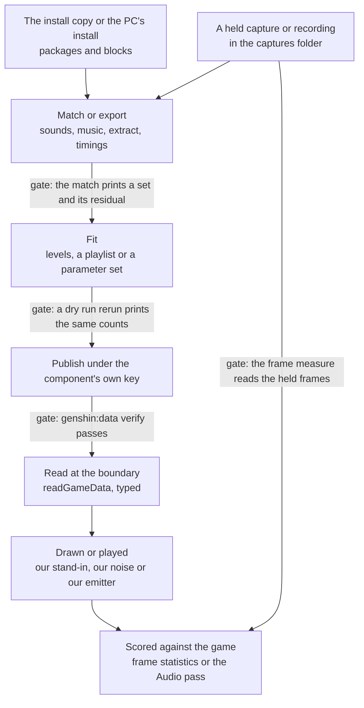

# Effects, audio and music assets

The game's effects, sounds and music are the one family whose source is the most spread out: the install holds the packages and the blocks, the captures and recordings hold the timing and the level, and the recreation's own components play what those two fit. This page is the family's inventory of what the game has, what the repo draws and plays, the gaps between them, and the conversion each gap follows from the install. The login's weather, clouds, bloom, music and door are other changes' work and are linked here, not restated. Nothing of the game's audio or art is committed or shipped: the fitted numbers and the stand-ins are what reach the browser ([derived assets](../../specs/genshin/derived-assets/design.md)).

## What the game has

| Item                                          | Where it is read from                                                                                                                                            | Magnitude                                                                                                                                                | On this Mac, or only the PC                       |
| :-------------------------------------------- | :--------------------------------------------------------------------------------------------------------------------------------------------------------------- | :------------------------------------------------------------------------------------------------------------------------------------------------------- | :------------------------------------------------ |
| Asset index, every asset of the mapped blocks | `{data-root}/genshin-parity/extracted/maps/index.tsv`, written by `scripts/src/services/genshinAssets/blocks/buildAssetMap.ts`                                   | about three million rows; none of its types is an audio clip, a particle system or an audio mixer                                                        | Mac                                               |
| Shader programs                               | `{data-root}/genshin-parity/extracted/shaders/Shader` (raw exports) and `shaders/asm` (listings)                                                                 | a few dozen raw exports; several thousand listings, most of them the character shader                                                                    | Mac                                               |
| Animation clips and their timings             | `{data-root}/genshin-parity/extracted/timings/<block>/AnimationClip`, read by `pnpm -C scripts genshin:assets timings`                                           | about two thousand clips, a couple of dozen of them effect clips; the clips checked print no event second (task 3.1), and task 3.6 checks the raw bytes  | Mac                                               |
| Login clips and login behaviours              | `{data-root}/genshin-parity/extracted/login-clips` and `login-behaviours`                                                                                        | under two dozen files, among them the login's cloud emitters' MonoBehaviour                                                                              | Mac                                               |
| The install's audio packages                  | `{data-root}/genshin-parity/game/GenshinImpact_Data/StreamingAssets/AudioAssets`, globbed by `scripts/src/services/genshinAssets/music/readGameAudioPackages.ts` | about a hundred packages: the door's `Minimum.pck`, the sound banks, the music and the streamed packages, and one folder per language; tens of gigabytes | Mac, as a copy of the install; the PC has its own |
| Matched sound-effect WAVs                     | `{data-root}/genshin-parity/extracted/sounds`                                                                                                                    | a few dozen WAVs, the login door's two among them                                                                                                        | Mac                                               |
| Music chroma                                  | `{data-root}/genshin-parity/extracted/music/chroma`, one per music sound                                                                                         | over a thousand files; the decoding folder beside it is empty                                                                                            | Mac                                               |
| Login playlist and its decoded sources        | `{data-root}/genshin-parity/extracted/login/music`                                                                                                               | one playlist and two decoded sources with their readings                                                                                                 | Mac                                               |
| Captures of the game                          | `{data-root}/genshin-parity/captures`                                                                                                                            | about two hundred entries: three audio captures, the login's recordings, `oculus-minimap.mkv` and the world attacks' capture                             | Mac                                               |
| Decoder for the packages                      | `resolveVgmstream` in `scripts/src/services/genshinAssets/music/resolveVgmstream.ts`, which pins a Windows and a macOS archive                                   | a sound not yet decoded is decoded by its platform's archive, so a Mac decodes with the macOS build                                                      | PC, and Mac for a decode                          |
| Language folders                              | `English(US)`, `Chinese` and `Japanese` beside `Minimum.pck` in the install's audio folder                                                                       | numbered packages in each folder; no command reads them, and whether they hold the spoken lines is not checked                                           | Mac, as a copy                                    |
| Voice-over text                               | the fetter rows in `packages/genshin-persona/src/generated/characterLines/English.json`                                                                          | text, not audio                                                                                                                                          | Mac                                               |
| Persona reference clips                       | `REFERENCES_DIRECTORY` in `packages/genshin-persona/src/services/constants.ts`                                                                                   | absent on this Mac: the state folder holds the roster and the picks only                                                                                 | neither here                                      |
| CC0 sample libraries                          | `SAMPLES_DIRECTORY` in `scripts/src/services/genshinAssets/shared/constants.ts`                                                                                  | absent; the CC0 recordings the login uses are in the repo                                                                                                | neither here                                      |
| Wiki audio                                    | `{data-root}/cache/genshin-wiki`                                                                                                                                 | none at its top level                                                                                                                                    | neither here                                      |
| Community dump                                | `{data-root}/genshin-dump-backup-6.6`                                                                                                                            | no effect, sound or music table                                                                                                                          | Mac                                               |

## What the repo draws and plays today

| Piece                                                      | File and symbol                                                                                                                                                                            | What it is                                                                                                                             | How close to the game                                                                   |
| :--------------------------------------------------------- | :----------------------------------------------------------------------------------------------------------------------------------------------------------------------------------------- | :------------------------------------------------------------------------------------------------------------------------------------- | :-------------------------------------------------------------------------------------- |
| Hit spark, skill and burst visual, reaction flash          | none                                                                                                                                                                                       | nothing drawn; `git grep` over the Genshin packages finds no component or material of the kind                                         | not found                                                                               |
| Damage numbers                                             | none                                                                                                                                                                                       | no readout of a hit's damage; the `coldDamage` in `packages/genshin-world/src/components/World/Windrise/Index.vue` is the sheer cold's | not found                                                                               |
| Energy drops                                               | `packages/genshin-world/src/models/enemy/EnergyDrop.ts` (`EnergyDrop`), made by `createParticleDrops`; the reaction's `models/party/ParticleDrop.ts` is made by `getReactionParticleDrops` | a data model; no component draws it                                                                                                    | not drawn                                                                               |
| Rain and snow streaks                                      | `packages/genshin-engine/src/nodes/createPrecipitationMaterial.ts` (`createPrecipitationMaterial`) and `packages/genshin-engine/src/atmosphere/createPrecipitationGeometry.ts`             | generated from our parameters                                                                                                          | starting values, named as such in `packages/genshin-engine/src/atmosphere/constants.ts` |
| Rain splashes                                              | `packages/genshin-engine/src/nodes/createSplashMaterial.ts`                                                                                                                                | generated                                                                                                                              | starting values, as the streaks                                                         |
| Lightning                                                  | `packages/genshin-engine/src/nodes/createLightningBoltMaterial.ts` (`createLightningBoltMaterial`)                                                                                         | generated                                                                                                                              | rate from the weather table                                                             |
| Login cloud sprites and cloud layer                        | `packages/genshin-engine/src/atmosphere/placeCloudBand.ts` and `packages/genshin-engine/src/nodes/createCloudLayerNode.ts`                                                                 | generated from fitted outlines and statistics                                                                                          | each band's spread not measured                                                         |
| Water glints, caustics, waterfall sheet and river foam     | `packages/genshin-engine/src/nodes/createWaterMaterial.ts`, `createCausticsNode.ts`, `createWaterfallMaterial.ts` and `createRiverMaterial.ts`                                             | generated                                                                                                                              | the falls' mist and foam are not built                                                  |
| Grass trail                                                | `packages/genshin-engine/src/vegetation/createGrassTrail.ts`, constants in `packages/genshin-engine/src/vegetation/constants.ts`                                                           | a generated stamp                                                                                                                      | provisional, named so in its constants                                                  |
| Elemental Sight trails                                     | `packages/genshin-world/src/components/World/SightTrails/Index.vue`                                                                                                                        | a white ribbon with no texture                                                                                                         | provisional width and fade                                                              |
| Bloom                                                      | `packages/genshin-engine/src/post/createPostPipeline.ts`                                                                                                                                   | the game's bloom node at the game's values, drawn on the login scene                                                                   | no longer a stand-in; its reading is not held yet (passes 1.3, 1.4)                     |
| Login music player                                         | `packages/genshin-engine/src/audio/createMusicPlayer.ts` (`createMusicPlayer`) and `scheduleMusicNote.ts`                                                                                  | synthesised from our parameters                                                                                                        | judged by the listening score                                                           |
| Login instrument recordings                                | `packages/genshin-world/src/data/login/recordings` and `packages/genshin-engine/src/audio/scheduleMusicRecording.ts`                                                                       | CC0 recordings layered over the synthesiser                                                                                            | layered, never replacing                                                                |
| Login door sound                                           | `packages/genshin-engine/src/audio/computeSoundEffectSamples.ts` (`computeSoundEffectSamples`) and `createSoundEffectBuffer.ts`                                                            | our noise from fitted levels                                                                                                           | measured against the game's in the Audio pass                                           |
| Oculus chime                                               | `packages/genshin-world/src/services/statue/playOculusSound.ts` (`playOculusSound`), called by `packages/genshin-world/src/components/Hud/Minimap/Index.vue`                               | a sine tone of a fixed frequency and length, provisional by its own comment                                                            | stand-in until the game's sound is matched                                              |
| Weapon ascension pips and the wish's sparkle               | `packages/genshin-world/src/components/Weapon/Screen/Ascend/Sparks/Index.vue` and `packages/genshin-interface/src/styles/sparkle.css`                                                      | CSS shapes of the interface                                                                                                            | not effects                                                                             |
| Other screens' music                                       | none; the only `musicPlaylistId` set is the login's, in `scripts/src/services/genshinAssets/shared/DerivedAssetComponentMap.ts`                                                            | nothing                                                                                                                                | not found                                                                               |
| Sounds of any other screen, footsteps, combat and ambience | none beyond the login's door                                                                                                                                                               | nothing                                                                                                                                | not found                                                                               |

## The gap

Each gap is a piece of the game's feedback or sound that the recreation does not draw or play. The last column says whether a machine can close it: Mac for work on this machine's copies, PC for work that runs the decoder or the AnimeStudio export.

| Id  | Gap                                                     | Why it matters                                                                                                                                                                                                                                                                                                                    | Smallest closing piece                                                                                                                                                                                          | Needs                                                     |
| :-- | :------------------------------------------------------ | :-------------------------------------------------------------------------------------------------------------------------------------------------------------------------------------------------------------------------------------------------------------------------------------------------------------------------------- | :-------------------------------------------------------------------------------------------------------------------------------------------------------------------------------------------------------------- | :-------------------------------------------------------- |
| G1  | A landed hit shows no spark                             | A fight gives no contact feedback, so a hit cannot be read as one                                                                                                                                                                                                                                                                 | One stand-in spark fired by the strike that lands a hit in `packages/genshin-world/src/services/kit/strikeEnemy.ts`, its size and life provisional until task 1.1 reads them off the held world attacks capture | Mac                                                       |
| G2  | No damage numbers                                       | The damage a hit deals is never shown                                                                                                                                                                                                                                                                                             | One readout in the interface's type, fed by the same strike; its digit layout measured by task 1.1                                                                                                              | Mac                                                       |
| G3  | No skill, burst or reaction visual                      | A cast or a reaction shows nothing at its caster or its enemy                                                                                                                                                                                                                                                                     | One stand-in per kind: a visual at the caster when a skill or burst is cast, a flash at an enemy a reaction strikes                                                                                             | Mac                                                       |
| G4  | The world's emitters are unread                         | The particle system fields are not in the dumps, so no emitter's rate, life or size is known. The [scene derivation](../../specs/genshin/scene-derivation/design.md) design records that an export's bytes may name neither a spread nor a rate, so the reader may find nothing, and task 1.3 reports which fields it cannot read | A raw-bytes reader for particle system fields (task 1.3), then one world effect's emitter fitted from its block (task 3.2)                                                                                      | PC for the world's blocks, Mac for an export already here |
| G5  | Energy drops are not drawn                              | The energy a defeated enemy drops has no visible form, though the drop is modelled                                                                                                                                                                                                                                                | One stand-in drop that flies to the member it charges                                                                                                                                                           | Mac                                                       |
| G6  | No camera response to a burst                           | A burst's landing gives the camera no shake                                                                                                                                                                                                                                                                                       | One shake on a burst's landing, its amplitude and length read from the held attacks capture through task 1.1; motion blur has no recording and is not in this change                                            | Mac                                                       |
| G7  | Effect shaders are unnamed                              | The index holds under two thousand shaders and none is named as an effect                                                                                                                                                                                                                                                         | A listing of each component's effect shaders by their state (task 1.4), then one effect's shader ported (task 3.5)                                                                                              | PC for the export, Mac for the login's                    |
| G8  | Clip events may be empty                                | No sound or particle can be timed from a clip, see Decisions                                                                                                                                                                                                                                                                      | One check on the PC that some clip fires an event (task 3.1)                                                                                                                                                    | PC                                                        |
| G9  | Only one screen's music is mapped                       | Every other screen plays no music                                                                                                                                                                                                                                                                                                 | One screen's playlist named from its recording and its music fit registered (task 4.3)                                                                                                                          | Mac to match, PC to export the playlist                   |
| G10 | Only the login door's sound is matched                  | The sounds of every other screen are silent                                                                                                                                                                                                                                                                                       | One screen's sound matched from a held audio capture and fitted under its own key (task 4.1)                                                                                                                    | PC to match                                               |
| G11 | The Oculus chime is a tone                              | A near Oculus sounds a sine, not the game's chime                                                                                                                                                                                                                                                                                 | The chime in the held minimap capture matched and replacing the tone (task 4.2)                                                                                                                                 | PC to match, Mac to play                                  |
| G12 | The falls' mist and foam are not built                  | A waterfall has no spray at its foot                                                                                                                                                                                                                                                                                              | Owned elsewhere: see Already specified                                                                                                                                                                          | PC or Mac, by its owner                                   |
| G13 | The rain, snow, sand and splash looks are provisional   | The weather's particles are starting values                                                                                                                                                                                                                                                                                       | Owned elsewhere: see Already specified                                                                                                                                                                          | by its owner                                              |
| G14 | The login clouds' spread and colour are unmeasured      | The login's cloud emitters are not matched band by band                                                                                                                                                                                                                                                                           | Owned elsewhere: see Already specified                                                                                                                                                                          | Mac                                                       |
| G15 | The game's bloom is not matched yet                     | The post pass draws the game's bloom node at the game's values; its reading does not close yet                                                                                                                                                                                                                                    | Owned elsewhere: see Already specified                                                                                                                                                                          | Mac                                                       |
| G16 | The sight and grass trails are provisional              | The trails' width and fade are guessed                                                                                                                                                                                                                                                                                            | Owned elsewhere: see Already specified                                                                                                                                                                          | by its owner                                              |
| G17 | The login's music is a synthesis with its layering open | Its score is unlistened, and the roadmap's Audio item records the CC0 sample layering as decided, with its build still open                                                                                                                                                                                                       | Owned elsewhere: see Already specified                                                                                                                                                                          | Mac                                                       |
| G18 | The login's clicks and wind are unmatched               | Two sounds of the login are silent                                                                                                                                                                                                                                                                                                | Owned elsewhere: see Already specified                                                                                                                                                                          | PC to match                                               |
| G19 | The login door's measures are not reproduced            | The delay, the correlations and the rush are read by hand                                                                                                                                                                                                                                                                         | Owned elsewhere: see Already specified                                                                                                                                                                          | Mac                                                       |
| G20 | The game's voice-over audio                             | The world plays no voice                                                                                                                                                                                                                                                                                                          | A missing asset, recorded in Not shippable, with no task                                                                                                                                                        | none                                                      |

Each closing piece is one task. A gap whose closing piece needs a command that does not exist has that command as a separate task marked `[phase 0]` ahead of it, and the closing task names it.

## Conversion path

The steps run in the order of the derived-assets recipe: map, extract, fit, publish, check. A step is either a command that exists, written exactly as it is run from the repository root, or **no command yet** with the task that builds it. A step that does not apply to a stand-in is written as not applicable.

**Visual feedback (G1, G2, G3, G5, G6).** Map: not applicable, the recording is the source. Extract: not applicable, the effect is ours. Fit: not applicable, the sizes, timings and colours are read off the held capture. Publish: not applicable. Check: **no command yet**, `genshin:parity frames` (task 1.1) reads a rectangle's statistics in every frame of a clip; the scenario tests of tasks 2.1 to 2.3 and 3.3 to 3.4 then prove the behaviour.

**World emitters (G4).** Map: `pnpm -C scripts genshin:assets map`, once per patch. Extract: `pnpm -C scripts genshin:assets extract <component>` on the PC for the world's effect block. Fit: **no command yet**, `genshin:assets emitters <component>` (task 1.3) reads the fields; then `pnpm -C scripts genshin:assets fit <component> --dry-run`. Publish: `pnpm -C scripts genshin:assets fit <component> --only <record>`, which needs the record key of task 1.2 and is followed by `pnpm -C scripts genshin:data verify`. Check: the scenario test of task 3.2, and `genshin:parity frames` once task 1.1 holds.

**Effect shaders (G7).** Map: `pnpm -C scripts genshin:assets map`. Extract: `pnpm -C scripts genshin:assets extract <component>` on the PC. Fit: `pnpm -C scripts genshin:assets shaders <component>` writes each program, then **no command yet**, `genshin:assets effect-shaders <component>` (task 1.4) names the effect ones. Publish: not applicable, the port is code. Check: the scenario test of task 3.5.

**Clip events (G8).** Map: `pnpm -C scripts genshin:assets map`. Extract: `pnpm -C scripts genshin:assets timings <pattern>` on the PC, which prints each clip's event seconds. Fit: not applicable. Publish: not applicable. Check: the command's output for a skill clip, which prints no event second for any clip checked on the PC (task 3.1); task 3.6 reads one clip's raw bytes to tell an empty list in the game's data from one AnimeStudio drops, and records the defect in the AnimeStudio upstream design if it is the latter.

**Other screens' music (G9).** Recording: found by search, as the References sought of the roadmap say. Map: `pnpm -C scripts genshin:assets music <recording>` on the Mac names the playlist; `pnpm -C scripts genshin:assets playlist <component>` on the PC exports it; the `musicPlaylistId` is then set by hand in `scripts/src/services/genshinAssets/shared/DerivedAssetComponentMap.ts`. Fit: **no command yet** for another component's music fit; task 4.3 registers it as the component's own fit entry, since the login's music is called from inside `fitLoginScene` and has no entry of its own, and `pnpm -C scripts genshin:assets fit <component> --dry-run` then runs it. Publish: `pnpm -C scripts genshin:assets fit <component> --only <record>`, with the key of task 1.2. Check: `pnpm -C scripts genshin:parity listen`.

**Other screens' sounds (G10, G11).** Recording: a held audio capture, or the minimap capture for the chime. Map: `pnpm -C scripts genshin:assets sounds <recording> <from,to>` on the PC, with `--package "Banks*.pck"` for a sound in a bank package; then the matched set is written by hand into `scripts/src/services/genshinAssets/sound/DerivedAssetSoundEffectMap.ts`. Fit: `pnpm -C scripts genshin:assets fit <component> --dry-run` runs the component's sound fit once task 1.2 registers it, so no fit exists for these components yet. Publish: `pnpm -C scripts genshin:assets fit <component> --only <record>` under the key of task 1.2, then `pnpm -C scripts genshin:data verify`. Check: `pnpm -C scripts genshin:parity passes <component> --pass Audio`, whose measure is written for any component the map names.

**Login door measures (G19).** Map and extract: already on this Mac. Fit: not applicable. Publish: not applicable. Check: `pnpm -C scripts genshin:parity passes login --pass Audio`. The package and the door's two decoded sounds are both on this Mac, so the pass reads them without a decode and this check has its inputs here.



## Already specified

Each gap below was searched across `openspec/` before it was written as a task. A gap owned by an open change or a roadmap item is linked and has no task here.

| Gap                                        | Owner                                                                                                                                                                                                                                                                 | What it covers                                                                                                |
| :----------------------------------------- | :-------------------------------------------------------------------------------------------------------------------------------------------------------------------------------------------------------------------------------------------------------------------- | :------------------------------------------------------------------------------------------------------------ |
| G4, the login's cloud emitters             | [login-screen clouds](../../specs/genshin/login-screen/clouds/design.md), an open item                                                                                                                                                                                | each cloud's colour over its life, waiting on the emitter's data                                              |
| G8, clip events                            | [kits README](../../specs/genshin/kits/README.md)                                                                                                                                                                                                                     | the clips checked print no event second (task 3.1), so gcsim gives the timings; task 3.6 checks the raw bytes |
| G12, the falls' mist and foam              | [flowing water](../../specs/genshin/flowing-water/design.md), with the roadmap's Phase 7 item of that name                                                                                                                                                            | the pool's particles, which wait on a recording of a fall                                                     |
| G13, the rain, snow, sand and splash looks | [weather change](../genshin-weather/design.md) and the roadmap's Weather schedule, Rain and Snow items                                                                                                                                                                | the streaks and splashes, which wait on recordings not yet found                                              |
| G14, the login clouds' spread              | [derived assets](../../specs/genshin/derived-assets/design.md), its open list, and the Atmosphere pass of the [recreation passes](../genshin-recreation-passes/design.md)                                                                                             | each band's spread, measured off the captures                                                                 |
| G15, the game's bloom                      | the Display pass of the [recreation passes](../genshin-recreation-passes/design.md), whose bloom node is built and whose reading is open, and the roadmap's bloom item                                                                                                | the drawn bloom reads closer to the game's brightest pixels                                                   |
| G16, the sight and grass trails            | [elemental sight](../../specs/genshin/elemental-sight/design.md) and the roadmap's Elemental Sight item; [trees and scatter](../genshin-trees-and-scatter/design.md)                                                                                                  | the trails' width and fade, waiting on the recording                                                          |
| G17, the login's music                     | the roadmap's Audio items under Phase 1, the Audio pass of the [recreation passes](../genshin-recreation-passes/design.md), and the [music](../../specs/genshin/music/README.md) and [sampled instruments](../../specs/genshin/sampled-instruments/design.md) designs | layering, noise, the listening score                                                                          |
| G18, the login's clicks and wind           | the roadmap's Audio item that matches the clicks, the door's assembly and the wind, the Audio pass's sounds, and the [sound effects](../../specs/genshin/sound-effects/design.md) design's Not yet list                                                               | a recording that plays each one clearly                                                                       |
| G19, the door's measures                   | the roadmap's Audio item for the login's sounds, and the [sound effects](../../specs/genshin/sound-effects/design.md) design's Open list                                                                                                                              | the delay, the correlations and the rush                                                                      |
| G3, skill and burst visuals                | the [character kits](../genshin-character-kits/design.md) design says they are matched in the recreation passes, but no pass holds an item for them                                                                                                                   | not owned: task 2.3                                                                                           |
| G11, the Oculus chime                      | the [statues](../../specs/genshin/statues-of-the-seven/design.md) design calls the sound provisional, and the [minimap](../../specs/genshin/minimap/design.md) design says the audio pass reads its start, but no open item carries it                                | not owned: task 4.2                                                                                           |
| G1, G2, G5, G6, G7, G9, G10                | none found: `git grep` over `openspec/` for each term (spark, damage number, shake, energy particle, effect shader, another screen's music or sound) returns no open item                                                                                             | tasks 2.1, 2.2, 3.3, 3.4, 3.5, 4.3, 4.1                                                                       |

## Not shippable

Each row is a piece of the game's audio or art. None ships, and each has a substitute that is ours. The rule is the one the music design states: the game's audio is read locally and is never shipped ([music](../../specs/genshin/music/README.md)), and the derived-assets rule is that only fitted parameters ship ([derived assets](../../specs/genshin/derived-assets/spec.md)).

| Item                                            | Where it is                                                                                                                                   | Why it cannot ship                                                                                                     | What the recreation draws or plays instead                |
| :---------------------------------------------- | :-------------------------------------------------------------------------------------------------------------------------------------------- | :--------------------------------------------------------------------------------------------------------------------- | :-------------------------------------------------------- |
| The install's audio packages                    | `{data-root}/genshin-parity/game/GenshinImpact_Data/StreamingAssets/AudioAssets` and the PC's install                                         | the game's audio                                                                                                       | our synthesised music, our noise and the sine chime       |
| Decoded game sounds                             | the WAVs in `{data-root}/genshin-parity/extracted/sounds` and the login's music sources in `{data-root}/genshin-parity/extracted/login/music` | the game's audio                                                                                                       | our noise and our synthesiser                             |
| The audio captures and the minimap capture      | `{data-root}/genshin-parity/captures`                                                                                                         | captured game audio, held for measuring                                                                                | the fitted levels and the stand-in chime                  |
| Music chroma                                    | `{data-root}/genshin-parity/extracted/music/chroma`                                                                                           | a measurement of the game's sounds, held locally                                                                       | the fitted parameters                                     |
| Language packages and the spoken lines          | the per-language folders of the install's audio folder                                                                                        | the game's voice audio                                                                                                 | no voice plays; the Profile tab shows the voice-over text |
| The persona's reference clips                   | `REFERENCES_DIRECTORY` in `packages/genshin-persona/src/services/constants.ts`                                                                | cached in the state folder and never committed, as `packages/genshin-persona/src/services/readReferenceClip.ts` states | the persona's own clone, a plugin's concern               |
| Shader programs and listings                    | `{data-root}/genshin-parity/extracted/shaders`                                                                                                | the sources of a port, not the port                                                                                    | our TSL nodes                                             |
| Animation clips and their timings               | `{data-root}/genshin-parity/extracted/timings`, `login-clips` and `login-behaviours`                                                          | game data, from which only fitted numbers ship                                                                         | gcsim's timings and our stand-ins                         |
| The game's particle emitters and their settings | whichever export holds them                                                                                                                   | only our parameters ship                                                                                               | our emitters fitted to measured rates and lives           |
| The game's voice-over audio                     | the language folders of the install copy                                                                                                      | the game's voice audio                                                                                                 | no voice plays; a missing asset, recorded here            |
| Shippable: the CC0 recordings                   | `packages/genshin-world/src/data/login/recordings`                                                                                            | licensed CC0, not the game's                                                                                           | the login's instrument layering                           |

## Decisions

- **Timings come from gcsim and from recordings, never from a clip's events.** The clips checked on the PC print no event second, a skill, an enemy's normal attack and a character's attack chain among them, so no sound or particle can be timed from one, and the kits already take their timings from gcsim ([kits](../../specs/genshin/kits/README.md)). The alternative was to time each spark, sound and particle off the clip's events, which the exports cannot supply. This decision is reversed only if a clip is found to fire an event, which task 3.6 checks for events the command dropped.
- **Feedback an action's gate needs is phase 3, and the game's own look and sound is phase 7.** The playable core's gate names fighting, and a fight with no contact or number cannot be read as played, so the stand-ins of G1, G2 and G3 take the lower phase, the rule for an arguable unit. The alternative was phase 7 for every combat visual, which would let the gate pass with the fight unreadable. The game's exact spark, sound and shake are fidelity, phase 7.
- **Effects are our components driven by our numbers, and no game particle runtime is replayed.** The alternative was to port the game's particle runtime module by module. That would be a second render path, and only fitted numbers ship.
- **Matching runs on the PC, and the Mac uses the WAVs and the chroma already decoded.** `resolveVgmstream` pins a Windows archive and a macOS archive beside it, and takes the one its platform names, so a sound not yet decoded is decoded by the Mac's own build. The split is kept as recorded when the Mac had no pinned decoder; moving the matching onto the Mac is left to the owner, since it is a choice between two machines' work and not a fix.
- **A component's sound or music record is published by its fit under a key of its own, never by a hand edit of the lock.** The lock is the publish's report, and the login's sound record is written by `scripts/src/services/genshinAssets/fit/fitLoginScene.ts` alone. The alternative was to write the lock by hand for each new key, which leaves no publish report.
- **One per-frame measure serves the spark, the number, the flash and the shake.** The alternative was a measure per effect, four commands for one reading, or the hand sampling with ffmpeg described in the motion reference ([motion](../../../.agents/skills/genshin-parity/references/motion.md)), which leaves no record a rerun can check.
- **Voice-over stays a missing asset.** The alternative was to use the install's language packages, either shipped or as the persona's reference clip. The first breaks the rule on game audio. The second changes the persona's own rule that its references come from the wiki, which is the persona plugin's decision to make, not this family's.
- **Gaps owned by another change are linked, and their work stays where it is.** The alternative was to restate the weather, bloom, cloud and login-audio work here, which would give two tasks for one piece of work.

## Key files

| File                                                                     | Role after the change                                                                          |
| :----------------------------------------------------------------------- | :--------------------------------------------------------------------------------------------- |
| `packages/genshin-world/src/services/kit/strikeEnemy.ts`                 | the strike that lands a hit, which fires the stand-in spark and the number (tasks 2.1 and 2.2) |
| `packages/genshin-world/src/services/combat/damage/getDamage.ts`         | the damage a hit deals, which the number shows (task 2.2)                                      |
| `packages/genshin-world/src/models/enemy/EnergyDrop.ts`                  | the energy drop the stand-in flies (task 3.3)                                                  |
| `packages/genshin-world/src/services/party/gainPartyEnergy.ts`           | the energy a standing member gains, the drop's target (task 3.3)                               |
| `packages/genshin-world/src/services/statue/playOculusSound.ts`          | the Oculus chime, a tone until the matched sound replaces it (task 4.2)                        |
| `packages/genshin-world/src/components/Hud/Minimap/Index.vue`            | calls the chime when a near Oculus is marked (task 4.2)                                        |
| `packages/genshin-world/src/models/data/GameDataset.ts`                  | the dataset members a component's record key is named by (task 1.2)                            |
| `packages/genshin-engine/src/audio/createSoundEffectBuffer.ts`           | renders a fitted sound effect once, reused for other screens (task 4.1)                        |
| `packages/genshin-engine/src/audio/computeSoundEffectSamples.ts`         | our noise from fitted levels, reused for other screens (task 4.1)                              |
| `packages/genshin-engine/src/audio/createMusicPlayer.ts`                 | the synthesiser player, through which another screen's music plays (task 4.3)                  |
| `scripts/src/services/genshinAssets/commands/soundsCommand.ts`           | matches a recording's window to the game's sounds (tasks 4.1 and 4.2)                          |
| `scripts/src/services/genshinAssets/commands/musicCommand.ts`            | names a recording's music (task 4.3)                                                           |
| `scripts/src/services/genshinAssets/commands/timingsCommand.ts`          | prints a clip's event seconds (task 3.1)                                                       |
| `scripts/src/services/genshinAssets/commands/shadersCommand.ts`          | exports a component's shaders (task 3.5)                                                       |
| `scripts/src/services/genshinAssets/commands/behavioursCommand.ts`       | reads MonoBehaviour fields from raw bytes, the model for the emitter reader (task 1.3)         |
| `scripts/src/services/genshinAssets/sound/DerivedAssetSoundEffectMap.ts` | maps each component's matched sounds (tasks 4.1 and 4.2)                                       |
| `scripts/src/services/genshinAssets/shared/DerivedAssetComponentMap.ts`  | holds each component's `musicPlaylistId` (task 4.3)                                            |
| `scripts/src/services/genshinAssets/sound/readGameSoundEffect.ts`        | the matched sounds laid at their offsets, which fits and the Audio pass read                   |
| `scripts/src/services/genshinAssets/fit/fitSoundEffect.ts`               | fits a matched sound to levels (tasks 4.1 and 4.2)                                             |
| `scripts/src/services/genshinAssets/fit/fitLoginScene.ts`                | writes the login's sound record under its key, the model for task 1.2                          |
| `scripts/src/services/genshinAssets/fit/DerivedAssetFitMap.ts`           | registers each component's fits (tasks 1.2 and 4.3)                                            |
| `scripts/src/services/genshinAssets/music/readGameAudioPackages.ts`      | globs a pattern in the install's audio folder                                                  |
| `scripts/src/services/genshinAssets/music/resolveVgmstream.ts`           | pins the decoder each platform takes, Windows or macOS                                         |
| `scripts/src/services/genshinParity/passes/measureAudio.ts`              | the Audio pass, which scores each component's effects                                          |
| `scripts/src/services/genshinParity/commands/lumaCommand.ts`             | one region's darkness across frame folders, the nearest reader of frames today                 |
| `scripts/src/services/genshinParity/commands/probeCommand.ts`            | reads a rectangle off a still, the model for the frame measure (task 1.1)                      |
| `packages/genshin-world/src/generated/gameDataLock.json`                 | the lock a publish writes, never edited by hand                                                |
| `openspec/specs/genshin/derived-assets/animestudio-upstream/design.md`   | where a clip-event defect is recorded if task 3.6 finds one                                    |

New files are not named in the table, since a backticked path must already exist. Task 1.1 adds a frame measure under a new folder for the parity tools, task 1.3 adds an emitter reader beside `behavioursCommand.ts`, task 1.4 adds a listing of effect shaders, and tasks 2.1 to 2.3 and 3.3 to 3.5 add the combat's effects under a new folder in the world's components and services:

```text
packages/genshin-world/src/components/World/Effects/
packages/genshin-world/src/services/effects/
packages/genshin-engine/src/effects/
scripts/src/services/genshinParity/frames/
scripts/src/services/genshinAssets/particles/
scripts/src/services/genshinAssets/effects/
```

## Sources

- The install copy on this machine, read through the paths named in the inventory table: its audio folder, its blocks and its version file, which states the copy's game version. No outside decision is taken.
- The captures and recordings named in the tables above, each read as held on this machine.
- The repository's own pages, linked where each fact is stated.
