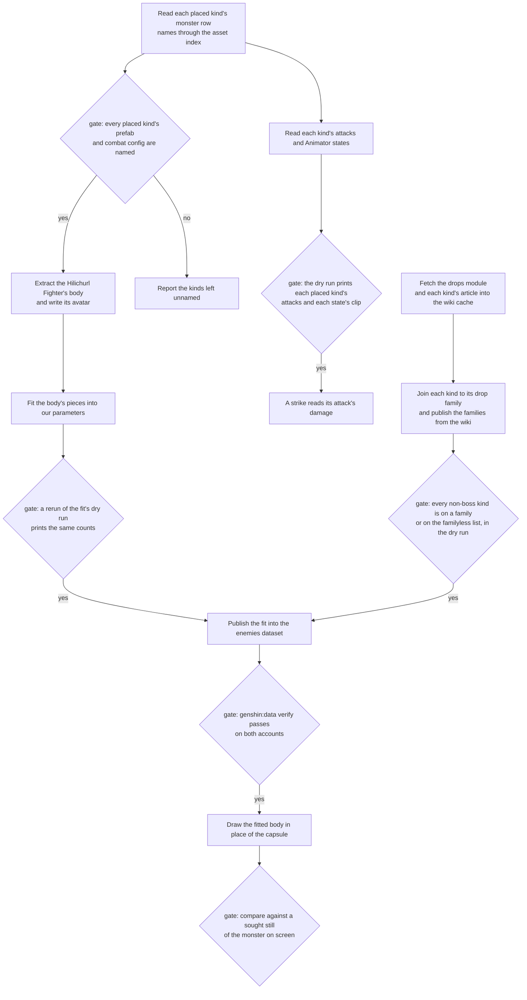

# Enemy asset family

The enemies are the one family whose game art the recreation has never converted. Its monsters' bodies, animation clips, attack effects and per-attack damage sit in the install's blocks and dumps, and the derived-assets recipe ([derived assets](../../specs/genshin/derived-assets/design.md)) has a step for each. Several of those steps have no command yet, the drop families were written by hand for one family and are joined from the wiki's table by this change, and the camp kinds sit behind a hand-written map. This page is the lead for the family: what the game holds and where it is read from, what the repository draws today, the gaps and the smallest piece that closes each, the conversion path with a command or a task for every step, what open work already owns a gap, and what the recreation cannot ship. The tasks in [tasks](tasks.md) are the build order.

## How it works

The family converts in the recipe's order. Each stage's check is a gate: a stage's output is not used until its gate passes.

The drops and the attacks read from tables, not from the body, so they run beside the body's chain and meet at the publish. The draw cap is a separate fix in the enemy framework and needs none of the chain.

## What the game has

Every row is read from the installed game's dumps or blocks, or from the wiki's cache, on this Mac unless the last column says otherwise. The dumps are the community's extraction of the game's tables, and the blocks are the game's asset bundles.

| Item                                                                                                                                                  | Where it is read from                                                                                                                                                                                                                                          | On this Mac, or only the PC's install                                                                                                                               |
| :---------------------------------------------------------------------------------------------------------------------------------------------------- | :------------------------------------------------------------------------------------------------------------------------------------------------------------------------------------------------------------------------------------------------------------- | :------------------------------------------------------------------------------------------------------------------------------------------------------------------ |
| Monster rows: base stats, resistances, kill and health-threshold drop ids, and the hashes of each kind's prefab, controller, combat config and script | `{data-root}/genshin-parity/text/ExcelBinOutput/MonsterExcelConfigData.json`                                                                                                                                                                                   | This Mac. Every kind the regions place has its row.                                                                                                                 |
| Monster names and describe ids                                                                                                                        | `MonsterDescribeExcelConfigData.json`, beside it                                                                                                                                                                                                               | This Mac                                                                                                                                                            |
| Level curves for stats                                                                                                                                | `MonsterCurveExcelConfigData.json`, beside it                                                                                                                                                                                                                  | This Mac                                                                                                                                                            |
| Codex monster entries                                                                                                                                 | `AnimalCodexExcelConfigData.json`, beside it                                                                                                                                                                                                                   | This Mac                                                                                                                                                            |
| Monster rows the roadmap calls install-bound, which the trial enemies wait on                                                                         | Named as install-bound by the [roadmap](../genshin-roadmap/tasks.md)'s trial item                                                                                                                                                                              | Only the PC's install, per that item. This change does not read it.                                                                                                 |
| Path names of prefabs, controllers and combat configs                                                                                                 | The community asset index `{data-root}/genshin-parity/asset-index/gi-2.6.0.json`, which stops at game 2.6; a monster's hash past it is named by nothing, since the derived route names world prefabs only                                                      | This Mac                                                                                                                                                            |
| Prefabs, Animator controllers, meshes and materials                                                                                                   | The game's blocks under `{data-root}/genshin-parity/game/GenshinImpact_Data/StreamingAssets/AssetBundles/blocks`                                                                                                                                               | This Mac's copy of the install. The PC is the install of record, and nothing here reads it.                                                                         |
| Asset map and its index                                                                                                                               | `{data-root}/genshin-parity/extracted/maps/index.tsv`                                                                                                                                                                                                          | This Mac. It lists thousands of animator rows, over ten thousand clip rows and over a thousand monster icon rows.                                                   |
| Monster animation clips                                                                                                                               | The `Ani_Monster_*` and `Ani_Hili_*` clips in the blocks                                                                                                                                                                                                       | This Mac. One is exported, `{data-root}/genshin-parity/extracted/timings/07268175/AnimationClip/Ani_Monster_Hili_Club_NormalAtk.json`, and its event list is empty. |
| Monster effects                                                                                                                                       | The `Eff_Monster*` GameObject dumps under `{data-root}/genshin-parity/extracted`                                                                                                                                                                               | This Mac. Over a thousand dumps, none with particle fields.                                                                                                         |
| Combat configs                                                                                                                                        | `Data/_BinOutput/Monster/ConfigMonster_*` paths, which name files in the blocks                                                                                                                                                                                | This Mac's blocks. No code reads them.                                                                                                                              |
| Attack elements                                                                                                                                       | The game's own skill tables, which the roadmap names as the PC export, or the wiki's family pages                                                                                                                                                              | The PC export, per the roadmap. The wiki's family pages are cached on this Mac.                                                                                     |
| Drop families: Mora, Character EXP, materials and their tiers by level band                                                                           | The wiki's Enemies table in `{data-root}/cache/genshin-wiki/Page_Module:Drops_Table%2Fdata.json`, joined to each kind by the first Drops Table its own article lists, in `{data-root}/cache/genshin-wiki/Page_<kind name>.json`. The dump holds no drop table. | This Mac (the cache)                                                                                                                                                |
| Wiki pages the enemies read: the drops module and each non-boss kind's article, by its English name                                                   | The wiki cache, under the names above. The six family pages the Enemy page names are read by task 2.2, which fetches them with its reader.                                                                                                                     | Cached on this Mac by `genshin:assets enemy-pages`, which fetches any of them the cache lacks.                                                                      |
| Monster portraits and small icons                                                                                                                     | `UI_MonsterIcon_*` and `UI_MonsterSmallIcon_*` rows in the index                                                                                                                                                                                               | This Mac                                                                                                                                                            |

## What the repo draws today

| Part                   | Where it lives                                                                                                                                                                                           | What it does now                                                                                                                                |
| :--------------------- | :------------------------------------------------------------------------------------------------------------------------------------------------------------------------------------------------------- | :---------------------------------------------------------------------------------------------------------------------------------------------- |
| The enemy stand-in     | `packages/genshin-world/src/components/World/Enemies/Index.vue`, the instanced capsule and its draw loop                                                                                                 | One capsule for every kind, tinted by state, with a white flash after a hit. The loop stops at the draw capacity in map order, not by distance. |
| The draw capacity      | `ENEMY_CAPACITY` in `packages/genshin-world/src/services/enemy/constants.ts`                                                                                                                             | The one bound on drawn enemies                                                                                                                  |
| The AI's pacing        | `ENEMY_WINDUP_SECONDS`, `ENEMY_RECOVERY_SECONDS`, `ENEMY_WALK_SPEED` and `ENEMY_LEASH_DISTANCE` in the same file                                                                                         | One value for every kind. Their comments name clips and recordings that the repository does not hold.                                           |
| The common strike      | `computeEnemyStrikeDamage` in `packages/genshin-world/src/services/kit/computeEnemyStrikeDamage.ts`, with `ENEMY_STRIKE_TALENT_MULTIPLIER` in `packages/genshin-world/src/services/kit/constants.ts`     | An enemy's ATK through the target's defence, with one multiplier for every kind                                                                 |
| The attack element     | `EnemyKindTraitsMap` in `packages/genshin-world/src/services/enemy/EnemyKindTraitsMap.ts`                                                                                                                | An attack element on one kind, the Cryo Abyss Mage                                                                                              |
| The drop tables        | `readEnemyTables` in `packages/genshin-world/src/services/enemy/readEnemyTables.ts`, which joins the two drop records                                                                                    | Each kind's drop table as the enemies dataset publishes it, none for a kind on no family                                                        |
| The drop roll          | `computeEnemyDrops` in `packages/genshin-world/src/services/enemy/computeEnemyDrops.ts`                                                                                                                  | Character EXP for every common or elite kind, and its drop table's Mora and materials where it has one                                          |
| The boss moves         | `EnemyKindMovesMap` in `packages/genshin-world/src/services/bosses/EnemyKindMovesMap.ts`                                                                                                                 | Three bosses' moves as data, each with its own windup and recovery                                                                              |
| The monster kinds      | `scripts/src/services/genshinAssets/enemies/buildEnemyKinds.ts`                                                                                                                                          | Publishes the kinds and their level curves from the monster tables, and no drop family                                                          |
| The camp kinds         | `FamilyLabelEnemyKindIdMap` in `scripts/src/services/genshinAssets/camps/FamilyLabelEnemyKindIdMap.ts`                                                                                                   | A hand-written map from family labels to kinds, which leaves about half of the map's families out and says how many in its comment              |
| The derived components | `DerivedAssetComponent` in `scripts/src/models/genshinAssets/shared/DerivedAssetComponent.ts`, and `DerivedAssetComponentMap` in `scripts/src/services/genshinAssets/shared/DerivedAssetComponentMap.ts` | No monster member                                                                                                                               |
| The derived fits       | `DerivedAssetFitMap` in `scripts/src/services/genshinAssets/fit/DerivedAssetFitMap.ts`                                                                                                                   | No monster fit                                                                                                                                  |

## The gap

Nine gaps, numbered as the family's inventory numbers them. The smallest piece is the least that closes the gap and proves it, and the last column says what each piece needs. Every piece runs on this Mac's copy of the blocks and dumps; none needs the PC's install, and the attack element, the one piece the roadmap names as the PC export, stays with its owner.

| Id  | Gap                                                                                                              | Why it matters                                                                                                                                       | Smallest piece                                                                              | Needs: Mac, PC                                                                      |
| :-- | :--------------------------------------------------------------------------------------------------------------- | :--------------------------------------------------------------------------------------------------------------------------------------------------- | :------------------------------------------------------------------------------------------ | :---------------------------------------------------------------------------------- |
| 1   | No monster has a body of its own, so every kind is the one capsule                                               | The world shows one shape for about eighty kinds, so no monster reads as the thing it is                                                             | The Hilichurl Fighter's body extracted and its avatar written, then one fitted body drawn   | Mac. PC: none.                                                                      |
| 2   | Clips and hit timings: one clip exported with no events, and no reader for the Animator states                   | The windup, recovery and stagger times are provisional, and the AI's timings need the clips                                                          | The Hilichurl's Animator states, each with the clip it plays and the clip's events          | Mac. PC: none.                                                                      |
| 3   | Attack effects: the windup is a colour, and the effect dumps hold no particle fields                             | A player cannot read an attack before it lands                                                                                                       | A telegraph of the windup's reach, drawn as our own shape                                   | Mac. PC: none.                                                                      |
| 4   | Attack damage per attack for the placed kinds: only the element of one kind is set, and a strike is one flat ATK | An enemy's hits are the same size whatever its attack is                                                                                             | The Hilichurl Fighter's attack list read from its combat config, with the strike reading it | Mac. PC: the attack element stays with its roadmap item, which names the PC export. |
| 5   | Drop families: one family of about fifty is built, so a common enemy drops nothing of the others                 | The spec says a defeated common enemy drops Mora, Character EXP and materials, and most kinds drop none                                              | The drop families published from the wiki's table, and the Hilichurl family unchanged       | Mac. PC: none.                                                                      |
| 6   | Camp kinds: the family label map leaves about half of the families out                                           | A camp of a left-out family spawns no kind                                                                                                           | The family map from the pages' variants, task 2.2, see below                                | Mac. PC: none.                                                                      |
| 7   | AI timings and ranges are provisional                                                                            | The comments say they were measured, and no measurement exists                                                                                       | Owned by the compute item, see below                                                        | Mac for the clips; the range and leash need a recording.                            |
| 8   | Boss moves and bodies                                                                                            | Each boss's attacks are data for three kinds only, and no boss has a body                                                                            | Owned by the bosses change for moves; its bodies follow gap 1                               | Mac. PC: none.                                                                      |
| 9   | The draw stops at the capacity in map order                                                                      | Once more enemies are loaded than the capacity, the ones nearest the character can go undrawn, since the map holds every camp of every loaded region | The nearest enemies drawn first, within the same capacity                                   | Neither: a code change with a test.                                                 |

## The conversion path

The steps follow the recipe in the derived-assets page, which names the map, extract, fit, publish and check stages. Where a step has a command, it is the command that exists; where it does not, the step is a task, named as **no command yet** with the task that builds it. The map stage is already run for this install, so the family runs no mapping of its own.

### Map

| Step                                                                                  | Command                                                                                                                                                                                                                                                                                                                                                             | Gap                                                                         | Task |
| :------------------------------------------------------------------------------------ | :------------------------------------------------------------------------------------------------------------------------------------------------------------------------------------------------------------------------------------------------------------------------------------------------------------------------------------------------------------------ | :-------------------------------------------------------------------------- | :--- |
| Map the blocks into the asset map and its index                                       | `pnpm -C scripts genshin:assets map`, run once per install                                                                                                                                                                                                                                                                                                          | None here. Re-mapping a new patch is the pipeline's gap, not this family's. | None |
| Read each placed kind's monster row and name its prefab, controller and combat config | `pnpm -C scripts genshin:assets monsters`, which names each placed kind's and each boss's prefab, controller and combat config through the asset index, and counts each hash it cannot name. Names come from the index's path names, and a hash past game 2.6 that the index does not hold is counted as unnamed, since the derived route names world prefabs only. | 1, 2, 4                                                                     | 1.1  |

### Extract

| Step                                                                 | Command                                                                                                                                                                                                                                                                                                              | Gap | Task     |
| :------------------------------------------------------------------- | :------------------------------------------------------------------------------------------------------------------------------------------------------------------------------------------------------------------------------------------------------------------------------------------------------------------- | :-- | :------- |
| Name the Hilichurl Fighter's body component in the two derived files | **No command yet.** Add a member to the component enum and an entry to the component map, with the prefab's root and a clip pattern.                                                                                                                                                                                 | 1   | 5.1      |
| Export the body's closure                                            | `pnpm -C scripts genshin:assets extract <component>`, then `inventory` and `tree` for the same component                                                                                                                                                                                                             | 1   | 5.1      |
| Export the monster's clips by name pattern                           | `pnpm -C scripts genshin:assets timings "^Ani_Monster_Hili_"`. The `clips` step needs a component, so the clips come through `timings`, which exports each clip as JSON and prints its events.                                                                                                                       | 2   | 4.1      |
| Read each Animator state and the clip it plays                       | **Patch AnimeStudio first.** The JSON export of a controller holds `m_TOS` and `m_AnimationClips` only, so task 4.0 carries the export of its `m_Controller` member, and the monsters subcommand reads that member (task 4.1). The `behaviours` step exports a component's animators raw but reads no state machine. | 2   | 4.0, 4.1 |
| Read each placed kind's attacks from its combat config               | **No command yet.** Build the combat config reader, which the monsters subcommand can name.                                                                                                                                                                                                                          | 4   | 3.2      |

### Fit

| Step                                                        | Command                                                                                                                                                                                                                                                        | Gap | Task |
| :---------------------------------------------------------- | :------------------------------------------------------------------------------------------------------------------------------------------------------------------------------------------------------------------------------------------------------------- | :-- | :--- |
| Write the monster-shape fit for a humanoid's skinned pieces | **No command yet.** Write the fit file and register it in the fit map. The candidate is the statue fit, `fitStatueComponent` in `scripts/src/services/genshinAssets/fit/fitStatueComponent.ts`, which writes a piece as stacks. Its shape is the task's check. | 1   | 5.2  |
| Dry-run the fit                                             | `pnpm -C scripts genshin:assets fit <component> --dry-run`                                                                                                                                                                                                     | 1   | 5.2  |
| Camp kinds from the map's family labels                     | `pnpm -C scripts genshin:assets enemy-camps --dry-run` exists; the family map is hand-written, and task 2.2 maps it from each family page's variants                                                                                                           | 6   | 2.2  |

### Publish

| Step                                                                                | Command                                                                                                                                                                                                                                              | Gap      | Task     |
| :---------------------------------------------------------------------------------- | :--------------------------------------------------------------------------------------------------------------------------------------------------------------------------------------------------------------------------------------------------- | :------- | :------- |
| Publish the kinds and their level curves                                            | `pnpm -C scripts genshin:assets enemies`, with `--dry-run` first                                                                                                                                                                                     | Existing | None     |
| Publish the drop families into the enemies dataset, read through the enemies reader | `pnpm -C scripts genshin:assets enemies --dry-run`, which prints each family with the kinds it covers, then without the flag. The enemies step reads the wiki's table through the drops module and each kind's article, so `enemy-pages` runs first. | 5        | 3.1      |
| Publish the body's fit into the enemies dataset                                     | `pnpm -C scripts genshin:assets fit <component> --only <key>`, once step 5.2 registers the fit                                                                                                                                                       | 1        | 5.2      |
| Verify both accounts                                                                | `pnpm -C scripts genshin:data verify`                                                                                                                                                                                                                | 1, 5     | 3.1, 5.2 |
| Commit the lock                                                                     | **No command yet.** The recipe's git step, by hand, with the publish report in its body, as the genshin-data skill has every publish do. Each publishing task ends with it.                                                                          | 1, 5     | 3.1, 5.2 |

### Check

| Step                                  | Command                                                                                                                                                                          | Gap  | Task |
| :------------------------------------ | :------------------------------------------------------------------------------------------------------------------------------------------------------------------------------- | :--- | :--- |
| Fetch the enemy pages the cache lacks | `pnpm -C scripts genshin:assets enemy-pages --dry-run`, then without the flag: each page the cache lacks, through the wiki's API, as the kits' talent pages are                  | 4, 5 | 2.1  |
| Check the windup's telegraph          | A unit test of the telegraph's reach, with no reference: no game frame of a telegraph exists to compare against                                                                  | 3    | 5.3  |
| Check the draw order                  | A unit test of the nearest-first selection                                                                                                                                       | 9    | 3.3  |
| Check a body on screen                | `pnpm -C scripts genshin:parity compare <reference>`, once a still of the monster is found in published material and recorded as its reference. No monster reference exists yet. | 1    | 5.4  |

## Already specified

Each gap that an open page already owns is linked here, and the owning page is not written again. Each row says what the owner covers and what this change adds beside it.

| Gap                                      | Owner                                                                                                                                                                          | What the owner covers                                                                                | What this change adds                                                                                     |
| :--------------------------------------- | :----------------------------------------------------------------------------------------------------------------------------------------------------------------------------- | :--------------------------------------------------------------------------------------------------- | :-------------------------------------------------------------------------------------------------------- |
| 4, the attack element                    | [genshin-party](../genshin-party/tasks.md) task 5.1, and the roadmap line "Each placed enemy kind's attack element has a source" in [the roadmap](../genshin-roadmap/tasks.md) | The element each placed kind's attacks carry                                                         | Nothing. The per-attack damage is task 3.2.                                                               |
| 5, the common enemy's drop               | The enemies spec's requirement on a common enemy's drop, in [enemies](../../specs/genshin/enemies/spec.md)                                                                     | The rule that a common enemy drops by its level band                                                 | The families the rule reads: task 3.1, which rewords the requirement when it ships                        |
| 6, camp kinds                            | [spawned places](../genshin-spawned-places/design.md), which writes the camps from the map's family labels and marks its family map provisional                                | The family to kind map and the camps it forms; no open task of its covers the map                    | The family map from each family page's variants, task 2.2, which fetches and reads the pages it maps from |
| 7, AI timings and ranges                 | The compute item `{enemy-measures}` in [the world's compute page](../../specs/genshin/compute/world/design.md), and the roadmap line "Enemies' measures and places"            | The timings and speeds read off the Hilichurl's clips, and the aggro range and leash off a recording | The clip and state reader it reads: task 4.1                                                              |
| 8, boss moves                            | [bosses](../genshin-bosses/tasks.md), tasks 2.1 and 2.3                                                                                                                        | Each boss's attacks, phases and timings                                                              | The boss bodies follow task 5.4                                                                           |
| The Unusual Hilichurl's 18 Adventure EXP | The enemies spec's Open item, and the roadmap line "Enemy and boss rules the wiki states differently"                                                                          | The reward, which no region places yet                                                               | Nothing                                                                                                   |
| The trial enemies                        | The roadmap line "Character trials: the trial enemies"                                                                                                                         | The trial enemies, blocked on install-bound monster rows                                             | Nothing. This change does not read the install.                                                           |

## Not shippable

The game's art below cannot ship, because it is the game's own mesh, texture, clip or effect. Each row names what the recreation draws until a generated or traced one exists, so the stand-in is never an unrecorded gap.

| Missing asset                                              | What the recreation draws until one exists                    | What would replace it                                                       |
| :--------------------------------------------------------- | :------------------------------------------------------------ | :-------------------------------------------------------------------------- |
| Each kind's meshes, skinned meshes, materials and textures | The capsule                                                   | A fitted body per kind, as task 5.2 and task 5.4 build                      |
| The animation clips' curves                                | The one provisional timing in the enemy framework's constants | Fitted timing numbers from the clips, as task 4.1 and the compute item give |
| Effect meshes, textures and particle parameters            | The colour tint and the hit flash                             | A telegraph of our own shape, as task 5.3 builds                            |
| Monster portraits and small icons                          | Nothing: the sight draws the name as text                     | A traced portrait, if a screen needs one, as a roadmap line                 |

## Decisions

- **The bodies ship as fitted parameters, never as the avatar's mesh.** The avatar's files stay in the extraction folder, since the derived-assets page ships only our parameters. The alternative, shipping the avatar's mesh, was rejected because it is the game's own art.
- **The AI timings belong to the compute item, and this change links them rather than measuring the same clips twice.** The alternative was a second timing task, rejected because two measures of one clip drift apart.
- **The enemy family pages are fetched by a command, never copied by hand.** The alternative, copying pages into the cache, was rejected because the other machine could not reproduce the cache.
- **The drop families become a hosted record read through the reader, and the hand-written table is deleted in the same change.** The alternative, generating TypeScript from the table, was rejected because the game data is hosted under a lock, and a generated file would bundle it. Keeping the old table beside the record was rejected under the rule that the old form is deleted in the change that replaces it.
- **A kind takes its drop family from its own wiki article: the first Drops Table the article lists, where the table's type is a member of a family in the Enemies table.** A name match was rejected, since it pins a drop without the link the wiki gives from a kind to its table, which is the article. Assigning families by the order of the wiki's member lists was rejected, since it pins a drop to the wrong kind without a sign.
- **A kind whose article lists two Drops Tables takes the first.** Floating Anemo Fungus lists `Fungi (Small)` and then `Fungi (Small, Activated)`, and the two name different materials: the first names Fungal Spores, Luminescent Pollen and Crystalline Cyst Dust, the second Inactivated, Dormant and Robust Fungal Nuclei. The second family is not published, so the kind drops the first's materials only. Taking both was rejected, since the enemies dataset gives each kind one drop family.
- **A kind whose article lists no Drops Table takes no family only if the familyless list names it with its reason.** The familyless list, in `enemies/constants.ts`, names the kinds whose article draws its drops from a `{{Drops|...}}` template in place of a table, each with its reason beside it. The build refuses a kind on neither the table nor the list, and a listed kind whose article does list a table, so the list cannot drift from the wiki.
- **Bosses drop nothing, the weekly boss among them, and their articles are not read.** The monster table types a boss, and the drop roll gives a boss no Mora, materials or Character EXP, so the join skips every boss. The weekly boss's article is Dvalin's, and the cached Dvalin page names no Drops Table. Every other kind, placed, bounty or Spiral Abyss chamber, is joined, so no kind loses its drops by accident: Dendro and Electro Samachurl take the Samachurls family from their own articles.
- **A family with a material of fixed count is refused where a kind reaches it, rather than published without the count.** See Not built.
- **The two drop records are keyed by what they describe, and the family key is a string.** `enemies/dropFamilies` holds one row a family, keyed by the Drops Table type its kinds name it by, and `enemies/dropFamilyKinds` holds one row a kind, keyed by the kind's id. The family key is a string the record's schema validates, and the `EnemyDropFamily` enum is deleted with its uses, with no alias.
- **The fetch step covers every non-boss kind's article, not the placed kinds only.** The camps, the bounties and the Spiral Abyss chambers each name kinds of their own, and each one's drops come from its own article, so the step reads every one.
- **The draw takes the nearest enemies first, within the same capacity constant.** Raising the capacity was rejected, since the loaded Mondstadt camps already hold over a thousand members and the cutoff would only move. A fixed distance cull was rejected, since region data arrives at different distances and a fixed radius would hide enemies at the edge of reach.
- **The telegraph is our own shape of the windup's reach.** Reading the game's particle parameters was rejected, since no dump holds them.
- **The damage per attack is read from the combat config, and the wiki's family pages are the fallback.** The wiki names the attacks but not each attack's multiplier as the game stores it, so the config is the primary source. If the config does not decode, the fallback is the wiki, and the task reports which was used.
- **The monster rows are read by a new subcommand, not by a hand search of the index.** The recipe's own step for the rows is a hand search; a hand search cannot be rerun on a new install, so it is replaced.
- **No task here needs the PC's install.** Every piece reads this Mac's copy of the blocks and dumps. The attack element is the one that names the PC export, and it stays with its owner. The alternative, reading the PC's install for every piece, was rejected: the other pieces read the Mac's copy of the same blocks, and the one piece the roadmap names as the PC export is already its owner's.
- **Phase placement.** The draw order is phase 3, since a fight in the playable core must show the enemies beside the character, which the lower phase's gate requires. The bodies and the telegraph are phase 7, since the capsule passes the phase 3 gate and both are art. The damage per attack is phase 3 in its meaning, but its task builds a missing reader, so it is phase 0. The drop families and the monster-shape fit build missing commands, so they are phase 0 by the same rule. The camp family map, task 2.2, is phase 4, since the Mondstadt camps need its kinds for the spawned places the Mondstadt gate names, and a unit two gates need sits in the lower one. The change's phase is 0, since most of its tasks build the missing readers. Rejected: the highest phase among its tasks, since a change's phase is the lowest whose gate fails without it.
- **The enemies spec's common-enemy drop requirement is reworded to the built behaviour in the change that builds the families (task 3.1).** The openspec rule is that a target the code does not meet is not a requirement, so the requirement now states what the join gives: Character EXP for every common or elite kind, and the family's Mora and materials where the kind is on one.
- **The constants' "measured" comments stay until the compute item lands.** The comments name the Hilichurl's clips and a recording, and the dump holds one clip with no events and no recording exists. The word becomes true only when the compute item measures, so the comments are reworded in that change. The alternative, rewording them now to say the timings are provisional, was rejected because the compute item rewrites the same lines when it measures; the cost is that the comments stay wrong until then, and this change does not claim otherwise.
- **The spec's Open item on the kill drop 22010010 is corrected when the Unusual Hilichurl item is settled.** The spec says the id is in no table the dump holds. The id appears in three dump files, the monster table among them, but no drop table holds it, and that narrower statement is the one the dump supports. The alternative, correcting the Open item in this change, was rejected: this change specifies and ships no drop, and the item that settles the kill drop is where the corrected statement gets its answer.
- **The Hilichurl Fighter's attacks are read from its cached page.** The traits comment cites the page's Attacks section, where every attack is Physical DMG, so the kind has no attack element. The page's infobox also lists a Dendro element, which no attack uses and the page does not explain; its damage type there is Physical. The attack-element task reads the same page for the fighter's attacks.

- **A controller's states come from AnimeStudio's JSON export of its `m_Controller` member, not from a TypeScript parse of the raw bytes.** The raw bytes parse only with a type-tree reader. The controller's layout depends on its serialized type, since the blend-node triangle branch and the state's MDB blend-rate field are gated by the type's hash, and the raw export does not carry the type tree. On the Hilichurl's raw controller the layout with the triangle branch and without the MDB field leaves a fixed 16-byte trailer after `m_AnimationClips`. Some monster controllers leave that trailer too, the Hilichurl's among them; the rest leave 80 to 688 bytes, so no one layout consumes every controller exactly, and the layout cannot be chosen per file. `m_ControllerSize` is not a byte count: on the Hilichurl's controller it is larger than the file. A Hilichurl-only parser would be a shortcut the other kinds break. Patching AnimeStudio's export (task 4.0, drafted in `openspec/specs/genshin/derived-assets/animestudio-upstream/design.md`) keeps the tool's own reader as the one reader.
- **The monsters command finds a controller's block from a record, not from a scan at each run.** The community index does not name AnimatorController objects, `index.tsv` has no such type, and the 2.6 index's block ids are absent from the install, so the Hilichurl's controller was found by one scan of the monster-named blocks on this Mac, in the block the record names. Task 4.0 publishes the record of how the command finds a controller's block, so a run reads the record and does not scan.

## Not built

- **The Sumpter Beast families' fixed Raw Meat count.** The Sumpter Beast families name Raw Meat as a fixed count in their second material set, where the wiki writes `nums = '3'` for the Hilichurl Sumpter Beast and `'4 + 20.00%'` for the others. The drop table's counts are expected counts by level band, with no fixed form, so no field holds it, and none is added. No placed kind reaches a Sumpter family, so none is refused. The join refuses a family with such a set if a kind ever reaches it, rather than publish the family without the count.

## Key files

| File                                                                    | Role                                                                                                                          |
| :---------------------------------------------------------------------- | :---------------------------------------------------------------------------------------------------------------------------- |
| `scripts/src/services/genshinAssets/commands/genshinAssetsCommand.ts`   | The asset tool's subcommands, where the monsters subcommand is added                                                          |
| `scripts/src/services/recreation/animeStudio/buildAnimeStudio.ts`       | Applies the Ooz and Leviathan edits to the pinned clone and, once task 4.0 applies it, the controller export patch            |
| `scripts/src/services/genshinAssets/commands/enemiesCommand.ts`         | Publishes the kinds and curves, and the drop families joined to each kind, and prints each family's kinds before it publishes |
| `scripts/src/services/genshinAssets/commands/enemyPagesCommand.ts`      | Fetches the enemy wiki pages the cache lacks, with its dry run                                                                |
| `scripts/src/services/genshinAssets/enemies/fetchEnemyWikiPages.ts`     | Walks the enemy wiki pages, fetching each one the cache does not hold                                                         |
| `scripts/src/services/genshinAssets/commands/timingsCommand.ts`         | Exports the clips a name pattern matches, and prints their events                                                             |
| `scripts/src/services/genshinAssets/commands/avatarCommand.ts`          | Writes a humanoid's avatar from its exported body                                                                             |
| `scripts/src/services/genshinAssets/commands/fitCommand.ts`             | Runs each component's fit, with its dry run and its publish                                                                   |
| `scripts/src/services/genshinAssets/enemies/buildEnemyKinds.ts`         | Builds the kinds and their level curves from the monster tables                                                               |
| `scripts/src/services/genshinAssets/world/readAssetPathNames.ts`        | Names the path hashes the community index holds                                                                               |
| `scripts/src/services/genshinAssets/enemies/nameMonsterAssets.ts`       | Names a monster row's prefab, controller and combat config from the path names, and counts the hashes they do not name        |
| `scripts/src/services/genshinAssets/enemies/readMonsterAssetRows.ts`    | Reads the monster table's rows, its path hashes as the source text the dump writes them in                                    |
| `scripts/src/services/genshinAssets/world/readPrefabBlocks.ts`          | Finds the blocks a prefab's root is exported from                                                                             |
| `scripts/src/services/genshinAssets/kits/constants.ts`                  | The wiki's API address and the wiki cache folder                                                                              |
| `scripts/src/services/genshinAssets/kits/wiki/readWikiTalentPages.ts`   | The wiki's API read the enemy page fetch follows                                                                              |
| `scripts/src/services/genshinAssets/fit/DerivedAssetFitMap.ts`          | Each component's fit, which gains the monster fit                                                                             |
| `scripts/src/services/genshinAssets/fit/fitStatueComponent.ts`          | Writes a piece as upright stacks, the candidate for a body's pieces                                                           |
| `scripts/src/services/genshinAssets/shared/DerivedAssetComponentMap.ts` | Each component's assets and roots, which gains the monster component                                                          |
| `scripts/src/models/genshinAssets/shared/DerivedAssetComponent.ts`      | The component enum, which gains the monster member                                                                            |
| `scripts/src/services/genshinAssets/camps/FamilyLabelEnemyKindIdMap.ts` | The family label map, which task 2.2 maps from each family page's variants                                                    |
| `packages/genshin-world/src/services/enemy/readEnemyTables.ts`          | Reads the enemy records as the world opens, and joins each kind to its drop table                                             |
| `packages/genshin-world/src/models/enemy/EnemyDropFamilyRow.ts`         | The drop family row the enemies dataset publishes, with its schema, which replaces the hand-written drop table                |
| `packages/genshin-world/src/services/enemy/computeEnemyDrops.ts`        | Rolls a defeat's drops from its kind's drop table, and its Character EXP                                                      |
| `packages/genshin-world/src/services/enemy/EnemyKindTraitsMap.ts`       | Each kind's traits, including its attack element                                                                              |
| `packages/genshin-world/src/models/enemy/EnemyDropFamilyKindRow.ts`     | The row joining each kind to its drop family, with its schema                                                                 |
| `packages/genshin-world/src/services/enemy/constants.ts`                | The draw capacity and the AI's provisional timings                                                                            |
| `packages/genshin-world/src/components/World/Enemies/Index.vue`         | Draws the capsules, which gain the nearest-first selection, the telegraph and the bodies                                      |
| `packages/genshin-world/src/services/kit/computeEnemyStrikeDamage.ts`   | An enemy's strike, which reads its attack's damage                                                                            |
| `packages/genshin-world/src/services/bosses/EnemyKindMovesMap.ts`       | Each boss's moves, owned by the bosses change                                                                                 |
| `packages/genshin-world/src/generated/gameDataLock.json`                | The lock of every published record, which gains the drop families and the monster fit                                         |
| `scripts/src/services/genshinAssets/enemies/buildEnemyDropFamilies.ts`  | Joins each non-boss kind to its drop family through its article, and builds the family and kind rows                          |
| `scripts/src/services/genshinAssets/enemies/parseLuaTable.ts`           | Reads a wiki data module's Lua table, the Enemies table among them, into values                                               |
| `scripts/src/services/genshinAssets/enemies/readWikiPageContent.ts`     | Reads a wiki page's text from the cache, and refuses a page the cache lacks                                                   |
| `scripts/src/services/genshinAssets/enemies/toEnemyWikiPageTitles.ts`   | Derives the titles the enemy step fetches: the drops module and each non-boss kind's English name                             |
| `scripts/src/services/genshinAssets/enemies/readMaterialIdsByName.ts`   | Each material's item ids by its English name, which the families name their materials by                                      |
| `scripts/src/services/genshinAssets/enemies/toDropFamilyLines.ts`       | The family lines the enemies step prints before it publishes                                                                  |
| `scripts/src/services/genshinAssets/enemies/constants.ts`               | The drops module's title, and the familyless kinds with the reason each gives                                                 |
| `scripts/src/services/genshinAssets/items/buildItems.ts`                | Takes every drop family's materials into the items table, read from the published families                                    |
| `packages/genshin-world/src/data/regions/mondstadt.json`                | The Mondstadt camps, whose kinds the drop families and the body name                                                          |

## Notes

- The Mac's copy of the blocks records its version in `{data-root}/genshin-parity/game/config.ini`, and no task here compares that version with the PC's install.

## Sources

- [Enemy](https://genshin-impact.fandom.com/wiki/Enemy), Genshin Impact Wiki, cached as `{data-root}/cache/genshin-wiki/Page_Enemy.json`: the family pages it names, which task 2.2 reads.
- [Module:Drops Table/data](https://genshin-impact.fandom.com/wiki/Module:Drops_Table/data), Genshin Impact Wiki, cached as `{data-root}/cache/genshin-wiki/Page_Module:Drops_Table%2Fdata.json`: the Enemies table's families, members, Mora and materials, the source task 3.1 builds from.
- The drops module and the article of every non-boss kind, cached by `genshin:assets enemy-pages`. The drop join reads each kind's first Drops Table from its article. The six family pages the Enemy page names are task 2.2's to fetch and read.
- [AnimeStudio](https://github.com/Escartem/AnimeStudio), the exporter the derived-assets pipeline runs over the blocks, for the export the extract and timings steps write.
- [AnimeGameData](https://github.com/DimbreathBot/AnimeGameData), the community's dump of the game's tables, for the monster rows, the names and the level curves the monsters subcommand reads.
