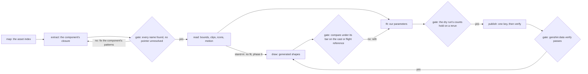

# Fishing and wildlife assets

This change specifies the fishing and wildlife asset family: the game's art and data for it, what the repo draws today, each gap between the two, and the conversion that turns each gap into our shapes, in the order the derived-assets recipe runs. It owns the models, their conversion, the animals' motion numbers and the family's icons. The fishing rules and the wildlife behaviour stay with [genshin-fishing](../genshin-fishing/design.md) and [genshin-wildlife](../genshin-wildlife/design.md), so each gap they already own is linked below and given no task here. Tasks 1.5 and 3.12 wait on [interface art](../genshin-assets-interface-art/design.md) task 1.1, the named-icon command, and on [props](../genshin-assets-props/design.md) tasks 1.3 and 1.4, the outline fit and its dataset member; no other task here waits on another change.

## What the game has

`{data-root}` is the machine's data root. The install is the game's own folder, which the fleet detects as the `game-install` capability (`scripts/src/services/fleet/readDetectedCapabilities.ts`).

| Item                              | Where it is read from                                                                                                         | Magnitude                                                                                   | On the Mac                                       |
| :-------------------------------- | :---------------------------------------------------------------------------------------------------------------------------- | :------------------------------------------------------------------------------------------ | :----------------------------------------------- |
| Fish records and their codex rows | the fish table in `{data-root}/genshin-parity/text/ExcelBinOutput/`, joined to the animal codex by monster id and model path  | about a hundred and twenty fish; all but a couple of their monster ids name a codex row     | yes                                              |
| Fish pools, stock, rods and baits | the pool, stock, rod and bait tables in the same folder                                                                       | about a hundred and sixty pools; about two dozen rods and baits                             | yes                                              |
| Fishing points                    | the official map's points under the fishing label, read by `scripts/src/services/genshinAssets/fishing/constants.ts`          | about a hundred points, about ten of them in Mondstadt                                      | yes                                              |
| Fishing-area props                | each region's witness layout, `{data-root}/genshin-parity/extracted/<component>/witness.json`, and its meshes exported as OBJ | several placements in each of four regions; about twenty OBJ exported                       | yes                                              |
| Fish, rod and float models        | the asset index, `{data-root}/genshin-parity/extracted/maps/index.tsv`, built from the install's blocks                       | about twenty fishable models, about ten rod models, one float effect                        | names yes; the bytes are in the install's blocks |
| Cast, ripple and splash effects   | the same index                                                                                                                | the cast effect, a few hundred ripple and splash names, none tagged to fishing but the cast | names yes; the bytes are in the blocks           |
| Animal models                     | the same index                                                                                                                | about a hundred and fifty model names over about fifty bases                                | yes                                              |
| Animal clips                      | the same index                                                                                                                | over a thousand clip names, the fleeing kinds' run clips among them                         | yes; no clip timings exported yet                |
| Critter gather rows               | `EnvAnimalGatherExcelConfigData.json` in the parity folder                                                                    | about sixty rows, most of them monsters; some with no describe row                          | yes                                              |
| Animal describe and codex rows    | `AnimalDescribeExcelConfigData.json` and `AnimalCodexExcelConfigData.json` in the parity folder                               | several hundred rows, about sixty of them fish                                              | yes                                              |
| Critter and animal map points     | `points.json` in `{data-root}/genshin-parity/references/interactive-map/`, the Animals group of its label tree                | several thousand points                                                                     | yes                                              |
| Pet and pot animal rows           | the codex's cat and dog rows; `HomeworldAnimalExcelConfigData.json` for the Serenitea Pot                                     | cat and dog rows, and about two hundred pot rows none of which joins a codex row            | yes; no builder reads the pot rows               |
| Animal icons                      | `UI_AnimalIcon_*` textures under `{data-root}/genshin-parity/extracted/characters/playergirl/raw/`                            | sixteen icons                                                                               | yes, for those sixteen only                      |
| Fish, bait and rod icons          | `UI_ItemIcon_*` textures, `Btn_Fishing_Bait` and `UI_EquipIcon_Pole_Rod`                                                      | seven fish item icons out of about a hundred and twenty; two rod textures                   | partly; the rest are in the install              |
| Reel reference recording          | `{data-root}/genshin-parity/captures/yt-iKr-nF1P7xQ-fishing-reel.mkv`                                                         | about a minute of the English PC client, read at 52.5 seconds for the screen's reference    | yes                                              |
| Flight recordings                 | none; the roadmap's References sought                                                                                         | none found                                                                                  | no                                               |
| Challenge panel words             | the English text map in `{data-root}/genshin-dump-backup-6.6/TextMap/`                                                        | the four strings the reel's panel shows                                                     | yes                                              |

The Mac holds the install's blocks, the asset index and the map built from them, so the animal and fishing bytes are reachable on the Mac and not only on the PC. Nothing here checks the PC's install.

## What the repo draws today

| Piece                                                  | File and symbol                                                                                                                     | What it is                                                                                                                               | How close to the game                                                                                                |
| :----------------------------------------------------- | :---------------------------------------------------------------------------------------------------------------------------------- | :--------------------------------------------------------------------------------------------------------------------------------------- | :------------------------------------------------------------------------------------------------------------------- |
| Reel overlay: bar, zone, tension marker, ring and hook | `packages/genshin-world/src/components/Fishing/Screen/Index.vue`, `FishingScreen`                                                   | Plain CSS and SVG over the world; the hook is traced from a still                                                                        | Its parity score is taken over the reference frame as the backdrop, so it measures the overlay alone (see Decisions) |
| Fishing points                                         | `packages/genshin-world/src/services/fishing/computeFishingInteractables.ts`, `computeFishingInteractables`                         | One Use row per point in reach; no point is drawn                                                                                        | none                                                                                                                 |
| Cast and reel logic                                    | `packages/genshin-world/src/composables/useWorldFishing.ts` and `packages/genshin-world/src/services/fishing/stepFishingReel.ts`    | Logic only; no rod, line, float or lure is drawn                                                                                         | not measured                                                                                                         |
| Fleeing animals                                        | `packages/genshin-world/src/components/World/Wildlife/Index.vue`, `WorldWildlife`                                                   | One instanced capsule per animal, sized by `packages/genshin-world/src/services/wildlife/constants.ts`; mounted outside the witness only | not measured; no reference shows one                                                                                 |
| Crystalflies                                           | `packages/genshin-world/src/services/wildlife/pickUpMaterialSource.ts`                                                              | Picked up as an item; no body                                                                                                            | none                                                                                                                 |
| Splash and ripple in the engine                        | `packages/genshin-engine/src/atmosphere/constants.ts` (rain) and `packages/genshin-engine/src/nodes/createWaterMaterial.ts` (water) | Rain and water, not fishing; the water ripple node is the reuse for the cast's rings                                                     | not applicable                                                                                                       |
| Prompt icons                                           | `packages/genshin-interface/src/components/InteractionPrompts/Index.vue`                                                            | A disc in the icon's place, marked provisional                                                                                           | a disc until a traced glyph replaces it                                                                              |
| Archive, Living Beings                                 | `packages/genshin-world/src/components/Archive/Screen/Index.vue`                                                                    | No animal icon is drawn                                                                                                                  | none                                                                                                                 |
| World export families                                  | `packages/genshin-world/src/services/world/WorldSceneExportFamilyMeshRegexMap.ts`                                                   | Each region's building family, and Windrise's oak, paving and statue; no prop family                                                     | none                                                                                                                 |

## The gap

| Id  | Gap                                                             | Why it matters                                                                               | Smallest piece                                                                                                          | Needs                                                                      |
| :-- | :-------------------------------------------------------------- | :------------------------------------------------------------------------------------------- | :---------------------------------------------------------------------------------------------------------------------- | :------------------------------------------------------------------------- |
| F1  | No fish body                                                    | The hooked fish is the cast's payoff, and the reel reference shows fish splashing            | One generated fish shape at the lure while a fish is hooked, one per fish category                                      | Stand-in: any machine. Likeness: the install, which the Mac holds          |
| F2  | No rod in hand                                                  | The reference frame's picture is a rod and a line                                            | One tapered rod in the character's hand while the line is out                                                           | Stand-in: any. Likeness: the install                                       |
| F3  | No float at the lure                                            | The float marks where the lure lies on the water, which the bite depends on                  | One generated float at the lure point while the line is out                                                             | Stand-in: any. Likeness: the install                                       |
| F4  | No bite, splash or cast effect                                  | The reference frame shows spray and rings at the strike, and the repo draws none             | A ring and a spray burst at the lure on a strike, from the engine's water ripple node                                   | Stand-in: any. The game's look: the install and a cut reference            |
| F5  | Fishing points show nothing until the prompt                    | The fishing rule says a ripple marks a point with fish, and no ripple is drawn               | A ring at each point in reach while its region has stock                                                                | Any: the points are published                                              |
| W1  | Fleeing kinds are capsules                                      | Every White Pigeon, Crimson Fox, Squirrel and Boar in the world is a capsule                 | One silhouette per kind, sized from its exported bounds                                                                 | Stand-in: any. Sizing and likeness: the install                            |
| W2  | Critters are not drawn                                          | The gather-row critters and the animal points stand bare, and butterflies have no gather row | One stand-in per species group at its points                                                                            | Stand-in: any. Likeness: the install                                       |
| W3  | Flight numbers are provisional                                  | The speed is a placeholder and the escape time is a gadget's; no flight recording was found  | The speed and the escape time from each run clip                                                                        | The install, for the clip bytes                                            |
| W4  | Critter groups beyond the crystalflies are not material sources | The wildlife design lists them as picked up, but the build publishes the crystalflies only   | Their labels, joined to their gather rows                                                                               | Any: the points and tables are here                                        |
| W5  | No pet                                                          | Cats and dogs are deferred by the wildlife change, and their models are in the index         | Their models fitted and published, drawn once the pet kind lands                                                        | The install                                                                |
| P1  | Fishing-area props are not drawn                                | They are placed in four regions' layouts, and no draw reads the placements                   | A props dataset from the layouts, and one stand-in per prop                                                             | Stand-in and dataset: any. Likeness: the install                           |
| I1  | Icons are discs                                                 | The bag, the prompts and the codex show discs, since the game's icon files cannot ship       | Traced glyphs of the fish, bait and rod icons, and of the animal icons                                                  | The exports need the install; each trace needs a full-resolution reference |
| R1  | Challenge panel words are not keys                              | The panel's four strings are not in the game text the package reads                          | The four strings as keys, and the panel drawn with them                                                                 | Any: the English text map holds them                                       |
| R2  | Reel bar, allowance and challenge rules                         | Provisional, and the rules sit in no table the repo reads                                    | Owned by [genshin-fishing](../genshin-fishing/design.md); this change supplies only the frame cut its measurement needs | Not this change                                                            |

## The conversion path

The steps run in the order of the derived-assets recipe: map, extract, read, fit, publish, check. Every step names its command, and a step with no command yet names the task that builds it, so each missing command is a task here.



The map and the inventory are shared by every component: `pnpm -C scripts genshin:assets map` (once per patch) and `pnpm -C scripts genshin:assets inventory <component>`, both of which exist. Every other step is per gap.

- **F1, fish.** Extract: `pnpm -C scripts genshin:assets extract animals`, which needs task 1.1 to name the component. Read: `pnpm -C scripts genshin:assets bounds animals <name>`, which task 1.2 writes. Fit: no fit yet; task 3.7 writes it, then `pnpm -C scripts genshin:assets fit animals --dry-run`. Publish: no key yet; task 3.7 names it, then `pnpm -C scripts genshin:assets fit animals --only <key>` and `pnpm -C scripts genshin:data verify`. Check: `pnpm -C scripts genshin:parity compare <reference>` over the bite's reference, which task 1.4 cuts. The stand-in (task 2.1) skips extract and fit and is checked the same way.
- **F2, rod.** Extract as F1, with `pnpm -C scripts genshin:assets extract fishing`. Read: bounds, task 1.2. Fit: no fit yet; task 3.8. Publish: its key from task 3.8. Check: compare over the cast reference from task 1.4.
- **F3, float.** As F2, for the float effect; fit and publish under task 3.9.
- **F4, bite and splash.** Extract `fishing`. The effects' rows are named with `pnpm -C scripts genshin:assets find <pattern>`, which task 1.7 writes, and their shaders read with `pnpm -C scripts genshin:assets shaders fishing`, which takes the `fishing` component that task 1.1 names. Fit: task 3.10. Check: compare over the strike frame from task 1.4.
- **F5, point ripple.** No extract. The points come from `pnpm -C scripts genshin:assets fishing --dry-run`, which exists. The ring is the engine's water ripple node, drawn by task 2.5; there is no fit.
- **W1, fleeing kinds.** Extract `animals`; bounds, task 1.2; fit and publish under task 3.5, checked by `pnpm -C scripts genshin:assets fit animals --dry-run` and `genshin:data verify`. Check: a reference of a kind's flight, if a public still shows one (`pnpm -C scripts genshin:parity fetch` finds the source); until one is recorded, the wildlife scenario of the playtest is the check.
- **W2, critters.** Extract `animals`; bounds, task 1.2; fit and publish under task 3.6. Check as W1.
- **W3, flight numbers.** Clips: `pnpm -C scripts genshin:assets clips animals`, which exports each run clip as JSON once task 1.1 names the `animals` component. Timings: `pnpm -C scripts genshin:assets timings '<clip pattern>'`, which exists and prints seconds and events. Root motion: no command yet; task 1.3 writes `genshin:assets motion`. The write into the wildlife constants is task 3.4, a manual edit checked by the wildlife tests, with no fit.
- **W4, material sources.** `pnpm -C scripts genshin:assets materialSources --dry-run` exists and publishes the crystalflies; task 3.3 adds the other labels and their join, checked by the same dry run.
- **W5, pets.** Extract `animals` (its cat and dog names); fit and publish under task 3.11. The pet kind that draws them is [genshin-wildlife](../genshin-wildlife/design.md) task 5.1.
- **P1, props.** Layout: `pnpm -C scripts genshin:assets witness <component>`, which exists and lays the placements out for each region. Placements: task 1.6 adds them to `pnpm -C scripts genshin:assets fishing`, which exists and publishes the fishing dataset. Meshes: `pnpm -C scripts genshin:assets extract <component>` for each region, which exists. Outlines: the props change's `fit props`, with task 3.12 adding the fishing kinds to it; the stand-in is task 4.1.
- **I1, icons.** Export: the named-icon command that interface art task 1.1 adds, which task 1.5 calls with the fishing names. Trace: `pnpm -C scripts genshin:parity trace <source>`, which exists, on each exported icon at full resolution (tasks 4.2 and 4.3). Publish: none. A traced path is a shape of ours and ships in the code, as the parity glyphs do.
- **R1, challenge words.** `pnpm -C scripts genshin:text write`, which exists, writes the keys once task 2.6 names them.

Two joins are by key, not by name. A fish reaches its model through its codex row's model path, the path's species stem finding the index's names (task 3.7). A critter reaches its item through the name join the crystalflies already use (task 3.3).

## Already specified

| Gap                       | Owner                                                                                                                                                                                               | What it already holds                                                                               | What this change adds                                                                                      |
| :------------------------ | :-------------------------------------------------------------------------------------------------------------------------------------------------------------------------------------------------- | :-------------------------------------------------------------------------------------------------- | :--------------------------------------------------------------------------------------------------------- |
| F5                        | [fishing spec](../../specs/genshin/fishing/spec.md), "A spot's ripple shows only while a stock of its region still has fish"                                                                        | The rule for when a point's ripple shows                                                            | The drawing of the ring, task 2.5                                                                          |
| F1 to F4                  | [genshin-fishing](../genshin-fishing/design.md)                                                                                                                                                     | The bite, the reel, the bait and the screen; the cast reuses the character's normal attack          | The bodies, tasks 2.1 to 2.4, and their likeness, tasks 3.7 to 3.10                                        |
| R2                        | [genshin-fishing](../genshin-fishing/design.md), "Provisional until a clip shows them", and the roadmap's ticked "Fish reel"                                                                        | The bar's scale, the allowance and the reel's rules                                                 | Nothing; task 1.4 adds the frame command their measurement needs                                           |
| W1 and W3                 | [genshin-wildlife](../genshin-wildlife/design.md), "Measured", and the roadmap's three open flight items                                                                                            | The rule that flight numbers come from recordings, and the flight items, none found                 | The clip route, tasks 1.3 and 3.4; a found recording still wins                                            |
| W1                        | [genshin-wildlife](../genshin-wildlife/design.md), "The placement" and the capsule                                                                                                                  | The placement, the flight and the capsule stand-in                                                  | The silhouettes, task 3.1                                                                                  |
| W4                        | [genshin-wildlife](../genshin-wildlife/design.md), "Three kinds" and its crystalfly dataset                                                                                                         | The decision that critters are picked up as items                                                   | The labels and their joins, task 3.3                                                                       |
| W5                        | [genshin-wildlife](../genshin-wildlife/design.md) task 5.1, deferred                                                                                                                                | The pet kind, which waits on a map label                                                            | The pet models, task 3.11                                                                                  |
| I1, bag and prompts       | [interaction](../../specs/genshin/interaction/design.md), the item icons as discs, and the Use icon with no reference                                                                               | The disc stand-in and the open item that replaces it                                                | The traced glyphs, task 4.3, which close that item                                                         |
| I1, codex                 | [archive](../../specs/genshin/archive/design.md), Living Beings, open on the wildlife strike                                                                                                        | The codex route                                                                                     | The traced animal icons, task 4.2                                                                          |
| P1                        | [props](../genshin-assets-props/design.md), tasks 1.3 and 1.4, and the [development exports](../../specs/genshin/derived-assets/development-exports/design.md) route for the families a scene names | The props component, each kind's outline fit and the dataset member its record is published through | The fishing-area placements, task 1.6, the fishing kinds' outlines, task 3.12, and the stand-ins, task 4.1 |
| Frame cut                 | [parity commands](../../specs/genshin/parity/commands/design.md), `verify`, which cuts each recording source at its named frame                                                                     | The cut itself, `cutRecordingFrame`, which the fishing-screen reference already uses                | The `frame` command over the same cut, task 1.4                                                            |
| Named-icon export         | [interface art](../genshin-assets-interface-art/design.md), "One named-icon export serves every family"                                                                                             | The one command beside `namecards` that exports a named icon, texture or sprite by name             | The fishing names, task 1.5, and the list of names in task 1.1 of that change                              |
| R1                        | [game text](../../specs/genshin/game-text/design.md)                                                                                                                                                | Keys by text id, read from the game's own text                                                      | The four keys, task 2.6                                                                                    |
| Serenitea Pot animal rows | [serenitea pot](../genshin-serenitea-pot/design.md)                                                                                                                                                 | Its own rows; no page names the pot's animal table                                                  | Nothing; the rows are recorded above and read by no task                                                   |
| Pipeline                  | [derived assets](../../specs/genshin/derived-assets/design.md)                                                                                                                                      | The pipeline, the component and fit steps, and "only our parameters ship"                           | The family's components and commands, tasks 1.1 to 1.7                                                     |
| Phases                    | [phases](../genshin-phases/design.md)                                                                                                                                                               | The gates and the marker each task carries                                                          | The marker on each task                                                                                    |

## Not shippable

These are the game's art, which cannot ship. Each row names the stand-in that draws the piece until one of our generated or traced shapes replaces it.

| Art                             | Names, by magnitude                                                                                                  | Form                | Stand-in until                                                                                  |
| :------------------------------ | :------------------------------------------------------------------------------------------------------------------- | :------------------ | :---------------------------------------------------------------------------------------------- |
| Fish meshes and textures        | fish and fishable model names, about twenty-odd, with their textures                                                 | mesh, texture       | the fish silhouette, task 3.7 (F1)                                                              |
| Rod meshes, textures and clips  | ten rod models, about thirty rod texture names, the rod clips                                                        | mesh, texture, clip | the rod, tasks 2.2 and 3.8 (F2); the clips never ship, their numbers may                        |
| Float                           | one float effect                                                                                                     | mesh                | tasks 2.3 and 3.9 (F3)                                                                          |
| Cast, ripple and splash effects | the cast effect, the ripple names and the splash names                                                               | texture, mesh       | tasks 2.4 and 3.10 (F4); the point ring is task 2.5 (F5)                                        |
| Animal models                   | about a hundred and fifty names                                                                                      | mesh                | tasks 3.5, 3.6 and 3.11 (W1, W2, W5)                                                            |
| Animal clips                    | over a thousand names                                                                                                | clip                | never ship; their speed and time may, task 3.4 (W3)                                             |
| Fishing-area props              | the props of the four regions' layouts                                                                               | mesh, texture       | the prop stand-in, task 4.1; the likeness, task 3.12 (P1)                                       |
| Icons                           | the animal icons, the fish, bait and rod icons, the Serenitea Pot's fishable icons, and the tutorial's fishing icons | texture             | traced glyphs, tasks 4.2 and 4.3, or the disc; the tutorial's own screen is outside this change |
| Pet models                      | the cat and dog names                                                                                                | mesh                | task 3.11 (W5)                                                                                  |
| Reel reference frame            | the recording's frame at the screen's reference second                                                               | a reference         | never the overlay's art; it is only the reference the check reads                               |

## Decisions

- **Our shapes ship; the game's bytes never do.** Stand-ins and fits are generated by our code, and the game's files are read for numbers, bounds and traces. Rejected: shipping an exported mesh, which would look right at once, because the derived-assets rule and the refusal of game art rule it out.
- **The animals and the fishing scene are two components.** Each is a `DerivedAssetComponent` member named over the index, so extract, clips, bounds and fit share the one path the recipe already has. Rejected: a separate exporter for the animals, which would copy the closure walk. Each names the world screen as its screen, as the Fontaine component does, since neither has a screen of its own.
- **A fish reaches its model through its codex row.** The fish record names a monster id, that id's codex row names a model path, and the path's species stem finds the index's names. Rejected: matching the fish by name, since the fish record holds only a text id. The two monster ids with no codex row stay unmatched, and task 3.7 prints them.
- **Flight numbers come from the run clip, and a recording wins when one is found.** The roadmap's three flight searches found none, and a run clip is the game's own motion. Rejected: keeping the provisional numbers until a recording turns up, since none is coming. The escape radius stays provisional, because no clip gives it: it is a trigger distance, not a motion.
- **Icons are traced, never shipped.** A game icon is exported to the references folder, traced at full resolution into a path of ours, and only the path ships. Rejected: the disc forever, since the parity loop's glyph route already turns a game mark into a shape of ours (`.agents/skills/genshin-parity/references/glyphs.md`).
- **A stand-in belongs to its system's phase, and the likeness to phase 7.** A stand-in is what the fishing or wildlife system needs in order to be done, so it is phase 6; a likeness is art fidelity, phase 7. Rejected: holding the stand-ins until the likeness, which would park each system behind art its gate does not ask for.
- **No task holds phase 1, 4 or 5.** Windrise's animals are a system's bodies, and the Windrise gate is the passes, which no animal feeds; they take phases 6 and 7. The family's stand-ins serve every region, so none belongs to Mondstadt alone. Rejected: putting Windrise's animals in phase 1, which would hold a system's bodies in the look's gate.
- **Pets are fitted now and drawn when their kind lands.** Rejected: inventing a pet kind here, since the wildlife change owns the kind and the map has no pet label to carry it.
- **The reel's numbers and the challenge's rules stay with genshin-fishing.** This change adds the frame command their measurement needs, task 1.4, over the existing cut, and does not measure the bar. Rejected: measuring the bar here, since the bar is the fishing rule.
- **A rod, float or splash is checked against a cut frame, not the screen's score.** The fishing screen's reference is a backdrop: its score is taken over the frame's own pixels, which already show the rod, the line, the splash and the panel, so the 0.05% measures the overlay alone and cannot see those pieces. Rejected: reusing that number as the rod's or the splash's check, which would pass an overlay that draws none of them.
- **Props come from the witness layouts.** The fits already read each region's placements from its layouts, so the fishing dataset's placements ride the same source. Rejected: a prop list typed by hand, since the layouts already hold every placement.
- **Critter groups join by the name join the crystalflies use.** A second join key would be a second copy of the same match. Rows that do not join print as unmatched and stay out of the dataset.

## Scope and order

Group 1, the foundations, comes first: its commands and the two components are read by every later group. Groups 2 to 4 are independent once group 1 holds. Group 5, the roadmap, comes last, since its `Asset:` lines name the pieces the stand-ins replace.

This change holds phase 0, its `x-phase`, because its lowest open task does: the commands and the datasets they publish hold phase 0, the challenge words and the bag icons hold phase 2, the stand-ins and system pieces hold phase 6, and the likeness fits, the motion numbers and the world art lines hold phase 7. Each task carries its phase after its number.

Playtest: a player reaches the cast and the animals, so two playtest scenarios name the states they show, one for the cast and one for the wildlife and props. Each is a file in the dev scenarios folder, listed in that folder's constants, and the first task that needs it creates it. Pet drawing waits on [genshin-wildlife](../genshin-wildlife/design.md) task 5.1, and no task here waits on it.

## Key files

| File                                                                                | Role                                                                    |
| :---------------------------------------------------------------------------------- | :---------------------------------------------------------------------- |
| `scripts/src/models/genshinAssets/shared/DerivedAssetComponent.ts`                  | The enum gains `animals` and `fishing`                                  |
| `scripts/src/services/genshinAssets/shared/DerivedAssetComponentMap.ts`             | Each component's name patterns, clip pattern and world screen           |
| `scripts/src/services/genshinAssets/fit/DerivedAssetFitMap.ts`                      | The family's fits, registered beside the existing ones                  |
| `scripts/src/services/genshinAssets/commands/genshinAssetsCommand.ts`               | Gains `bounds`, `motion` and `find`                                     |
| `scripts/src/services/genshinAssets/commands/fishingCommand.ts`                     | Publishes the fishing dataset, which gains the fishing-area placements  |
| `scripts/src/services/genshinAssets/commands/namecardsCommand.ts`                   | The precedent for the named-icon export interface art's task 1.1 builds |
| `scripts/src/services/genshinAssets/namecards/exportNamecards.ts`                   | The precedent's export, which that named-icon command follows           |
| `scripts/src/services/genshinAssets/commands/clipsCommand.ts`                       | Exports the clips the motion read and the bounds read take              |
| `scripts/src/services/genshinAssets/timings/readClipTimings.ts`                     | The timings the motion read sits beside                                 |
| `scripts/src/services/genshinAssets/materialSources/constants.ts`                   | The label list the critter groups join                                  |
| `scripts/src/services/genshinAssets/materialSources/readMaterialSourceItemIdMap.ts` | The name join the critter groups reuse                                  |
| `scripts/src/services/genshinAssets/fishing/toFish.ts`                              | The fish record's reader, which takes the codex model                   |
| `scripts/src/services/genshinAssets/scene/writeWitnessLayout.ts`                    | The placements the fishing dataset reads                                |
| `scripts/src/services/genshinAssets/wildlife/buildWildlifePlaces.ts`                | The wildlife dataset the kinds are placed from                          |
| `scripts/src/services/genshinParity/commands/traceCommand.ts`                       | Traces each exported icon into a path                                   |
| `scripts/src/services/genshinParity/commands/stillCommand.ts`                       | The live-game still, beside the new frame command                       |
| `scripts/src/services/genshinParity/reference/cutRecordingFrame.ts`                 | The existing cut at a recording's second, which the frame command calls |
| `scripts/src/services/genshinParity/shared/ParityReferenceMap.ts`                   | The fishing screen's reference: its source second and its backdrop      |
| `packages/genshin-world/src/services/wildlife/constants.ts`                         | The flight numbers and the capsule the silhouettes replace              |
| `packages/genshin-world/src/services/wildlife/stepWildlife.ts`                      | The flight step the speed and the time feed                             |
| `packages/genshin-world/src/components/World/Wildlife/Index.vue`                    | Draws the animals, now as silhouettes                                   |
| `packages/genshin-world/src/services/wildlife/pickUpMaterialSource.ts`              | Picks up a critter as its item                                          |
| `packages/genshin-world/src/services/fishing/computeFishingInteractables.ts`        | The points the ripples mark                                             |
| `packages/genshin-world/src/components/Fishing/Screen/Index.vue`                    | The reel screen gains the challenge panel and its words                 |
| `packages/genshin-world/src/components/Archive/Screen/Index.vue`                    | Draws the traced animal icons in Living Beings                          |
| `packages/genshin-world/src/services/dev/scenarios/constants.ts`                    | Lists the playtest scenarios the family adds                            |
| `packages/genshin-world/src/services/dev/scenarios/nightAtWindriseScenario.ts`      | The precedent scenario for a Windrise state                             |
| `packages/genshin-engine/src/nodes/createWaterMaterial.ts`                          | The water ripple node the cast's rings reuse                            |
| `packages/genshin-engine/src/kits/architecture/createBoxesGeometry.ts`              | A box generator the family's stand-ins are built from                   |
| `packages/genshin-engine/src/kits/architecture/createLatheStackGeometry.ts`         | A stacked-lathe generator the family's stand-ins are built from         |
| `packages/genshin-interface/src/components/InteractionPrompts/Index.vue`            | The prompt's icon takes a traced glyph                                  |
| `packages/genshin-text/src/generated/text/English.json`                             | The four challenge keys                                                 |
| `packages/genshin-world/src/generated/gameDataLock.json`                            | Moves on each publish                                                   |
| `openspec/changes/genshin-roadmap/tasks.md`                                         | Gains the `Asset:` lines the art gaps need                              |

The stand-ins are new files, which the table does not list, since they do not exist yet. Each is named for the gap it closes:

```text
packages/genshin-engine/src/kits/fishing/
  createFishGeometry.ts        the fish stand-in, one per category (F1)
  createRodGeometry.ts         the tapered rod (F2)
  createFloatGeometry.ts       the float (F3)
  createSplashGeometry.ts      the bite's rings and spray (F4)
  createPropGeometry.ts        one stand-in per fishing-area prop (P1)
packages/genshin-engine/src/kits/wildlife/
  createSilhouetteGeometry.ts  one silhouette per fleeing kind (W1)
  createCritterGeometry.ts     one stand-in per critter group (W2)
```

## Sources

- [AnimeStudio](https://github.com/Escartem/AnimeStudio): the exporter the install's blocks are read through, as the derived-assets page cites it.
- [The fishing reel recording](https://www.youtube.com/watch?v=iKr-nF1P7xQ): the English PC client's reel, the source of the fishing screen's reference frame and of the cast and strike frames task 1.4 cuts.
