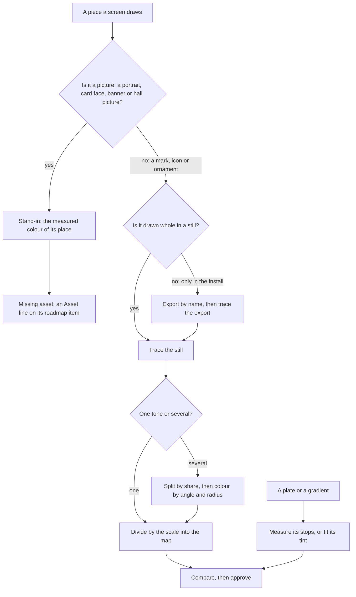

# Interface art: items, icons and ornaments

The index and the process for one family of the recreation's art: the item icons, portraits, card faces, stat icons, emblems, ornaments and glyphs its screens draw. The interface is measured from stills and recordings first, as the [derived assets](../../specs/genshin/derived-assets/design.md) page's first branch sets out, so the install is read only for a name, an export or a colour. Each missing piece is named by the roadmap line that holds its screen, linked below and never copied; this page owns the method that closes each kind, and only the tasks no line or open change covers.

## What the game has

The install's asset index names the art, and a name's type says what it is. Magnitudes only, since the index moves with each patch.

| Art                       | Where the install names it                                                           | Magnitude                               | How it is closed                                                                          |
| :------------------------ | :----------------------------------------------------------------------------------- | :-------------------------------------- | :---------------------------------------------------------------------------------------- |
| Item icons                | Sprite and Texture2D names beginning `UI_ItemIcon_`                                  | about three thousand each               | export by name, then trace                                                                |
| Weapon and artifact icons | names beginning `UI_Equip`, `UI_Relic`, `UI_Weapon`, `UI_Artifact` or `UI_Reliquary` | about sixteen hundred                   | export by name, then trace                                                                |
| Food icons                | names beginning `UI_Cook`                                                            | a couple of dozen                       | export by name, then trace                                                                |
| Element icons             | names beginning `UI_Icon_Element_`                                                   | about two dozen Sprites, fewer textures | the element mark is already traced from the wiki; the install's icons are a second source |
| Stat icons                | no name under the attribute prefixes (`UI_Attr`, `UI_FightProp`)                     | none found by prefix                    | a candidate search first, below                                                           |
| Tab emblems               | names beginning `UI_Tab`                                                             | a few hundred                           | export by name, then trace                                                                |
| Ornaments and frames      | names beginning `UI_Frame_` or `UI_Frm_`                                             | several thousand                        | export by name, then trace at scale 8                                                     |
| Card faces                | names beginning `Gcg_CardFace_`                                                      | a few thousand                          | a picture, not closed by trace                                                            |
| Other duel board art      | names beginning `UI_Gcg_`                                                            | several thousand                        | export by name, then trace or fit                                                         |
| Character portraits       | names beginning `UI_AvatarIcon_`                                                     | several hundred                         | a picture, not closed by trace                                                            |
| Namecard art and icons    | names beginning `UI_NameCardPic_` and `UI_NameCardIcon_`                             | several hundred each                    | exported by `namecards`, never shipped                                                    |
| Achievement art           | names beginning `UI_Achievement`                                                     | a couple of hundred                     | export by name, then trace                                                                |
| Quest art                 | names beginning `UI_Quest`                                                           | several hundred                         | export by name, then trace                                                                |
| Map and minimap art       | names beginning `UI_Map` or `UI_Mini`                                                | about two thousand                      | pins traced from the overlay references                                                   |
| Login UI sprites          | block `11790361`, exported to `{data-root}/genshin-parity/extracted/login-ui/`       | a few hundred sprites                   | by hand today, see the gap below                                                          |
| Talent icons              | the wiki's talent renders, not the install                                           | per character                           | traced and published by `skill-glyphs`                                                    |
| Fonts                     | `Font` rows in a few blocks                                                          | a handful of names                      | not this family; see Not shippable                                                        |

The index is `{data-root}/genshin-parity/extracted/maps/index.tsv`, one row per name with its type, block, path ID and offset. The install is on the PC. A copy is on the Mac too, but its provenance is not recorded, so an export from it is not compared with the PC's.

## What the repo draws today

| Piece                                               | File and symbol                                                                                                                          | What it is                                                                                          |
| :-------------------------------------------------- | :--------------------------------------------------------------------------------------------------------------------------------------- | :-------------------------------------------------------------------------------------------------- |
| Round-button glyphs                                 | `packages/genshin-interface/src/services/InterfaceIconPathMap.ts`                                                                        | traced vectors, drawn by `RoundButton`                                                              |
| Close-button marks                                  | `packages/genshin-interface/src/services/CloseButtonMarkGlyphMap.ts`                                                                     | traced vectors                                                                                      |
| Bag tab glyphs                                      | `packages/genshin-interface/src/services/ItemCategoryGlyphMap.ts`                                                                        | traced vectors                                                                                      |
| Element marks                                       | `packages/genshin-world/src/services/loading/ElementMarkPathMap.ts`                                                                      | traced from the wiki's standalone render at full resolution                                         |
| Menu, quest and category marks                      | `packages/genshin-world/src/services/menu/` and `packages/genshin-world/src/services/quest/` glyph maps                                  | traced, with tone layers                                                                            |
| Dialogue and blessing marks                         | `packages/genshin-interface/src/services/DialogueChoiceIconPathMap.ts`, `packages/genshin-interface/src/services/BlessingMarkPathMap.ts` | traced vectors                                                                                      |
| Paimon emblem                                       | `packages/genshin-world/src/services/hud/constants.ts` (`PAIMON_EMBLEM_LAYERS`)                                                          | colour layers, traced from the English client's HUD still, with the box and scale its comment names |
| Ornaments, check, flourish, server mark, back arrow | `packages/genshin-interface/src/services/constants.ts`                                                                                   | traced; the back arrow's comment names no trace                                                     |
| Title logos                                         | `scripts/src/services/genshinAssets/fit/fitTitleLogos.ts` (`fitTitleLogos`)                                                              | traced from a name-filtered export of the login's block, its scale carried by hand (`TRACE_SCALE`)  |
| Item tile                                           | `packages/genshin-interface/src/components/ItemTile/Index.vue`                                                                           | a rarity gradient face and a count strip, with no art place                                         |
| Rarity faces                                        | `packages/genshin-interface/src/services/ItemRarityFaceGradientMap.ts`                                                                   | measured gradient stops; the two-star face is not measured                                          |
| Character portrait discs                            | `packages/genshin-interface/src/components/CharacterMenu/Characters/Index.vue`                                                           | a plain disc                                                                                        |
| Duel board plates, discs, dice                      | `packages/genshin-world/src/components/Gcg/Screen/Card/Index.vue`, `.../Gcg/Screen/Plates/Index.vue`, `.../Gcg/Screen/Die/Index.vue`     | fitted gradient plates, plain discs, a shape for the die                                            |
| Attribute stars and stat rows                       | `packages/genshin-world/src/components/Character/AttributeList/Index.vue`, `.../AttributeList/Rows/Index.vue`                            | white four-point stars; no stat icon                                                                |
| Achievement and mail placeholders                   | `packages/genshin-world/src/components/Achievement/Screen/Index.vue`, `packages/genshin-world/src/components/Mail/Screen/Index.vue`      | flat placeholders; bare places                                                                      |
| Expedition pin and book                             | `packages/genshin-interface/src/components/ExpeditionScreen/Index.vue`                                                                   | plain CSS shapes                                                                                    |
| Map landmark mark                                   | `packages/genshin-world/src/components/Map/Drawing/Mark/Index.vue`                                                                       | a plain circle                                                                                      |
| Duel board ornament                                 | `packages/genshin-world/src/components/Gcg/Screen/Index.vue`                                                                             | nothing drawn                                                                                       |

## The shared pieces

The shared pieces are where a traced shape is placed. Their owner for layout and state is the [interface library](../../specs/genshin/interface-library/design.md) page, except where a row says otherwise.

| Piece             | File                                                                  | Its part in this family                                                                                             |
| :---------------- | :-------------------------------------------------------------------- | :------------------------------------------------------------------------------------------------------------------ |
| `GameScreen`      | `packages/genshin-interface/src/components/GameScreen/Index.vue`      | the root; a traced mark's pixel is one reference pixel of its screen, set through its unit                          |
| `GameButton`      | `packages/genshin-interface/src/components/GameButton/Index.vue`      | every button's look per state; a mark inside a button takes the button's colour                                     |
| `GameRect`        | `packages/genshin-interface/src/components/GameRect/Index.vue`        | places a traced mark by its rectangle inside its parent                                                             |
| `ItemTile`        | `packages/genshin-interface/src/components/ItemTile/Index.vue`        | the item's tile; it has no art place, so every item icon waits on one. Its owner is the gap below, not an open line |
| `RoundButton`     | `packages/genshin-interface/src/components/RoundButton/Index.vue`     | draws one traced glyph from the path map and centres it by the centre map                                           |
| `OrnamentDivider` | `packages/genshin-interface/src/components/OrnamentDivider/Index.vue` | draws the traced ends and middle of a rule                                                                          |
| `ProgressBar`     | `packages/genshin-interface/src/components/ProgressBar/Index.vue`     | drawn from measured shapes with no picture; no art gap                                                              |

## How a kind of art is routed

A piece is routed by what it is, and the routing is only a first attempt: the screen's compare decides whether a traced shape reaches its bar. A picture is never traced into a shape, so it takes its stand-in and its roadmap line.



## The conversion path

Each kind runs in the order the [derived assets](../../specs/genshin/derived-assets/design.md) pipeline reads a part: find the still, export the install's piece when no still shows it whole, trace or fit it, record it, and prove it by compare. A step is either the command that exists, or the words **no command yet**, which the gap table names as a task.

**Flat mark, emblem or ornament (one or two tones)**

- **Find:** `pnpm -C scripts genshin:parity screens <title>` lists a wiki article's whole-screen stills, and `pnpm -C scripts genshin:parity recordings clip <url> --from <s> --to <s> --name <name>` cuts a section of a video.
- **Trace:** `pnpm -C scripts genshin:parity probe <reference> <x> <y> <width> <height>` finds the box and the ink, then `pnpm -C scripts genshin:parity trace <reference or "File:Title"> <x> <y> <width> <height> <scale> [inkShare]` traces it. Scale 3 suits inner detail and 8 an ornament, as the glyph rules set.
- **Record:** dividing the path by the scale into the reference's pixels, and writing it into the component's keyed map, is **no command yet** (task 1.2). The path map's shape is the one `InterfaceIconPathMap` holds.
- **Prove:** a reference is named in the parity reference map and written with `pnpm -C scripts genshin:parity references pack`, then `pnpm -C scripts genshin:parity compare <reference>` scores it and `pnpm -C scripts genshin:parity approve <screen>` writes its image.

**Multi-tone icon (layers by share)**

- **Find** and **Trace**: as above, once per layer with its share. The white share of a mark on a grey disc is read as `(luminance - disc) / (255 - disc)`, the rule the glyph page gives.
- **Split:** the talent icons alone are split by their own histogram, `pnpm -C scripts genshin:assets skill-glyphs`. Splitting any other icon is **no command yet** (task 1.3).
- **Colour:** `pnpm -C scripts genshin:parity polar <image> <bands> <angles>` fills a multi-colour silhouette by angle and by radius.
- **Record:** one entry per layer in the keyed map is **no command yet**, written with the single-layer step (task 1.2).
- **Prove:** as the flat mark.

**Named icon or texture (in the install, not whole in a still)**

- **Find:** the name is searched with `grep -E` over the asset index. No command searches Sprite or Texture2D names, since `pnpm -C scripts genshin:assets ui-find` reads RectTransforms only, so the search is **no command yet** (task 1.1).
- **Export:** `pnpm -C scripts genshin:assets namecards` exports the namecards and nothing else. Exporting any other icon by its exact name is **no command yet** (task 1.1).
- **Read:** a Sprite's rectangle inside its texture is **no command yet**, since the tooling's asset types have no Sprite member (task 1.1).
- **Then:** the exported texture takes the flat-mark or multi-tone route above, traced from the export as it would be from a still.

**Plate, gradient or mean colour (shippable)**

- **Measure:** `pnpm -C scripts genshin:parity measure <image> <x,y>...` prints the colour under each point, and `pnpm -C scripts genshin:parity probe` reads a rectangle's ink and edges. Both read a still.
- **Fit:** `pnpm -C scripts genshin:assets fit windrise --only surfaces` reads each face through its material's tint, and that reader serves surfaces alone. A picture's or an icon's mean colour is **no command yet** (task 1.4).
- **Record:** a gradient stays a constant in its own map beside the component (the rarity face map's shape), hand-kept. A fitted colour that is published is a record of the hosted game data, published by `pnpm -C scripts genshin:assets fit <component> --only <key>` and checked by `pnpm -C scripts genshin:data verify`.
- **Prove:** `compare` over the plate's region.

**Picture (portrait, card face, banner, hall picture): cannot ship**

- **Export:** by name for measuring only, which is **no command yet** (task 1.1). The export stays under `{data-root}` and is never committed.
- **Colour:** the picture's mean colour, which becomes the stand-in, is **no command yet** (task 1.4).
- **Stand-in:** the component keeps its disc or plate in that colour, as the character menu's portrait discs do.
- **Record:** an `Asset:` line under the roadmap item that holds its screen, in the roadmap's own format. Lines the roadmap lacks are task 4.1.
- **Prove:** `pnpm -C scripts genshin:parity compare <screen>` over the stand-in.

## The gap

Needs is **PC** where the step reads the install's exports, and **Mac or PC** where it traces or measures a still or a committed reference. Each closing line is linked by its heading's opening words, with the roadmap file as its target.

| Id  | Gap                                                                                                                                  | Why it matters                                                   | Smallest piece                                        | Needs     | Closed by                                                                                                                                                                                                                                                                                                                                                                                                                                            |
| :-- | :----------------------------------------------------------------------------------------------------------------------------------- | :--------------------------------------------------------------- | :---------------------------------------------------- | :-------- | :--------------------------------------------------------------------------------------------------------------------------------------------------------------------------------------------------------------------------------------------------------------------------------------------------------------------------------------------------------------------------------------------------------------------------------------------------- |
| G1  | Item icons in the reward and goods lists, every item the roadmap names                                                               | each list shows its items as a gradient tile with no art         | one traced icon in the item tile's art place          | PC        | [The vendor shop draws a card grid](../genshin-roadmap/tasks.md), [The domain entrance draws a level list](../genshin-roadmap/tasks.md), [Paimon's Bargains is held to a near 2021](../genshin-roadmap/tasks.md), [The Statue's Worship popup is held](../genshin-roadmap/tasks.md), [The Mail screen's body words](../genshin-roadmap/tasks.md), [The Achievements screen's progress banner](../genshin-roadmap/tasks.md); tasks 1.1, 1.2, 1.3, 3.1 |
| G2  | Achievement marks: laurel, category badge, medal, stamp ring                                                                         | flat placeholders stand where a mark is                          | one traced mark, the laurel                           | Mac or PC | [The Achievements screen's progress banner](../genshin-roadmap/tasks.md)                                                                                                                                                                                                                                                                                                                                                                             |
| G3  | Mail marks: mailbox pin, gift box, help, sender, star, claim arrow, trash, selection pointer, thumbnail frame                        | the rows read bare                                               | one traced mark, from the mail still                  | Mac or PC | [The Mail screen's body words](../genshin-roadmap/tasks.md)                                                                                                                                                                                                                                                                                                                                                                                          |
| G4  | Handbook marks: tab emblems, the current chapter's ornate ring and check, the quill and cover corners                                | the tab bar and the header draw without them                     | one traced emblem                                     | Mac or PC | [The Handbook's Experience page draws without](../genshin-roadmap/tasks.md)                                                                                                                                                                                                                                                                                                                                                                          |
| G5  | Statue marks and plates: Restorative Power emblem, padlocks, offer arrows, worship parchment, blessing background, offer plates      | the popup and the blessing panel draw without their art          | one traced padlock; the plates in their fitted colour | Mac or PC | [The Statue's Blessing screen is held](../genshin-roadmap/tasks.md), [The Statue's Worship popup is held](../genshin-roadmap/tasks.md)                                                                                                                                                                                                                                                                                                               |
| G6  | Shop and Bargains marks and plates: Mora coin, purchase glyph and tag, Starglitter cost icon, tab plates, the purple card background | the shop's currency and its tabs draw as placeholders            | one traced coin                                       | Mac or PC | [The vendor shop draws a card grid](../genshin-roadmap/tasks.md), [Paimon's Bargains is held to a near 2021](../genshin-roadmap/tasks.md)                                                                                                                                                                                                                                                                                                            |
| G7  | Domain marks: resin crescent and the header's diamond                                                                                | the counter and the header draw plain shapes                     | one traced crescent                                   | Mac or PC | [The domain entrance draws a level list](../genshin-roadmap/tasks.md)                                                                                                                                                                                                                                                                                                                                                                                |
| G8  | Stat icons beside each attribute                                                                                                     | the attribute list has no icon                                   | one traced icon, after its name is found              | PC        | [The Attributes tab draws no stat icons](../genshin-roadmap/tasks.md); task 1.1                                                                                                                                                                                                                                                                                                                                                                      |
| G9  | Element-coloured attribute stars                                                                                                     | the reference's stars are coloured by element and ours are white | one traced star, its colour measured                  | Mac or PC | task 3.4; no roadmap line names it                                                                                                                                                                                                                                                                                                                                                                                                                   |
| G10 | Map landmark pins, one per landmark class                                                                                            | the overlays' error includes the pins                            | one traced pin                                        | Mac or PC | task 3.3; no roadmap line names it                                                                                                                                                                                                                                                                                                                                                                                                                   |
| G11 | Quest journal emblem: a cream ring round a dark interior with a star                                                                 | a solid disc stands in                                           | one traced emblem from the quest still                | Mac or PC | [The quest screen's journal emblem is unbuilt](../genshin-roadmap/tasks.md)                                                                                                                                                                                                                                                                                                                                                                          |
| G12 | Expedition pin and book emblem                                                                                                       | plain shapes stand in                                            | one traced pin                                        | Mac or PC | task 4.1                                                                                                                                                                                                                                                                                                                                                                                                                                             |
| G13 | Duel board frame ornament, its icons and coins                                                                                       | the board draws none of them, and the ornament is traceable      | one traced ornament                                   | Mac or PC | [The duel board draws no character](../genshin-roadmap/tasks.md) names the card art only; task 4.1 for the rest                                                                                                                                                                                                                                                                                                                                      |
| G14 | Forge recipe item icons                                                                                                              | the recipe's items draw as placeholders                          | the item icon route in G1                             | PC        | task 4.1; G1 closes the icons                                                                                                                                                                                                                                                                                                                                                                                                                        |
| G15 | Two-star item tile face                                                                                                              | a two-star tile draws bare                                       | its gradient stops, measured                          | Mac or PC | task 3.2                                                                                                                                                                                                                                                                                                                                                                                                                                             |
| G16 | Pictures that cannot ship                                                                                                            | a stand-in holds each place                                      | the stand-in and its colour                           | PC        | the table in Not shippable                                                                                                                                                                                                                                                                                                                                                                                                                           |
| G17 | Stand-in colours for pictures: portrait discs and card plates                                                                        | a picture's place is a guessed tone                              | the mean colour of one exported picture               | PC        | task 1.4                                                                                                                                                                                                                                                                                                                                                                                                                                             |
| G18 | Login UI sprites exported with no command                                                                                            | the login's art has no reproducible source                       | the login's atlas through one command                 | PC        | task 2.1                                                                                                                                                                                                                                                                                                                                                                                                                                             |
| G19 | The back arrow's path, whose comment names no trace                                                                                  | the path cannot be re-traced from its file                       | its trace's still, box and scale, written as an entry | Mac or PC | task 1.2's writer, when the arrow is next traced                                                                                                                                                                                                                                                                                                                                                                                                     |

## Not shippable

Each picture keeps the stand-in named here until its roadmap line closes it, which is a picture the game holds and a traced shape cannot be.

| Picture                                                              | Stand-in now                 | Roadmap line that records it                                                |
| :------------------------------------------------------------------- | :--------------------------- | :-------------------------------------------------------------------------- |
| Character card faces on the board                                    | the card's mean colour plate | [The duel board draws no character](../genshin-roadmap/tasks.md)            |
| Hand card faces                                                      | the same plate               | [The duel board draws no character](../genshin-roadmap/tasks.md)            |
| Team portraits on the top band, and the Blessing and Party portraits | a disc or a plain span       | [The Statue's Blessing screen is held](../genshin-roadmap/tasks.md)         |
| Forge support portrait                                               | a plain span                 | task 4.1                                                                    |
| Gcg plate portraits                                                  | a fitted plate               | task 4.1                                                                    |
| Commission card art                                                  | the rows draw without it     | [The Handbook's Experience page draws without](../genshin-roadmap/tasks.md) |
| Paimon's Bargains character card art                                 | a flat card                  | [Paimon's Bargains is held to a near 2021](../genshin-roadmap/tasks.md)     |
| Namecard banner of the Marksmanship category                         | a flat banner                | [The Achievements screen's progress banner](../genshin-roadmap/tasks.md)    |
| Golden House hall picture                                            | a placeholder picture        | [The domain entrance draws a level list](../genshin-roadmap/tasks.md)       |
| Quest series-row picture                                             | a plain region               | task 4.1                                                                    |
| Namecard art and icons                                               | none shipped                 | exported by `namecards` into `{data-root}`, never committed                 |

The font is outside this family. The game's face is not shippable, and the open face that stands in for it is chosen by the rule in the [interface](../../specs/genshin/interface-library/design.md) page's text notes; no command scores a face.

## Already specified

- [Derived assets](../../specs/genshin/derived-assets/design.md): nothing the game draws is bundled, and only fitted parameters ship.
- [Parity tracing](../../specs/genshin/parity/tracing/design.md): a vector is used as it is, and only a mark with none is traced.
- `.agents/skills/genshin-parity/references/glyphs.md`: the trace rules, scale 3 for inner detail and the white share of a mark on a disc.
- `.agents/skills/genshin-parity/references/interface.md`: placing a traced icon in the reference's own pixels.
- [Adventurer Handbook](../../specs/genshin/adventurer-handbook/design.md), [Character screen](../../specs/genshin/character-screen/design.md), [Statues of the Seven](../../specs/genshin/statues-of-the-seven/design.md), [Shops](../../specs/genshin/shops/design.md), [Quests](../../specs/genshin/quests/design.md), [Achievements](../../specs/genshin/achievements/design.md): each names its own art gap in prose.
- [Duel board](../../specs/genshin/genius-invokation/duel-board/design.md): its open list names the frame's art, icons and coins, with no source the screen owns.
- [Map](../../specs/genshin/map/design.md): its open list names the fixture that draws no landmark pins, which the pin trace waits on for its compare.
- [Hosted game data](../../specs/genshin/hosted-game-data/design.md): a published fit's record and its verify step.

## Decisions

- **A picture is never traced into a shape.** Tracing a painted portrait would ship the game's art in our markup, which the derived-assets rule rules out. Rejected: tracing pictures and comparing them, since a trace of a picture is still the picture.
- **An item icon takes the same first route as a mark, and its compare decides.** Rejected: declaring every item icon a picture from its family name, because no item has been traced yet to show that one cannot reach its bar, and the trace is the cheap attempt.
- **Roadmap lines are linked by their opening words, never copied.** Rejected: copying every `Asset:` line into this page, since a second copy drifts, and the roadmap is regrouped under phase headings while this page is read.
- **A traced mark stays in a keyed code map, and only a roster is published.** The talent icons are published by `skill-glyphs` because they are a roster of hundreds. Rejected: publishing every traced mark as hosted data, since a mark drawn on first paint would wait for a read.
- **One named-icon export serves every family.** Rejected: a sprite export per family, since `namecards` already holds the loop and a second would repeat it.
- **The item tile gains one optional art place.** Rejected: a per-screen icon component, since each screen would repeat the rarity face.
- **Stat icons are searched by candidate names before they are called missing.** The attribute prefixes hold no name, but a few sprites under other prefixes (`UI_Icon_HP`, `UI_Icon_Critical`, `UI_Icon_CriticalDamage`, `UI_Icon_Heal`) are unchecked candidates. Rejected: recording the stat icons as not in the install on the prefix search alone.
- **This change's `x-phase` is 0.** Its recipe is the family's spec and recipe, which phase 0's gate requires, so the lowest gate that fails without it is phase 0. Its screen tasks carry their own phase markers. Rejected: phase 2 as `x-phase`, because most of its tasks serve screens, since the phases page sets a change by its lowest gate.

## Key files

| File                                                                      | Role                                                                                  |
| :------------------------------------------------------------------------ | :------------------------------------------------------------------------------------ |
| `scripts/src/services/genshinParity/commands/traceCommand.ts`             | the trace command; gains the write of its path into the reference's pixels (task 1.2) |
| `scripts/src/services/genshinAssets/commands/genshinAssetsCommand.ts`     | the registry of `genshin:assets` commands; gains the named export (task 1.1)          |
| `scripts/src/services/genshinAssets/namecards/exportNamecards.ts`         | the named export the new one follows                                                  |
| `scripts/src/models/genshinAssets/shared/AssetType.ts`                    | the asset types; gains a Sprite member (task 1.1)                                     |
| `scripts/src/services/genshinAssets/skillGlyphs/traceTalentIcon.ts`       | the talent icons' tone split, generalised to any icon (task 1.3)                      |
| `scripts/src/services/genshinAssets/fit/fitSurfaceColours.ts`             | the tint reader the picture colour reuses (task 1.4)                                  |
| `scripts/src/services/genshinAssets/fit/fitTitleLogos.ts`                 | a trace whose scale is divided by hand today                                          |
| `packages/genshin-interface/src/services/InterfaceIconPathMap.ts`         | the keyed path map the trace writes into                                              |
| `packages/genshin-interface/src/components/ItemTile/Index.vue`            | the item tile; gains its art place (task 3.1)                                         |
| `packages/genshin-interface/src/services/ItemRarityFaceGradientMap.ts`    | the rarity faces; gains the two-star stops (task 3.2)                                 |
| `packages/genshin-world/src/components/Map/Drawing/Mark/Index.vue`        | the landmark mark the pins replace (task 3.3)                                         |
| `packages/genshin-world/src/components/Character/AttributeList/Index.vue` | the attribute list whose stars take their element colour (task 3.4)                   |
| `packages/genshin-world/src/services/hud/constants.ts`                    | the Paimon emblem's layers, with the trace its comment names                          |
| `packages/genshin-interface/src/services/constants.ts`                    | the ornament, check, flourish, server mark and back arrow paths                       |
| `openspec/changes/genshin-roadmap/tasks.md`                               | the open work; gains the lines task 4.1 adds                                          |

New files, which the tasks create, in plain text:

```text
scripts/src/services/genshinAssets/sprites/exportSpritesByName.ts
scripts/src/services/genshinAssets/sprites/readSpriteRectangle.ts
scripts/src/services/genshinAssets/commands/spritesCommand.ts
scripts/src/services/genshinParity/shared/writeTracedPath.ts
scripts/src/services/genshinAssets/colours/fitPictureColour.ts
```

## Sources

- [imagetracerjs](https://github.com/jankovicsandras/imagetracerjs): the public-domain tracer behind `trace`, which the flat-mark and layered routes take as their trace step, unchanged.
