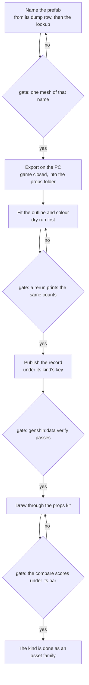
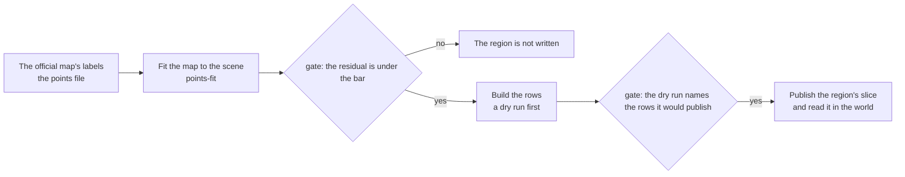

# Props and gadgets asset family

The world's props and gadgets are the family this change converts: chests, Oculi, teleport waypoints, the Statues of the Seven, puzzles, crafting benches and the forge, ley line blossoms, mining outcrops, gathering nodes, the frostbearing tree, domain entrances, and the doors and gates of the region buildings. Each is drawn today as a plain stand-in or not drawn at all. Only the Windrise statue has a shape fitted from the install, and no other kind has a conversion path yet. This page sets out the family's models, the path each takes from the install to a fitted record, and the placement data each needs. Behaviour belongs to the open changes that own it, so this page links them and schedules nothing they already schedule.

## What the game has

| Item                                                                                                                          | Read from                                                                                                           | Magnitude                                                                                                                                                             | On this Mac                                                                                               |
| :---------------------------------------------------------------------------------------------------------------------------- | :------------------------------------------------------------------------------------------------------------------ | :-------------------------------------------------------------------------------------------------------------------------------------------------------------------- | :-------------------------------------------------------------------------------------------------------- |
| Chest gadget templates                                                                                                        | `{data-root}/genshin-parity/text/ExcelBinOutput/GadgetExcelConfigData.json`, type Chest                             | several hundred templates, a few hundred prefab names                                                                                                                 | yes, the dump                                                                                             |
| Chest levels and blossom chest rows                                                                                           | `ChestLevelSetConfigData.json` and `BlossomChestExcelConfigData.json` in the same folder                            | a handful of rows each                                                                                                                                                | yes, the dump                                                                                             |
| Chest markers on the official map                                                                                             | `{data-root}/genshin-parity/references/interactive-map/points.json`, labelled through the chest label map           | thousands, Common the largest kind                                                                                                                                    | yes                                                                                                       |
| Mora chest markers                                                                                                            | the same points file, two labels the chests builder does not read                                                   | about a thousand                                                                                                                                                      | yes                                                                                                       |
| Chest or gather placements in the game's scene-3 point list                                                                   | `{data-root}/genshin-parity/text/BinOutput/Scene/Point/scene3_point.json`, joined to the gadget rows by gadget id   | none: the scene holds transport, workbench and other gadgets, and no chest or gather node                                                                             | yes; the absence is the finding                                                                           |
| Seal gadgets (vines, ice, rock)                                                                                               | the gadget rows of type SealGadget                                                                                  | a handful of templates over a few prefabs                                                                                                                             | yes, the dump                                                                                             |
| Oculus markers on the official map                                                                                            | the points file, one label for each kind of `OculusKind`                                                            | about fifteen hundred, nearly all on the ground                                                                                                                       | yes                                                                                                       |
| Gather rows that give an Oculus item                                                                                          | `GatherExcelConfigData.json` in the dump                                                                            | a few rows, one item for each kind of `OculusKind`                                                                                                                    | yes                                                                                                       |
| Statue of the Seven markers                                                                                                   | the points file                                                                                                     | about sixty, all on the ground                                                                                                                                        | yes                                                                                                       |
| Statue meshes exported                                                                                                        | `{data-root}/genshin-parity/extracted/windrise/assets/Mesh`, the Goddess stage meshes                               | one set, for Windrise only                                                                                                                                            | yes                                                                                                       |
| Goddess statue prefab names, other regions                                                                                    | the gadget rows whose name holds Goddess and Build or Prop                                                          | one per region for four regions; the other regions' names are not found by this search                                                                                | yes, the dump                                                                                             |
| Statue level rows                                                                                                             | `CityLevelupConfigData.json` in the dump                                                                            | several dozen rows                                                                                                                                                    | yes                                                                                                       |
| Teleport waypoint markers                                                                                                     | the points file                                                                                                     | several hundred, nearly all on the ground                                                                                                                             | yes                                                                                                       |
| Transport gadget templates and their placements                                                                               | the gadget rows of types TransPointFirst and TransPointSecond, and the scene-3 point list                           | dozens of templates; over a thousand placements in scene 3                                                                                                            | yes                                                                                                       |
| Waypoint unlock and reward rows                                                                                               | `TransPointUnlockConfigData.json` and `TransPointRewardConfigData.json`                                             | a dozen unlock rows and a few hundred reward rows                                                                                                                     | yes                                                                                                       |
| Domain entrances                                                                                                              | `DungeonEntryExcelConfigData.json`; scene-3 points that name a domain                                               | over a hundred rows; a few hundred points                                                                                                                             | yes                                                                                                       |
| Puzzle markers on the official map                                                                                            | the points file, the puzzle labels                                                                                  | well over a thousand                                                                                                                                                  | yes                                                                                                       |
| Puzzle tables                                                                                                                 | `TreasureSeelieRegionExcelConfigData.json`, `TreasureMapExcelConfigData.json`, `LeyLineDungeonExcelConfigData.json` | a few rows each                                                                                                                                                       | yes, the dump                                                                                             |
| Gather gadget templates                                                                                                       | the gadget rows of types GatherObject and GatherPoint                                                               | hundreds of templates over a few hundred prefab names                                                                                                                 | yes, the dump                                                                                             |
| Gather rows                                                                                                                   | `GatherExcelConfigData.json` in the dump                                                                            | hundreds of rows                                                                                                                                                      | yes, the dump                                                                                             |
| Mining chunk markers (mining outcrops)                                                                                        | the points file, one label                                                                                          | several hundred                                                                                                                                                       | yes                                                                                                       |
| Ley line blossom markers                                                                                                      | the points file, one label                                                                                          | a few hundred, all on the ground                                                                                                                                      | yes                                                                                                       |
| Frostbearing Tree marker                                                                                                      | the points file, one label                                                                                          | one                                                                                                                                                                   | yes                                                                                                       |
| Workbench gadget templates                                                                                                    | the gadget rows of type Worktop                                                                                     | hundreds of templates; over a hundred placements in scene 3                                                                                                           | yes, the dump                                                                                             |
| Forge recipes                                                                                                                 | `ForgeExcelConfigData.json` in the dump                                                                             | dozens of rows; no forge placement in the lock                                                                                                                        | yes, the dump                                                                                             |
| Serenitea Pot tables                                                                                                          | `FurnitureMakeExcelConfigData.json`, `HomeWorldFurnitureExcelConfigData.json`                                       | about a thousand and a half blueprint rows and a few thousand furnishing rows; the realm layout is not in the dump                                                    | the tables yes; the realm layout no, PC only                                                              |
| Door gadget names                                                                                                             | the gadget rows whose name holds door                                                                               | several hundred templates                                                                                                                                             | yes, the dump                                                                                             |
| Door and gate meshes exported                                                                                                 | `{data-root}/genshin-parity/extracted/<region>/assets/Mesh`, the names holding door                                 | a few dozen across six region folders; none for four regions                                                                                                          | yes; the Mondstadt gate's name falls in the buildings family                                              |
| Scene-3 block scripts                                                                                                         | `{data-root}/genshin-parity/extracted/lua/raw/`, three block files                                                  | three files, not decoded                                                                                                                                              | yes, undecoded                                                                                            |
| Prefab meshes of the other kinds (chest, Oculus, gather node, waypoint, bench, forge, blossom, frostbearing, realm, monument) | a name match over every region's Mesh folder                                                                        | none matched                                                                                                                                                          | no; PC install only                                                                                       |
| Family recordings                                                                                                             | `{data-root}/genshin-parity/captures/`                                                                              | the chest opening and digging clips, the sealed chest, the Mondstadt monument, the minimap Oculus, the Seelie route, both statue clips; no camp-lock clip             | yes                                                                                                       |
| Hosted datasets for the family                                                                                                | `packages/genshin-world/src/generated/gameDataLock.json`, hashes only                                               | the chest, Oculus, puzzle, gather, outcrop, blossom, bench, tree and waypoint datasets, the statue levels, the Windrise statue and the gadget and scene-group records | the lock is in git; the records are in the hosted data                                                    |
| The install itself                                                                                                            | `{data-root}/genshin-parity/game`, with its blocks; the version is in its config file                               | every prefab, texture and mesh                                                                                                                                        | yes, a copy of the blocks; the exporter built on this Mac has no checked output, so exports run on the PC |

The install's asset map and index are built on this Mac: `{data-root}/genshin-parity/extracted/maps/index.tsv` is the name index every lookup reads. A prefab's path hash is a 64-bit value that a JavaScript number cannot hold exactly, so it is read as text.

## What the repo draws today

| Piece                               | File and symbol                                                                                                                                                       | What it draws                                                                                                                               |
| :---------------------------------- | :-------------------------------------------------------------------------------------------------------------------------------------------------------------------- | :------------------------------------------------------------------------------------------------------------------------------------------ |
| Chests in Mondstadt, the Open rows  | `packages/genshin-world/src/components/World/Interactables/Index.vue`, `chestMesh`                                                                                    | a box of the chest stand-in size, in `packages/genshin-world/src/services/interaction/constants.ts`                                         |
| Chests in the other seven regions   | `packages/genshin-world/src/store/chests.ts`                                                                                                                          | nothing: the store reads Mondstadt's record alone                                                                                           |
| Buried chest (Dig)                  | `packages/genshin-world/src/components/World/Interactables/Index.vue`                                                                                                 | a prompt row only                                                                                                                           |
| Sealed chest                        | none                                                                                                                                                                  | nothing                                                                                                                                     |
| Oculi, not yet found                | `packages/genshin-world/src/components/World/StandIns/Index.vue`, with the Oculus radius in `packages/genshin-world/src/services/statue/constants.ts`                 | one gold sphere for every kind of `OculusKind`                                                                                              |
| The Oculus on the minimap           | `packages/genshin-world/src/components/Hud/Minimap/Index.vue`                                                                                                         | a pale gold dot, which its own comment calls provisional                                                                                    |
| Statue of the Seven, Windrise       | `packages/genshin-world/src/components/World/Landmark/Statue/Index.vue`, with `packages/genshin-engine/src/kits/statue/createStatueGeometries.ts`                     | the statue of fitted stacks                                                                                                                 |
| Statues of the Seven, other regions | `packages/genshin-world/src/components/World/Landmarks/Index.vue`                                                                                                     | nothing: the region data holds a statue landmark only for Mondstadt                                                                         |
| Domain entrance                     | `packages/genshin-world/src/components/World/Landmark/DomainEntrance/Index.vue`                                                                                       | one box pillar                                                                                                                              |
| Gates                               | `packages/genshin-world/src/services/mondstadt/MondstadtPartFamilyMeshRegexMap.ts`, `packages/genshin-world/src/services/world/WorldSceneExportFamilyMeshRegexMap.ts` | the Mondstadt gate falls in the buildings family, drawn from the export only under the development server                                   |
| Doors                               | none: `packages/genshin-engine/src/kits/architecture` holds no door part                                                                                              | nothing                                                                                                                                     |
| Teleport waypoints                  | `packages/genshin-world/src/components/World/Landmarks/Index.vue` branches on the tree, statue, building and domain kinds only                                        | nothing drawn; the region data holds the waypoints, and `packages/genshin-world/src/services/map/findNearestTeleportWaypoint.ts` reads them |
| Waypoint menu                       | `packages/genshin-world/src/components/Map/Overlay/Teleport/Index.vue`                                                                                                | a menu, not world geometry                                                                                                                  |
| Frostbearing Tree                   | `packages/genshin-world/src/components/World/FrostbearingTree/Index.vue`, with its constants in `packages/genshin-world/src/services/offering/constants.ts`           | a capsule                                                                                                                                   |
| Mining outcrop                      | `packages/genshin-world/src/components/World/Windrise/PlaceStandIns/Index.vue`, into `packages/genshin-world/src/components/World/StandIns/Index.vue`                 | a blue dodecahedron rock, with its radius in `packages/genshin-world/src/services/gathering/constants.ts`                                   |
| Gather pick-ups                     | `packages/genshin-world/src/components/World/Interactables/Index.vue`, with rows from `packages/genshin-world/src/store/pickups.ts`                                   | a sphere the size of dropped loot                                                                                                           |
| Ley line blossom                    | `packages/genshin-world/src/composables/useWorldInteractionDispatch.ts`, the claim prompt                                                                             | a prompt only; the outcrop's camp is drawn as enemies in `packages/genshin-world/src/components/World/Windrise/Index.vue`                   |
| Puzzles                             | `packages/genshin-world/src/components/World/SightTrails/Index.vue` and `packages/genshin-world/src/components/World/Screen/Index.vue`                                | trails to resting Seelie courts and a kind filter; no mechanism is drawn                                                                    |
| Crafting bench and stove            | `packages/genshin-world/src/components/World/Screen/Index.vue`, `packages/genshin-world/src/composables/useWorldInteractionDispatch.ts`                               | a prompt row only                                                                                                                           |
| Forge                               | `packages/genshin-world/src/components/Forge/Screen/Index.vue`                                                                                                        | a screen; no world geometry                                                                                                                 |
| Serenitea Pot realm                 | `packages/genshin-world/src/components/World/Realm/Index.vue`                                                                                                         | a flat disc and two boxes, which its comment says stand in until the PC exports the layout                                                  |

## The gap

Each row is one gap. A gap owned by an open change or roadmap item is not in this table; it is listed under Already specified. The Task column names the task that closes the gap here.

| ID  | Gap                                                                                                                                       | Why it matters                                                                  | Smallest piece                                                                                       | Needs              | Task |
| :-- | :---------------------------------------------------------------------------------------------------------------------------------------- | :------------------------------------------------------------------------------ | :--------------------------------------------------------------------------------------------------- | :----------------- | :--- |
| G1  | No props component: the component enum and its map have no member for a prop, and the map is a full record, so one member needs one entry | A prop has no export closure to be found by                                     | a props member with no roots, a name pattern for its prefabs and the world screen                    | Mac                | 1.1  |
| G2  | No lookup of a mesh by name: `ui-find` covers the UI blocks, and `asset-index` fetches the community index                                | A prefab is named by its dump row, and nothing finds it in the game's own index | a subcommand beside `ui-find` that searches the index on this Mac                                    | Mac                | 1.2  |
| G3  | No prop fit: the fit map has no props entry, and no fit reads a prop's mesh                                                               | Without a fit a prop has no parameters to publish                               | a props entry that runs the outline fits, with a dry run                                             | Mac                | 1.3  |
| G4  | No props dataset: the dataset enum has no props member, and no record holds a prop's outline                                              | A fitted shape cannot be published or read                                      | a props member, its builder and its lock keys                                                        | Mac                | 1.4  |
| G5  | No prop check: no prop-level witness or reference                                                                                         | The asset family's done-check needs a score                                     | one fitted prop drawn at its reference's camera and scored                                           | Mac                | 1.5  |
| G6  | The statue fit is Windrise's alone: the Windrise scene's fit list wires the statue fit to Windrise                                        | No other region's statue can be fitted                                          | the statue fit takes a region's Goddess prefab and keys its record by region                         | Mac                | 1.6  |
| G7  | The Windrise statue and oak are placed and turned, but no comparison with the recording has been run                                      | A placement is claimed, not measured                                            | a comparison of the witness with a recorded frame, run on the statue and the oak                     | Mac                | 2.1  |
| G8  | Mora chests: the map marks about a thousand, and the chests builder leaves them out                                                       | The world has no Mora chest where the game has one                              | the two Mora labels as chest kinds, published per region                                             | Mac                | 3.1  |
| G9  | The other seven regions' chests are published and never read in the world                                                                 | Their chests exist as data and are not offered                                  | a read of each region's chest record                                                                 | Mac                | 3.2  |
| G10 | Waypoints: the list of regions the waypoints command writes holds Mondstadt alone, and the world draws no waypoint                        | Seven regions' waypoints never reach the world                                  | each region joins the list once its map fit passes, and is drawn as a stand-in until its model lands | Mac                | 3.3  |
| G11 | Goddess statues of four regions are not exported; two more regions' names are not found yet                                               | Those statues have no shape                                                     | each prefab exported on the PC, found by the lookup, and fitted with the statue fit                  | PC                 | 3.4  |
| G12 | Chest models: every chest is a box                                                                                                        | The most-seen prop is a stand-in                                                | one Common chest prefab fitted; each other tier and the Buried chest take the same step              | PC                 | 4.2  |
| G13 | Seal models: a sealed chest draws nothing                                                                                                 | A sealed chest is invisible                                                     | one prefab for each seal kind                                                                        | PC                 | 4.3  |
| G14 | Mora chest models: none                                                                                                                   | A Mora chest, once placed, has no shape                                         | the Wooden and Stone Pile prefabs                                                                    | PC                 | 4.4  |
| G15 | Oculus models: one gold sphere for every kind of `OculusKind`                                                                             | The collectible reads as a dot                                                  | the Anemoculus prefab, and each kind's colour read from its export                                   | PC                 | 4.5  |
| G16 | Gather and outcrop models: a sphere or a rock                                                                                             | The gather nodes read as drops                                                  | the commonest gather prefab of each region, and the crystal chunk prefab                             | PC                 | 4.6  |
| G17 | Puzzle look: nothing is drawn for monuments, Seelie courts, shrines or time trials                                                        | The monuments are the puzzles a player meets first                              | one Elemental Monument prefab, compared with the Mondstadt pillars recording                         | PC, measure on Mac | 4.7  |
| G18 | Blossom model: a prompt only                                                                                                              | The blossom is what the player claims at                                        | one blossom prefab                                                                                   | PC                 | 4.8  |
| G19 | Bench and forge models: the bench is a prompt row and the forge a screen                                                                  | Nothing stands where a bench or the forge is                                    | one prefab for each bench kind, and the forge's prefab                                               | PC                 | 4.9  |
| G20 | Waypoint model: a stand-in only, once G10 lands                                                                                           | A waypoint has no body                                                          | one transport point prefab fitted to a waypoint shape                                                | PC                 | 4.10 |
| G21 | Domain entrance model: one box pillar                                                                                                     | The entrance reads as a box                                                     | one entrance prefab fitted                                                                           | PC                 | 4.11 |
| G22 | Frostbearing Tree: a capsule                                                                                                              | The tree is the offering's place                                                | its prefab fitted to the tree kit                                                                    | PC                 | 4.12 |
| G23 | No props kit: each stand-in is drawn by its own component                                                                                 | A model cannot replace a stand-in without a shared drawer                       | a kit that draws a fitted outline in its colour, and the components draw a record through it         | Mac                | 4.1  |

## The pipeline

The derived-assets pipeline runs in the order the recipe gives, and each stage has a check where it can fail. The prop path reads the install's exports, so the export is the only stage that needs the PC.



Placement is a second pipeline, and it reads the official map, not the install:



## The conversion path

The map step has run once on this Mac for the install, and it is not repeated per prop. Every prop kind takes the same steps, and the first two need the props component and lookup that tasks 1.1 and 1.2 add. The table names the command that exists, or says no command yet and the task that builds it.

| Step                  | Command                                                                                                             | Status                                                                 |
| :-------------------- | :------------------------------------------------------------------------------------------------------------------ | :--------------------------------------------------------------------- |
| 1. Name the prefab    | the dump row's name, read in the dump; the lookup over the index                                                    | no command yet for the lookup (task 1.2)                               |
| 2. Export its closure | `pnpm -C scripts genshin:assets extract props`, on the PC with the game closed                                      | no command yet for the props component (task 1.1)                      |
| 3. Inventory it       | `pnpm -C scripts genshin:assets inventory props`                                                                    | no command yet for the props component (task 1.1)                      |
| 4. Fit the outline    | `pnpm -C scripts genshin:assets fit props --dry-run`, then `pnpm -C scripts genshin:assets fit props --only <kind>` | no command yet (task 1.3)                                              |
| 5. Publish            | the `--only` run writes the kind's record under its own key; then `pnpm -C scripts genshin:data verify`             | verify exists; the props key no command yet (task 1.4)                 |
| 6. Read and draw      | `readGameData` in `genshin-world`, then the props kit                                                               | the reader exists; the kit has no command yet (task 4.1)               |
| 7. Check              | `pnpm -C scripts genshin:parity compare <reference>`, over a prop-level reference                                   | compare exists; the prop-level reference has no command yet (task 1.5) |

Each kind's fit takes one of the two outline fits that already exist, `fitVisualHull` for a solid kind and `fitLatheProfile` for a round one. Its name, its reference and its fit are these:

| Kind (task)                            | Name source                                                     | Outline fit        | Reference on disk                                   |
| :------------------------------------- | :-------------------------------------------------------------- | :----------------- | :-------------------------------------------------- |
| Common chest and the other tiers (4.2) | the chest template 70210001 and the chest rows                  | visual hull        | the chest-open clip                                 |
| Seals (4.3)                            | the seal rows                                                   | visual hull        | the chest-seal-pyro clip                            |
| Mora chests (4.4)                      | the two Mora labels and their rows                              | visual hull        | none on disk; a public clip frame is searched first |
| Oculi (4.5)                            | the Anemoculus row, and the other kinds' rows for their colours | lathe              | the minimap clip shows the mark only                |
| Gather and outcrops (4.6)              | the commonest gather row per region, and the crystal chunk row  | visual hull        | none on disk                                        |
| Monuments (4.7)                        | an Elemental Monument row                                       | visual hull        | the Mondstadt pillars clip                          |
| Blossoms (4.8)                         | a blossom row                                                   | lathe              | none on disk                                        |
| Benches and the forge (4.9)            | the bench rows named by the bench places, and the forge's row   | visual hull        | none on disk                                        |
| Waypoints (4.10)                       | one transport point template                                    | visual hull        | the waypoint clips on disk                          |
| Domain entrances (4.11)                | one entrance's dungeon row                                      | visual hull        | none on disk                                        |
| Frostbearing Tree (4.12)               | the tree's row                                                  | the tree kit's fit | none on disk                                        |

The placement steps run as the builders already do, each with its dry run first: `pnpm -C scripts genshin:assets points`, then `pnpm -C scripts genshin:assets points-fit`, then the builders `chests`, `waypoints`, `statues`, `offerings`, `gadgets`, `crafting`, `oculi`, `gathering`, `mining-outcrops`, `puzzles` and `domains`, each with `--dry-run`.

## Already specified

Each owned gap is linked here and carries no task in this change. Where an owner names the work only as provisional, with no scheduled task and no build order, it is not counted as owned (Decisions).

- Chests: the Mondstadt chests in the world, the sealed chest freed by Pyro or a blunt attack, and the Dig prompt are the [chests](../genshin-chests/design.md) change's behaviour, and task 4.2 of that change frees the sealed chests.
- Gadgets: the Treasure Compass, the Seelie detector, and the Oculus Resonance Stone's detector, which the [gadgets](../genshin-gadgets/design.md) change orders in its scope and order. Its gadget icons are task 6.1 there, blocked on the PC.
- Oculi and the Statues of the Seven: the Oculi in the world, the minimap mark and the statue levels are built on the [statues of the Seven](../../specs/genshin/statues-of-the-seven/design.md) page.
- Gathering: the investigation spots and the Mora spots are tasks 2.1 and 2.2 of the [gathering](../genshin-gathering/design.md) change.
- Ley line blossoms: the claim and the outcrop places are the [ley line outcrops](../genshin-ley-line-outcrops/design.md) change, and task 5.1 there adds the blossoms of four regions.
- Puzzles: the monuments' and shrines' behaviour and the Seelie courts are tasks of the [puzzles](../genshin-puzzles/design.md) change, and the puzzles' spec records that the servers' puzzle logic is not in the client's data, so that part is not closable here.
- Mondstadt's gate bridge: task 2.1 of the [Mondstadt](../genshin-mondstadt/tasks.md) change builds the city's gate bridge matched to its reference, and the Mondstadt buildings page lists it as not yet built.
- Doors and the rest of a region's buildings: the building work of each region's own change, Mondstadt's gate bridge above among them. This change adds no door of its own.
- Domain entrances: the entrances' behaviour, the arrival and the claim are the [domains](../genshin-domains/design.md) change.
- Waypoint unlocking and jumps: task 2.1 of the [map unlocking](../genshin-map-unlocking/design.md) change, which waits on the waypoints in region data.
- Nod-Krai's statues as waypoints: task 3.1 of the [Nod-Krai](../genshin-nod-krai/tasks.md) change.
- The forge screen and the blacksmith's place: task 2.4 of the [forging](../genshin-forging/design.md) change.
- The frostbearing tree's places and offerings: the [offering systems](../genshin-offering-systems/design.md) change publishes each region's places. Its tree landmark waits on the world's drawing, which is G22 here.
- The Serenitea Pot realm, its layout and its furnishings: the [Serenitea Pot](../genshin-serenitea-pot/design.md) change derives each realm as a region and draws the furnishings through its building kit.
- The game's own placements of chests, gathers and puzzles: the scene-group block scripts are open in the [scene groups](../../specs/genshin/scene-groups/design.md) spec, and the stand-in placements are the [spawned places](../genshin-spawned-places/design.md) change.
- The landmark meshes of Fontaine, Inazuma, Nod-Krai, Liyue and Natlan: the phase 5 item on the five regions' passes in the [roadmap](../genshin-roadmap/tasks.md) names all five. Fontaine, Inazuma and Nod-Krai have queued naming items, and Liyue and Natlan have none queued. Task 3.4 here adds only the Goddess statue prefabs of Liyue, Natlan, Snezhnaya and Sumeru to the landmark map, not any region's landmark meshes.
- Statues joining the region data: the roadmap's item on the other nations' expeditions.
- The gathering pick, the camp lock and the Liyue outcrops by rank: items of the [roadmap](../genshin-roadmap/tasks.md).

## Not shippable

These are the game's art. Each is a missing asset the recreation draws a stand-in for until a generated or traced one exists. The fitted outline and colour of a prop do ship (Decisions).

| Art                                                                                      | Why it cannot ship  | Stand-in until then                                                          | Owner                                             |
| :--------------------------------------------------------------------------------------- | :------------------ | :--------------------------------------------------------------------------- | :------------------------------------------------ |
| The Anemoculus icon and the other Oculi icons                                            | the game's icon art | the pale gold dot on the minimap, and the Oculus tile drawn without its icon | the roadmap's Statue Worship item                 |
| The gadget icon                                                                          | the game's icon art | the disc without its icon                                                    | [gadgets](../genshin-gadgets/design.md), task 6.1 |
| Chest, seal, Oculus, waypoint, bench, forge, blossom, frostbearing and entrance textures | the game's textures | the fitted outline in its fitted colour                                      | this change, tasks 4.2 to 4.12                    |
| Each prop mesh beyond its fitted outline                                                 | the game's meshes   | the outline                                                                  | this change, tasks 4.2 to 4.12                    |
| The Goddess statue meshes                                                                | the game's meshes   | the statue's fitted stacks, as Windrise's are                                | this change, tasks 1.6 and 3.4                    |
| The gate and door meshes on disk                                                         | the game's meshes   | recorded as exported, never shipped                                          | the region building work                          |

## Decisions

- **One props component, with a name pattern and no roots.** Rejected: one component per family, because a prop's prefab is found by its name in the index, not by a scene's roots, and the families share one fit and one kit. The component's map entry needs a screen, and the world screen is the one the Windrise component names.
- **Ship fitted outlines and colours only.** Rejected: publishing the exported mesh for the world to draw, because the derived-assets spec ("Only fitted parameters ship") forbids a vertex or a converted file of the game's.
- **Each kind takes one of the existing outline fits.** Rejected: a fit written for each kind, because a solid kind is a visual hull and a round kind a lathe, and the two fits already read those shapes.
- **Props are drawn from their own records, not from the scene's placements.** Rejected: reading the prop placements from the scene-3 point list, which holds no chest and no gather node, so it cannot place the family.
- **The lookup reads this Mac's index, not the community index.** Rejected: the existing `asset-index` command, which fetches the community index, because a community name is not the game's own name for the prefab on this install.
- **Exports run on the PC, and dry runs and the lookup run here.** Rejected: exporting on this Mac, because its exporter build has no checked output, and the derived-assets page says a Mac exporter's counts are not to be treated as the PC's.
- **A mesh task is phase 7, a placement task takes its region's phase, and a missing command is phase 0.** Two mesh tasks take the phase of the unit they draw instead: the Mondstadt gate (task 4.13) is one region's own building, so it holds that region's phase 4, and the Serenitea Pot realm (task 4.14) is the realm system's, which the phases page holds at phase 6. Rejected: putting the other meshes in Mondstadt's phase 4. Mondstadt's exit gate names its passes and its placements, and the stand-in boxes already hold the placements. A mesh is art fidelity, which its mesh tasks hold at phase 7, as the phases page's fidelity row sets the level for what it draws.
- **The Windrise check is phase 0.** Rejected: phase 1, which is Windrise's own phase. The check builds the comparison it then runs, so it holds the foundation's measure, and the lower phase is taken for a task that spans two.
- **A gap is owned only by a scheduled task or by an owner's build order.** A design that calls a model provisional, for example "a stand-in until the rock kit is read", names no task and no order, so the gap is taken here. Rejected: linking that line, because no task would ever pick the gap up.
- **Mora chests are placed as their own kinds.** Rejected: keeping them out by design, which the chests spec states as "Mora chests are not chests of these kinds". That line is the rejected direction: the family's gap is that the world has no Mora chest where the game has one.
- **The statues of four regions are fitted here, and the other three follow their roadmap items.** Rejected: fitting all seven here, because the roadmap already queues the landmark meshes of Fontaine, Inazuma and Nod-Krai, and a second queue for them would duplicate it.

## Notes

- The change holds more tasks than the proposal rule's twelve. It is kept whole, one task per gap, because its Key files and its spec delta are shared across the family; a split by phase would copy both.

## Key files

| File                                                                            | Role after the change                                                                      |
| :------------------------------------------------------------------------------ | :----------------------------------------------------------------------------------------- |
| `scripts/src/models/genshinAssets/shared/DerivedAssetComponent.ts`              | gains the props member                                                                     |
| `scripts/src/services/genshinAssets/shared/DerivedAssetComponentMap.ts`         | gains the props entry, with no roots, a name pattern and the world screen                  |
| `scripts/src/services/genshinAssets/fit/DerivedAssetFitMap.ts`                  | gains the props fit entry                                                                  |
| `scripts/src/services/genshinAssets/fit/fitWindriseScene.ts`                    | hands the statue fit a region's Goddess prefab by key                                      |
| `scripts/src/services/genshinAssets/fit/fitWindriseStatue.ts`                   | the statue fit, taking any region's Goddess prefab                                         |
| `scripts/src/services/genshinAssets/commands/genshinAssetsCommand.ts`           | registers the new lookup subcommand                                                        |
| `scripts/src/services/genshinAssets/commands/chestsCommand.ts`                  | publishes the Mora kinds' rows per region                                                  |
| `scripts/src/services/genshinAssets/chests/ChestKindLabelIdMap.ts`              | gains the two Mora labels as kinds                                                         |
| `scripts/src/services/genshinAssets/shared/constants.ts`                        | the list of regions the waypoints command writes                                           |
| `scripts/src/services/genshinAssets/witness/DerivedAssetLandmarkMap.ts`         | names each region's landmark meshes for the export, and gains a region's statue prefab     |
| `packages/genshin-world/src/models/data/GameDataset.ts`                         | gains the props dataset                                                                    |
| `packages/genshin-world/src/generated/gameDataLock.json`                        | gains the props keys on publish                                                            |
| `packages/genshin-world/src/store/chests.ts`                                    | reads every region's chest record, not Mondstadt's alone                                   |
| `packages/genshin-world/src/components/World/Interactables/Index.vue`           | draws a chest and a gather node from its record, keeping the stand-in for a kind with none |
| `packages/genshin-world/src/components/World/StandIns/Index.vue`                | draws an Oculus and an outcrop from their records, keeping the stand-ins                   |
| `packages/genshin-world/src/components/World/Landmark/Statue/Index.vue`         | draws each region's statue from its own record                                             |
| `packages/genshin-world/src/components/World/Landmark/DomainEntrance/Index.vue` | draws the entrance from its record in place of the box                                     |
| `packages/genshin-world/src/components/World/Landmarks/Index.vue`               | draws the waypoints as stand-ins, then from their records                                  |
| `packages/genshin-world/src/components/World/FrostbearingTree/Index.vue`        | draws the tree from its record in place of the capsule                                     |

The new kit draws each outline through the box and stacked-lathe generators that the architecture kit already holds, and the new lookup subcommand sits beside the UI-block one. Both are created, and the tree is:

```text
packages/genshin-engine/src/kits/props/
scripts/src/services/genshinAssets/commands/assetFindCommand.ts
```

## Sources

- [AnimeStudio](https://github.com/Escartem/AnimeStudio), the exporter whose closure export the props use, as the [derived assets](../../specs/genshin/derived-assets/design.md) page describes.
- [AnimeGameData](https://github.com/DimbreathBot/AnimeGameData), the community's per-patch dump of the game's tables, which the [game text](../../specs/genshin/game-text/design.md) page names as the source of its text folder and which the family's gadget, chest and gather rows come from.
- The official Teyvat interactive map's point and label API, read by the points command (`scripts/src/services/genshinAssets/points/constants.ts`), which grounds every marker count and every label id used here.
