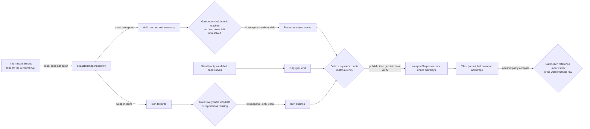

# Weapon assets

The weapons are the one held-item family the recreation has no picture of. The table is built and the screens draw their text, but nothing is held, struck or dropped, and every tile and portrait is a placeholder. This design takes the family through the derived-assets recipe, one gap at a time, and says which step needs the Windows PC. The attack clip task waits on [the Traveler's skeleton item](../genshin-roadmap/tasks.md) in the roadmap, and on nothing else.

## What the game has

| Item                                     | Where it is read from                                                                                                                                           | What it holds                                                                                                                                                                                              | On this Mac                                                                                     |
| :--------------------------------------- | :-------------------------------------------------------------------------------------------------------------------------------------------------------------- | :--------------------------------------------------------------------------------------------------------------------------------------------------------------------------------------------------------- | :---------------------------------------------------------------------------------------------- |
| Weapon table, the copy the builder reads | `{data-root}/genshin-parity/text/ExcelBinOutput/WeaponExcelConfigData.json`, the folder `scripts/src/services/genshinText/constants.ts` sets                    | About three hundred rows over six kinds. Every row names an icon, a texture folder and a drop gadget                                                                                                       | Yes                                                                                             |
| Weapon table, the 6.6 dump               | `{data-root}/genshin-dump-backup-6.6/ExcelBinOutput/WeaponExcelConfigData.json`                                                                                 | Fewer rows, none missing from the copy above. The builder does not read it                                                                                                                                 | Yes                                                                                             |
| Promote, level and curve tables          | the same two folders, the `Weapon...ExcelConfigData.json` files beside the table                                                                                | The ascension and levelling rows the stats run reads                                                                                                                                                       | Yes                                                                                             |
| Held weapon meshes                       | the Mesh rows of `{data-root}/genshin-parity/extracted/maps/index.tsv` named `Equip_<kind>_<name>_Model`                                                        | A little over two hundred names over some forty blocks. The meshes are not exported on this Mac                                                                                                            | The index: yes. The blocks that hold them: yes. The export: no                                  |
| Effect meshes                            | the Mesh rows of the same index named `Equip_..._EffectMesh`                                                                                                    | Seven names, some carrying a weapon's own name instead of its kind                                                                                                                                         | The index: yes. The export: no                                                                  |
| Weapon animators                         | the Animator rows of the same index named `Equip_*`                                                                                                             | About two hundred rows over nine blocks                                                                                                                                                                    | The index: yes                                                                                  |
| Icon names                               | the Sprite and Texture2D rows named `UI_EquipIcon_*`                                                                                                            | About eight hundred distinct names, which include every table icon key the index holds                                                                                                                     | The index: yes. The icon textures: not exported                                                 |
| Hand bones of the bodies                 | the rig dumps `{data-root}/genshin-parity/extracted/avatars/<body>/Avatar/*_ModelAvatar.json` and `{data-root}/genshin-parity/extracted/playergirl/avatar.json` | Each of the five body dumps and the player girl's rig names a WeaponR and a WeaponL bone. No body dump is for a claymore                                                                                   | Yes                                                                                             |
| Attack, show and standby clips           | `{data-root}/genshin-parity/extracted/timings/*/AnimationClip/*.json`                                                                                           | About eighteen hundred clip files, nearly all named with a kind word. The standby clips carry hand curves                                                                                                  | Yes                                                                                             |
| Held-weapon footage                      | `{data-root}/genshin-parity/captures/`                                                                                                                          | A handful of clips: the claymore ore captures, the ore capture without a claymore, and the weapon-levelling and weapon-enhance clips. The claymore ore captures are the only footage of a claymore by name | Yes                                                                                             |
| Weapon reference stills                  | `{data-root}/genshin-parity/references/`                                                                                                                        | A handful of stills of the weapon screen and its states, the inventory's weapons and the character's weapons tab                                                                                           | Yes                                                                                             |
| Install blocks                           | `{data-root}/genshin-parity/game/GenshinImpact_Data/StreamingAssets/AssetBundles/blocks`, and the hotfix copies under `Persistent`                              | Roughly two thousand block files and a couple of hundred hotfix copies, at the version the game's `config.ini` states                                                                                      | Yes, but this Mac's exports are not taken as the PC's, for the reason the conversion path gives |
| Drop prefabs                             | in the blocks, each reached from a weapon row's `gadgetId`                                                                                                      | One gadget id per row                                                                                                                                                                                      | The blocks: yes. The prefab: not exported                                                       |

The index names a weapon's meshes, animators and icons by their file, never by the weapon. The table is the only place a weapon is named, and it reaches the index through its texture folder's name, which the name map of gap G3 has to handle. The table's kinds are six, because one crossbow row is a template; the repo's own `WeaponType` names five, and the builder leaves the crossbow out with a note.

## What the repo draws today

| Piece                       | File and symbol                                                                                                                       | What it draws                                                                             |
| :-------------------------- | :------------------------------------------------------------------------------------------------------------------------------------ | :---------------------------------------------------------------------------------------- |
| Character body in the world | `packages/genshin-world/src/components/Character/Model/Index.vue`, `readCharacterMesh`                                                | The body from its published pack, with nothing held                                       |
| Hands                       | `packages/genshin-engine/src/character/pose/computeCharacterPose.ts`, the two wrist rotations                                         | Both wrists are set to zero, and no bone past the wrist is posed                          |
| Bone names                  | `packages/genshin-world/src/services/character/avatar/constants.ts`                                                                   | LeftHand and RightHand map to the wrists. No WeaponL or WeaponR entry exists              |
| Drops                       | `packages/genshin-world/src/components/World/Interactables/Index.vue`, `dropMesh`                                                     | A sphere for every drop                                                                   |
| Item tile                   | `packages/genshin-interface/src/components/ItemTile/Index.vue`                                                                        | The rarity face with the count, and no art. Its comment leaves the item's art to the game |
| Weapon screen               | `packages/genshin-world/src/components/Weapon/Screen/Index.vue` with `packages/genshin-interface/src/components/WeaponMenu/Index.vue` | Text, stars and rows. The portrait frame and the sword scene are not drawn                |
| Inventory grid              | `packages/genshin-interface/src/components/InventoryScreen/Index.vue`                                                                 | Tiles with no art                                                                         |
| Character's Weapons tab     | `packages/genshin-interface/src/components/CharacterMenu/Weapons/Index.vue`                                                           | Squares and text. Its lock glyph is left to the game's art, by its own comment            |
| Weapon data                 | `packages/genshin-world/src/models/weapon/WeaponData.ts`, built by `scripts/src/services/genshinAssets/stats/getWeaponDatas.ts`       | Table values only. No model, icon, grip, drop or effect field                             |
| Weapon kinds                | `packages/genshin-world/src/models/weapon/WeaponType.ts`                                                                              | The five kinds the open world gives                                                       |
| Trails                      | none for weapons. `packages/genshin-engine/src/vegetation/stepGrassTrail.ts` is the grass's                                           | Nothing                                                                                   |
| Kits                        | `packages/genshin-engine/src/kits`                                                                                                    | Three kit folders: architecture, statue and tree                                          |

## The gap

| ID  | Gap                                                                                      | Why it matters                                                                                               | Smallest piece                                                                                                                     | Needs                                                                                                                                                                      |
| :-- | :--------------------------------------------------------------------------------------- | :----------------------------------------------------------------------------------------------------------- | :--------------------------------------------------------------------------------------------------------------------------------- | :------------------------------------------------------------------------------------------------------------------------------------------------------------------------- |
| G1  | No held blade or shaft is drawn.                                                         | A held weapon is on the character in the world and in every scene that shows one.                            | A weapon component whose roots are the held meshes, and a fit of each held mesh through the statue kit's stacks and blades.        | PC: the closure is exported by the Windows CLI.                                                                                                                            |
| G2  | No grip per kind, and no pose reaches a hand bone.                                       | A model without its grip floats, and the pose sets only the wrists.                                          | A fitted grip for each kind, relative to the WeaponR or WeaponL bone, and one pose hook from that bone to the weapon's root.       | Mac for the standby clips' hand curves, as a lead, checked against the PC's export of the same clips. PC for the equip's own transform, which no export on this Mac holds. |
| G3  | A few dozen of the table's rows name a texture folder with no mesh of the expected name. | A row cannot be paired with its model, and a name guessed from the weapon's own name picks the wrong blade.  | A map from each row to its `_Model` mesh where the index holds one, and an explicit no-mesh entry for the rest.                    | Mac: the table and the index are both here. The index is this Mac's own map (see the notes), so the PC's index checks the name map before it publishes.                    |
| G4  | Every drop is a sphere.                                                                  | A dropped weapon looks like any other item on the ground.                                                    | A drop shape per weapon, from its gadget's prefab, fitted through the same kit as the blades.                                      | PC: the gadget prefab is in the blocks and is not exported.                                                                                                                |
| G5  | No strike or trail is drawn.                                                             | The strike is the weapon's most visible motion, and the repo draws none of it.                               | A trail's width, colour and fade measured from the claymore captures, and one ribbon drawn from those values.                      | Mac for the measurement. The effect meshes stay with the PC, and are used only if the ribbon misses.                                                                       |
| G6  | Every weapon tile is a rarity face with no picture.                                      | The inventory, the bag, the shops and the rotation show weapons as placeholders.                             | Each weapon's icon traced to an outline, published as a record, and drawn on its tile.                                             | PC: the icon textures come from the blocks.                                                                                                                                |
| G7  | The weapon screen's portrait and the sword scene behind its grid are not drawn.          | The parity score counts the portrait as plate, so the first thing a player sees on the screen is empty.      | The outline placed in the portrait frame, and the picked weapon's fitted blade behind the grid.                                    | The outline comes through G6 (PC). The blade comes through G1.                                                                                                             |
| G8  | No record holds a weapon's shape, and the two table copies disagree.                     | Every shape above needs a published record, and the table is the stats run's input, which must stay a table. | A GameDataset member for the weapons' shapes, keyed per fit. The table's patch is recorded by the game-text change, which owns it. | Mac: any machine with the Azure login publishes.                                                                                                                           |
| G9  | The attack clip is never played on the body.                                             | The body poses only at rest and while walking, so a strike has no motion of its own.                         | One sword attack clip played through the clip retarget.                                                                            | Mac: the clip files are here. The retarget is the roadmap item the change waits on.                                                                                        |

## The conversion path

The steps follow the derived-assets recipe's order: map, extract, fit, publish, then check, with the draw step after the publish. Each step is an existing command, shown exactly, or **no command yet** followed by the command or code to build. The PC runs every step that reads the install's blocks. This Mac holds the same install, but its AnimeStudio build has no recorded parity acceptance, which the [AnimeStudio on macOS](../../specs/genshin/derived-assets/animestudio-macos/design.md) page leaves open, so the PC's exports stay the reference.

**Map (every gap).** The index is already on this Mac. Run `pnpm -C scripts genshin:assets map` once per install patch, and `pnpm -C scripts genshin:assets map --index` to rewrite the index alone when the map is kept. A run that logs an exception fails.

**Name the component (G1, G2, G4, G6).** **No command yet:** add the weapons to the component enum and to the component map with the weapon screen as its screen and no roots, since a component may start with none. The roots come in task 3.1.

**Held meshes and drops (G1, G3, G4).**

- Extract: `pnpm -C scripts genshin:assets extract weapons` on the PC, then `pnpm -C scripts genshin:assets inventory weapons` and `pnpm -C scripts genshin:assets tree weapons`. The extract prints every mesh it reached and each pointer it could not resolve.
- Map each row to its mesh: **no command yet**, a row-to-mesh map written beside the models fit, whose dry run prints the rows with a mesh and the rows with none.
- Fit the blades: **no command yet**, a fit beside the statue fit, registered in the weapons' fit entry. Then `pnpm -C scripts genshin:assets fit weapons --only models --dry-run`.
- Fit the drops: **no command yet**, the same kind of fit over each gadget's prefab, registered under the same entry. Then `pnpm -C scripts genshin:assets fit weapons --only drops --dry-run`.

**Grips (G2).** **No command yet:** a fit that reads the hand curves of each kind's standby clip from `{data-root}/genshin-parity/extracted/timings`, and fits the grip relative to WeaponR or WeaponL. Then `pnpm -C scripts genshin:assets fit weapons --only grips --dry-run`. The clips' stop times come from `pnpm -C scripts genshin:assets timings <pattern>`, which reads the game, so the PC runs it for a new export.

**Icons (G6, G7).**

- Extract: **no command yet**, `pnpm -C scripts genshin:assets weapon-icons`, which exports the table's icon names into `{data-root}/genshin-parity/extracted/weapons/icons` through the helper the namecards export uses. It reports each name the index does not hold, and the PC runs it.
- Fit: **no command yet**, an outline fit that traces each icon's alpha into loops in its unit square, registered in the weapons' entry. Then `pnpm -C scripts genshin:assets fit weapons --only icons --dry-run`.

**Trails (G5).** **No command yet:** `pnpm -C scripts genshin:parity trail`, which reads a claymore strike's frames from a capture and writes the trail's width, colour and fade. Then **no command yet:** a fit of those values under `weaponShapes/trails`, run by `pnpm -C scripts genshin:assets fit weapons --only trails --dry-run`.

**Publish (G8).** **No command yet:** the GameDataset member `weaponShapes` and its reader, because a fit's key must sit under a dataset. Then `pnpm -C scripts genshin:assets fit weapons --only icons` without `--dry-run` publishes the record under its key, and `pnpm -C scripts genshin:data verify` checks both accounts. The other fits publish the same way.

**Attack clip (G9).** **No command yet:** one sword attack clip played through the clip retarget. The retarget is the roadmap item the change waits on.

**Draw.** **No command yet:** each component reads its record at the boundary that first needs it, with the generated reader for `weaponShapes`, and the held weapon attaches to the bone the pose hook names.

**Check.** `pnpm -C scripts genshin:parity compare inventory-weapons` and `pnpm -C scripts genshin:parity compare weapon-screen` score the tiles and the portrait, each followed by `approve`. The held claymore gets a reference row of its own, from one frame of the Beidou ore capture, and is compared the same way.

## Already specified

- [Derived assets](../../specs/genshin/derived-assets/design.md) describes the method each step above follows, from the pipeline through the fits. Its inventory has no weapon row and its open items no weapon item, so every gap here is new to that page.
- [Derived assets spec](../../specs/genshin/derived-assets/spec.md) holds the two rules this family keeps: nothing the game draws is bundled, and only fitted parameters ship. Its requirements are not restated here.
- [Weapon enhancement](../../specs/genshin/weapon-enhancement/design.md) owns the stats run and the weapon's data record. It covers gap G8's data side only, and the visual records here sit beside that record rather than in it.
- [Archive](../../specs/genshin/archive/design.md) has an open item saying the weapon art on each tile and the sword scene are not drawn, blocked on the game's icons not being in the published data. G6 removes that blocker, and the change that ships G6 rewrites the item.
- [Task rows](../genshin-roadmap/tasks.md) hold the rotation's weapon art under Paimon's Bargains, which names four weapons' icons. Its source note says the table names no icon, but every row names one, so the item waits on G6 and on nothing else. The bag's weapon detail panel and the weapon screen's EXP tag and multiplier are data and text, and they are not closed here.
- [Interaction](../../specs/genshin/interaction/design.md) states that each drop is a sphere stand-in, which G4 replaces for weapons only.
- [Props](../genshin-assets-props/design.md) owns the gather nodes, the chests and the other world props. Its gather pick-ups draw through the same sphere in the Interactables component as the drops do, and its gap G16 is that gather path. G4 changes only the weapon drop's path, so the two share a file and no gap.
- [Gadgets](../../specs/genshin/gadgets/design.md) leaves avatar attachments out of its slice. If a weapon is held as an attachment, G2 meets that page, and this design does not check it.
- [Shading](../../specs/genshin/characters/shading/design.md) and [drawing](../../specs/genshin/characters/drawing/design.md) own the body's five meshes and its standard bones, which are the body side of G2.
- [Published packs](../../specs/genshin/characters/published-packs/design.md) names the pack's file set, which holds no weapon file.
- [Kits](../../specs/genshin/kits/README.md) and [Nefer](../../specs/genshin/kits/nefer/design.md) hold the weapons' attack rules and clip lengths as frames. They hold no visual, so G9 needs its own clip playback.
- [Game text](../../specs/genshin/game-text/design.md) has an open item on the table's dump revision, which G8's patch record is.
- [Weapon screen](../genshin-weapon-screen/design.md) keeps a wielded weapon out of its scope, so G1 and G2 are this family's and not the screen's.

## Not shippable

| Art                                                                    | Where it is drawn                                  | Stand-in drawn now                                | Generated or traced route                                                                                |
| :--------------------------------------------------------------------- | :------------------------------------------------- | :------------------------------------------------ | :------------------------------------------------------------------------------------------------------- |
| Held weapon meshes and their textures                                  | in the character's hand, which draws nothing today | Nothing                                           | A fitted blade through the statue kit (task 3.3)                                                         |
| Weapon icon textures                                                   | the inventory tiles and the portrait               | The rarity face                                   | The outline traced from the icon's own alpha (task 2.1)                                                  |
| Effect art: effect meshes and particle sprites                         | the strike                                         | Nothing                                           | The measured ribbon (task 3.7)                                                                           |
| The portrait picture at the frame's place                              | the weapon screen                                  | The plate, which the parity score treats as plate | The outline placed in the frame (task 2.3)                                                               |
| The sword scene behind the grid: its sky and the picked weapon's sword | the weapon screen's backdrop                       | The plate                                         | The picked weapon's fitted blade (task 3.8). Its sky stays the parity frame's                            |
| The lock glyph on the Weapons tab                                      | the character's Weapons tab                        | Left bare, as its comment says                    | Traced from a still by the glyph route the parity skill gives for marks                                  |
| Animation curves of the held clips                                     | the body, when a weapon is held                    | The body at rest                                  | A fitted pose and the clip's frame counts. The sampled curves stay with the exports                      |
| Drop prefabs                                                           | the ground                                         | The sphere                                        | The drop's fitted shape (task 3.6)                                                                       |
| Icons the index does not hold                                          | the tiles of the rows they belong to               | The rarity face                                   | None until found. Four named weapons' icons are among those the index lacks, and the export reports them |

## Decisions

- **The weapons are a family of their own, not part of the characters.** Rejected: putting the weapon meshes in the characters' packs. The published-packs exception covers the character packs under the owner's stated permission, and a weapon is not one of the files that exception names.
- **A held blade is drawn by the statue kit's stacks and blades, with no weapon kit.** Rejected: a visual-hull fit, because its cell is a tenth of a metre and a blade is under a centimetre thick. Rejected: a lathe, because a blade is not round. The statue fit already keeps a leaf's blade to the millimetre.
- **An icon's outline is traced from the icon's own alpha, as the cloud sprites are.** Rejected: projecting the blade's mesh onto a plane. A projection needs a camera the icon does not state, so its outline would be a guess, and it would wait on the meshes and on the name map of G3.
- **The visual records are one dataset member, keyed per fit.** Rejected: fields on the weapon's data record. The stats run rebuilds that record from the table on every run, the weapon enhancement change adds its passive rows to it, and each fit's key must sit under a dataset.
- **The icon export writes into the weapons' own exports folder.** Rejected: the references folder the namecards export uses. A component's fits read its own exports, and the references are the parity loop's committed set.
- **A row whose mesh is missing stays unpaired.** Rejected: pairing by the weapon's English name. Some rows have textures and materials under their folder name and no mesh of that name in the index, so a name guess would give one weapon another's blade.
- **The trail is measured from the captures, not from the effect meshes.** Rejected: exporting the effect meshes first. Their shape is one source of a trail, but the gate reads the frames, and the meshes can be exported later if the ribbon misses.
- **The Mac runs no export step that reads the install until its acceptance is recorded.** The map and index it already holds are its own output, read by the commands above. Rejected: running the exports on this Mac now. The acceptance has never run, so its counts are not the Windows CLI's, and a mismatch would only show after the publish.

## Notes

- The change names phase 0, the lowest phase whose gate fails without it: its spec and recipe are the family's share of phase 0's exit gate, and its two commands are phase 0 tasks. Every task carries its phase as a marker, the phase 0 tasks included, so each task reads the same way in the pick.
- This Mac's map and index are its own output. The map's sources are this Mac's paths, and its build log reports its own assets and collisions, while the acceptance that would tie this Mac's build to the Windows CLI has not run. So every index and export read here is this Mac's until that acceptance is recorded, and a record built from one is checked against the PC's export before it publishes.
- G5 and G6 each have a task in phase 0 that builds the command the family cannot run without, and a later task in phase 2 or 7 that uses it. The phase 0 task holds only the command, so the screen and motion work is not pulled into phase 0.

## Key files

| File                                                                       | Role                                                                          |
| :------------------------------------------------------------------------- | :---------------------------------------------------------------------------- |
| `scripts/src/services/genshinAssets/shared/DerivedAssetComponentMap.ts`    | Each component's roots, screen and interface. The weapons' entry goes here    |
| `scripts/src/models/genshinAssets/shared/DerivedAssetComponent.ts`         | The component enum, which gains the weapons                                   |
| `scripts/src/services/genshinAssets/fit/DerivedAssetFitMap.ts`             | Each component's fits. The weapons' fits register here                        |
| `scripts/src/services/genshinAssets/fit/fitStatueComponent.ts`             | One piece as stacks or as blades, the fit the held blades reuse               |
| `scripts/src/services/genshinAssets/fit/fitCloudSprites.ts`                | The alpha-to-loops fit the icon outline follows                               |
| `scripts/src/services/genshinAssets/fit/traceCoveredGrid.ts`               | The loops round a grid's covered cells, shared by the outline fit             |
| `scripts/src/services/recreation/animeStudio/readIndexedAssets.ts`         | The indexed export the icon export reuses                                     |
| `scripts/src/services/genshinAssets/namecards/exportNamecards.ts`          | The namecards export the icon export follows                                  |
| `scripts/src/services/genshinAssets/commands/genshinAssetsCommand.ts`      | Where the icon export command registers                                       |
| `scripts/src/services/genshinAssets/commands/fitCommand.ts`                | The fit command the weapons' fits run through                                 |
| `scripts/src/services/genshinAssets/stats/getWeaponDatas.ts`               | The weapon table's data, which stays the table's record                       |
| `scripts/src/services/genshinAssets/skillGlyphs/buildSkillGlyphs.ts`       | The traced-icon dataset the weapon shapes follow                              |
| `scripts/src/services/genshinParity/shared/ParityReferenceMap.ts`          | The parity rows for the weapon screen and the held claymore                   |
| `scripts/src/services/genshinParity/shared/ParityReferenceMap.snapshot.md` | The scores the tiles and the portrait are compared against                    |
| `packages/genshin-world/src/models/data/GameDataset.ts`                    | The dataset members, which gain the weapons' shapes                           |
| `packages/genshin-world/src/models/weapon/WeaponData.ts`                   | The weapon's table record, unchanged by this family                           |
| `packages/genshin-world/src/services/character/avatar/constants.ts`        | The bone names, which gain WeaponR and WeaponL                                |
| `packages/genshin-engine/src/character/pose/computeCharacterPose.ts`       | The wrists, where the hand pose hook goes                                     |
| `packages/genshin-engine/src/kits/statue`                                  | The stacks and blades the held weapons reuse                                  |
| `packages/genshin-world/src/components/Character/Model/Index.vue`          | Where a character's model is drawn, and where a held weapon attaches          |
| `packages/genshin-world/src/components/World/Interactables/Index.vue`      | The drop sphere a weapon's drop replaces                                      |
| `packages/genshin-interface/src/components/ItemTile/Index.vue`             | The tile's face, which gains the outline                                      |
| `packages/genshin-interface/src/components/InventoryScreen/Index.vue`      | The inventory grid of tiles                                                   |
| `packages/genshin-world/src/components/Weapon/Screen/Index.vue`            | The weapon screen, whose portrait and backdrop gain the outline and the blade |

## Sources

- [AnimeStudio](https://github.com/Escartem/AnimeStudio): the exporter the install's blocks are read through, as the derived assets design cites it. This change reads its exports and does not change the exporter.
- [AnimeGameData](https://github.com/DimbreathBot/AnimeGameData): the community dump the weapon table and its icon names come from, as the weapon enhancement design cites it. The table is read from the copy on disk, and the dump itself was not re-opened for this design.
