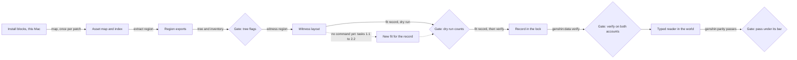

# World scenery asset family

This is the state of the scenery family: the buildings, ground, water, rocks, ruins, trees, plants and statues of the nine regions. The asset recipe is the one [derived assets](../../specs/genshin/derived-assets/design.md) states, and this page applies it to the scenery without changing it. Most of the family's gaps are already planned by an open region or compute change, and the table of owners links each one to that planning. The remaining gaps get the tasks in this change, and each task names the command or test that proves it.

## What the game has

| Item                                              | Read from                                                                                                                                                                                                  | On this Mac                                                                                                                                                     |
| :------------------------------------------------ | :--------------------------------------------------------------------------------------------------------------------------------------------------------------------------------------------------------- | :-------------------------------------------------------------------------------------------------------------------------------------------------------------- |
| Terrain tiles and their ground meshes, per region | `world/TerrainData` in each region's extract under `{data-root}/genshin-parity/extracted/<region>`                                                                                                         | Yes, for all nine regions                                                                                                                                       |
| Capital and region building families              | Mesh and material exports under each extract's `assets`, placed by its `layout`                                                                                                                            | Yes, except Snezhnaya's capital hall, which no export places ([development exports](../../specs/genshin/derived-assets/development-exports/design.md), line 78) |
| Water prefabs                                     | The water prefabs the flowing-water change names, exported only for Liyue                                                                                                                                  | Liyue only. No other region's witness holds a water surface ([flowing water](../genshin-flowing-water/design.md), line 26)                                      |
| Waterfall and river placements                    | The witness layout of each region                                                                                                                                                                          | Yes                                                                                                                                                             |
| Trees and plant placements                        | The witness layout and each region's tree and plant exports                                                                                                                                                | Yes for the placements. Per-species mesh exports are not checked here                                                                                           |
| Rock objects                                      | Placed rock prefabs in each extract                                                                                                                                                                        | Yes by the extract. The rock prefabs are not counted here                                                                                                       |
| Ruins, stilt huts, camps and statues              | Placements in the install's blocks; `genshin:assets enemy-camps` writes the camps into region data                                                                                                         | Yes, in the install                                                                                                                                             |
| Landmark meshes                                   | Names in each extract; the landmark map names them for a few regions                                                                                                                                       | The names are not all mapped                                                                                                                                    |
| Sky, sun and light                                | The login and each region's EnviroSky record, a MonoBehaviour with no JSON fields, read raw by `genshin:assets behaviours` ([game data formats](../../specs/genshin/game-data-formats/design.md), line 75) | Yes, raw                                                                                                                                                        |
| Weather templates                                 | The game text dump, fetched by `genshin:text fetch`                                                                                                                                                        | Yes                                                                                                                                                             |
| Windrise's shafts and the sun's minute            | Neither is in the install. They are frames or recordings                                                                                                                                                   | Neither machine                                                                                                                                                 |

The install is on this Mac, with its blocks and the asset map, so every step in this family that reads the install or its exports runs here. Nothing in the family needs the PC's install.

## What the repo draws today

Each row is what draws the piece in the running world. Exports replace these only under `nuxt dev`, so production shows only the rows below.

| Piece                                 | File and symbol                                                                                                                                                                                                     | What draws it                                                                                                                      |
| :------------------------------------ | :------------------------------------------------------------------------------------------------------------------------------------------------------------------------------------------------------------------ | :--------------------------------------------------------------------------------------------------------------------------------- |
| Windrise ground                       | `packages/genshin-world/src/components/World/Windrise/Index.vue`, `WorldTerrain`                                                                                                                                    | The fitted `windrise/ground` record. Its outline and normal miss their shape bars, its colour holds                                |
| Windrise still water                  | `packages/genshin-world/src/components/World/Water/Index.vue`                                                                                                                                                       | One square plane at the level of the `windrise/water` record. The Windrise component mounts it, and no other                       |
| Windrise great oak                    | `packages/genshin-world/src/components/World/Landmark/Tree/Index.vue` with `packages/genshin-engine/src/kits/tree/createTreeGeometry.ts`                                                                            | The fitted `windrise/oak` record. It is the only species built                                                                     |
| Windrise statue                       | `packages/genshin-world/src/components/World/Landmark/Statue/Index.vue` with `packages/genshin-engine/src/kits/statue/createStatueGeometries.ts`                                                                    | Stacks fitted in the `windrise/statue` record                                                                                      |
| Windrise paving                       | `packages/genshin-world/src/services/windrise/createWindrisePavingGeometry.ts` over `packages/genshin-engine/src/kits/architecture/createPavingGeometry.ts`                                                         | Outlines fitted in the `windrise/paving` record                                                                                    |
| Windrise grass and plants             | `packages/genshin-world/src/components/World/Grass/Index.vue` and `packages/genshin-world/src/components/World/Plants/Index.vue`, placed by `packages/genshin-world/src/services/windrise/computeWindrisePlants.ts` | Seeded scatter, mounted only by the Windrise component                                                                             |
| Capital buildings                     | `packages/genshin-world/src/services/world/BuildingKitPartsMap.ts` routes each region to its kit                                                                                                                    | Each region's generator under `packages/genshin-world/src/services/`, except Natlan, which draws the engine's generic building kit |
| Liyue rivers                          | `packages/genshin-world/src/components/World/Rivers/Index.vue`                                                                                                                                                      | Fitted ribbons, Liyue only                                                                                                         |
| Waterfalls                            | `packages/genshin-world/src/components/World/Waterfalls/Index.vue`                                                                                                                                                  | Generated sheets from each region's `waterfalls` record, for five regions                                                          |
| Enemy camps                           | `packages/genshin-world/src/components/World/Enemies/Index.vue`                                                                                                                                                     | One capsule per enemy, so a camp is a group of capsules                                                                            |
| Domain entrances                      | `packages/genshin-world/src/components/World/Landmark/DomainEntrance/Index.vue`                                                                                                                                     | A box                                                                                                                              |
| Landmarks                             | `packages/genshin-world/src/components/World/Landmarks/Index.vue`                                                                                                                                                   | Each landmark by its kind. It has no branch for a waypoint                                                                         |
| Mondstadt windmill                    | `packages/genshin-world/src/services/mondstadt/computeWindmillSailAngle.ts`                                                                                                                                         | Nothing outside its own test                                                                                                       |
| Sumeru stilt hut                      | `packages/genshin-world/src/services/sumeru/createStiltHutGeometry.ts`                                                                                                                                              | Nothing, and no test                                                                                                               |
| Sumeru desert ruin                    | `packages/genshin-world/src/services/sumeru/createDesertRuinGeometry.ts`                                                                                                                                            | Its own test only                                                                                                                  |
| Nod-Krai stone circles                | `packages/genshin-world/src/services/nod-krai/createStoneCircleGeometry.ts`                                                                                                                                         | Its own test only                                                                                                                  |
| Snezhnaya factory and Kresnik's Torch | `packages/genshin-world/src/services/snezhnaya/createFactoryGeometry.ts` and `packages/genshin-world/src/services/snezhnaya/createKresnikTorchGeometry.ts`                                                          | Nothing                                                                                                                            |
| Sky and weather                       | `packages/genshin-world/src/composables/useAreaWeather.ts` with the Windrise sky                                                                                                                                    | The area's weather chain and the Windrise sky's keyframes                                                                          |

## The gap

Each gap is an observable state of the scenery, not a file. The owner of each gap is in [Already specified](#already-specified). A gap with no owner and a task here is marked in its last column.

| ID  | Gap                                                                                                           | Why it matters                                                                               | Smallest closing piece                                    | Needs                                                                 |
| :-- | :------------------------------------------------------------------------------------------------------------ | :------------------------------------------------------------------------------------------- | :-------------------------------------------------------- | :-------------------------------------------------------------------- |
| G1  | Still water has a level only for Windrise                                                                     | A sea is the largest flat tone of its frame, so a wrong level moves every shot of its region | A level fit per region, from its water prefab             | Mac, after the water prefab exports the flowing-water change waits on |
| G2  | Still water is mounted only by the Windrise component                                                         | A fitted level would draw nowhere                                                            | A mount per region with a fitted level                    | Mac, after G1                                                         |
| G3  | Rivers outside Liyue are not fitted                                                                           | Rivers are a region's moving water                                                           | A river fit per region                                    | Mac, after the same exports as G1                                     |
| G4  | Falls in Fontaine, Nod-Krai and Snezhnaya are not placed                                                      | A region's falls are much of its sound and motion                                            | A fall fit wherever the game places one                   | Mac, once the placements are read. Not checked here                   |
| G5  | Region ground is ranked by its shape pass only for Windrise                                                   | The frame cannot be trusted over ground that was never measured                              | The shape pass per region                                 | Mac                                                                   |
| G6  | The sun's direction is unread, and each region's held minute is provisional (720, and 0 for Everfrozen Earth) | The light, the shadows and the god rays all depend on the sun                                | A reference with a cast shadow on a flat receiver         | A reference, neither machine                                          |
| G7  | No region has an atmosphere pass past its camera                                                              | The sky is most of the frame                                                                 | The atmosphere pass per region                            | Mac, after its camera                                                 |
| G8  | Each cloud band's spread is not measured                                                                      | The clouds set the sky's look                                                                | A measure of each band's spread from its reference        | Mac. Task 3.1                                                         |
| G9  | Weather parameters are not measured for each kind                                                             | Weather is what a frame differs by after the sun                                             | A measure per weather kind from a reference               | A reference, neither machine                                          |
| G10 | One tree species is built, and no region has a forest                                                         | Forests are most of a region's green                                                         | A fitted species per species, and a forest per region     | Mac                                                                   |
| G11 | Grass and plants are placed by the Windrise component only                                                    | The ground of every other region is bare where the game is green                             | A plant fit per region                                    | Mac. Task 1.1                                                         |
| G12 | Grass and plants are mounted only in Windrise                                                                 | A plant fit has nowhere to draw                                                              | A mount per region                                        | Mac. Task 1.2                                                         |
| G13 | Rock objects, other than Liyue's karst, are not built                                                         | Rocks are a region's silhouette                                                              | A rock kind and a rock fit                                | Mac. Task 1.3                                                         |
| G14 | Sumeru's stilt huts and desert ruins have no placements read                                                  | They are the places a player finds                                                           | A fit of each record, which gives each generator a caller | Mac. Task 2.1                                                         |
| G15 | Mondstadt's windmill and Nod-Krai's stone circles are built but not placed                                    | As G14                                                                                       | Each generator placed by its region's landmarks           | Mac                                                                   |
| G16 | Each nation's Statue of the Seven stands only in Windrise                                                     | Each nation's statue is a landmark of its own                                                | A statue fit per nation with Windrise's kit               | Mac. Task 2.2                                                         |
| G17 | Snezhnaya's factories are not placed, and its torch is not lit                                                | The industrial and warm landmarks of the nation                                              | The torch is planned; a factory placement is not          | Mac                                                                   |
| G18 | Sub-areas have no derivation root                                                                             | A sea or a snowfield is an area of its own                                                   | A root per sub-area, derived the way a capital is         | Mac. Task 3.2                                                         |
| G19 | The capitals' Layout, Camera and Shape passes are not run                                                     | A capital is its region's landmark                                                           | The three passes per capital                              | Mac                                                                   |
| G20 | Landmark camera meshes are unnamed in most regions                                                            | Without names there is no camera, so no pass past Layout                                     | Each landmark's mesh named from the extracts              | Mac                                                                   |
| G21 | The god rays and the bloom threshold have no reference                                                        | The shafts are Windrise's most visible light                                                 | A recording with the shafts                               | A recording, neither machine                                          |
| G22 | The art the scenery cannot ship has no record                                                                 | The frame's stand-ins are not listed anywhere                                                | A roadmap line per missing asset                          | Text only. Task 4.1                                                   |
| G23 | Enemy camps are drawn as capsules                                                                             | A camp is a group of enemies, so its stand-in belongs to the enemies capability              | None in scenery                                           | Mac                                                                   |
| G24 | Snezhnaya's palette and capital hall are unread                                                               | The nation's colours and its capital                                                         | Its building export, then its palette                     | Mac, after a re-extraction                                            |

## Already specified

Each gap is owned by one of these, and a gap owned by an open change or roadmap item has no task here.

| ID       | Owner                                                                                                                                                                                                                                                                                                                         | Status                                                            |
| :------- | :---------------------------------------------------------------------------------------------------------------------------------------------------------------------------------------------------------------------------------------------------------------------------------------------------------------------------- | :---------------------------------------------------------------- |
| G1       | The water prefab exports named in the flowing-water change's `x-waiting`, and the water page's open item "one level per region" ([water](../../specs/genshin/water/design.md), line 68)                                                                                                                                       | Blocked. The level is not fitted, so no task here                 |
| G2       | The water page's open item on Windrise's ponds and the per-region mount ([water](../../specs/genshin/water/design.md), lines 67 and 68)                                                                                                                                                                                       | Blocked on G1                                                     |
| G3       | [Flowing water](../genshin-flowing-water/design.md), line 26, and its `x-waiting`                                                                                                                                                                                                                                             | Blocked on the same exports as G1                                 |
| G4       | Fontaine's great fall in [Fontaine](../genshin-fontaine/tasks.md), task 1.1. Nod-Krai and Snezhnaya have none                                                                                                                                                                                                                 | Partly planned. No task, since the game's placements are not read |
| G5       | The roadmap's "Each region's ground held to its shape pass" ([roadmap](../genshin-roadmap/tasks.md), line 279)                                                                                                                                                                                                                | Planned                                                           |
| G6       | The roadmap's "The sun's direction cannot be read from four references" ([roadmap](../genshin-roadmap/tasks.md), line 290)                                                                                                                                                                                                    | Blocked on a reference                                            |
| G7       | The roadmap's "Each region's render pass, in build order" ([roadmap](../genshin-roadmap/tasks.md), line 277), and the login's haze and sky items (lines 55 and 56)                                                                                                                                                            | Planned                                                           |
| G8       | The derived assets page's open item "Each cloud band's spread is measured off the captures" ([derived assets](../../specs/genshin/derived-assets/design.md))                                                                                                                                                                  | Noted, no source. Task 3.1                                        |
| G9       | [Weather](../genshin-weather/design.md), lines 18 and 19 on colours and particles. The roadmap's weather schedule, rain and snow items (lines 45, 46 and 286) record that no recording was found                                                                                                                              | Blocked on references                                             |
| G10      | [Trees and scatter](../genshin-trees-and-scatter/tasks.md), task 2.2 for each species; the forests of [Mondstadt](../genshin-mondstadt/tasks.md), task 3.2, and [Snezhnaya](../genshin-snezhnaya/tasks.md), task 2.1; the impostor distance is deferred ([deferred](../../deferred/genshin/tree-impostor-distance/design.md)) | Planned, and one item deferred                                    |
| G11, G12 | None                                                                                                                                                                                                                                                                                                                          | Tasks 1.1 and 1.2                                                 |
| G13      | [Liyue](../genshin-liyue/tasks.md), task 1.1, for the karst and stone-forest rocks only                                                                                                                                                                                                                                       | Planned for karst. Task 1.3 for the rest                          |
| G14      | The Sumeru change's design names stilt huts and sandstone ruins in its kit graph ([Sumeru](../genshin-sumeru/design.md), lines 31 and 32), and no task places them                                                                                                                                                            | Noted in a design, unplanned. Task 2.1                            |
| G15      | [Mondstadt](../genshin-mondstadt/tasks.md), task 1.2 for the windmill; [Nod-Krai](../genshin-nod-krai/tasks.md), task 2.2 for the stone circles                                                                                                                                                                               | Planned                                                           |
| G16      | None. The Statues of the Seven change covers levels and Oculi, not placed geometry                                                                                                                                                                                                                                            | Task 2.2                                                          |
| G17      | The torch: [Snezhnaya](../genshin-snezhnaya/tasks.md), task 1.2, and [the Snezhnaya page](../../specs/genshin/snezhnaya/design.md), line 37 ("No torch landmark yet"). Factories: none                                                                                                                                        | Torch planned. Factory placement not planned, so no task here     |
| G18      | The rule that every other region derives from its capital ([scene derivation](../../specs/genshin/scene-derivation/design.md), "The other regions"). No change names a sub-area root                                                                                                                                          | Noted. Task 3.2                                                   |
| G19      | The roadmap's "Each region's render pass, in build order" (line 277) and each capital's change ([Liyue](../genshin-liyue/tasks.md), [Inazuma](../genshin-inazuma/tasks.md), [Fontaine](../genshin-fontaine/tasks.md), [Natlan](../genshin-natlan/tasks.md))                                                                   | Planned                                                           |
| G20      | The roadmap's "Five regions' recreation passes stop at the camera" (line 293), and the compute pages' landmark-mesh items ([Fontaine compute](../../specs/genshin/compute/fontaine/design.md), [Inazuma compute](../../specs/genshin/compute/inazuma/design.md))                                                              | Planned                                                           |
| G21      | The roadmap's "God rays and bloom, priced by a recording" (line 67), and the [Windrise compute](../../specs/genshin/compute/windrise/design.md) item                                                                                                                                                                          | Blocked on a recording                                            |
| G22      | None                                                                                                                                                                                                                                                                                                                          | Task 4.1                                                          |
| G23      | [Enemies](../../specs/genshin/enemies/design.md), "The stand-in" (line 69)                                                                                                                                                                                                                                                    | Noted, in the enemies capability                                  |
| G24      | The roadmap's "Region palettes" item (line 281), the development exports' missing hall (line 78), and [Snezhnaya](../genshin-snezhnaya/tasks.md), task 3.1, blocked on a re-extraction                                                                                                                                        | Blocked                                                           |

## The conversion path

Each step is a real command, or it says **no command yet** with what builds it. `pnpm -C scripts genshin:assets map` runs once per patch, and `genshin:data verify` follows every publish, as the [derived assets](../../specs/genshin/derived-assets/design.md) pipeline states.

| Gap | Extract and witness                                                                                                                                                                 | Fit                                                                                                                                                                                                                 | Publish and check                                                                                                                                                                                 |
| :-- | :---------------------------------------------------------------------------------------------------------------------------------------------------------------------------------- | :------------------------------------------------------------------------------------------------------------------------------------------------------------------------------------------------------------------ | :------------------------------------------------------------------------------------------------------------------------------------------------------------------------------------------------ |
| G1  | `pnpm -C scripts genshin:assets extract <region>`, then `witness <region>`. Both exist                                                                                              | `pnpm -C scripts genshin:assets fit windrise --only water --dry-run` exists for Windrise. **No command yet** for another region, which first needs its water prefab streamed in its derivation                      | Then `genshin:assets fit <region> --only water`, then `pnpm -C scripts genshin:data verify`. Check with `pnpm -C scripts genshin:parity compare` once a sea reference is held                     |
| G2  | As G1                                                                                                                                                                               | None. The mount is code                                                                                                                                                                                             | A test named after the scenario in the spec                                                                                                                                                       |
| G3  | `extract <region>` and `witness <region>`. Both exist                                                                                                                               | `pnpm -C scripts genshin:assets fit liyue --only rivers --dry-run` exists for Liyue only. **No command yet** for another region                                                                                     | The same publish as G1                                                                                                                                                                            |
| G4  | `extract <region>` and `witness <region>`                                                                                                                                           | `pnpm -C scripts genshin:assets fit <region> --only waterfalls --dry-run` exists for every region whose data holds falls. **No command yet** for Fontaine, Nod-Krai or Snezhnaya unless the game places falls there | `fit <region> --only waterfalls`, then `genshin:data verify`. Check with `genshin:parity compare`                                                                                                 |
| G5  | As G4                                                                                                                                                                               | `pnpm -C scripts genshin:assets fit <region> --only ground --dry-run`                                                                                                                                               | `fit <region> --only ground`, then `genshin:data verify`. Check with `pnpm -C scripts genshin:parity passes <region> --pass Shape`, then `pnpm -C scripts genshin:parity rank`                    |
| G6  | None                                                                                                                                                                                | Held minute: **no command yet** beyond `pnpm -C scripts genshin:parity pose <ref> --witness <region> --write` for the camera                                                                                        | `pnpm -C scripts genshin:parity shadows <ref> --witness <region>` exists. A search for a reference frame with a shadow edge: **no command yet**                                                   |
| G7  | As G4                                                                                                                                                                               | None                                                                                                                                                                                                                | `pnpm -C scripts genshin:parity passes <region> --pass Atmosphere`, after the region's camera                                                                                                     |
| G8  | None                                                                                                                                                                                | None                                                                                                                                                                                                                | **No command yet** to measure a band's spread. Task 3.1 builds it beside `pnpm -C scripts genshin:parity measure`                                                                                 |
| G9  | None                                                                                                                                                                                | None                                                                                                                                                                                                                | `pnpm -C scripts genshin:parity fetch` finds references. `pnpm -C scripts genshin:parity fog <ref> --witness <region>` exists. **No command yet** for particle density or a weather kind's colour |
| G10 | `pnpm -C scripts genshin:assets tree <component>` exists                                                                                                                            | The oak is `fit windrise --only oak`. **No command yet** for another species; [trees and scatter](../genshin-trees-and-scatter/tasks.md) task 2.2 builds it                                                         | The species' own dry run, once its fit exists                                                                                                                                                     |
| G11 | As G4                                                                                                                                                                               | `pnpm -C scripts genshin:assets fit windrise --only plants --dry-run` exists for Windrise. Task 1.1 builds the fit for each region                                                                                  | `fit <region> --only plants`, then `genshin:data verify`. Check with `pnpm -C scripts genshin:parity passes <region> --pass Layout`                                                               |
| G12 | None                                                                                                                                                                                | None                                                                                                                                                                                                                | A test named after the scenario in the spec (task 1.2)                                                                                                                                            |
| G13 | `extract <region>` for the rock prefabs, then `witness <region>`                                                                                                                    | **No command yet.** Task 1.3 builds the fit                                                                                                                                                                         | The same publish as G11. Check with the Layout pass                                                                                                                                               |
| G14 | As G13                                                                                                                                                                              | **No command yet.** Task 2.1 builds the fit for the huts and the ruins                                                                                                                                              | The same publish. Check with `pnpm -C scripts genshin:parity passes sumeru --pass Layout`                                                                                                         |
| G15 | None                                                                                                                                                                                | None                                                                                                                                                                                                                | Owned by the two region changes                                                                                                                                                                   |
| G16 | As G13                                                                                                                                                                              | `pnpm -C scripts genshin:assets fit windrise --only statue` exists for Windrise. **No command yet** for another nation. Task 2.2 builds it                                                                          | The same publish. Check with the Layout pass                                                                                                                                                      |
| G17 | None                                                                                                                                                                                | **No command yet** to place a factory                                                                                                                                                                               | Owned in part by the Snezhnaya change                                                                                                                                                             |
| G18 | `extract <sub-area>` is rejected until the component names it. **No command yet** to add the name: task 3.2 adds it. `pnpm -C scripts genshin:assets city-areas` prints counts only | None                                                                                                                                                                                                                | A test named after the scenario in the spec                                                                                                                                                       |
| G19 | `pnpm -C scripts genshin:assets extract <capital>` and `witness <capital>`                                                                                                          | None                                                                                                                                                                                                                | `pnpm -C scripts genshin:parity passes <capital> --pass Layout`, then `Camera`, then `Shape`                                                                                                      |
| G20 | `pnpm -C scripts genshin:assets tree <capital>` exists. **No command yet** to write the mesh names: a manual edit to the landmark map                                               | None                                                                                                                                                                                                                | `pnpm -C scripts genshin:parity pose <ref> --witness <region> --write`                                                                                                                            |
| G21 | None                                                                                                                                                                                | None                                                                                                                                                                                                                | `pnpm -C scripts genshin:parity recordings` lists what is held. No recording of the shafts is held                                                                                                |
| G22 | None                                                                                                                                                                                | None                                                                                                                                                                                                                | **No command yet:** a roadmap line, written by hand (task 4.1)                                                                                                                                    |
| G23 | `pnpm -C scripts genshin:assets enemy-camps` writes the camps into region data                                                                                                      | None                                                                                                                                                                                                                | The enemies capability's own check                                                                                                                                                                |
| G24 | `pnpm -C scripts genshin:assets palette <region>` takes every region but Snezhnaya                                                                                                  | None                                                                                                                                                                                                                | Blocked on a re-extraction of the capital's building                                                                                                                                              |

## The pipeline

The gates sit where a stage's check reads its output. The fit and the record each have a dry run before they publish, and the reader and the pass each have a check before the scenery counts as drawn. The dashed path is what the new fits add, and it reaches the same gate.

## Not shippable

These are the game's art the scenery cannot ship. Each is a missing asset, and the recreation draws a stand-in until a generated or traced one exists. None is committed.

| Art                                                            | What the repo draws instead                                                                                                                                                                                                                                                  | The missing asset                                                | Where it is recorded                                                            |
| :------------------------------------------------------------- | :--------------------------------------------------------------------------------------------------------------------------------------------------------------------------------------------------------------------------------------------------------------------------- | :--------------------------------------------------------------- | :------------------------------------------------------------------------------ |
| Painted sky and cloud atlas                                    | The fitted sky gradient and cloud sprites, `scripts/src/services/genshinAssets/fit/fitSkyGradient.ts` and `scripts/src/services/genshinAssets/fit/fitCloudSprites.ts`, with the atlas drawn from them by `packages/genshin-engine/src/atmosphere/createCloudAtlasTexture.ts` | A painted dome, only if the colours cannot be fitted as profiles | Task 4.1                                                                        |
| Ground layers' diffuse textures                                | The fitted layer colours and spectra in the `ground-paint` record                                                                                                                                                                                                            | Each layer's detail texture                                      | [Ground detail](../genshin-ground-detail/tasks.md), task 2.2                    |
| Oak leaf and bark textures                                     | The oak's fitted vertex colour, read by `scripts/src/services/genshinAssets/fit/createNearestColourReader.ts`                                                                                                                                                                | The leaf card and the bark texture                               | Task 4.1                                                                        |
| Karst and stone-forest rock textures                           | None yet                                                                                                                                                                                                                                                                     | The rock texture                                                 | The meshes: [Liyue](../genshin-liyue/tasks.md), task 1.1. The texture: task 4.1 |
| Waterfall and river mist and foam                              | No pool particles yet                                                                                                                                                                                                                                                        | The emitter, judged by a recording                               | [Roadmap](../genshin-roadmap/tasks.md), line 355                                |
| Water surface, foam and caustic textures                       | Procedural glints and caustics, `packages/genshin-engine/src/nodes/createCausticsNode.ts`                                                                                                                                                                                    | None, if the procedural look holds                               | The compare of the frame, with no record                                        |
| Lacquer, roof-tile and plaster colours                         | Palette constants in `packages/genshin-world/src/services/liyue/constants.ts` and `packages/genshin-world/src/services/mondstadt/constants.ts`                                                                                                                               | Colours sampled from the textures the extracts hold              | [Roadmap](../genshin-roadmap/tasks.md), line 281                                |
| Stadium of the Sacred Flame and Ochkanatlan's painted surfaces | Not built                                                                                                                                                                                                                                                                    | The kit's painted surfaces                                       | [Natlan](../genshin-natlan/tasks.md), task 3.1                                  |
| Grass blades and flowers                                       | Our own blades, `packages/genshin-engine/src/vegetation/createGrassBladePoint.ts`                                                                                                                                                                                            | The flower look                                                  | [Flower look](../../deferred/genshin/flower-look/design.md)                     |

## Decisions

- **Owned gaps are linked, not tasked again.** Rejected: a task per gap. The owners already plan the work, and two changes writing one file would race.
- **A still water level is fitted from the export, never typed in.** Rejected: a constant per region in the world's constants. Nothing publishes such a level, and a value no source shows is estimated, not recorded. The water gap waits on the export that the flowing-water change already names.
- **A missing command is a phase 0 task, even when its content is a region's.** The fit is the measure that region's gate reads, so a region's phase would wait on a command nobody built. Rejected: placing each fit in its region's phase.
- **The scenery ships parameters and our generators' output, never a game mesh or texture.** Rejected: shipping a game rock or ruin mesh. It would break the rule that only fitted parameters ship.
- **Each nation's statue uses Windrise's statue kit.** Rejected: a statue kit per nation. The kit already draws a statue from fitted stacks, and a second kit would be a second render path.
- **Sub-areas get roots in the component map, not a command of their own.** Rejected: a command per sub-area. `extract` already takes a component, so a root is one more entry.
- **Cloud spread is measured, not set by eye.** Rejected: a fixed spread taken from the look. No reference records it, so a fixed value would be a guess.
- **Snezhnaya's palette and hall wait for the re-extraction.** Rejected: sampling Snezhnaya's palette from another region's building families. The sampler reads each region's own families.
- **Camps are enemies' stand-ins.** Rejected: drawing camp structures as scenery. A camp is a group of enemies, and the game draws no camp structure in the scenery to copy.
- **The art the scenery cannot ship stays a stand-in and is recorded.** Rejected: shipping the game's textures, or a sky dome painted from a screenshot of the game.
- **The family runs on this Mac.** The install and the exports are here. Rejected: sending the family to the PC, which the inventory's column suggested before the install was checked.

## Key files

| File                                                                     | Role                                                                                     |
| :----------------------------------------------------------------------- | :--------------------------------------------------------------------------------------- |
| `scripts/src/services/genshinAssets/fit/DerivedAssetFitMap.ts`           | Registers each component's fits; the new plant, rock, ruin and statue fits register here |
| `scripts/src/services/genshinAssets/fit/fitWindrisePlants.ts`            | Windrise's plant fit, the pattern each region's plant fit follows                        |
| `scripts/src/services/genshinAssets/fit/fitWindriseStatue.ts`            | Windrise's statue fit, the one each nation's statue reuses                               |
| `scripts/src/services/genshinAssets/fit/fitVisualHull.ts`                | A visual hull, which a rock kit may be built from                                        |
| `scripts/src/services/genshinAssets/shared/DerivedAssetComponentMap.ts`  | Each component's roots; the sub-area roots are added here                                |
| `scripts/src/models/genshinAssets/shared/DerivedAssetComponent.ts`       | The component names, to which the sub-areas are added                                    |
| `scripts/src/services/genshinParity/commands/measureCommand.ts`          | The parity measure, beside which the cloud spread command sits                           |
| `packages/genshin-world/src/components/World/Plants/Index.vue`           | Mounts a region's plants                                                                 |
| `packages/genshin-world/src/components/World/Grass/Index.vue`            | Mounts a region's grass                                                                  |
| `packages/genshin-world/src/models/world/LandmarkKind.ts`                | The landmark kinds; a rock kind is added here                                            |
| `packages/genshin-world/src/services/sumeru/createStiltHutGeometry.ts`   | The stilt hut generator, which task 2.1 gives a caller                                   |
| `packages/genshin-world/src/services/sumeru/createDesertRuinGeometry.ts` | The desert ruin generator, which task 2.1 gives a caller                                 |
| `packages/genshin-world/src/components/World/Landmark/Statue/Index.vue`  | Draws a statue from its record, reused for each nation                                   |
| `openspec/changes/genshin-roadmap/tasks.md`                              | The open work, where task 4.1 writes its records                                         |

## Sources

- [Derived assets](../../specs/genshin/derived-assets/design.md): the pipeline's steps and the rule that only fitted parameters ship, which every task here follows.
- [Genshin phases](../genshin-phases/design.md): the phase each task holds, and the rule that a missing command is a phase 0 task.
