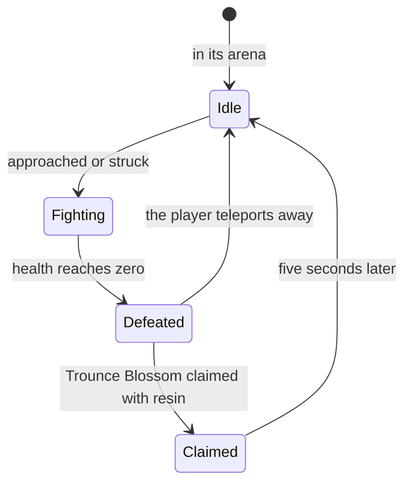

# Bosses

A boss is an enemy whose reward is claimed, not dropped. A normal boss gives the material each character ascends with, and a weekly boss the material talents need past level 6, so the character screen's ascension and the talents lean on them. The [enemies](../../specs/genshin/enemies/design.md) already place a boss's camp, respawn it at once and drop nothing for it, leaving its reward to its blossom; this page is that blossom and the fight before it. It waits on [Original Resin](../../specs/genshin/original-resin/design.md)'s claim, the [domains](../genshin-domains/design.md)' scenes the trounce domains are, and the [character kits](../genshin-character-kits/design.md) that fight them. The respawn after a claim and the weekly reset and count are [built](../../specs/genshin/bosses/design.md); this page keeps the rest.

## Decisions

- **A normal boss waits in its arena.** It stands idle at its arena's centre until a player comes too close or strikes it, as the wiki describes, which the enemies' notice already models. A few are fought only after a world quest's step or a simple puzzle, named with their camp.
- **Each boss fights by its own moves.** A boss's attacks, phases and shields are a module per boss over the enemies' step, its states, its notice and its leash kept as they are. Each module is written from the wiki's page of that boss, and its timings measured off recordings, as the controller's are. Bosses resist displacement, carry high interruption resistance and are never frozen by Frozen: the first two are the boss's poise type, and the last an immunity [combat](../../specs/genshin/combat/design.md)'s Frozen learns to check. The first boss's moves (2.1) are written from its wiki page in `services/bosses/anemoHypostasis.ts`, with the common enemies' windup and recovery as their provisional timings until measured. The enemies' step runs the seven attack moves in turn through the moves `stepEnemy` is passed, each windup and recovery at its own move's seconds, with the moves fed from `services/bosses/BossMovesMap.ts`. Second Wind, the one-time turn at about 5% health, is not yet run: it needs its teleport and orbs. A boss resists displacement, which `services/enemy/displaceEnemy.ts` states, and no strike calls it, since no strike in the combat model pushes an enemy (Kaeya's knockback is not built).
- **A normal boss leaves a Trounce Blossom.** Its reward, Adventure EXP, Mora, Companionship EXP, its own ascension material and artifacts by World Level, is claimed for 40 resin. The boss comes back five seconds after the claim; left unclaimed, it stays defeated until the player teleports away, as the game does, which replaces the enemies' respawn "at once" for a boss.
- **A normal boss's claim pays its Mora and its own drop by World Level, from the wiki.** No table counts a normal boss's claim: its `RewardPreviewExcelConfigData` rows (such as `无相之风_90级`, the Anemo Hypostasis's) list its items with their counts mostly blank, and no blossom row names a boss. So the counts are the Basic Drops tab of the wiki's `Template:World_Boss_Rewards`, its normal branch: the Mora a fixed count, and the boss's own drop a guaranteed count plus one more at a chance. Its Adventure EXP column, 200, is the claim's 40 resin at five a point, and its Companionship EXP column is the grant's, so the claim's draw holds neither, as [Original Resin](../../specs/genshin/original-resin/design.md) decides. Its Character EXP column waits on the enemies' Character EXP, which the world does not give yet. The boss's gems and artifacts are the wiki's other tabs, read with the first boss. Read from the wiki's MediaWiki API: the rows of `Template:World_Boss_Rewards` (its Basic Drops tab, normal branch) for World Levels 0 to 8, with the boss levels cross-checked against the [Adventure Rank](https://genshin-impact.fandom.com/wiki/Adventure_Rank) page's World Level table. The page titles are cited so a recording can measure them. World Level 9 has no row in the template, and the [Normal Boss](https://genshin-impact.fandom.com/wiki/Normal_Boss) page and the [Character Level-Up Material](https://genshin-impact.fandom.com/wiki/Character_Level-Up_Material) page give no World Level 9 Mora or drop counts, so World Level 9 repeats World Level 8's rows, provisional until a source gives its own. `drawNormalBossReward` refuses only a World Level the game does not have.
- **A weekly boss waits in its trounce domain.** Its domain opens once the Archon or story quest that introduces it is done, every day of the week, and is entered as any [domain](../genshin-domains/design.md) is. Andrius alone is fought in the open world. From Adventure Rank 40, a locked one can be challenged from the handbook alone. Stormterror's domain opens once the eight quests of Prologue Act III, Song of the Dragon and Freedom, are done, read from the wiki's list of the act: provisional, since the dump leaves the domain's own condition empty. `services/bosses/checkIsWeeklyBossDomainOpen.ts` is that gate: the handbook's Domains tab and the map both call it, through `services/bosses/checkIsWeeklyBossEntryOpen.ts`, so a locked weekly entrance is neither listed as unlocked nor a jump target until its quests are done. A tab with no list (Embattle, Enemies, Guide) now shows nothing, where it showed the commissions.
- **A weekly boss's entrance is a Trounce domain entrance, named by its own title.** The domain is a domain in the game, so it takes `DomainKind.Trounce` rather than a landmark kind of its own: its entrance is a domain entrance, drawn with the domains' stand-in pillar, and its open rule is the one the domains share, read from `DomainOpenRankMap` (Adventure Rank 40, the rank the wiki's quick challenge takes) and open every day, as Blessing is (`checkIsDomainKindOpenOnDay`). The quests that unlock it are the gate `checkIsWeeklyBossEntryOpen` reads on the map and in the handbook, separate from the rank, and a weekly entrance takes no resonance. Every domain entrance's point holds a `titleTextID`, 39 distinct titles across the entrances, so one mechanism names them all: a domain entrance's landmark holds its `titleTextKey`, read from its point, and its jump names it by that key. The 39 keys are `GameTextKey.DomainEntrance<N>` = `UI_DUNGEON_ENTRY_<N>`, each named in the game text (`genshin:text find` with `--id` lists every one), and `GameTextKey.DomainEntrance`, the old page title, is removed with its only user. Until the fit writes the regions' entrances with their titles, the regions' files hold none and the landmark schema refuses them, so the app's entrances wait on that run.
- **A weekly claim is once a week.** Each weekly boss's reward is claimed once a week, at the price [Original Resin](../../specs/genshin/original-resin/design.md) already gives. The week's count, its reset and each boss's once-a-week gate are built. A weekly boss's defeat leaves its weekly blossom where it fell, read before a normal boss's (`computeDefeatWeeklyBossTrounceBlossom`), and a claim pays through the offer chosen (`claimWeeklyBossTrounceBlossom`). The claim's EXP is granted as a normal boss's is: the boss's Adventure EXP through the rank, its Companionship EXP by the World Level's row. The resin's own Adventure EXP, which the claim computes, is not written back on either path, an open point for the normal boss's claim as much as the weekly one.
- **What a weekly boss gives.** Its talent materials, Adventure EXP, Mora, Companionship EXP, ascension gems and artifacts by World Level, with a 12% chance of a billet for forging and a 33% chance of a Dream Solvent, as the wiki gives them. Its highest difficulty's first clear also gives one of each of its talent materials, Dvalin's Plume, Claw and Sigh, once, claimed in the handbook (`claimWeeklyBossFirstClear`, through the domains' first-clear rule); the spec's "its materials" is read as the three its claim pays, provisional until a source names the boss's own set. Provisional: the wiki's rows are by Domain Level I to VI, boss levels 40 to 90, so a World Level maps onto a row by clamping it into I to VI, World Level 0 and 1 reading I; each claim draws one of Dvalin's Plume, Claw and Sigh for its talent count. **Discrepancy:** the wiki's talent column pays none at Domain Level III, but the game's own reward preview (`RewardPreviewExcelConfigData` 15003) lists the three talent materials from III, and the preview decides what can drop, so III pays them at a provisional 10% chance until the wiki gives its rate. The wiki gives a 12% chance of a Northlander billet, one of five by weapon class (101101 to 101105), and an average count per row for each star tier of Ascension Gem, rounded at random up or down so the mean holds; the gem ids are 104121 to 104124, 104141 to 104144 and 104151 to 104154, the families Varunada Lazurite, Vajrada Amethyst and Vayuda Turquoise, and the wiki gives no split between the families, so each gem is one of them, drawn at random. Character EXP, which the wiki's tab also lists, is not paid, since the claim's spec names no such reward.
- **A weekly boss's trounce domain is read from the dump.** Entry 1006 names its levels as its cooldown tips list, dungeons 2020 to 2025, each a boss dungeon read for its enemies' level and recommended rank. They publish as one record, `domains/weeklyBosses`, beside the domains' index, so the domain list is a single `--dry-run` away (`genshin:assets domain-levels`). Its entrance is a `DomainKind.Trounce` entrance that the domain run places with the others. `getDomainEntryKind` names an entry by its id, since the dump types every trounce entry alike: only entry 1006 is a weekly boss's, so the twelve other trial entries stay out. The dry run, `pnpm -C scripts genshin:assets domains --dry-run`, counts 39 entries, 36 placed (Mondstadt 8, Liyue 6, Inazuma 4, Sumeru 5, Fontaine 5, Natlan 4, Nod-Krai 4, with 1006 among Mondstadt's eight), none without a transport point, and 3 in no fitted region, left out as before. Writing the regions is the same command without `--dry-run`, run by the coordinator: `genshin:assets fit` is a different command, publishing derived records, and writes no entrance.
- **A weekly boss's trounce domain is fought on the domain arena.** `openDomain` reads a `DomainKind.Trounce` entrance's levels from `domains/weeklyBosses` through `toWeeklyBossSchedule`, which opens each level every day and gives it no tree or resin, since the claim pays at the blossom. Its six tiers (by recommended rank) are each one wave of Stormterror Dvalin alone, a `defeatTarget` of one and no time limit: the wiki's Confront Stormterror page gives the domain one enemy card and no Domain Enemies table, so the wave is read from that card (PROVISIONAL). A wave names its boss by `enemyKindId`, which its camp spawns in place of a stand-in, so the boss fights with its own moves. A clear of a Trounce domain raises no Petrified Tree, the boss's defeat leaving its weekly blossom where it fell. The wind currents and the platforms they cross are not modelled: the wiki names Anemograna's updrafts, but the arena has no platform positions until the scene export.
- **A weekly boss's handbook row and first clear.** The Domains tab lists every domain entrance the map has, the locked ones too, each as a row with the one action it offers (`services/handbook/toHandbookDomains.ts`). A locked weekly boss from Adventure Rank 40 gets Quick Challenge, which enters its domain at the tier the rank reaches and starts that fight on the arena, without a jump, by `services/bosses/computeWeeklyBossQuickChallengeDungeonId.ts` (the highest tier reached, or the lowest when none is). A weekly boss's first clear is claimable once its highest tier is cleared: the arena's clear at that tier marks `<entryId>:top` in the cleared-domain set, and the claim adds the entry id alone, paying the talent materials into the bag through `grantRewardItems`. The set saves as a list of strings, so the mark needs no save field of its own, and a later save field could replace both keys. The two labels are the game's: Quick Challenge (`UI_BOSS_QUICKSTART_TITLE`) and Claim Rewards (`UI_ACTIVITY_GET_RWARD`), the second a generic label, PROVISIONAL.
- **Stormterror is a boss kind added ahead of its domain.** Its monster id 29010104 is `EnemyKindId.StormterrorDvalin`, its row read from the monster table with the enemies dataset through the weekly boss kind ids, since no camp places it. Its element is Anemo and its poise a boss's; its energy drops are none, unread. Its moves are the wiki's six with the damage share the wiki gives, Caelestinum Finale Termini left out for want of a share; each carries its element (Dvalin's Cleansing and Tempestuous Barrage and Energy Lightning Anemo, the rest physical), and Dvalin's Cleansing its wiki hit interval of 0.5s. Windup and recovery stay the common enemies' until measured. The five phases from the wiki's page (shield time limits of 2, 8, 2 and 8 minutes, shield breaks of 1, 3, 5 and 6, then indefinite) and its wind currents (Anemograna's updrafts) are read as data in the same file, PROVISIONAL and citing the speedrun recording the page gives (youtu.be/j62DdUZXczM). `services/bosses/stepStormterrorFight.ts` steps the fight by the time and the shield breaks since: each phase ends at its time limit or at its total shield-break limit, and the step names the transition attack each phase leaves. The shield is a fifth of Dvalin's max HP, non-elemental (`STORMTERROR_SHIELD_HP_FRACTION`), and its paralysis is untimed. The wind currents stand on a ring beyond the camp (`services/bosses/computeStormterrorWindCurrentPlaces.ts`), PROVISIONAL until the scene export places them. The shield is a pool `damageEnemy` drains before the enemy's health (`Enemy.shield`, a fifth of Dvalin's max HP from `EnemyKindTraitsMap`). Every hit's damage takes it, whatever its element, since the wiki gives the shield as non-elemental and an elementless ward as an extra health bar, so no element is checked. Its break staggers Dvalin, and the enemy loop emits `shieldBreak` once for each break; the arena's run counts those into `stepStormterrorFight` each frame, returning the transition attacks each phase's end names. Dvalin stands again at full shield when the stagger ends, which is PROVISIONAL, as the wiki does not time the paralysis. Session starts each named attack with `startBossMove` on whichever enemy has a move of that name, and only while that boss is chasing, so a transition landing mid-move starts nothing (PROVISIONAL). Caelestinum Finale Termini has no move, its platforms being a scene not on this machine, so it starts nothing yet, while Energy Lightning starts. Its defeat raising the weekly claim is not wired yet: the blossom model now holds each boss's claim times, a weekly boss's counted on the week's reset, but a defeat leaves no weekly blossom until the 3.3 claim flow can pay one, since a blossom with no claim path would be a dead interactable.

## How it works



## Scope and order

**Built:** the [bosses page](../../specs/genshin/bosses/design.md) holds the claim and count rules.

**This still adds, in order:**

```text
packages/genshin-world/src/services/bosses/
├── drawNormalBossReward.ts
└── drawNormalBossReward.test.ts
```

1. **A normal boss's claim draw.** Add `drawNormalBossReward.ts`: for a World Level, the boss's own drop's item id and a random source, the claim's Mora and drop as `ItemCount[]`, read from two lists in `services/bosses/constants.ts`, one row per World Level from the Basic Drops tab of `Template:World_Boss_Rewards` (read through the persona's `readWikiPageText`). `NORMAL_BOSS_MORA` holds 3,450 at World Levels 0 and 1, then 3,650, 3,850, 4,125, 4,450, 4,725, 5,200 and 6,000 to World Level 8. `NORMAL_BOSS_UNIQUE_DROPS` holds each level's guaranteed count and its chance of one more: 1 and 61.85% at World Levels 0 and 1, then 1 and 70.37%, 1 and 87.41%, 2 and 4.45%, 2 and 21.49%, 2 and 38.52%, and 2 and 55.56% at World Levels 7 and 8. World Level 9's row is read from the same tab. Test: `drawNormalBossReward.test.ts`, asserting that World Level 0 with a random of 0.9 gives 3,450 Mora and one drop and with 0.1 two, and that World Level 4 with 0.9 gives two.
2. **The Trounce Blossom and its claim**, held by `useWorldTrounceBlossoms`, which the defeat event writes, the claim prompt reads and a respawn forgets, for the first normal boss in Mondstadt, the Anemo Hypostasis: its place the official map's one point under its label, carried by the [spawned places](../../specs/genshin/spawned-places/design.md) fit, its kind from the monster table, its blossom on defeat claimed through Original Resin's `claimResinReward` at 40 resin, with `drawNormalBossReward` as its reward list. Its Adventure EXP goes through `gainWorldAdventureExp` at `NORMAL_BOSS_ADVENTURE_EXP` (200 at every World Level), and its Companionship EXP to the deployed team at `NORMAL_BOSS_COMPANIONSHIP_EXP` by World Level (30 to 45), both from the wiki's Basic Drops tab and provisional until a recording measures them; a claim waits until the friendship levels load. `claimPetrifiedTree` has no caller, since no domain entry raises a Petrified Tree yet. Until the spawned places land, the blossom's place is the defeat position the enemies component reports, so it stays where the boss fell.
3. **The first boss's own moves**, then each boss's as its region is built.
4. **Weekly bosses**, in their trounce domains, with the once-a-week gate for each boss.
5. **The handbook's quick challenge and first-clear rewards.** The quick challenge opens a locked weekly boss's domain from Adventure Rank 40, by the Weekly Boss page, in `services/bosses/checkIsWeeklyBossQuickChallengeable.ts`, and the Domains tab now calls it. Its challenge enters the domain at that tier and starts the fight, as the spec's scenario names (3.4).

## Data and measures

- **Read from the game's tables:** each boss's kind from the monster table, which the enemies' run already reads, the trounce domains from the dungeon table, and each boss's items from its reward preview rows. The dump's blossom tables hold the ley lines' and Dragonspine's rows only, and no table counts a boss's claim. The Anemo Hypostasis's kind is 20040201 (Effigy_Wind_01), provisional until the Mondstadt camp places it. Its own drop, for the claim's draw, is Hurricane Seed, material 113001, whose name's text id is 3449149572.
- **Read from the wiki:** each boss's moves and phases, and its claim's counts by World Level (`Template:World_Boss_Rewards`).
- **Measured:** each boss's attacks' timings, ranges and speeds, off recordings of the fight, provisional until then.

## Key files

| File                                                                                     | Role after the change                                                                                           |
| :--------------------------------------------------------------------------------------- | :-------------------------------------------------------------------------------------------------------------- |
| `packages/genshin-world/src/services/enemy/stepEnemy.ts`                                 | Runs a boss's moves in turn from its moves argument, its states kept                                            |
| `packages/genshin-world/src/services/enemy/computeEnemyRespawnTime.ts`                   | A boss back by its claim's time, not at once                                                                    |
| `packages/genshin-world/src/composables/useWorldTrounceBlossoms.ts`                      | The blossoms by spawn: written on defeat, claimed at 40 resin, forgotten at respawn                             |
| `packages/genshin-world/src/components/World/Enemies/Index.vue`                          | Holds a boss until its claim's time or a teleport, reports each respawn and each poise break                    |
| `packages/genshin-world/src/services/enemy/computeEnemyDrops.ts`                         | Still nothing for a boss, its reward the blossom's                                                              |
| `packages/genshin-world/src/services/enemy/EnemyKindTraitsMap.ts`                        | Each boss's poise type and immunities                                                                           |
| `packages/genshin-world/src/services/bosses/anemoHypostasis.ts`                          | The first normal boss's moves and Second Wind threshold                                                         |
| `packages/genshin-world/src/services/bosses/BossMovesMap.ts`                             | Each boss kind's moves, which the enemies' step is passed                                                       |
| `packages/genshin-world/src/services/bosses/checkIsWeeklyBossDomainOpen.ts`              | Whether a weekly boss's domain is open, once its introducing quests are done                                    |
| `packages/genshin-world/src/services/bosses/checkIsWeeklyBossEntryOpen.ts`               | Whether a weekly boss's Trounce Domain entrance is open: its introducing quests are done                        |
| `packages/genshin-world/src/services/bosses/drawWeeklyBossReward.ts`                     | What a weekly boss's claim pays at a World Level: Mora, talent, billet, gems, Dream Solvent                     |
| `scripts/src/services/genshinAssets/domains/toWeeklyBossDomains.ts`                      | Each weekly boss's trounce domain, its levels read from the entry's dungeons                                    |
| `packages/genshin-world/src/services/bosses/stormterror.ts`                              | Stormterror's moves, phases, shield and wind currents, from the wiki                                            |
| `packages/genshin-world/src/composables/useWorldDomains.ts`                              | Steps the arena each frame, counting poise breaks into Stormterror's fight and returning its transition attacks |
| `packages/genshin-world/src/services/bosses/startBossMove.ts`                            | Starts a named move as a boss's next, while the boss is chasing                                                 |
| `packages/genshin-world/src/services/bosses/stepStormterrorFight.ts`                     | Steps Stormterror's five phases by time and shield breaks, naming each transition attack                        |
| `packages/genshin-world/src/services/bosses/computeStormterrorWindCurrentPlaces.ts`      | The wind currents' stand-in places on a ring beyond Dvalin's camp, PROVISIONAL                                  |
| `packages/genshin-world/src/models/bosses/TrounceBlossom.ts`                             | A blossom's claim times by kind: a normal boss's one claim, a weekly boss's one a week                          |
| `packages/genshin-world/src/services/bosses/checkIsTrounceBlossomClaimable.ts`           | Whether a blossom can be claimed at a time, by its kind's rule                                                  |
| `packages/genshin-world/src/services/handbook/toHandbookDomains.ts`                      | The Domains tab's rows: each domain's lock, its quick challenge and its first clear to claim                    |
| `packages/genshin-world/src/services/bosses/markWeeklyBossTopClear.ts`                   | The `<entryId>:top` mark a weekly boss's highest tier leaves in the cleared set                                 |
| `packages/genshin-world/src/services/bosses/checkIsWeeklyBossFirstClaimable.ts`          | Whether a weekly boss's first clear is claimable: its top mark and no claim yet                                 |
| `packages/genshin-world/src/services/bosses/computeWeeklyBossQuickChallengeDungeonId.ts` | The tier a weekly boss's quick challenge enters, the highest its rank reaches, from Adventure Rank 40           |
| `packages/genshin-world/src/services/domains/toWeeklyBossSchedule.ts`                    | A weekly boss's trounce domain as a schedule: every day open, no tree or resin                                  |
| `packages/genshin-world/src/services/domains/readWeeklyBossDomains.ts`                   | The weekly bosses' trounce domains from the hosted data, none before a publish writes them                      |
| `packages/genshin-world/src/models/domains/WeeklyBossDomain.ts`                          | A weekly boss domain's levels as the domains dataset writes them                                                |
| `packages/genshin-world/src/models/domains/DomainKind.ts`                                | The challenge domains' kinds, with Trounce for a weekly boss's domain                                           |
| `packages/genshin-world/src/models/world/DomainEntranceLandmark.ts`                      | A domain entrance's kind, its entry and the title its name is read from                                         |
| `packages/genshin-world/src/services/map/computeJumpLandmarkTextKey.ts`                  | A domain entrance's jump name: its own title                                                                    |
| `packages/genshin-world/src/services/map/checkIsWeeklyBossEntrance.ts`                   | Whether a landmark is a weekly boss's entrance, which opens by its quests, not resonance                        |
| `packages/genshin-text/src/models/GameTextKey.ts`                                        | The 39 domain entrance titles, `DomainEntrance<N>` for `UI_DUNGEON_ENTRY_<N>`                                   |
| `packages/genshin-world/src/services/enemy/displaceEnemy.ts`                             | A strike's push, which a boss resists                                                                           |
| `scripts/src/services/genshinAssets/domains/getDomainEntryKind.ts`                       | A domain entry's kind: Trounce for a weekly boss's entry, else its entry type's                                 |
| `scripts/src/services/genshinAssets/domains/toDomainEntrance.ts`                         | A domain entrance's kind, place and title, read from its entry and its point                                    |
| `scripts/src/services/genshinAssets/enemies/buildEnemyKinds.ts`                          | Builds the bosses' kinds as it builds every camp's                                                              |

## Sources

- [Normal Bosses](https://genshin-impact.fandom.com/wiki/Normal_Bosses), Genshin Impact Wiki: arenas near waypoints, idle until approached, immune to Frozen and resistant to displacement, the Trounce Blossom for 40 resin and its rewards.
- [Weekly Bosses](https://genshin-impact.fandom.com/wiki/Weekly_Bosses), Genshin Impact Wiki: trounce domains opened by quests, Andrius in the open world, the quick challenge from Adventure Rank 40, the rewards with the billet's and Dream Solvent's chances, and the highest difficulty's first-clear reward.
- The Domains and Daily Reset sources are the [bosses page](../../specs/genshin/bosses/design.md)'s.
