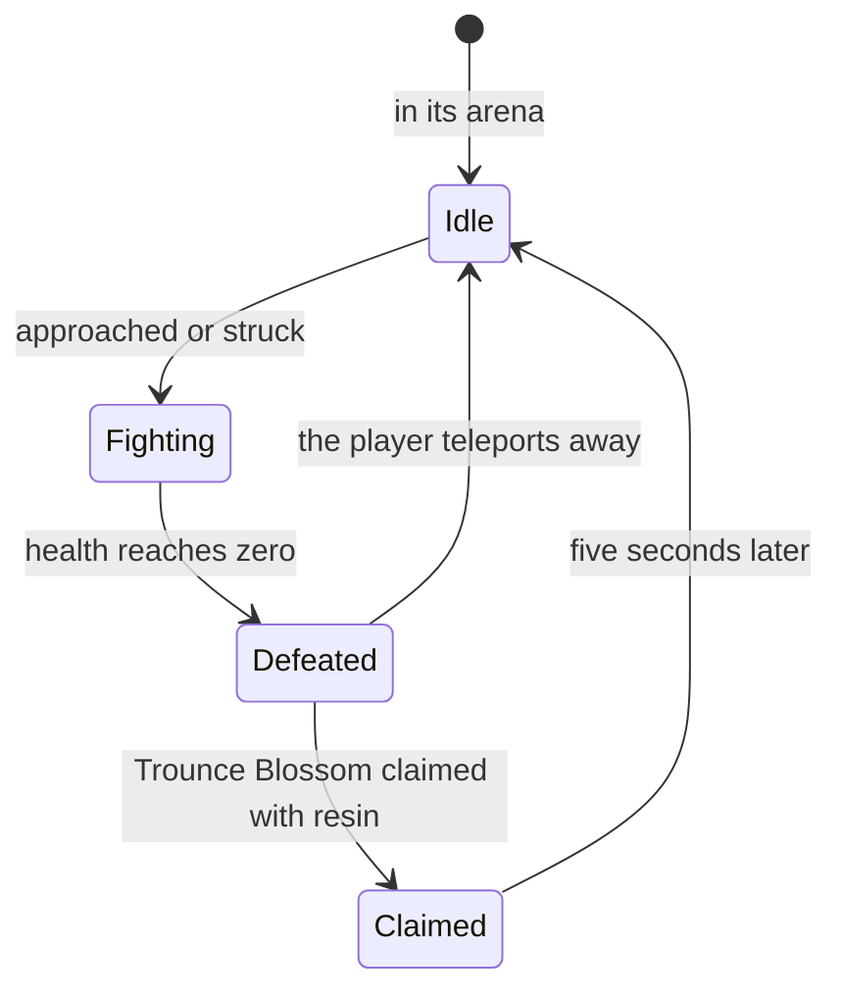

# Bosses

A boss is an enemy whose reward is claimed, not dropped. A normal boss gives the material each character ascends with, and a weekly boss the material talents need past level 6, so the character screen's ascension and the talents lean on them. The [enemies](../../specs/genshin/enemies/design.md) already place a boss's camp, respawn it at once and drop nothing for it, leaving its reward to its blossom; this page is that blossom and the fight before it. It waits on [Original Resin](../genshin-original-resin/design.md)'s claim, the [domains](../genshin-domains/design.md)' scenes the trounce domains are, and the [character kits](../genshin-character-kits/design.md) that fight them. The respawn after a claim and the weekly reset and count are [built](../../specs/genshin/bosses/design.md); this page keeps the rest.

## Decisions

- **A normal boss waits in its arena.** It stands idle at its arena's centre until a player comes too close or strikes it, as the wiki describes, which the enemies' notice already models. A few are fought only after a world quest's step or a simple puzzle, named with their camp.
- **Each boss fights by its own moves.** A boss's attacks, phases and shields are a module per boss over the enemies' step, its states, its notice and its leash kept as they are. Each module is written from the wiki's page of that boss, and its timings measured off recordings, as the controller's are. Bosses resist displacement, carry high interruption resistance and are never frozen by Frozen: the first two are the boss's poise type, and the last an immunity [combat](../../specs/genshin/combat/design.md)'s Frozen learns to check. The first boss's moves (2.1) are written from its wiki page in `services/bosses/anemoHypostasis.ts`, with the common enemies' windup and recovery as their provisional timings until measured. The enemies' step runs the seven attack moves in turn through the moves `stepEnemy` is passed, each windup and recovery at its own move's seconds, with the moves fed from `services/bosses/BossMovesMap.ts`. Second Wind, the one-time turn at about 5% health, is not yet run: it needs its teleport and orbs. A boss resists displacement, which `services/enemy/displaceEnemy.ts` states, and no strike calls it, since no strike in the combat model pushes an enemy (Kaeya's knockback is not built).
- **A normal boss leaves a Trounce Blossom.** Its reward, Adventure EXP, Mora, Companionship EXP, its own ascension material and artifacts by World Level, is claimed for 40 resin. The boss comes back five seconds after the claim; left unclaimed, it stays defeated until the player teleports away, as the game does, which replaces the enemies' respawn "at once" for a boss.
- **A normal boss's claim pays its Mora and its own drop by World Level, from the wiki.** No table counts a normal boss's claim: its `RewardPreviewExcelConfigData` rows (such as `无相之风_90级`, the Anemo Hypostasis's) list its items with their counts mostly blank, and no blossom row names a boss. So the counts are the Basic Drops tab of the wiki's `Template:World_Boss_Rewards`, its normal branch: the Mora a fixed count, and the boss's own drop a guaranteed count plus one more at a chance. Its Adventure EXP column, 200, is the claim's 40 resin at five a point, and its Companionship EXP column is the grant's, so the claim's draw holds neither, as [Original Resin](../genshin-original-resin/design.md) decides. Its Character EXP column waits on the enemies' Character EXP, which the world does not give yet. The boss's gems and artifacts are the wiki's other tabs, read with the first boss. Read from the wiki's MediaWiki API: the rows of `Template:World_Boss_Rewards` (its Basic Drops tab, normal branch) for World Levels 0 to 8, with the boss levels cross-checked against the [Adventure Rank](https://genshin-impact.fandom.com/wiki/Adventure_Rank) page's World Level table. The page titles are cited so a recording can measure them. World Level 9 has no row in the template, and the [Normal Boss](https://genshin-impact.fandom.com/wiki/Normal_Boss) page and the [Character Level-Up Material](https://genshin-impact.fandom.com/wiki/Character_Level-Up_Material) page give no World Level 9 Mora or drop counts, so World Level 9 repeats World Level 8's rows, provisional until a source gives its own. `drawNormalBossReward` refuses only a World Level the game does not have.
- **A weekly boss waits in its trounce domain.** Its domain opens once the Archon or story quest that introduces it is done, every day of the week, and is entered as any [domain](../genshin-domains/design.md) is. Andrius alone is fought in the open world. From Adventure Rank 40, a locked one can be challenged from the handbook alone. Stormterror's domain opens once the eight quests of Prologue Act III, Song of the Dragon and Freedom, are done, read from the wiki's list of the act: provisional, since the dump leaves the domain's own condition empty. `services/bosses/checkIsWeeklyBossDomainOpen.ts` is that gate, and no domain list calls it yet, since the domain screen and its entries are not built.
- **A weekly claim is once a week.** Each weekly boss's reward is claimed once a week, at the price [Original Resin](../../specs/genshin/original-resin/design.md) already gives. The week's count and its reset are built; the once-a-week gate for each boss is not.
- **What a weekly boss gives.** Its talent materials, Adventure EXP, Mora, Companionship EXP, ascension gems and artifacts by World Level, with a 12% chance of a billet for forging and a 33% chance of a Dream Solvent, as the wiki gives them. Its highest difficulty's first clear also gives one of each of its materials, claimed in the handbook.

## How it works



## Scope and order

**Built:** the [bosses page](../../specs/genshin/bosses/design.md) holds the claim and count rules.

**This still adds, in order:**

```text
packages/genshin-world/src/services/bosses/
├── drawNormalBossReward.ts
└── drawNormalBossReward.test.ts
```

1. **A normal boss's claim draw.** Add `drawNormalBossReward.ts`: for a World Level, the boss's own drop's item id and a random source, the claim's Mora and drop as `ItemCount[]`, read from two lists in `services/bosses/constants.ts`, one row per World Level from the Basic Drops tab of `Template:World_Boss_Rewards` (read through the persona's `readWikiPageText`). `NORMAL_BOSS_MORA` holds 3,450 at World Levels 0 and 1, then 3,650, 3,850, 4,125, 4,450, 4,725, 5,200 and 6,000 to World Level 8. `NORMAL_BOSS_UNIQUE_DROPS` holds each level's guaranteed count and its chance of one more: 1 and 61.85% at World Levels 0 and 1, then 1 and 70.37%, 1 and 87.41%, 2 and 4.45%, 2 and 21.49%, 2 and 38.52%, and 2 and 55.56% at World Levels 7 and 8. World Level 9's row is read from the same tab. Test: `drawNormalBossReward.test.ts`, asserting that World Level 0 with a random of 0.9 gives 3,450 Mora and one drop and with 0.1 two, and that World Level 4 with 0.9 gives two.
2. **The Trounce Blossom and its claim**, held by `useWorldTrounceBlossoms`, which the defeat event writes, the claim prompt reads and a respawn forgets, for the first normal boss in Mondstadt, the Anemo Hypostasis: its place the official map's one point under its label, carried by the [spawned places](../../specs/genshin/spawned-places/design.md) fit, its kind from the monster table, its blossom on defeat claimed through Original Resin's `claimResinReward` at 40 resin, with `drawNormalBossReward` as its reward list. Until the spawned places land, the blossom's place is the defeat position the enemies component reports, so it stays where the boss fell.
3. **The first boss's own moves**, then each boss's as its region is built.
4. **Weekly bosses**, in their trounce domains, with the once-a-week gate for each boss.
5. **The handbook's quick challenge and first-clear rewards.** The quick challenge opens a locked weekly boss's domain from Adventure Rank 40, by the Weekly Boss page, in `services/bosses/checkIsWeeklyBossQuickChallengeable.ts` with no handbook entry calling it yet.

## Data and measures

- **Read from the game's tables:** each boss's kind from the monster table, which the enemies' run already reads, the trounce domains from the dungeon table, and each boss's items from its reward preview rows. The dump's blossom tables hold the ley lines' and Dragonspine's rows only, and no table counts a boss's claim. The Anemo Hypostasis's kind is 20040201 (Effigy_Wind_01), provisional until the Mondstadt camp places it. Its own drop, for the claim's draw, is Hurricane Seed, material 113001, whose name's text id is 3449149572.
- **Read from the wiki:** each boss's moves and phases, and its claim's counts by World Level (`Template:World_Boss_Rewards`).
- **Measured:** each boss's attacks' timings, ranges and speeds, off recordings of the fight, provisional until then.

## Key files

| File                                                                        | Role after the change                                                               |
| :-------------------------------------------------------------------------- | :---------------------------------------------------------------------------------- |
| `packages/genshin-world/src/services/enemy/stepEnemy.ts`                    | Runs a boss's moves in turn from its moves argument, its states kept                |
| `packages/genshin-world/src/services/enemy/computeEnemyRespawnTime.ts`      | A boss back by its claim's time, not at once                                        |
| `packages/genshin-world/src/composables/useWorldTrounceBlossoms.ts`         | The blossoms by spawn: written on defeat, claimed at 40 resin, forgotten at respawn |
| `packages/genshin-world/src/components/World/Enemies/Index.vue`             | Holds a boss until its claim's time or a teleport, reports each respawn             |
| `packages/genshin-world/src/services/enemy/computeEnemyDrops.ts`            | Still nothing for a boss, its reward the blossom's                                  |
| `packages/genshin-world/src/services/enemy/EnemyKindTraitsMap.ts`           | Each boss's poise type and immunities                                               |
| `packages/genshin-world/src/services/bosses/anemoHypostasis.ts`             | The first normal boss's moves and Second Wind threshold                             |
| `packages/genshin-world/src/services/bosses/BossMovesMap.ts`                | Each boss kind's moves, which the enemies' step is passed                           |
| `packages/genshin-world/src/services/bosses/checkIsWeeklyBossDomainOpen.ts` | Whether a weekly boss's domain is open, once its introducing quests are done        |
| `packages/genshin-world/src/services/enemy/displaceEnemy.ts`                | A strike's push, which a boss resists                                               |
| `scripts/src/services/genshinAssets/enemies/buildEnemyKinds.ts`             | Builds the bosses' kinds as it builds every camp's                                  |

## Sources

- [Normal Bosses](https://genshin-impact.fandom.com/wiki/Normal_Bosses), Genshin Impact Wiki: arenas near waypoints, idle until approached, immune to Frozen and resistant to displacement, the Trounce Blossom for 40 resin and its rewards.
- [Weekly Bosses](https://genshin-impact.fandom.com/wiki/Weekly_Bosses), Genshin Impact Wiki: trounce domains opened by quests, Andrius in the open world, the quick challenge from Adventure Rank 40, the rewards with the billet's and Dream Solvent's chances, and the highest difficulty's first-clear reward.
- The Domains and Daily Reset sources are the [bosses page](../../specs/genshin/bosses/design.md)'s.
