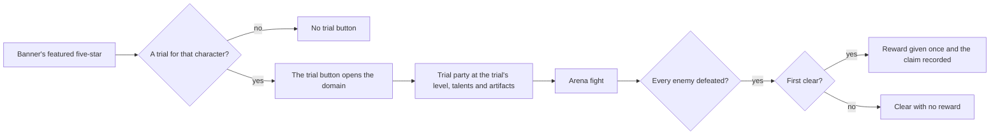

# Character Trials

A trial is a domain: a banner's trial button opens it, its party is the trial character at the trial's preset state, its enemies fight in the domain arena, and its first clear pays a reward once.

## How it works

A banner matches a trial when its featured five-star character id is the trial's character id. The trial's level comes from its trial row. Its talent level and artifacts come from the template row whose level is the highest at or below the trial's level (PROVISIONAL: the rule is read off the level brackets of the template table, and the wiki's trial pages have not yet confirmed it level by level). Each artifact is a reliquary from the template's list, read from the reliquary table with its main stat and sub-stats.

## Data model

The trial rows come from five 7.1 tables. `TrialAvatar` maps a trial id to a character id and a level. `TrialAvatarActivityData` holds each trial stage: its trial id, its dungeon, its party of trial ids and its first-clear reward. `TrialAvatarTemplate` gives the reliquaries and the talent level by level bracket, and `TrialReliquary` gives each reliquary's main stat and sub-stats. `TrialAvatarActivity` and `ActivityTrialAvatar` tie stages to schedules, which the banners do not yet use.

## Key files

| File                                                                   | Role                                                                                        |
| :--------------------------------------------------------------------- | :------------------------------------------------------------------------------------------ |
| `packages/genshin-world/src/services/wish/createBanners.ts`            | Builds each banner with its featured five-stars, which a trial is matched against           |
| `packages/genshin-world/src/components/Wish/Screen/Index.vue`          | Shows the trial button on a banner whose featured character has a trial                     |
| `packages/genshin-world/src/services/trial/createTrialCharacter.ts`    | Builds a trial's party member: its level, talents, artifacts and the weapon its build holds |
| `packages/genshin-world/src/composables/useWorldTrials.ts`             | Enters a trial with its party member, runs its arena clock, and pays its first clear once   |
| `packages/genshin-world/src/services/domains/createDomainArenaCamp.ts` | The arena camp a trial's enemies stand in                                                   |

## Notes

- The trial weapon is not in the trial rows: a bare-value search of every trial table finds no weapon id, and the `TrialTpsWeapon` rows carry ids that are not weapon ids. The weapon is the wiki's, cited per character in `scripts/src/services/genshinAssets/trials/wikiTrialBuilds.ts`: the newest level-90 build by page date, joined by character name, so provisional. 30 characters have level-80 builds only and no cited weapon.
- A trial's enemies are not in the dungeon rows, so the wiki's Trial Challenge wave lists stand in. They join to a chosen build by its page for 11 of 80, so the arena stays blocked until the lists are joined by group.
- The claimed first-clear stages are saved as `characterTrials: { claimedStageIds }` beside the abyss, a required field. Its absent value on an existing save is `{ claimedStageIds: [] }`, which a backfill writes into each `{userId}/save.json`; no backfill has run. The merge unions both copies' claims, so a stage cleared on either copy pays once.
- A trial whose character has no cited build has no party member: `createTrialCharacter` returns none, since a `Character` holds a weapon and the 30 characters with level-80 builds only have none to hold. PROVISIONAL until the wiki cites a level-90 build for them.
- A trial's artifacts are a reliquary's level counted from zero, with the experience its level has cost in the rarity's table, so the artifact is at its level and not an unlevelled one. A reliquary no set names is left out of the record, so a template that names one (the level-1 template names two) gives its trial fewer artifacts.
- The party is the trial character alone, as the spec says. The wiki's Character Trial page says the trial character joins the player's party as a fifth character. The spec is followed; the difference is not decided here.
- Constellations are not in the trial rows. Every level-90 wiki block reads 0 and an absent field is C0, so a trial party is C0 (cited).
- A trial's arena has no enemies, so the design's clear, "every enemy defeated", is vacuously true the moment it starts. The arena instead ends when its clock runs out, and that end is the clear: `TRIAL_PROVISIONAL_TIME_LIMIT_MILLISECONDS`, 300 seconds, neither sourced from the wiki nor the dump. PROVISIONAL until the design names the timer or the objective.
- A trial's fight is not yet run by the session: the trial's party member replacing the player's party and characters for the fight, and the jump to the trial's domain, are not built. The save does not carry the claimed stages yet either, so a claim lasts the session. Both belong with task 2.2 and a save decision.
- The first-clear reward is claimed once and saved with the save, so the save gains a key and the stored saves owe a backfill when it lands.

## Sources

- The Genshin Impact wiki, [Character Trial](https://genshin-impact.fandom.com/wiki/Character_Trial): trial characters come from quests, domains and events, with their artifacts given a fixed sub-stat distribution, and the reading of the trial's level and talents.
