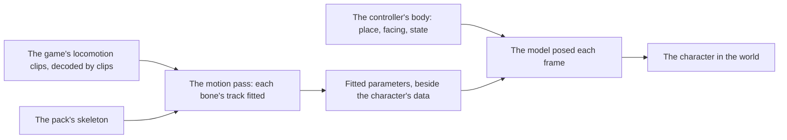

# Characters

This page builds on [characters](../../specs/genshin/characters/README.md) as built: the engine reads a character's official model pack, draws it at rest in the game's character shader at its holder's origin, and holds it on the [character controller](../../specs/genshin/character-controller/design.md)'s body, which it stands and faces with. What is left is the character's motion, its scale and where its terms are shown.

## Decisions

- **Its motion is fitted to the game's own locomotion clips** in the [recreation passes](../genshin-recreation-passes/design.md)' motion pass, so only the fitted parameters ship, never a motion file. How far and how fast the body moves is the controller's, and how it is seen is the [follow camera](../../specs/genshin/follow-camera/design.md)'s.
- **The fitted parameters are each bone's track sampled over a short loop.** The motion pass samples each bone's track of a clip over a loop of a few samples, so the parameters hold the clip's own pose at each sample and the body follows each clip as the game plays it. The set is larger than a gait model's, and that is the cost taken. Rejected: a few gait parameters per state, from which a pose is computed. That set is smaller, but a computed pose can miss the clip it stands for. It is the fallback only if the sampled form proves too large to ship, which the open question on size covers.
- **Its scale is the game's.** MMD's unit stands at the community's reckoning (`CHARACTER_PMX_RECKONED_UNIT_METRES`) until the game's own model of the character measures it: that model's height in the exports over the PMX's height in units. The Traveler's is measured, the game's 1.5667 metres over the PMX's 17.2332 units, and is wired per character by id in `CHARACTER_PMX_UNIT_METRES`. Every other character keeps the reckoned unit, **provisional** until its own game model is extracted from the exports, as the Traveler's was through the asset index's prefab for it, and its pack's PMX is measured with `genshin:assets measure`.
- **The Traveler is fitted first.** The world plays the Traveler (`TRAVELER_CHARACTER_ID`, 10000007, the medium female body), whose `Ani_Avatar_Girl_` clips the controller already reads for its speeds, so its standing, walk, run and sprint cycles in `00/00035183.blk` are the first clips the motion pass fits.
- **Its terms are shown beside the character the Character screen shows.** The terms view already shows a pack's terms with their credit; the loader at the Character screen's foot mounts it beside the character, in place of the dialog its button opened. Party Setup has no chosen character, so the party's screens take no part.

## How it works



## Scope

**Today:** a character's model is drawn at rest at its holder's origin, at MMD's reckoned scale, held by the controller's body in Windrise's scene (`packages/genshin-world/src/components/World/Windrise/Index.vue`), so it stands and faces where the body does, and nothing poses it.

**This adds:**

```text
packages/genshin-world/src/components/Character/Model/Index.reference.ts
```

1. **The Traveler's locomotion clips decoded**, the motion pass's first input.
   - `scripts/src/models/genshinAssets/shared/DerivedAssetComponent.ts` gains `Traveler = "traveler"`, and `DerivedAssetComponentMap` its entry: `clipPattern: "^Ani_Avatar_Girl_(Standby|WalkCycle|RunCycle|SprintCycle)$"`, `roots: []` and `screen: "WorldScreen"`, with a comment naming the clips' block, `00/00035183.blk` in the asset index. `DerivedAssetLandmarkMap` takes an empty `Traveler` entry, since it holds one for every component.
   - Run `pnpm -C scripts genshin:assets clips traveler` with the game closed. It prints each clip's seconds and, for each curve, the bone path it animates and its range.
   - Write `Index.reference.ts` in the shape of `packages/genshin-world/src/components/World/Character/Locomotion.reference.ts`: the four clips with their block and seconds, the bone paths their curves move, which is the skeleton the fit maps the pack's bones onto, and the run that read them.
   - The entry is data and the printout is its proof, so no unit test is owed.
2. **Its motion.** The motion pass reads the character's locomotion clips, exported from the game's blocks under `{data-root}/genshin-parity/extracted/` and decoded by `genshin:assets clips` once the character's component names their pattern, and the pack's model. It writes the fitted parameters as data beside the character's in `genshin-world`. Each bone's track is judged against its clip's, as the motion pass judges any track. It goes to the [compute queue](../genshin-roadmap/tasks.md) once step 1 names its inputs, and reads the Traveler's official pack, which the user has extracted under `{data-root}/character-packs/extracted/10000007/`.
3. **Its scale**, measured from the game's own model of the character, replacing MMD's reckoned unit. The Traveler's model prefab is `Avatar_Girl_Sword_PlayerGirl_Model`, whose Animator the asset index places in `00/02666572.blk`. It is the body `PlayerGirl`'s entry in `DerivedAssetComponentMap` already roots, so the Traveler reads that root rather than a second component's, and the scale needs the pack's height as well.
4. **Its terms beside the character**, shown by the Character screen's loader without a button, and the loader's terms button and dialog removed.

## Open questions

- **The size bar.** The fallback to gait parameters waits on a size measure. The motion pass measures a part's path in metres against its clip and its pace, not the size of a fitted parameter set, so nothing yet says when the sampled form is too large to ship.

## Key files

| File                                                                    | Role after the change                                                           |
| :---------------------------------------------------------------------- | :------------------------------------------------------------------------------ |
| `scripts/src/models/genshinAssets/shared/DerivedAssetComponent.ts`      | Gains the `Traveler` component the Traveler's clips are exported under          |
| `scripts/src/services/genshinAssets/shared/DerivedAssetComponentMap.ts` | Gains the Traveler's entry, its clip pattern and no root of its own             |
| `scripts/src/services/genshinAssets/witness/DerivedAssetLandmarkMap.ts` | Gains an empty `Traveler` entry                                                 |
| `packages/genshin-world/src/components/Character/Model/Index.vue`       | The model, posed by the fitted motion and drawn at its measured scale           |
| `packages/genshin-world/src/services/character/constants.ts`            | The Traveler's measured unit, and the reckoned unit every other character keeps |
| `packages/genshin-world/src/components/Character/Screen/Index.vue`      | Its foot slot, which holds the terms beside the character                       |
| `packages/genshin-world/src/components/World/Session/Index.vue`         | Fills the screen's foot slot with the terms view                                |

## Sources

- Each official model's bundled terms, as the [characters](../../specs/genshin/characters/README.md) page cites them.
