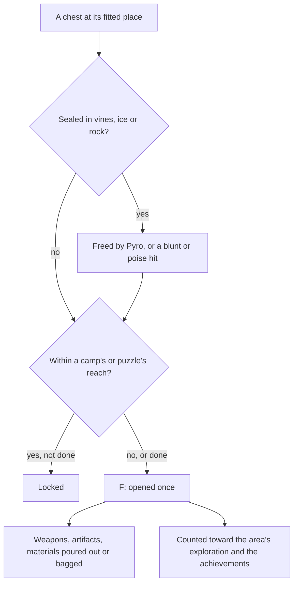

# Chests

The as-built [chests](../../specs/genshin/chests/design.md) page holds the chests' places and the Primogems and Mora an opening pays. What is left is what else an opening gives, the locks, digging and seals that hold some of them shut, and the join that makes an opened chest count toward the achievements.

## Decisions

- **Opened with F, rewarded two ways.** Its Primogems, Mora and Sigils go straight to the wallet, and its Adventure EXP to the Adventure Rank, which the wallet does not hold, as the Adventure EXP page's chest table gives it: 30 for each Common, Exquisite, Precious, Luxurious and Remarkable chest ([Adventure EXP](https://genshin-impact.fandom.com/wiki/Adventure_EXP)). Its weapons, artifacts and Character EXP materials pour out as drops to pick up, as the enemies' drops are, or go straight to the bag where the chest stands somewhere a drop would fall away. The drops' pools are the wiki's: each tier's weapons, the artifact sets it can give, and its Character EXP materials by star. An artifact a chest gives is rolled by the [artifact enhancement](../genshin-artifact-enhancement/design.md) page's rules.
- **A drop falls away where the ground gives none or lies under the water.** A chest's drop lies on the ground at its point, unless the world's ground gives no height there or the ground lies below the water's level. There it falls away and goes straight to the bag, through `checkIsDropFallingAway`, which is its own service so another drop source can take the same rule. A bag with no room for a bagged drop pours the rest out where the chest stands, as a pick up's overflow stays on the ground.
- **A locked chest waits on what is beside it.** As the wiki describes, a locked chest opens once the enemies near it are defeated or the puzzle near it is solved. Which camp or puzzle locks which chest is listed nowhere per chest, so a chest is locked by the camp or the [puzzle](../genshin-puzzles/design.md) whose reach it stands in, the reading closest to the rule the wiki gives, and stands unlocked where it stands in none. The reach is the camp clustering distance of the [spawned places](../genshin-spawned-places/design.md) page, a provisional estimate that page gives no value for yet, so no lock is set until one is.
- **Hidden chests are dug up.** A chest the map marks as buried offers Dig when the player stands at its place, and appears when dug.
- **Sealed chests are freed first.** A chest sealed in Dendro vines or ice is freed by Pyro, and one sealed in rock by a blunt attack or one that deals poise damage, through [combat](../../specs/genshin/combat/design.md)'s hits. The map's sealed label does not say which seal a place holds, so which one each place holds is measured, not read.
- **A dug or freed place's tier is unsettled.** The map gives a buried or a sealed place no tier, and no tiered chest stands within reach of one to read it off. What a dug or freed place holds is settled by a recording of one, and until then a dug or freed place is left unrewarded, a provisional call.
- **Luxurious and Remarkable pay the wiki's other rewards, and no Mora.** A Luxurious chest pays its 10 Primogems and 30 Adventure EXP, and none of the Mora the [Chest](https://genshin-impact.fandom.com/wiki/Chest) page leaves unstated, since only the named Luxurious chests carry Mora of their own. It pours out the wiki's 3-star Character EXP Materials, 0 to 3 of them, a provisional read of an entry the page marks unsure, and no weapon, the page naming none for it. A Remarkable chest pays 5 Primogems, none of them in Tsurumi Island, and 30 Adventure EXP, and pours nothing, since its blueprints are left out until a page names each one. A Luxurious chest's Sigils are the same table's 4 to 10, and a Remarkable chest pays none, the table giving it no row.
- **A chest's row is named by its kind.** The game's text holds each kind's name under several ids, none of them a chest gadget's own name in the gadget table, so a row is named by the first numeric id `genshin:text find` prints for the kind's English name: 3953934758 for "Common Chest", 3981652399 for "Exquisite Chest", 3576739246 for "Precious Chest", 94050446 for "Luxurious Chest" and 26276094 for "Remarkable Chest", as `GameTextKey.CommonChest`, `ExquisiteChest`, `PreciousChest`, `LuxuriousChest` and `RemarkableChest`. The user's eyes check the words against the game's own prompt.
- **A chest stands in as a box until it is measured.** The world draws it as a toon box on its ground point, as the drops and residents stand in as spheres and capsules, its size and colour provisional until a recording's chest is matched.
- **An opened chest counts once.** Each counts once toward its area's exploration progress and its region's chest achievements, kept with the player's progress.

## How it works

## Scope and order

**This adds, in order:**

1. **Mondstadt's chests in the world, opened on F.** Built, as [the as-built page](../../specs/genshin/chests/design.md) describes. Add `readMondstadtChestPlaces.ts`, a `readGameData` of the published `chests/mondstadt` record parsed with a `chestPlaceSchema` added beside `ChestPlace`, as `services/gathering/readMondstadtGatheringPlaces.ts` reads its slice, and `services/chest/computeChestInteractables.ts`, which gives each unopened chest of a kind `ChestKindRewardMap` rewards as an `InteractionKind.Open` row on the ground under its point, named by its kind's key above. `useWorldChests.ts` loads the places as `useGatheringPoints` loads its own and holds the opened ids, and `components/World/Session/Index.vue` adds its rows to `interactables` and, on F at one, runs `openChest` with the world's seeded random, sets the wallet and hands the drops to `placeWorldDrops` at the chest's point. `components/World/Interactables/Index.vue` draws the `Open` rows as box stand-ins (`CHEST_STAND_IN_SIZE`, `CHEST_STAND_IN_COLOR` and a `CHEST_STAND_IN_CAPACITY` above the region slice's count, in `services/interaction/constants.ts`). The opened ids are a save slice: `openedChests` in `GenshinSave` (`models/chest/OpenedChestSave.ts`, at most `MAX_OPENED_CHEST_COUNT` in `services/save/constants.ts`), read and written by `readGenshinSave` and `toGenshinSave`, and unioned by `mergeGenshinSave` as the built [chests spec](../../specs/genshin/chests/spec.md) requires, a chest opened on either copy staying opened, while the wallet and the bag keep the account's copy, as the [save data](../../specs/genshin/save-data/design.md) merge rule says. `GameTextKey` gains the three keys, whose words `pnpm -C scripts genshin:text write` then writes. Windrise's own area waits on the region outlines the exploration progress reads, since the places name no catalogue area. Tests: `computeChestInteractables.test.ts`, asserting that an unopened Common chest is offered and an opened one, a Luxurious one and a Buried one are not; and a case in `services/save/mergeGenshinSave.test.ts` that a chest opened only on the guest's copy stays opened after the merge.
2. **The other rewards and tiers.** Built: Sigils in the wallet, and Luxurious and Remarkable rewarded as the decision above settles.
3. **The locks by camps.** Waits on the reach a camp locks a chest within, measured.
4. **Digging and seals**, once a recording settles what a dug or freed place holds and which seal each sealed place wears.
5. **Locks by puzzles**, once the puzzles stand.
6. **The join to the achievements and the exploration progress.** An opened chest counts toward the 66 chest achievements and its area's progress through our own chest records, each one an official-map chest point with its tier. No join to the game's own chest records is owed. The area each chest counts toward is read from the region outlines the exploration progress reads.

## Data and measures

- **Read from the wiki:** the Sigils of each openable tier, from the [Chest](https://genshin-impact.fandom.com/wiki/Chest) page's reward table: 1 to 3 for Common, 2 to 4 for Exquisite, 3 to 10 for Precious, and 4 to 10 for Luxurious, which waits with its Mora. The drop pools: the weapons, artifact sets and Character EXP materials by star, encoded as provisional pools for the weapons and materials. The artifact pieces wait on an artifact drop model.
- **Not on the wiki:** Luxurious's Mora.
- **Read from the game's tables:** `GadgetExcelConfigData` names 270 gadgets of the `Chest` type, the chest templates such as `70210001`.
- **The achievements count our own records.** A placed chest has the map's point id and its tier, and the achievements' `TRIGGER_OPEN_WORLD_CHEST` rows and the exploration doings name chests by the game's own numbers, which no placed chest carries. An opened chest is therefore counted through its own record, not joined to the game's, so no join is needed for an opened chest to move an achievement or an area's exploration.
- **Measured:** the reach a camp or a puzzle locks within, against the chests the map marks beside them, how a chest opens, read off a recording of one, which seal each sealed place holds, what a dug or freed place gives, and the spread of each reward within its range.

## Key files

| File                                                                           | Role after the change                           |
| :----------------------------------------------------------------------------- | :---------------------------------------------- |
| `packages/genshin-world/src/services/interaction/computeInteractionPrompts.ts` | Lists a chest in reach to open, and Dig         |
| `packages/genshin-world/src/services/chest/ChestDropPoolMap.ts`                | Each tier's weapon, artifact and material pools |
| `packages/genshin-world/src/models/enemy/DroppedItem.ts`                       | What a chest pours out, as an enemy's drops are |
| `packages/genshin-world/src/services/inventory/addInventoryItem.ts`            | What goes straight to the bag                   |

## Sources

- [Chest](https://genshin-impact.fandom.com/wiki/Chest), Genshin Impact Wiki: the five kinds and where each is found, locks by nearby enemies and puzzles, dug chests, chests sealed in vines, ice and rock and what frees each, rewards sent straight to the inventory or poured out, Remarkable chests' regions and blueprints, and each kind's rewards. Read through the wiki's parse API with a Referer, as the genshin-persona readers do.
- [Adventure EXP](https://genshin-impact.fandom.com/wiki/Adventure_EXP), Genshin Impact Wiki: the Adventure EXP each chest kind gives: 30 for each of the five kinds, 90 for a Shrine chest and 150 for a Primal Obelisk chest.
- [Remarkable Chest](https://genshin-impact.fandom.com/wiki/Remarkable_Chest), Genshin Impact Wiki: a Remarkable chest's blueprint, its 5 Primogems outside Tsurumi Island and its 30 Adventure EXP.
- [AnimeGameData](https://github.com/DimbreathBot/AnimeGameData), the community's per-patch dump: the chest level table, `ChestLevelSetConfigData`, and the gadget table, `GadgetExcelConfigData`.

## Reference

- `chest-seal-pyro.mkv` — a sealed chest in Dendro vines or ice freed by Pyro, and one sealed in rock struck by a blunt attack, each from standing in reach, 15 seconds at most; the seal each kind wears and how long freeing it takes are measured from them. The freeing time is replaced by the animation clips: `genshin:assets timings` reads the seal clips' seconds once their blocks are extracted; which seal each kind wears is left to the recording itself. On the wiki and YouTube, none found (searched 2026-10-11).
- `chest-dig.mkv` — a buried chest dug from its place, the Dig prompt in view, 15 seconds at most; the Dig prompt's reach and the chest it reveals are measured from it, and what a dug place holds is settled from what it gives. The chest's reveal is replaced by the animation clips: `genshin:assets timings` reads the dig clip's seconds to its reveal once its block is extracted; the Dig prompt's reach stays on the recording. Partly found 2026-10-11: https://www.youtube.com/watch?v=j5ggVp4ffyc at 0–33 s (`captures/yt-j5ggVp4ffyc-chest-dig.mp4`); still sought: no scale in the clip, so the Dig prompt's reach cannot be measured from it.
- `chest-camp-lock.mkv` — a chest beside an enemy camp, the camp alive and its chest locked, then the camp cleared and the chest opened, 30 seconds at most; the reach a camp locks a chest within is measured from it. On the wiki and YouTube, none found (searched 2026-10-11).
