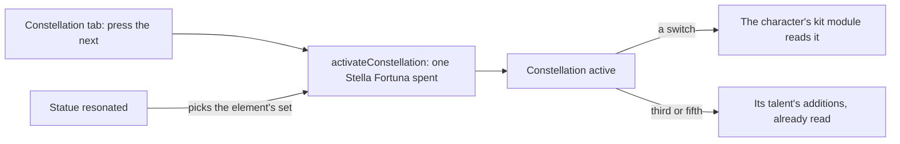

# Constellations

The table, the activation, the talent levels the third and fifth add, and the Stella Fortuna a wish brings are built, as the [constellations](../../specs/genshin/constellations/design.md) page records. What is left is the Constellation tab's press, which the drawn tab is ready for; each constellation's effect, which waits on the [character kits](../genshin-character-kits/design.md) for the characters with no module yet; the table's numbers, which the modules built so far type from the wiki and gcsim until the world's gate hands the kits the constellation table; and the Traveler's element sets, which wait on their sources.

## Decisions

- **Each constellation's effect is written in its character's kit module.** A switch is a small module over the kit's shared effects, reading its numbers from the table's `paramList`, as a character's own module reads its talents. Each is written from its constellation's description and the wiki's notes on it, the same as the module it joins.
- **The Traveler's sets come by element.** The statue a Traveler resonates with picks the set, and each set's source unlocks it: Archon Quests, Souvenir Shops, Adventure Rank rewards for Anemo, Statue of The Seven levels for Electro, Dendro, Hydro and Cryo, and Natlan's tribe reputation for Pyro, as the wiki lists them. Each comes with the page that builds its source.
- **A source reports its element; the chooser does not map sources.** `getTravelerConstellations` takes the set of elements whose source is done, and returns the set of the element a statue gave only when that element is in it. The table names no element for a set, so the element comes from the skill set the same id names, its burst's element. Which source unlocks which element is left to each source's page: the wiki's Constellation page, where the spec names the mapping, was not readable from this run (HTTP 402), and the spec's list gives seven elements but names Geo and Souvenir Shops without a pairing.
- **The Constellation tab activates from the character screen.** It lists the six with their state and presses the activation. Its look is the character screen's.
- **The tab asks before it presses.** As the Talents tab does, one function names why the next constellation cannot be activated now (all six active, or no Stella Fortuna held), and `activateConstellation` throws on that same answer, so no refusal is ever caught. The alternative, pressing and catching the throw, is rejected: a refusal would come back as an error the tab must tell apart from a fault, while the pre-check hands the reason over as a value the tab can show.
- **The wish hands its Stella Fortuna over where it adds new characters.** `Wish/Screen` already appends a wish's new characters; the same step adds `stellaFortunaCountMap`'s counts to the characters they belong to, so a duplicate's Stella Fortuna reaches its character the moment it is drawn.
- **Only a character with one set is read before a statue gives the Traveler its element.** `World/Session` reads the constellation table into a map by character id, and takes a character's set only where its table entry holds exactly one. The Traveler's several sets wait on the element a statue gives, so until then the Traveler has no set to press, and its Activate is refused with none.
- **A result card names the Stella Fortuna its draw brings.** A duplicate among its character's first six copies brings that character's own, shown as `"<Name>'s Stella Fortuna"` with its count. A five-star past six brings the Masterless one, shown with its count. Each set's kit records the item its six constellations spend, its id and the text id of its name from the dump's material table, so the name comes through the name records like every other. `makeWishes` reads each draw's Stella Fortuna onto its result, since the wallet's count alone would not reach the card.
- **A shield tells its owner the damage it took.** `strikePartyMember` returns a `ShieldAbsorbed` event for each live shield that took part of an enemy's strike on a party member, with its owner's character id and the health it lost. The step sends it with the other events, so the owner's kit reads it in `onKitEvent`, as Zhongli's Chrysos needs. Read into the shield effect, the owner is already on it; the event is what reaches the owner's kit, as every other event does.
- **A cooldown can be cut or reset while it runs.** `changeKitCooldown` adds seconds to a cooldown the character has running, a negative number cutting it short and the step ending it at zero, and it leaves one that is not running alone. Navia's Shrapnel cut, Alhaitham's and Candace's shorter holds and Ningguang's reset use it; a cooldown that is not started yet is still a number the record sets.
- **A strike's CRIT roll can be raised per enemy.** `getStrikeCriticalRateBonus` adds CRIT Rate to a kit's own strike as its CRIT roll is made against each enemy it lands on, given the strike and the enemy as it stands, so a bonus against enemies under half their HP, as Yanfei's Charged Attacks have, reads the enemy the hit meets. It is read where the strike's damage bonus is, and passed to `strikeEnemy` as a parameter rather than added to the striker's attributes, because it differs per enemy.

## How it works



## Scope and order

**Today:** what is built is on the [constellations](../../specs/genshin/constellations/design.md) page. Nothing yet reads a constellation's effect, and the Traveler has no set chosen.

**This adds, in order:**

```text
packages/genshin-world/src/services/character/getConstellationActivationRefusal.ts
```

1. **The Constellation tab's activation, and the wish's Stella Fortuna handed over.** The tab is drawn already, so this is its press and its supply.
   - **The rules.** A new `getConstellationActivationRefusal.ts` returns a `ConstellationActivationRefusal` (`models/character/ConstellationActivationRefusal.ts`: `AllActive`, `NoStellaFortuna`) or `undefined`, and `activateConstellation` throws on that refusal rather than checking for itself. A new `addStellaFortuna.ts` beside it takes the characters and a wish's `stellaFortunaCountMap` and returns the characters with each count added to its own. `getConstellationActivationRefusal.test.ts` asserts both refusals and none, and `addStellaFortuna.test.ts` that only the characters the map names gain, by their counts.
   - **The supply.** `Wish/Screen` applies `addStellaFortuna` where it appends the new characters, so `v-model:characters` carries both.
   - **The tab.** `World/Session` loads `readConstellationTables()`, which nothing calls yet, and hands `CharacterScreen` the chosen character's set. `CharacterMenuConstellation` (`packages/genshin-interface/src/components/CharacterMenuConstellation/Index.vue`) gains `isActivateDisabled` and emits `activate` from an Activate button under the rings, its label the `GameTextKey` that `genshin:text find "^Activate$"` returns. `Character/Screen` disables it on a refusal and on `activate` emits the character `activateConstellation` returns through `v-model:characters`, wired in `World/Session` as `WishScreen`'s is. The button's place is provisional, queued for the user's eyes against `character-constellation`.
2. **Each constellation's effect**, written in its character's kit module as each module is built on the [character kits](../genshin-character-kits/design.md) page, the unit the other machine holds.
3. **The Traveler's sets**, each unlocked by its source, with the element a statue gives picking the set the Traveler's kit reads, each with the page that builds its source.
4. **The wish screen's showing** of the Stella Fortuna and Masterless Stella Fortuna a draw brings, on its results' cards.

## Data and measures

- **Read from the game's tables:** each effect's numbers are the table's `paramList`, already written.
- **Measured:** nothing; the Constellation tab's look is the character screen's.

## Key files

Nothing is listed yet: each character's constellation effects are a module of their own under the kit folder, which this change creates, so no file it names exists to be listed.

## Sources

- [Constellation](https://genshin-impact.fandom.com/wiki/Constellation), Genshin Impact Wiki: what each constellation changes, and the Traveler's sources by element.
