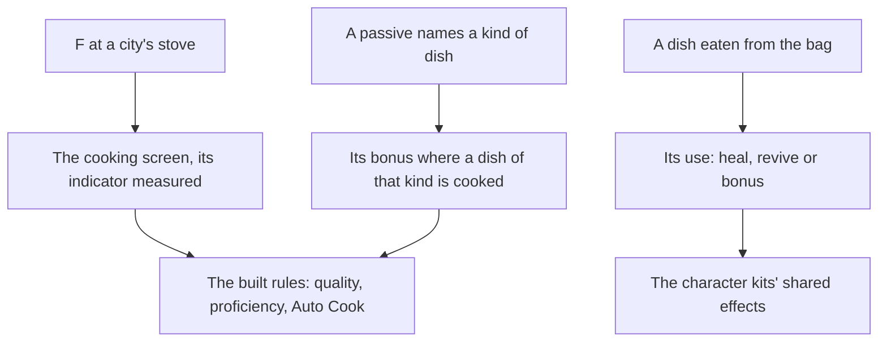

# Cooking

Food is how a party heals, revives and fights stronger in the game, and every dish is cooked from ingredients first gathered, hunted or bought. The dishes cooked by hand to proficiency, Auto Cook, the specialties, processing and campfires are built, as the [cooking](../../specs/genshin/cooking/design.md) page records. What remains is the stove where a city cooks, the cooking screen, what a dish does once it is eaten, and the passives that bonus a kind of dish. Eating goes through the [inventory](../genshin-inventory/design.md)'s using.

## Decisions

- **A city's stove always cooks.** A stove stands in a city and cooks whenever it is used, where a campfire cooks only while lit. No birth or map label places a stove, so a city's stove stands, as an estimate marked provisional, at the place and turn of its `Restaurant` building point in the [scene group record](../../specs/genshin/scene-groups/design.md), the scene's own mark of where the city cooks (`Restaurant_liyue` and the like for the others). Mondstadt's stove is the first placed.
- **The cooking screen's indicator is measured.** The indicator's speed and how a recipe's zone parameters lay its zones out come off a recording of the cooking screen, not from the table. Until it is read, the built zones stay provisional.
- **Food's effects act through the kits.** A dish's heal, revive or bonus is its item's use, read from the material table, and a bonus lasts as its description says, applied through the [character kits](../genshin-character-kits/design.md)' shared effects.
- **A heal is the figure its description leads with.** A recovery dish's heal buff writes its heal as a share of Max HP and a flat amount, with any alternatives the game lists in parentheses after it, and the heal reads the leading figure. A dish whose heal buff describes a drawback instead has no heal. A revive buff states the HP it restores, which lifts only a fallen eater to that HP, and a dish whose buffs give neither has no use. The spec left how a description is read open, so this was settled while building the use.
- **A passive bonuses its kind of dish.** A few characters' passives bonus their kind of dish, matched by the dish's food type as the table gives it (heal, function, attack or defense), and applied where the dish is cooked.
- **The cooking talents are keyed by the cook's avatar id, from the game's tables.** `ProudSkillExcelConfigData` holds ten cooking talents: eight rows of `PROUD_EFFECT_COOK_PERFECT_MULTI_OUTPUT` (a double) and two of `PROUD_EFFECT_COOK_PROB_MULTI_OUTPUT` (a Suspicious dish). Each row's group is a passive of a character's skill depot, so a talent is keyed to the character whose passives open its group; where more than one playable avatar names a group, the lowest id is kept, which leaves out 10000901, 10000902 and 10000904, the higher ids naming Xiangling's and Hu Tao's groups. The ten, each a utility passive unlocked from the start, are: on a Delicious dish cooked by hand, the game's perfect cooking, a double at 12% on `COOK_FOOD_HEAL` for Jean 10000003, Barbara 10000014 and Diona 10000039, on `COOK_FOOD_ATTACK` for Xiangling 10000023, on `COOK_FOOD_DEFENSE` for Noelle 10000034 and Xinyan 10000044, and on `COOK_FOOD_FUNCTION` for Yun Jin 10000064 and Nilou 10000070; and one more Suspicious dish of the recipe at 18% on any food type for Hu Tao 10000046 and Ayato 10000066. the game's perfect cooking: a double at 12% on `COOK_FOOD_HEAL` for Jean 10000003, Barbara 10000014 and Diona 10000039, on `COOK_FOOD_ATTACK` for Xiangling 10000023, on `COOK_FOOD_DEFENSE` for Noelle 10000034 and Xinyan 10000044, and on `COOK_FOOD_FUNCTION` for Yun Jin 10000064 and Nilou 10000070; and one more Suspicious dish of the recipe at 18% on any food type for Hu Tao 10000046 and Ayato 10000066. A double adds one more of the dish made, a character's special dish included. Auto Cook makes every dish Delicious, so each of its dishes draws the talent once, as each already draws the special dish.

## How it works



## Scope and order

**Today:** the [cooking page](../../specs/genshin/cooking/design.md) holds what is built, and nothing makes a dish in the world, which has no stove and no screen.

**This adds, in order:**

```text
packages/
├── genshin-interface/src/components/CookingScreen/
└── genshin-world/src/
    ├── components/Cooking/Screen/
    └── services/cooking/readCookingTalents.ts
```

1. **The cooking talents.**
   - `CookingRecipe` (`packages/genshin-world/src/models/cooking/CookingRecipe.ts`) gains `foodType: CookingFoodType`, a new enum in `models/cooking/CookingFoodType.ts` of the table's four values, written by `toCookingRecipe` from the row's `foodType`; `pnpm -C scripts genshin:assets cooking` republishes the existing `cooking/recipes` record, which gains the field and nothing else, and publishes `cooking/talents`, the ten talents of the Decisions, built by `buildCookingTalents` from the proud skill table's cooking rows and each character's passives.
   - `CookingTalent` (`models/cooking/CookingTalent.ts`): each talent of the Decisions as `{ chance, effect, foodTypes }`, the effect a new `CookingTalentEffect` (`DoubleProduct`, `SuspiciousDish`); `readCookingTalents.ts` reads the `cooking/talents` record, keyed by avatar id.
   - `cookRecipeByHand` draws once more from `random` on a Delicious dish, and `autoCookRecipe` once per dish, each adding the cook's talent's one dish to the bag where the draw is under its chance; the room check counts the added dishes.
   - Tests: `cookRecipeByHand.test.ts` gains Xiangling's attack dish doubled at a draw of 0.05 and not at 0.5, Hu Tao's Suspicious dish added, and a heal dish Xiangling cooks left single; `autoCookRecipe.test.ts` gains a batch whose draws double some dishes; `toCookingRecipe.test.ts` gains the field.
2. **The cooking screen, built now from the public clip.** `pnpm -C scripts recreation clip --directory ~/Esposter/genshin-parity/captures https://www.youtube.com/watch?v=fEbf_tOV1t4 --from 0 --to 154 --name cooking-sticky-honey-roast` (Cooking Sticky Honey Roast, 154 seconds); from its frames at one a second (`genshin:parity frames <the path clip prints> 1`) the builder takes the recipe list, the cook select and the indicator's bar with `genshin:parity frame yt-fEbf_tOV1t4-cooking-sticky-honey-roast.mp4 --at <second> --name cooking-screen`. Then `ScreenKind.Cooking`, `CookingScreen/` and its world wrapper `Screen/`, each with its fixture, driving `cookRecipeByHand` and `autoCookRecipe`. Its comparison is queued for the user's eyes, and the owed `cooking-zones.mkv` re-measures the indicator later; the built zones stay provisional and gate nothing.
3. **The stove's place**, read from the hosted `sceneGroups/scene3` record's `Restaurant` building point for Mondstadt; the screen is reached through its fixture until it stands.
4. **Eating a dish**, its use applied through the kits' shared effects, through the [inventory](../genshin-inventory/design.md)'s using of food, which that unit builds first.

## Data and measures

- **Read from the game's tables:** a dish's use from its item row in `MaterialExcelConfigData`, and each recipe's `foodType` from `CookRecipeExcelConfigData`.
- **Read from the game's tables:** the cooking talents, from the proud skill table's cooking rows joined to each character's passives, settled under Decisions.
- **Measured:** the indicator's speed and the zone layout off a recording of the cooking screen, provisional until then.
- **Not yet read:** the source that teaches most processings, which the table does not name, so they stay closed.

## Key files

| File                                                     | Role after the change    |
| :------------------------------------------------------- | :----------------------- |
| `packages/genshin-world/src/models/screen/ScreenKind.ts` | Gains the cooking screen |

## Sources

- [Cooking](https://genshin-impact.fandom.com/wiki/Cooking), Genshin Impact Wiki: stoves and campfires, the special dishes, and eating a dish's effects. Unreachable from this build, so its claims wait on this page's References sought.
- [AnimeGameData](https://github.com/DimbreathBot/AnimeGameData), the community's per-patch dump: the dish item rows and the passives' tables the remaining parts are read from.

## Reference

- `cooking-zones.mkv` — a dish cooked by hand twice, the indicator stopped in the orange zone once and in the yellow once, of each of two dishes whose zone parameters differ (one reading `0.63,0.4` and one reading `0.4,0.35`), 60 seconds at most; the bar's zones, the indicator's speed and the share of the regular zone the orange one takes are read from it, to replace `DELICIOUS_ZONE_SHARE` and the reading in `readCookingZones` ([cooking](../../specs/genshin/cooking/design.md)). On the wiki and YouTube, none found (searched 2026-10-11).
- `cooking-special-dish.mkv` — a dish cooked with a character who names a special dish in its specialties, each quality cooked in turn until the special dish is seen, 2 minutes at most; it confirms which quality each chance in the cook bonus table belongs to, since the chances are matched to the results in the table's order ([cooking](../../specs/genshin/cooking/design.md)). On the wiki and YouTube, none found (searched 2026-10-11).
- `processing-queue.mkv` — a processing queued for three units at once, the bag counted before and after queueing and the units followed until the last is collected, 3 minutes at most; it shows whether the units run one after another at the table's seconds each and whether the ingredients leave the bag when queued ([cooking](../../specs/genshin/cooking/design.md)). On the wiki and YouTube, none found (searched 2026-10-11).
- `campfire-elements.mkv` — a campfire lit by Pyro, then struck by Hydro, then lit again and left in rain, 60 seconds at most; it confirms which elements and which weather put a campfire out, as the built rules state ([cooking](../../specs/genshin/cooking/design.md)). On the wiki and YouTube, none found (searched 2026-10-11).
