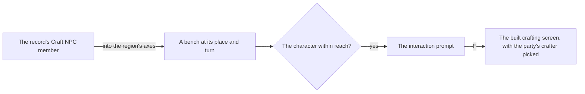

# Crafting

The as-built [crafting](../../specs/genshin/crafting/design.md) page holds the recipes, their rules, the instructions that open them, the characters' crafting talents, the bench's screen and the save's crafting slice. What is left is the bench in the world, which spends from the [inventory](../../specs/genshin/inventory/design.md)'s bag and wallet and takes Condensed Resin's resin from the [Original Resin](../../specs/genshin/original-resin/design.md) wallet.

## Decisions

- **The bench stands where the scene group record places it.** The dump's births place each city's bench as an NPC of its own, invisible and named Craft: the bench's interaction, not a person. The [scene group record](../../specs/genshin/scene-groups/design.md) holds it as an NPC member of its group, Mondstadt's NPC 10256 in group 133004082 within a unit of the scene's `Alchemy` building point, so the bench stands at that member's place and turn and is used through the [interaction](../../specs/genshin/interaction/design.md) prompts. The official map marks no bench, so it places none.
- **The keeper is a resident, not the bench.** Timaeus, who stands beside Mondstadt's bench, has no birth in the dump, so the record does not place him. The bench works without him, and he is placed with the other keepers at the wiki's location for him, marked provisional.
- **Left to other pages.** The [crafting page](../../specs/genshin/crafting/design.md) lists what it leaves out. The essential oils and the Xiao Lantern are quest items for the [quests](../genshin-quests/design.md) page to settle.

## How it works

## Scope and order

**Still to build, in order:**

1. **The bench's place**, Mondstadt's first, read from the hosted `sceneGroups/scene3` record's Craft NPC member, the wiki placing it in the Market District as the record does. Its prompt goes through the interaction page. The screen's learned recipes and crafted counts are already the world's, held in `useWorldSave`, so the bench binds them with its `craftedCountMap` model and its `progress` prop.

## Data and measures

- **Not measured.** Crafting takes no time in the game and has no timed state, so no compute-queue item is owed.

## Key files

| File                                                          | Role after the change                     |
| :------------------------------------------------------------ | :---------------------------------------- |
| `packages/genshin-world/src/models/sceneGroup/SceneGroups.ts` | The record the bench's place is read from |

## Sources

- [Crafting](https://genshin-impact.fandom.com/wiki/Crafting), Genshin Impact Wiki: where the bench stands in Mondstadt's Market District.
- [AnimeGameData](https://github.com/DimbreathBot/AnimeGameData), the community's per-patch dump, whose NPC births fill the record's bench member.
